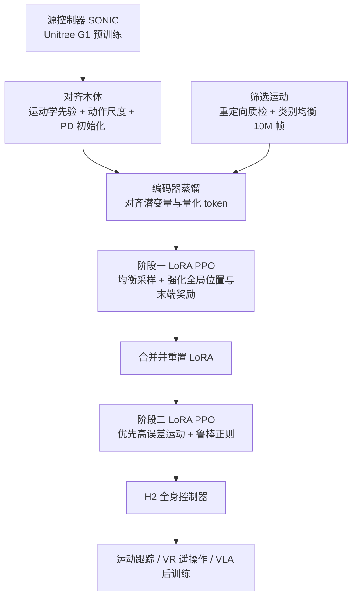
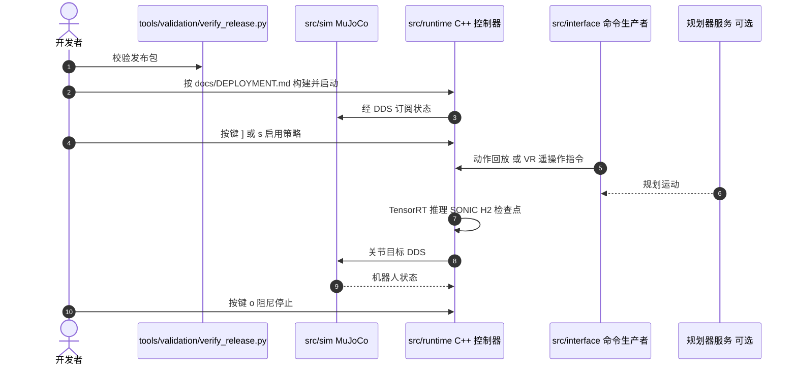

# TRACE：把现成的全身控制器搬到另一台人形上

**TRACE 保留预训练全身控制器（SONIC）的运动表征，只对目标人形重调反馈控制：先用运动学先验与动力学对齐把新本体"接"进旧网络，再用编码器蒸馏加低秩 RL 的两阶段课程，在小规模筛选运动集上完成适配。**

论文 *TRACE*（[arXiv:2610.17999](https://arxiv.org/abs/2610.17999)，[项目页](https://bfm-trace.github.io/)，[代码](https://github.com/QinnyuLan/SONIC_unitree_h2)）。注意：与 [TRACE 因果记忆](paper-trace-causal-memory.md) 同缩写，是不同论文。

## 英文缩写速查

| 缩写 | 英文全称 | 简要说明 |
|------|----------|----------|
| BFM | Behavior Foundation Model | 可做多种全身控制的预训练行为基础模型；本文源模型为 SONIC |
| LoRA | Low-Rank Adaptation | 低秩适配器，本文每阶段 r=32，作用于参考编码器、控制解码器与 critic |
| PPO | Proximal Policy Optimization | 适配阶段的强化学习算法，分两阶段课程 |
| PD | Proportional-Derivative | 关节位置控制增益，目标机器人的 PD 由源控制器固有频率与阻尼比初始化 |

## 为什么重要

- 大型全身控制器从零训练成本极高（论文称 SONIC 约 21,000 GPU 小时）；TRACE 报告适配仅约 8 GPU 小时，但该比值不含源预训练、也未跨硬件归一化。
- 控制器可复用意味着 [VLA](../methods/vla.md) 等上层策略可以在更换本体后沿用同一类全身接口。
- 论文把"换本体"拆成几步可消融的组件，给出了每步的损失量（见实验）。

## 核心信息

| 项 | 内容 |
|----|------|
| **机构** | 香港科技大学（广州）；香港科技大学（通讯作者 Junwei Liang 兼署） |
| **平台** | 源：Unitree G1（预训练 SONIC）；目标：Unitree H2（真机） |
| **数据** | 从 BONES-SEED 筛选 10M 帧适配集；67,953 条 PHUMA 运动用于评测（不参与适配） |
| **开源** | **已开源（部署侧）**（2026-10-17 核查）：[QinnyuLan/SONIC_unitree_h2](https://github.com/QinnyuLan/SONIC_unitree_h2)，Apache-2.0 源码，README 称含 H2 发布检查点 `models/sonic_h2_released/`；适配训练代码是否随附未核实；无 Hugging Face 链接 |

## 核心原理

### 流程总览

- **运动学先验：** 由配对重定向姿态拟合线性映射，并向肢体末端 Jacobian 先验正则；嵌入参考与本体输入投影，动作投影 P_act = S_t⁻¹ M S_s 单独变换。
- **动力学对齐：** PD 增益按折算执行器惯量缩放；连杆与接触动力学留给微调。
- **蒸馏：** 仅微调目标参考编码器，使其潜变量 / token 追随冻结的源编码器。

## 源码运行时序图

仓库可运行入口为 Sim2Sim 部署栈；时序对齐 README 的 `src/sim`（MuJoCo）、`src/runtime`（C++ 策略，TensorRT）、`src/interface`（Python 命令生产者）。训练管线入口未核实，故图只描绘部署。

- **复现路径（README）：** 克隆含子模块 → `python3 tools/validation/verify_release.py` → 按 `docs/DEPLOYMENT.md` 安装并构建控制器 → 跑 Sim2Sim；真机用 Sim2Real，遥操作用 PICO + XRoboToolkit。
- 本次仅读取仓库页面，未克隆或运行。

## 与其他工作对比

| 维度 | TRACE（本文） | [SONIC-Transfer](./paper-sonic-transfer.md) | [Any2Any](./paper-any2any-cross-embodiment-wbt.md) |
|------|------|------|------|
| 源 → 目标 | SONIC：Unitree G1 → Unitree H2 | GEAR-SONIC：G1 → AgiBot X2 Ultra | 单源 WBT 专家（含 Gear-SONIC）→ LimX Oli / Luna 等 |
| 对齐方式 | 线性运动学先验投影 + PD 按惯量缩放 + 编码器蒸馏 | 闭式 per-joint affine codec（sidecar 表） | 运动学对齐 |
| 可训范围 | 参考编码器、控制解码器与 critic 上的 LoRA（r=32），两阶段 PPO 课程 | 只训动力学解码器 LoRA（约 0.25% 参数），其余冻结 | 动力学敏感模块上的 LoRA 后训练 |
| 报告算力 | 约 8 GPU 小时 | 约 135 GPU 小时（约平台 2%） | 约 1% 全量训练成本 |
| 真机 | H2 遥操作 + GR00T-N1.7 VLA 后训练 | 选中检查点真机验证 ongoing | 真机验证 |

- **相对 SONIC-Transfer：** 两者都冻结 SONIC 表征、只训 LoRA；SONIC-Transfer 把可训范围压到动力学解码器并用闭式表对齐，TRACE 额外做编码器蒸馏与两阶段课程，并以 H2 真机下游 VLA 任务验证。
- **相对 Any2Any：** 同为"运动学对齐 + LoRA 后训练"的 WBT 跨本体迁移；TRACE 给出逐组件消融（去掉预适配降至 87.29%），并强调数据筛选与课程设计。
- 三者源/目标本体、评测运动集与算力口径不同（GPU 型号与是否含预训练均不一致），数字不可横比。

## 工程实践

| 项 | 建议 |
|----|------|
| 先跑通 | 先 `verify_release.py` 校验，再 Sim2Sim，最后才上 H2 真机 |
| 启停 | 默认站姿，`]` 或 `s` 启用，`o` 阻尼停止 |
| 数据 | 适配集选 10M 帧，类别均衡与命令空间选择（去掉后 93.80%） |
| 课程 | 两阶段比单阶段降低根位置误差 26.2%；单阶段基线 LoRA r=64 以匹配预算 |
| 算力 | 1 张 RTX PRO 6000 约 8 小时，12,288 并行环境 |

## 实验与评测

- **仿真（67,953 条 PHUMA 运动，身高缩放跟踪判据）：** TRACE on H2 96.08%；SONIC on G1 97.59%；阈值 G1 0.250 m、H2 0.3447 m。
- **消融（H2）：** 去掉预适配 87.29%；去掉数据策略 93.80%；去掉两阶段微调 95.64%。
- **对照：** Direct Finetune 收敛更慢；Scratch 在 3k 迭代内无可用跟踪器。
- **真机 VLA（GR00T-N1.7 用遥操作示教后训练，各 20 次）：** 搬玩具（单臂）90%；搬方块（双臂）75%；拿枕头 80%；开门 65%；开垃圾桶 65%。
- **遥操作：** 开门、装玩具、丢垃圾、搬椅子、踢球。

## 结论

**TRACE 说明在单一本体对（G1 到 H2）上，输入输出对齐加小规模课程 RL 就能把全身控制器的性能恢复到源的约 98%，但结论尚限于这一对。**

1. **预适配贡献最大** — 去掉后降到 87.29%（约 -8.8 pp），远大于去掉数据策略（-2.3）或课程（-0.4）。
2. **课程主要改善位置误差** — 对成功率增益小，但根位置误差降 26.2%。
3. **算力对比要带条件** — 8 GPU 小时对 21,000 GPU 小时不含源预训练、未跨硬件归一化。
4. **下游仍有缺口** — 真机 VLA 在开门与开垃圾桶仅 65%，说明控制器可用但任务成功还取决于上层策略与数据。
5. **部署栈可直接复用** — 仓库附 Sim2Sim 与阻尼停止流程，先仿真后真机；检查点内容未核实。

## 局限与风险

- 仅验证一对本体（G1 到 H2）与一个预训练 BFM（作者自述）。
- 无可复用 critic 的高效适配未探索；计划加入 RGB、深度与触觉（作者自述）。
- 96.08% 仅在仿真 PHUMA 评测上报告，真机未给出等价的大样本跟踪成功率（未核实）。
- 真机 VLA 每任务 20 次，方差较大。
- 仓库检查点、训练代码范围与最近提交日期未核实。

## 关联页面

- [NVIDIA SONIC](nvidia-sonic.md) — 源控制器
- [全身控制](../concepts/whole-body-control.md) — 任务背景
- [LoRA](../concepts/lora.md) — 适配机制
- [PHUMA 数据集](dataset-bfm-phuma.md) — 评测运动集
- [基础策略](../concepts/foundation-policy.md) — 预训练复用范式

## 参考来源

- [trace_humanoid_transfer_arxiv_2610_17999.md](../../sources/papers/trace_humanoid_transfer_arxiv_2610_17999.md) — 论文摘录与开源核查
- [trace-humanoid-transfer-project.md](../../sources/sites/trace-humanoid-transfer-project.md) — 项目页归档
- [trace-sonic-unitree-h2.md](../../sources/repos/trace-sonic-unitree-h2.md) — 仓库归档
- [arXiv:2610.17999](https://arxiv.org/abs/2610.17999) — 原文

## 推荐继续阅读

- [TRACE 项目页](https://bfm-trace.github.io/)
- [官方仓库 SONIC_unitree_h2](https://github.com/QinnyuLan/SONIC_unitree_h2)
