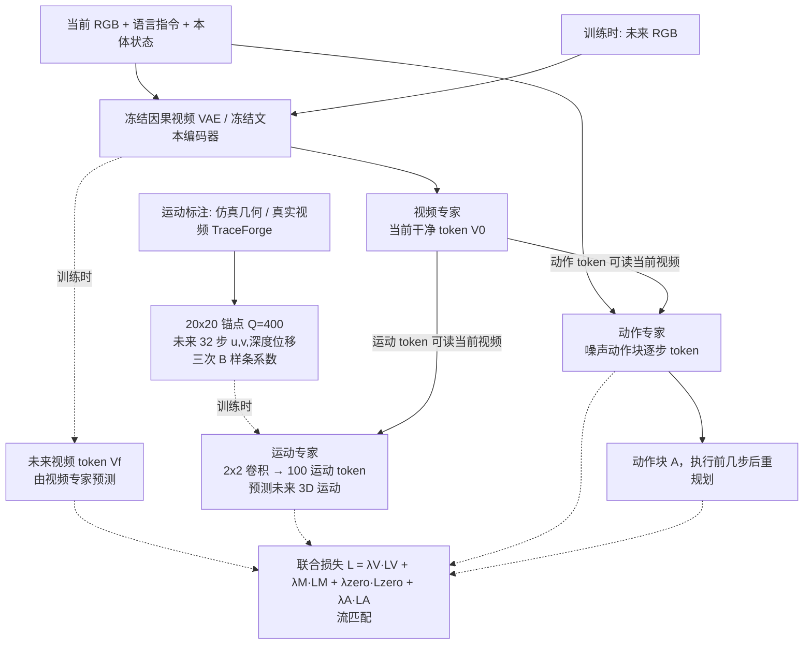

# Trace-WAM（arXiv:2610.36840）

**Trace-WAM**（*Trace-WAM: Learning to Act via 3D Motion Prediction for World Action Models*，[arXiv:2610.36840](https://arxiv.org/abs/2610.36840)，[项目页](https://trace-wam.github.io/)）来自 [具身智能小站 2026-10-28 盘点](../../sources/blogs/wechat_embodied_station_59_papers_human_video_to_robot_experience_2026-10-28.md)，属「潜在动作与世界模型」组。

## 一句话定义

**在视频预测与动作生成之外加入未来三维点运动预测，以三分支模型突出交互动力学。**

## 英文缩写速查

| 缩写 | 英文全称 | 简要说明 |
|------|----------|----------|
| Trace-WAM | Trace-WAM: Learning to Act via 3D Motion Prediction for World Action Models | 本文方法 / 基准的简称 |
| WAM | World Action Model | 世界–动作联合模型 |
| 3D | 3D | 三维 |

## 为什么重要

- 用三维运动监督动作表征。视频和运动预测用于训练，执行时保留当前观测到动作的路径，避免额外生成步骤。
- 开源结论：**项目页未列 GitHub**（步骤 2.5，2026-10-28）。项目页 HTTP 200，未见 GitHub 链接或 coming soon 字样。
- 同期同组工作见 [潜在动作、免渲染事件仿真与机器人评测：具身智能小站 10-28 期 59 篇阅读坐标](../overview/embodied-station-2026-10-28-59-papers-technology-map.md)。

## 流程总览

图依据：论文 §3.1–3.4 / Fig.1、Fig.3（Tri-MoT 与注意力掩码）、式 (1)–(8)。推理只保留「当前观测 → 动作」路径。

## 核心机制

| 项 | 内容 |
|----|------|
| **arXiv** | [2610.36840](https://arxiv.org/abs/2610.36840) |
| **开源** | **项目页未列 GitHub** |
| **要点** | 在视频预测与动作生成之外加入未来三维点运动预测，以三分支模型突出交互动力学。 |
| **文内指标** | 公众号转述：视频和运动预测用于训练，执行时保留当前观测到动作的路径，避免额外生成步骤。 |

## 源码运行时序图

**不适用（项目页未列 GitHub）** — 项目页 HTTP 200，未见 GitHub 链接或 coming soon 字样。 不编造运行脚本；代码公开后再补。

## 实验与评测

- 公众号转述：视频和运动预测用于训练，执行时保留当前观测到动作的路径，避免额外生成步骤。
- **读法：** 本页为索引级摘要，依据公众号转述的官方摘要与仓库信息整理；逐项数字与 baseline 以原文 PDF 为准。

## 与其他工作对比

- 横向索引见 [潜在动作、免渲染事件仿真与机器人评测：具身智能小站 10-28 期 59 篇阅读坐标](../overview/embodied-station-2026-10-28-59-papers-technology-map.md)；同 arXiv 不重复造页。

## 结论

**用三维运动监督动作表征：视频和运动预测用于训练，执行时保留当前观测到动作的路径，避免额外生成步骤。**

1. 开源边界：**项目页未列 GitHub** — 项目页 HTTP 200，未见 GitHub 链接或 coming soon 字样。
2. 核心机制：在视频预测与动作生成之外加入未来三维点运动预测，以三分支模型突出交互动力学。
3. 复现与选型前核对任务协议、硬件与基准口径，勿直接横比公众号摘录数字。

## 关联页面

- [world-action-models](../concepts/world-action-models.md)
- [generative-world-models](../methods/generative-world-models.md)
- [vla](../methods/vla.md)
- [embodied-station-2026-10-28-59-papers-technology-map](../overview/embodied-station-2026-10-28-59-papers-technology-map.md)

## 参考来源

- [trace_wam_arxiv_2610_36840.md](../../sources/papers/trace_wam_arxiv_2610_36840.md)
- [wechat_embodied_station_59_papers_human_video_to_robot_experience_2026-10-28.md](../../sources/blogs/wechat_embodied_station_59_papers_human_video_to_robot_experience_2026-10-28.md)
- [arXiv:2610.36840](https://arxiv.org/abs/2610.36840)
- [arXiv PDF](https://arxiv.org/pdf/2610.36840)：已通读方法部分（实验与附录以略读为准）：§3.1–3.4 方法（问题形式化、3D 运动表示、Tri-MoT 架构与结构化注意力、训练目标）、Fig.1；§4 实验设定略读

## 推荐继续阅读

- [arXiv PDF](https://arxiv.org/pdf/2610.36840)
- [项目页](https://trace-wam.github.io/)
