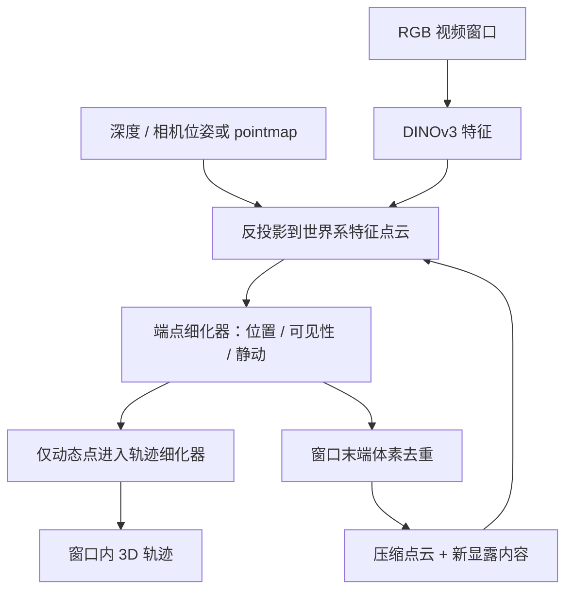

# TrackEverything（Long-Horizon Dense 3D Point Tracking）

**TrackEverything**（[*Long Horizon Dense Tracking via De-Duplicating 3D Scene Representations*](https://arxiv.org/abs/2609.30222)，[项目页](https://trackeverything.github.io/)，[代码仓](https://github.com/ayushjain1144/trackeverything)）由卡内基梅隆大学与 Meta 团队提出：把视频变成世界坐标系中的持久 3D 场景轨迹，跨窗口合并重复观测，让全可见点跟踪的计算更贴近独特场景几何规模。

## 一句话定义

**先把视频逐窗投影到世界系点云，再预测窗口端点并合并同一空间表面；只为动态点细化窗内轨迹，从而在长视频中持续跟踪所有可见点。**

## 英文缩写速查

| 缩写 | 英文全称 | 简要说明 |
|------|----------|----------|
| 3D | Three-Dimensional | 方法将像素观测提升到统一世界坐标系 |
| WAFT | Warp-Aligned Feature Transform | 在估计点的源/目标投影处采样图像特征，提供对应匹配信号 |
| APD | Average Percentage of Distances | TAPVid-3D 使用的点轨迹精度指标；论文区分 APD-P 与 APD-M |
| TAPVid-3D | Tracking Any Point in 3D | 评测稀疏标注 3D 点轨迹的基准，覆盖 ADT、DriveTrack、PStudio |
| VGGT-Ω | Visual Geometry Grounded Transformer Omega | 论文采用的外部点图/相机几何估计输入之一 |

## 为什么重要

- **把“追踪每帧像素”的复杂度改成“维护独特场景点”：** 同一表面在连续帧反复出现时不再永久累加一份点状态，窗口末端可合并空间重合的轨迹。
- **覆盖后来才显露的内容：** 新进入视野的表面可在出现时加入场景轨迹，补足仅从首帧采样的稠密跟踪器盲点。
- **适合作为动态世界表示的上游：** 长时点级运动可服务于动态场景理解、4D 重建及机器人感知/操作模型；但论文尚未验证这些下游收益。

## 核心信息

| 项 | 内容 |
|----|------|
| **机构** | 卡内基梅隆大学（Carnegie Mellon University）；Meta |
| **论文** | arXiv:2609.30222，2026-09-24 提交 v1 |
| **输入几何** | RGB 特征 + 每帧世界系 pointmap；来自深度/位姿传感器或外部几何估计器（如 VGGT-Ω） |
| **窗口** | 16 帧非重叠窗口；窗口内编码、跟踪，边界处状态交接与去重 |
| **模型** | 冻结 DINOv3-small 特征骨干 + ViT Adapter、端点细化器、动态轨迹细化器 |
| **训练数据** | Kubric、PointOdyssey、Dynamic Replica；参数规模论文正文报告 61M（含冻结骨干） |
| **长视频结果** | 作者报告 1000+ 帧视频在 40 GB 显存内追踪所有可见点 |
| **开源** | **待发布**：官方项目页和仓库截至 2026-10-16 均称代码即将发布；仓库暂无可运行入口 |

## 核心原理

### 持久世界系场景表示

输入 RGB 视频和逐帧 3D pointmap ​\(\mathbf{P}\)。每个 16 帧窗口先以 DINOv3-small 提取图像特征，再按深度/相机几何将特征 token 关联到统一世界坐标。逐帧体素聚合可压缩同一帧内的空间冗余；而跨帧的同表面候选在窗口结束前暂时保留，以免把不同时刻的动态物体错误折叠。

### 端点先行，动态点再解轨迹

端点细化器在场景点云上迭代预测每个点的**窗口末端 3D 位置、可见性和静/动类别**。跨窗口传递只需要边界端点，不需要保存每个点所有历史帧的密集轨迹；对静态点，世界坐标位置保持不变；对动态点，轨迹细化器才解码窗口内完整路径。这个分解把高开销的逐时刻轨迹预测集中到较少的运动点上。

### 3D WAFT 与窗口边界去重

3D WAFT 把点当前的 3D 位置投影到源帧和目标帧特征图并双线性采样，形成类似模板匹配的外观信号；它避免为所有时空位置构造巨大的 4D correlation volume。每个窗口末端，点都已被推进到同一个目标时刻，于是按预测 3D 坐标体素化，并将落入同体素的特征均值合并；压缩后的点云再与新窗口显露的场景内容共同进入下一轮。

### 流程总览

## 源码运行时序图

**不适用（截至 2026-10-16）。** 官方项目页标注 “Code coming soon”，官方仓库目前只有 README 与 `assets/`，没有可运行的训练、推理或评测入口。待代码发布后，应按真实目录和 README 运行命令补齐时序图；当前不能把论文架构图当作可复现代码路径。

## 实验与评测

- **TAPVid-3D 短片：** 在 48 帧评测中，使用 VGGT-Ω 几何时 TrackEverything 的平均 APD-P 为 **34.7**，对比开放源码 all-frame dense tracker VDPM 的 **10.9**；论文据此报告平均提升超过 20% APD-P。该比较针对相同短片评测设定，不代表所有稀疏/首帧稠密方法均落后。
- **全长视频：** 在 PointOdyssey 1000+ 帧、1 万多个标注点评测中，论文报告 APD-P **31.8**、APD-M **74.5**、静/动分类准确率 **91.2%**。因基线无法在同一设定运行，作者未给出该长视频数字的定量对照。
- **显存边界：** 摘要报告 1000+ 帧在 **40 GB** GPU 显存内运行；另一个 PointOdyssey 复杂度实验报告低于 30 GB。具体显存随输入分辨率、场景内容、几何前端与推理配置变化。
- **速度读法：** TAPVid-3D 短片开启 early merge 后，tracker-only 平均速度为 **23.1 FPS**；包含 VGGT-Ω 几何前端为 **7.2 FPS**。几何前端占据明显耗时，不能把 tracker-only 速度等同于端到端视频吞吐。

## 结论

TrackEverything 的主要贡献是用跨窗世界系去重，把全帧稠密 3D 跟踪从短 clip 推向长视频；论文支持其可扩展性，但 1000+ 帧尚无可运行官方代码供独立复验。

- **场景规模取代帧数作为主要状态增长来源：** 同一表面跨窗口重复出现可被合并，后来显露的表面仍能新建轨迹。
- **端点/轨迹拆分有明确计算目的：** 所有点先估边界状态，只有分类为动态的点才进行密集窗内解码。
- **短片精度结果需按比较组理解：** 相对开放源码的全帧稠密 3D 基线优势明显，但不能据此泛化为超过稀疏跟踪器或所有几何前端组合。
- **长片实测可扩展，比较仍有限：** 1000+ 帧报告没有可运行基线的同场景定量对照。
- **工程关键依赖输入几何与去重策略：** 位姿/深度误差会污染 world pointmap；错误体素合并采用均值池化后可能难以恢复。
- **当前适合跟踪研究与表示设计，不宜作为即插即用模块选型：** 官方代码、权重与评测流程待发布。

## 对比

| 方法 | 主要表示 / 跟踪对象 | 长时稠密能力 | 与 TrackEverything 的区别 |
|------|----------------------|--------------|----------------------------|
| [Track4World](./paper-track4world.md) | VGGT 风格全局场景特征；前馈输出世界系像素轨迹 | 全像素 3D 跟踪，重点是前馈构建完整场景流 | Track4World强调一次前馈的全局几何与流融合；TrackEverything强调跨窗持久轨迹、边界去重和 1000+ 帧扩展 |
| [D4RT](./paper-d4rt.md) | 全局场景编码 + 独立时空查询解码 | 查询式动态 4D 重建与跟踪 | D4RT 通过查询点/时刻解码，TrackEverything显式维护逐窗场景点云；论文报告 D4RT 的公开基准短片精度有优势，但未扩展到同一长视频设定 |
| 稀疏点跟踪器（如 CoTracker3） | 用户给定少量查询点 + 局部时间窗/相关特征 | 少量点可跟踪较长序列 | TrackEverything面向全部可见点，跟踪点数更多，但依赖深度与位姿的 3D 场景表示 |

## 工程实践

| 项 | 实践建议 |
|----|----------|
| 几何输入 | 先验证深度、相机位姿和世界系 pointmap 的尺度/坐标一致性；需要传感器几何或可用的外部重建器 |
| 窗口边界 | 跨窗去重要求候选点位于同一目标时刻；不能直接按不同时间的原始位置合并 |
| 动态类别 | 静/动误分类会影响是否生成细轨迹；检查静态背景漂移与动态点漏分 |
| 体素合并 | 体素尺寸是精度与压缩率的权衡；近邻但不同的表面可能错误合并，论文指出该合并不可逆 |
| 效率测量 | 同时报告几何前端、跟踪器和完整 pipeline 的耗时/峰值显存，避免只报 tracker-only 吞吐 |
| 复现状态 | 截至 2026-10-16 官方代码待发布；当前只能核对论文、项目页结果与公开仓库占位内容 |

## 局限与风险

- **外部几何依赖：** 方法本身不是 RGB-only；pointmap 的准确性会影响轨迹位置和跨窗合并。
- **场景增长并未消失：** 去重消除了重复观测，但永久探索新区域时唯一场景内容仍会扩展；论文提出未来可加入空间缓存淘汰。
- **不可逆合并：** 不同表面若因位置误差进入同一体素，均值池化可能永久混合轨迹；指定的稀疏查询点可走不参与体素合并的分支。
- **困难外观/运动：** 快速大位移、重复纹理和低纹理会让 lifted 3D 对应更难确定。
- **开放复现尚缺：** 截至入库日没有官方可运行代码与权重；论文数值暂缺独立运行验证。

## 关联页面

- [状态估计](../concepts/state-estimation.md) — 深度、位姿、pointmap 与动态场景几何。
- [Track4World](./paper-track4world.md) — 前馈世界系稠密 3D 点跟踪对照。
- [D4RT](./paper-d4rt.md) — 查询式动态 4D 重建与点跟踪对照。
- [Point Tracking Improves World Action Models](./paper-rcl-2605-23856-point-tracking-improves-world-action-models.md) — 点级运动信号与机器人世界动作模型。

## 参考来源

- [TrackEverything 论文摘录](../../sources/papers/trackeverything_arxiv_2609_30222.md)
- [TrackEverything 官方项目页](../../sources/sites/trackeverything-project.md)
- [TrackEverything 官方代码仓](../../sources/repos/trackeverything.md)

## 推荐继续阅读

- [TrackEverything: Long Horizon Dense Tracking via De-Duplicating 3D Scene Representations](https://arxiv.org/html/2609.30222v1) — 论文方法、全长视频指标与局限。
- [TrackEverything 项目页](https://trackeverything.github.io/) — 长视频可视化、基线比较与失败案例。
