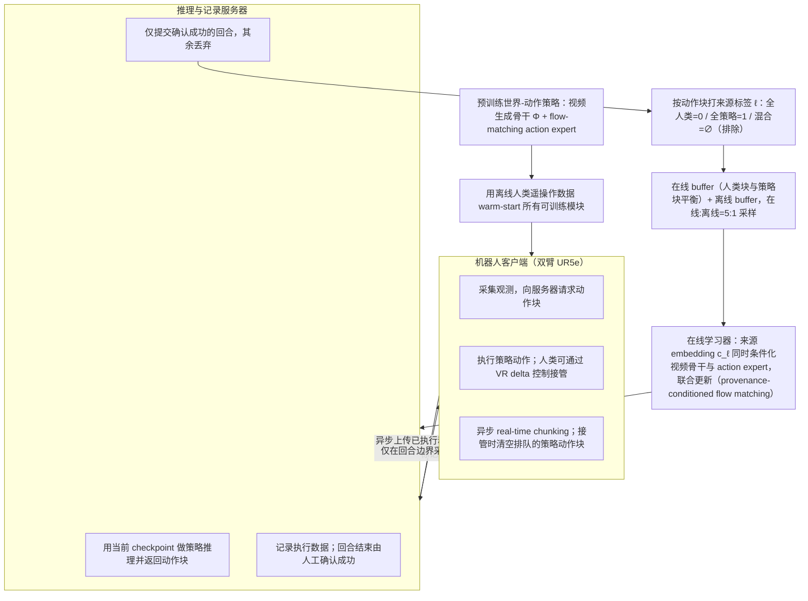

# Training in Deployment（arXiv:2610.29264）

**Training in Deployment**（*Training in Deployment: Human-in-the-loop Online Post-Training for Robot Manipulation*，[arXiv:2610.29264](https://arxiv.org/abs/2610.29264)，[项目页](https://logosintelligencelab.github.io/TIDE/)）来自 [具身智能小站 2026-10-29 盘点](../../sources/blogs/wechat_embodied_station_58_papers_diverse_demonstrations_2026-10-29.md)，属「VLA、智能体与策略后训练」组。

## 一句话定义

**TIDE区分人工干预与策略生成数据的来源，以监督学习在线后训练；双臂真机实验支持短时适配，但仍依赖人工确认，长期遗忘和跨平台泛化尚未验证。**

## 英文缩写速查

| 缩写 | 英文全称 | 简要说明 |
|------|----------|----------|
| Training in Deployment | Training in Deployment: Human-in-the-loop Online Post-Training for Robot Manipulation | 本文方法 / 基准的简称 |

## 为什么重要

- 部署中吸收人工干预，在线更新策略。
- 开源结论：**已开源**（步骤 2.5，2026-10-29）。公众号未给代码链接；项目页链接的 LogosIntelligenceLab/TIDE 经 git ls-remote 可达。
- 同期同组工作见 [多样成功示范、触觉工具链与预见式感知：具身智能小站 10-29 期 58 篇阅读坐标](../overview/embodied-station-2026-10-29-58-papers-technology-map.md)。

## 流程总览

图依据：论文 §III-A / §III-B / Fig.2。

## 核心机制

| 项 | 内容 |
|----|------|
| **arXiv** | [2610.29264](https://arxiv.org/abs/2610.29264) |
| **开源** | **已开源** |
| **要点** | TIDE区分人工干预与策略生成数据的来源，以监督学习在线后训练；双臂真机实验支持短时适配，但仍依赖人工确认，长期遗忘和跨平台泛化尚未验证。 |
| **文内指标** | 公众号未给具体数字，本页不引用。 |

## 源码运行时序图

**不适用（已开源）** — 公众号未给代码链接；项目页链接的 LogosIntelligenceLab/TIDE 经 git ls-remote 可达。 不编造运行脚本；代码公开后再补。

## 实验与评测

- 公众号未给具体数字，本页不引用。
- **读法：** 本页为索引级摘要，依据公众号转述的官方摘要与仓库信息整理；逐项数字与 baseline 以原文 PDF 为准。

## 与其他工作对比

- 横向索引见 [多样成功示范、触觉工具链与预见式感知：具身智能小站 10-29 期 58 篇阅读坐标](../overview/embodied-station-2026-10-29-58-papers-technology-map.md)；同 arXiv 不重复造页。

## 结论

**部署中吸收人工干预，在线更新策略：TIDE区分人工干预与策略生成数据的来源，以监督学习在线后训练；双臂真机实验支持短时适配，但仍依赖人工确认，长期遗忘和跨平台泛化尚未验证。**

1. 开源边界：**已开源** — 公众号未给代码链接；项目页链接的 LogosIntelligenceLab/TIDE 经 git ls-remote 可达。
2. 核心机制：TIDE区分人工干预与策略生成数据的来源，以监督学习在线后训练；双臂真机实验支持短时适配，但仍依赖人工确认，长期遗忘和跨平台泛化尚未验证。
3. 复现与选型前核对任务协议、硬件与基准口径，勿直接横比公众号摘录数字。

## 关联页面

- [vla](../methods/vla.md)
- [imitation-learning](../methods/imitation-learning.md)
- [reinforcement-learning](../methods/reinforcement-learning.md)
- [embodied-station-2026-10-29-58-papers-technology-map](../overview/embodied-station-2026-10-29-58-papers-technology-map.md)

## 参考来源

- [training_in_deployment_arxiv_2610_29264.md](../../sources/papers/training_in_deployment_arxiv_2610_29264.md)
- [wechat_embodied_station_58_papers_diverse_demonstrations_2026-10-29.md](../../sources/blogs/wechat_embodied_station_58_papers_diverse_demonstrations_2026-10-29.md)
- [arXiv:2610.29264](https://arxiv.org/abs/2610.29264)
- [arXiv PDF](https://arxiv.org/pdf/2610.29264)：已通读方法部分（实验与附录以略读为准）：§III Method（A、B）；§IV-A 实验设定与 §IV-B 前段

## 推荐继续阅读

- [arXiv PDF](https://arxiv.org/pdf/2610.29264)
- [项目页](https://logosintelligencelab.github.io/TIDE/)
