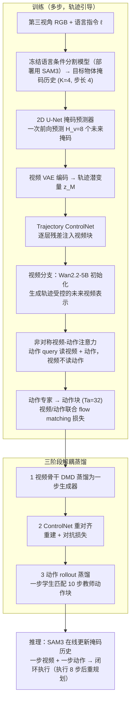

# TrajWAM（arXiv:2610.25763）

**TrajWAM**（*TrajWAM: An Efficient Trajectory-Guided World Action Model for Dynamic Robotic Manipulation*，[arXiv:2610.25763](https://arxiv.org/abs/2610.25763)，[项目页](https://kevingeng3.github.io/TrajWAM/)）来自 [具身智能小站 2026-10-31 盘点](../../sources/blogs/wechat_embodied_station_50_papers_scenerig_photo_to_sim_2026-10-31.md)，属「世界模型与仿真重建」组。

## 一句话定义

**TrajWAM用目标掩码轨迹引导未来表示，再分步蒸馏实现单步推理；动态仿真与传送带、转盘抓取验证，但主要处理目标独立运动的场景。**

## 英文缩写速查

| 缩写 | 英文全称 | 简要说明 |
|------|----------|----------|
| TrajWAM | TrajWAM: An Efficient Trajectory-Guided World Action Model for Dynamic Robotic Manipulation | 本文方法 / 基准的简称 |
| WAM | World Action Model | 世界–动作联合模型 |

## 为什么重要

- 抓运动目标，先预测它将去哪里。
- 开源结论：**已开源**（步骤 2.5，2026-10-31）。公众号未给代码链接；项目页链接的 KevinGeng3/TrajWAM 经 git ls-remote 可达。
- 同期同组工作见 [单图重建仿真、VLA 适配评测与跨形态世界模型：具身智能小站 10-31 期 50 篇阅读坐标](../overview/embodied-station-2026-10-31-50-papers-technology-map.md)。

## 流程总览

图依据：论文 §III-A/B/C、Fig.2–4、§IV-A 实现细节。

## 核心机制

| 项 | 内容 |
|----|------|
| **arXiv** | [2610.25763](https://arxiv.org/abs/2610.25763) |
| **开源** | **已开源** |
| **要点** | TrajWAM用目标掩码轨迹引导未来表示，再分步蒸馏实现单步推理；动态仿真与传送带、转盘抓取验证，但主要处理目标独立运动的场景。 |
| **文内指标** | 公众号未给具体数字，本页不引用。 |

## 源码运行时序图

**不适用（已开源）** — 公众号未给代码链接；项目页链接的 KevinGeng3/TrajWAM 经 git ls-remote 可达。 不编造运行脚本；代码公开后再补。

## 实验与评测

- 公众号未给具体数字，本页不引用。
- **读法：** 本页为索引级摘要，依据公众号转述的官方摘要与仓库信息整理；逐项数字与 baseline 以原文 PDF 为准。

## 与其他工作对比

- 横向索引见 [单图重建仿真、VLA 适配评测与跨形态世界模型：具身智能小站 10-31 期 50 篇阅读坐标](../overview/embodied-station-2026-10-31-50-papers-technology-map.md)；同 arXiv 不重复造页。

## 结论

**抓运动目标，先预测它将去哪里：TrajWAM用目标掩码轨迹引导未来表示，再分步蒸馏实现单步推理；动态仿真与传送带、转盘抓取验证，但主要处理目标独立运动的场景。**

1. 开源边界：**已开源** — 公众号未给代码链接；项目页链接的 KevinGeng3/TrajWAM 经 git ls-remote 可达。
2. 核心机制：TrajWAM用目标掩码轨迹引导未来表示，再分步蒸馏实现单步推理；动态仿真与传送带、转盘抓取验证，但主要处理目标独立运动的场景。
3. 复现与选型前核对任务协议、硬件与基准口径，勿直接横比公众号摘录数字。

## 关联页面

- [world-action-models](../concepts/world-action-models.md)
- [generative-world-models](../methods/generative-world-models.md)
- [simulation-evaluation-infrastructure](../concepts/simulation-evaluation-infrastructure.md)
- [embodied-station-2026-10-31-50-papers-technology-map](../overview/embodied-station-2026-10-31-50-papers-technology-map.md)

## 参考来源

- [trajwam_arxiv_2610_25763.md](../../sources/papers/trajwam_arxiv_2610_25763.md)
- [wechat_embodied_station_50_papers_scenerig_photo_to_sim_2026-10-31.md](../../sources/blogs/wechat_embodied_station_50_papers_scenerig_photo_to_sim_2026-10-31.md)
- [arXiv:2610.25763](https://arxiv.org/abs/2610.25763)
- [arXiv PDF](https://arxiv.org/pdf/2610.25763)：已通读全文：目标轨迹预测与轨迹条件视频-动作建模（§III-A/B）、解耦蒸馏（§III-C）、实验设定与实现（§IV-A）

## 推荐继续阅读

- [arXiv PDF](https://arxiv.org/pdf/2610.25763)
- [项目页](https://kevingeng3.github.io/TrajWAM/)
