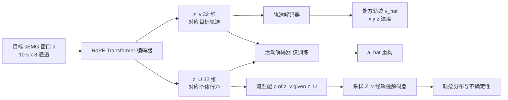

# Transformer 轨迹处方：以 sEMG 为目标的机器人康复（arXiv:2611.08295）

**Transformer-Based Trajectory Prescription for sEMG-Optimizing Robot-Mediated Rehabilitation**（[arXiv:2611.08295](https://arxiv.org/abs/2611.08295)），Gabriel Parra、Kimia Khoshnami、Daniel S. Brown、Laura A. Hallock，犹他大学机械工程系与 Kahlert 计算学院（论文首页）。页脚标注 CoRL 2026。逐段读完全文与附录，核对范围见 [来源归档](../../sources/papers/transformer-trajectory-prescription-semg-rehab_arxiv_2611_08295.md)。

## 一句话定义

**给定专家指定的目标肌电（sEMG）时间序列，用 Transformer 自编码器加流匹配反推「该让用户做什么轨迹才能诱发这些肌肉活动」，并支持几分钟内的个体微调；只在健康参与者的等长任务上验证过可行性。**

## 英文缩写速查

| 缩写 | 英文全称 | 简要说明 |
|------|----------|----------|
| sEMG | surface electromyography | 表面肌电，皮肤电极测得的肌肉电活动，噪声大且依赖电极位置 |
| RoPE | Rotary Position Embedding | 旋转位置编码，让注意力依赖相对时间偏移 |
| TD | Transformer-Decoded | 论文表 2 中「确定性解码」的误差记号（MSE_TD） |
| FM | Flow Matching | 流匹配，这里在潜变量 z_v 上学条件分布（MSE_FM） |
| MSE / RMSE | (Root) Mean Squared Error | 均方 / 均方根误差；论文在归一化量纲上报告 |
| LSTM / MLP | Long Short-Term Memory / Multi-Layer Perceptron | 表 2 中的两个朴素基线 |
| AD / MD / PD | anterior / middle / posterior deltoid | 前 / 中 / 后三角肌 |
| BB / TR / BR | biceps brachii / triceps (long head) / brachioradialis | 肱二头肌 / 肱三头肌长头 / 肱桡肌 |
| FL / EX | wrist flexors / extensors | 腕屈肌 / 腕伸肌 |

## 为什么重要

- **作者自述的问题（§1）：** 现有康复机器人多用阻抗式误差修正去跟随给定的运动学轨迹，尚未显示出优于常规治疗的结果；神经科学观点认为需要诱发健康的肌肉激活模式，而不只是带动肢体运动。
- **作者自述的缺口（§1、§2）：** 肌肉活动有滞回与随机性、sEMG 噪声大、干预数据集昂贵，因此缺少「处方轨迹 → 个体肌肉激活」的模型；文中称此前未见把 ML 用于康复中的目标轨迹生成（「据作者所知」）。
- **我的判断：** 这是把「期望肌肉活动」当作目标、反向生成任务的思路，与机器人学习里的目标条件生成有相通之处，但它的输出不是机器人自己的动作，而是给人看的力 / 轨迹任务，数据与评价都围绕人体。作者自己定位为概念验证（§1）。

## 核心原理

**问题建模（§3.3）：** 激活 a ∈ R^(T×8)，目标速度轨迹 v_target ∈ R^(T×3)；引入未知潜变量 U（个体策略、电极位置、疲劳等），a = f(v_target, U)，学 g≈f⁻¹。

- **损失（式 1）：** L = λ1‖v_target − v̂_target‖² + λ2‖a − â‖² + λ3‖z_v − Z_v‖²。注意正文式 1 中 λ1 对应轨迹项、λ2 对应活动项，而表 4 把 λ1 标为「Activation loss weight = 1.0」、λ2 标为「Velocity trajectory loss weight = 2.0」，两处标注顺序不一致，实际权重对应关系以代码为准（未核实）。
- **模型规模（表 4）：** 宽度 128、4 头、前馈 512、编码 3 层、解码 3 层、潜变量 64；流匹配隐层 256，ODE 20 步。
- **流匹配的角色（§2、§3.3）：** 提供轨迹分布 / 不确定性，并「倾向于」把预测拉向训练分布；作者强调这不是理论安全保证，只作为治疗师决策辅助。

## 流程总览：数据与实验

- **平台（§3.1）：** KUKA LBR iiwa 14 + Bota 六轴力传感器；用户的 x/y/z 力映射成屏幕虚拟球速度；sEMG 8 通道（Delsys Trigno，2.22 kHz）。
- **数据（§3.2、表 1）：** P01–P16 共 16 名健康者、右臂、15 个等长任务（单轴 T01–T12，含「锁定非目标轴」与否、两个力水平；随机轨迹 T14–T15）。训练 P01–P10 × T01–T12，三类测试见下表。窗口 10 s / 步长 1 s，6480 训练窗口，4562 测试窗口（§4.1）。
- **sEMG 处理（附录 E）：** 20–500 Hz 带通、二阶陷波、整流、窗口 200 的 RMS，对齐到 1000 Hz。

| 测试集（§4.1） | 用户 | 任务 | Full MSE_TD | Full MSE_FM | LSTM MSE_TD |
|----------------|------|------|-------------|-------------|-------------|
| 新任务 | P01–P10（已知） | T14–T15 | 0.084 ± 0.227 | 0.067 ± 0.190 | 0.068 ± 0.143 |
| 新用户 | P11–P16 | T01–T12 | 0.086 ± 0.252 | 0.077 ± 0.211 | 0.191 ± 0.354 |
| 新用户新任务 | P11–P16 | T14–T15 | 0.082 ± 0.211 | 0.062 ± 0.174 | 0.063 ± 0.128 |

（数字取自表 2；训练集上 Full 的 MSE_TD 为 0.009 ± 0.110，LSTM 为 0.155 ± 0.308。）

## 工程实践

- **算力与速度（§4.1）：** RTX 4070 12 GB；基线训练约 1.5 h；一条确定性轨迹约 5 ms；250 个流匹配样本 <1 s。
- **个体微调（§4.2、附录 I）：** 对 6 名新用户，用贪心算法选 1–12 个用户任务再训练；12 个模型共约 7 min，约 35 s/个；校准总时间 = 新增试次数 ×（60 或 20 s）+ 35 s。所有用户的损失 L 随数据增加下降，效应约 2–12%。作者称不同任务选择之间差别不大，但只有 6 名用户，属初步观察（附录 I）。
- **闭环初测（§4.1，图 4，附录 H）：** 以 P07 的 T08 活动生成一条轨迹，5 人跟随，活动 RMSE 0.155 ± 0.026，只报最后一次重复。
- **复现入口：** 数据与代码按论文发布于 SimTK OpenRobotRehab；我只确认了项目首页可打开，首页描述的是另一版数据（13 名健康 + 2 名卒中参与者，对应平台论文），本文数据 / 代码的具体文件**未核实**。

## 局限

**论文自述（Limitations 节）：**

- 只有健康参与者与等长交互，需要目标人群验证治疗价值；任务未经优化，训练多是单轴刻板运动。
- 流匹配在训练分布边缘的行为只做了定性检查，其不确定性不能当作安全保证；建议叠加硬件限位以及控制障碍函数或可达性控制层（见 [控制障碍函数](../concepts/control-barrier-function.md)、[安全滤波](../concepts/safety-filter.md)）。
- 超参数凭直觉选择；利手等因素未纳入；未来才做动态轨迹。

**我在读论文时看到的未验证之处（判断，非作者自述）：**

- **误差口径：** 摘要的「<8%」对应表 2 中 Full 的 MSE_FM（0.062–0.077）；这是归一化量纲上的均方误差，不等同于「百分比轨迹误差」；标准差（0.17–0.21）远大于均值，而确定性解码 MSE_TD 约 0.082–0.086，需分清引用的是哪一列。
- **基线对比有限：** 新任务与新用户新任务上，LSTM 的确定性误差（0.068、0.063）与 Full 的 MSE_FM（0.067、0.062）在量级上相同，差异远小于标准差；Full 的明显优势只出现在新用户已知任务与训练集。
- **目标轨迹是速度而非力：** 摘要说「处方接触力轨迹」，但 §3.3 的输出是 x/y/z 速度轨迹（由力经表 1 的力—速度比例映射得到），读时注意。
- **闭环初测规模小：** 5 人、一条处方轨迹、只报最后一次重复、无对照条件（如随机或任意轨迹）；P17–P19 不在 16 人数据内；目标活动来自 P07，而参与者是另一些人，误差同时包含个体差异。
- **微调评价：** 图 5 报告的是损失 L（作者称为预测误差上界），贪心选任务时用的是剩余任务上的测试损失（附录 I），选择与评估同源，且只有 6 名用户。
- **数据与协议细节：** P01 的力水平与他人不同且未排除（附录 B）；文中称每人 15 个任务，但表 1 只列出 T01–T12 与 T14–T15 共 14 项，编号缺 T13；附录 C 图 6 的说明把 T04 写成 T02，属论文笔误。

## 关联页面

- [Transformer 概念页](../concepts/transformer.md)
- [流匹配在具身策略中的用法](../concepts/flow-matching-embodied-policy.md)
- [扩散模型](../concepts/diffusion-model.md)
- [安全滤波](../concepts/safety-filter.md)
- [控制障碍函数](../concepts/control-barrier-function.md)
- [阻抗控制](../concepts/impedance-control.md)（论文所说现有康复机器人的常见做法）
- [模仿学习](../methods/imitation-learning.md)
- [DexEMG](./paper-dexemg.md)（同样用 sEMG，但用于遥操作的手部姿态估计）
- [膝关节外骨骼仿真扭矩](./paper-knee-exoskeleton-sim-derived-torque.md)

## 参考来源

- [来源归档：transformer-trajectory-prescription-semg-rehab_arxiv_2611_08295.md](../../sources/papers/transformer-trajectory-prescription-semg-rehab_arxiv_2611_08295.md)
- [arXiv:2611.08295](https://arxiv.org/abs/2611.08295)
- [SimTK OpenRobotRehab 项目页](https://simtk.org/projects/openrobotrehab)

## 继续阅读

- [arXiv PDF（v1）](https://arxiv.org/pdf/2611.08295v1)
- 平台论文：Anand 等，ICORR 2025（论文参考文献 [26]），描述数据采集平台
- 同组病例研究：Anand 等，IEEE TNSRE 2026（论文参考文献 [5]），健康与卒中者等长游戏中的神经肌肉行为
- [DexEMG](./paper-dexemg.md)
