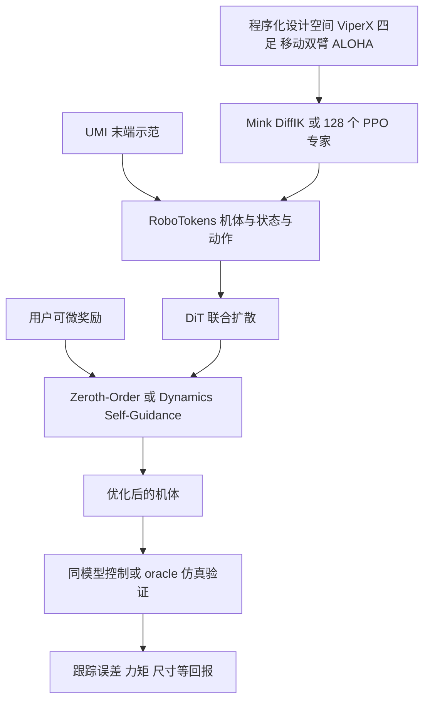

# Transformer Transformer（运动条件机器人共设计 · arXiv:2607.25798）

**Transformer Transformer**（Ha、Liu、Song；Stanford / Columbia；[项目页](https://transformer-transformer.github.io/)，[arXiv:2607.25798](https://arxiv.org/abs/2607.25798)，[代码](https://github.com/real-stanford/transformer-transformer)）把「生成完整机体」和「跨具身跟踪控制」放进同一个在 RoboTokens 上训练的扩散 Transformer。命名双关：第一个 Transformer 指变形机器人，第二个指自注意力（论文 §1 脚注）。本页依据 2026-11 对 PDF 全文的通读，核对范围见[来源归档](../../sources/papers/transformer_transformer_arxiv_2607_25798.md)。

## 一句话定义

**用统一 token 序列描述「机体 + 状态 + 动作」，训练单个 DiT 同时当生成器、评分器（critic）与跨具身控制器；推理时把模型自己预测的动力学接到任意可微奖励上，用 Dynamics Self-Guidance 把机体扩散推向高回报设计（§1、§2.2、§2.3）。**

## 英文缩写速查

| 缩写 | 英文全称 | 简要说明 |
|------|----------|----------|
| DiT | Diffusion Transformer | 以 Transformer 为骨干的扩散模型（§2.2） |
| DDIM | Denoising Diffusion Implicit Models | 训练与采样所用调度器（§2.2） |
| RoboTokens | Robot Tokens | link / 关节 / 电机 / 状态 / 动作的统一连续值 token（§2.1） |
| DSG（文中也写 DGS） | Dynamics Self-Guidance | 用同一网络的动力学预测得到奖励梯度，引导机体扩散（§2.3） |
| CMA-ES | Covariance Matrix Adaptation Evolution Strategy | 进化式共设计基线（§3） |
| UMI | Universal Manipulation Interface | 人类示范末端轨迹的来源（§2.4） |
| WBC | Whole-Body Control | 腿式设计空间的 RL 专家控制器（§2.4） |
| DiffIK | Differential Inverse Kinematics | 非腿式空间用 Mink 的运动学控制 oracle（§2.4） |
| MJCF | MuJoCo XML Format | 文本机体描述，RoboTokens 与之比较长度（§2.1） |
| DoF | Degrees of Freedom | 自由度；部分离散设计选择会改变 DoF（§9.3.1） |

## 为什么重要

- 把机体当作可优化变量：给定末端轨迹与奖励，直接生成连杆、关节、电机与惯量，而不只是训练更强的策略（§1）。
- 奖励零样本：训练目标是动力学建模而非某个奖励，推理期可换跟踪、力矩、速度、尺寸、质量等奖励项（§2、§8）。
- 速度：GPU 并行候选加上对时间维度的并行（非自回归），使评估一个候选不必顺序仿真数千步（§3）。在移动双臂多轨迹上，CMA-ES 需 11505 s，DSG 约 31 s（表 5）。
- 真机闭环：把优化后的 ALOHA 做出来并测了抛布展开（§3，Fig. 9）。作者自述与本页判断见下文「与清单说法的核对」和「局限」。

## 核心原理与流程总览

### RoboTokens（§2.1、§9.1）

- 完整：5 类机体 token、4 类状态 token、动作 token，范围与 MJCF 相当，几何限基元。
- 灵活：用 ID 互相指向表示连通性，支持可变 DoF 与被动关节。
- 一致：统一变换约定、拆分集总惯量、折叠冗余变换。
- 可优化：连续值可扩散，既有全局可控性也可微；文本自回归的 MJCF 则两者皆缺（作者论述）。
- 紧凑：Menagerie 11 个机器人 token 化后长度 28–101，比 MJCF 文本 token 短 27–110 倍（Fig. 3、§3）。

### 同一模型的多种角色（§2.2）

| 用例 | 条件 | 扩散对象 |
|------|------|----------|
| Motion-to-Robot | 目标末端轨迹 | 机体 + 状态 + 动作 token（100 步扩散，§9.2） |
| Cross-Embodiment Control | 机体 + 当前状态 + 目标运动 | 动作 token（5 步扩散，§9.2） |

### 优化器（§2.2、§2.3）

1. Zeroth-Order：并行扩散 n 个候选，用模型预测的奖励排序取最优。
2. Dynamics Self-Guidance：奖励对机体 token 的梯度按 classifier-guided DDIM 注入每步去噪，再并行 n 条取最优。
3. 多轨迹：diffusion composition 组合噪声预测，只用单轨迹训练即可做多轨迹优化（§3，Fig. 5b,d）。

## 工程实践

| 项 | 要点（均出自论文） |
|----|--------------------|
| 数据生成 | 程序化语法扩展 MJCF（§9.3.1）；非腿式用 Mink（80 ms 前瞻，§2.4）；四足为每个离散选择训一个 PPO 专家共 128 个，各约 16 h A100（§9.3.2） |
| 数据规模 | ViperX 3.8M episodes，四足 1.3M，移动双臂 50K（§9.3.4） |
| 数据质量 | 过滤短于 100 步的 episode；ViperX 与 ALOHA 空间对训练轨迹跑 CMA-ES 取样，偏向高性能机体（§9.3.3） |
| 模型 | 基础：hidden 256，8 层，4 头；大模型 63.6M 参数、小模型 11.6M（表 20、§7.1） |
| 引导 | η=1.0 随机 DDIM 对 DSG 有益；机体 token 奖励的引导系数需降到 0.005 否则输出无效机体（§8.4、§9.4） |
| 算力 | 计时在 RTX 4090 加 i9 单核上（§3） |
| 开源 | 代码已公开（见 [代码仓库归档](../../sources/repos/transformer-transformer.md)，沿用旧归档，本次未重新核对仓库内容） |

## 与清单说法的核对

清单（Glen Berseth 的 CoRL 2026 阅读清单，P2，Cross-Embodiment & Robot Design 组，按作者自己的兴趣模型排序，非质量评价；摘要为 LLM 据摘要起草）写：「Diffusion transformer over unified embodiment, state and action tokens that generates robot designs for target motions.」

- 与论文一致：DiT、embodiment / state / action 统一 token、目标运动条件下生成机体（摘要、§2）。
- 清单没提的：同一模型还做跨具身控制和奖励打分；以及 Dynamics Self-Guidance（论文核心之一）。
- 论文摘要列举 wheeled bimanual、quadrupeds、humanoids，但优化实验只有 ViperX、四足、移动双臂三个设计空间（§2.4、§3）；人形仅出现在 Menagerie 的 token 化覆盖里（§3），本页判断不应把它读成人形共设计已验证。
- 清单标注的「Workshops」会场信息：论文 PDF 中未见会场标注，本页无法核实。

## 局限

作者自述：
- 设计只在训练分布内插，不能外推新拓扑或超出训练范围的链长（§3）。
- 仅基元几何；无场景、物体、触觉、复杂几何；数据生成（尤其腿式控制）需要继续扩展（§4 Limitations）。
- 性能不稳健地随测试时算力增长（§3）。
- 学到的控制器与 RL 专家的相关性有限（四足 r=0.53），有离群机体（§3，Fig. 8）。

本页读到的未验证或需谨慎之处（读者判断，非作者结论）：
- 四足设计空间上并不占优：表 4/8/11/15 中 CMA-ES 的位置误差更低，正文速度优势的结论主要来自 ViperX 与移动双臂（Fig. 5）。
- 真机只有一次 ALOHA 抛布对比（-73% 位置误差、-30% 峰值关节速度），论文未给重复次数或方差；该设计是否在其他运动上也更好，论文没有测。
- ViperX 与 ALOHA 空间的训练数据本身来自对同批训练轨迹的 CMA-ES 采样（§9.3.3），与 CMA-ES 的对比因此并非完全独立。
- 奖励预测精度在四足上低于其他空间（Fig. 7）。
- 附录里部分行 DSG 劣于 Zeroth，如表 10 的 ViperX 多轨迹 Tracking Velocity。

## 关联页面

- [Shape Your Body](./paper-shape-your-body-value-gradient-design.md) — 固定拓扑连续参数的价值梯度共设计对照
- [ALOHA](./aloha.md) — 真机抛布硬件语境
- [扩散模型](../concepts/diffusion-model.md) — DiT / DDIM / classifier guidance 底座
- [跨具身策略迁移选型](../queries/cross-embodiment-transfer-strategy.md) — 控制侧跨机 vs 本文设计侧生成
- [双臂操作](../tasks/bimanual-manipulation.md) — 洗碗 / ALOHA 双臂任务场
- [遥操作](../tasks/teleoperation.md) — UMI / ALOHA 数据采集入口
- [强化学习](../methods/reinforcement-learning.md) — 腿式 WBC 专家的训练范式
- [PPO](../methods/ppo.md) — 128 个腿式专家所用算法
- [人形体脑共设计笔记](./paper-notebook-toward-humanoid-brain-body-co-design-joint-optim.md) — 相关共设计谱系
- [RealAB 14 篇技术地图](../overview/realab-14-papers-technology-map-2026.md) — 所在合集

## 参考来源

- [论文通读归档](../../sources/papers/transformer_transformer_arxiv_2607_25798.md)
- [项目页归档](../../sources/sites/transformer-transformer-github-io.md)
- [代码仓库归档](../../sources/repos/transformer-transformer.md)
- Ha, Liu, Song, *Transformer Transformer: A Unified Model for Motion-Conditioned Robot Co-design* (arXiv:2607.25798v1)

## 继续阅读

- [项目页](https://transformer-transformer.github.io/) — 视频与结果
- [arXiv:2607.25798](https://arxiv.org/abs/2607.25798) — 附录 §8 奖励定义与逐表指标
- [Shape Your Body](https://nico-bohlinger.github.io/shape-your-body/) — 价值梯度共设计对照
- [UMI](https://umi-gripper.github.io/) — 示范接口前序
