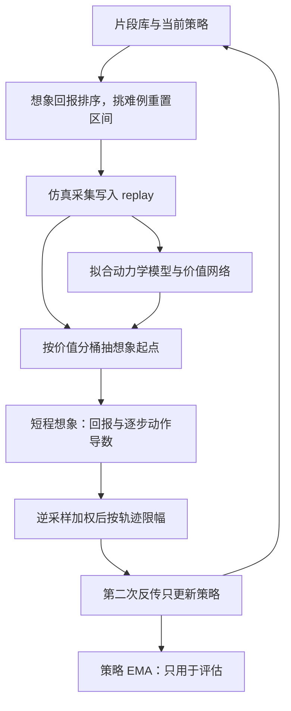

# Trust What Repeats · 给人形动作跟踪的世界模型梯度设上限

## 一句话定义

沿用 SuperMimic 的可微世界模型训练框架，发现极大的想象动作梯度常把回报变化估得太大，于是按轨迹限幅，并把更多训练机会分给难例。

## 英文缩写速查

| 缩写 | 英文全称 | 简要说明 |
|---|---|---|
| BPTT | Backpropagation Through Time | 沿多步想象动力学反传回报梯度 |
| DoF | Degrees of Freedom | 论文对照 29 与 23 个驱动关节版本 |
| EMA | Exponential Moving Average | 仅用于评估的策略权重平均，两组均用 |
| AUC | Area Under the Curve | 用于衡量重置难度排序对失败的区分能力 |

## 为什么重要

拟合出相近的回报并不保证导数可靠。同一 G1 策略中，超过批中位数 30 倍的想象轨迹约占 0.45%，却占各条轨迹范数之和的 22%。这不是它们占最终参数梯度向量的 22%；不同轨迹的方向可能抵消。控制排序时也不该把所有难状态都视为低效数据。

## 核心信息

| 项 | 内容 |
|---|---|
| 作者 | Xuzhe Dang、Stefan Edelkamp |
| 机构 | 捷克理工大学（Czech Technical University in Prague）、查理大学（Charles University） |
| 原文 | arXiv:2611.27648v1，2026-11-20 |
| 平台 | 单张 RTX 6000 Ada；Newton / MuJoCo Warp，200 Hz 仿真、50 Hz 目标位置控制 |
| 对照 | 同代码库重实现的 SuperMimic，不使用原作者源码；共享环境、网络及世界模型与 critic 更新 |

## 核心原理与流程总览

**先核对梯度。** 32,768 个 replay 起点各用独立观测噪声展开两次，把第二个动作梯度投影到第一个的方向，判断同起点能重复多少。另从 5,456 个起点，在仿真中沿模型动作梯度做正负扰动；64 步、最大分量 0.05，比较仿真变化与预测变化的比值。在低于中位数、3–10 倍、超过 30 倍三个区间，仿真比值中位数分别为 0.94、0.48、0.01。最后一档仍有 65% 符号一致；这主要显示幅度不可信，不代表 99% 的方向反了。

**再改训练。**

1. **逐轨迹限幅。** 把一条 rollout 所有时间步的动作导数拼成向量，范数为 G。按 `min(1, 10 × 批中位数 / G)` 赋权，低于阈值不改。第一遍只对动作扰动张量反传，第二遍在已存观测重新计算策略输出，将固定的加权动作梯度拉回参数；不是全批参数梯度裁剪，也不是把每条轨迹都归一化。
2. **抽想象起点。** 从 replay 取候选，以 critic value 分 32 桶，估计各桶的梯度范数，按相对抽样率 q 抽取。策略和 critic 用 1/q 加权，策略按加权范数再限幅；逆加权在限幅之前补偿抽样，限幅本身仍可能有偏。
3. **挑回合重置位置。** 每 2,000 次训练迭代，从训练片段的参考状态做 32 步想象加 critic 末值，选回报最低 5% 的时间段。重置 50% 均匀、40% 当前难例、10% 历史难例，不从片段最后 50 帧开始。

## 源码运行时序图

不适用。核对时未见本论文可运行的官方源码或权重；上图是论文算法，不是 SuperMimic 原仓库的调用顺序。对限幅、逆采样及表值做了 5 项合成算术断言，未运行策略或仿真。

## 实验与评测

BONES-SEED 主试验按动作类别划分留出集：同一动作的不同演员记录和镜像在同一侧。29-DoF 训练 109,233 段、222.7 小时，留出 353 个动作共 11,828 段；每组 3 种子。第 20,000 至 25,000 次迭代每千次取一次评估，下面前三个回报是这六个 EMA 策略快照的汇总。

| 指标 | SuperMimic 重实现 → 本文方法 |
|---|---|
| 归一化回报 | 0.9531 → 0.9671，差 +0.0140；按动作重采样区间 +0.0087 到 +0.0211 |
| 最低 10% / 1% 片段回报 | 0.811 → 0.886 / 0.648 → 0.756；每次运行各取自己的尾部 |
| 持续失败片段 | 15–18 → 7–10；六快照中至少三次跌倒 |
| 达到基线第 25,000 次的 0.9543 | 约 25,000 → 9,900 次；2.4–2.6 → 约 1.2 小时 |
| 单轮训练 | 0.34–0.37 → 0.42–0.45 秒；单轮变慢，因达到同一回报所需轮数减少，总耗时才下降 |

表 III 消融在第 15,000 次比较：相同重置、批量、窗口和学习率时，加限幅使平均回报 0.9341→0.9587；加难例重置主要改善尾部。最终配置再加起点抽样相对收益小（均值 0.9587→0.9589）。23-DoF 留出评估的提升来自每方法单种子。LAFAN1 的 0.9061→0.9347 是同 40 段训练和评估，不能用作泛化证据。

## 工程实践

先按梯度范数分桶画复抽投影、回报差分与符号一致率。报告全段回报、重复跌倒、尾部回报、运行时间和计算量；同时锁定重定向、训练/测试切分、评估权重及基线设置。若复现，另记录每轮生成的轨迹数、有效步数与提前截断：附录 D 的名义 H×B 从 131,072 降至 65,536，与 §V-A 文字所说每迭代想象步数相同不一致，不能据此声称等想象样本预算。

## 局限与风险

- 10× 是经验设定，不是由两项诊断唯一推导出的最优阈值；条件和训练阶段改变后需重新量化。
- 有限差分沿每个状态的一个方向核对训练仿真，不保证其他扰动或真机可迁移。倒立和部分波比跳两组都失败；倒立参考腕部逆动力学需求峰值达限值 5.8 倍，不是机器人实测扭矩。
- 主实验还改变了窗口、批量与学习率，不能把全部改进算给单项。表 III 的受控行更适合判断限幅作用。

## 与相关工作对比

[SuperMimic](./paper-supermimic.md) 证明可微学习动力学可以用于扩大运动库训练；本文问其一阶动作梯度有多少由重复采样和物理仿真支持。[BlinkMimic](./blinkmimic.md) 关注计算编排和短墙钟时间，本文没有与其在同一个阈值、数据和硬件下做对照。

## 结论

可靠的可微训练不只要拟合状态，还要检查想象梯度、难例和实际仿真结果是否一致。

1. 把梯度方向和幅度分别验收，不用一个回报均值替代诊断。
2. 分开消融逐轨迹限幅、想象起点抽样和物理回合重置，尾部收益不能只看均值。
3. 报告达到同一回报所需的墙钟与样本记账；不把仿真改进或同集拟合写成真机泛化。

## 关联页面

- [SuperMimic](./paper-supermimic.md)
- [BONES-SEED](./bones-seed.md)
- [基于模型的强化学习](../methods/model-based-rl.md)
- [人形基础模型纵深路线](../../roadmap/depth-bfm.md#stage-2-跟踪主线从-deepmimic-到-hover)

## 参考来源

- [论文全文及表格核对](../../sources/papers/trust_what_repeats_arxiv_2611_27648.md)

## 推荐继续阅读

- [Trust What Repeats v1](https://arxiv.org/html/2611.27648v1)
- [SuperMimic 官方原始基线](https://github.com/HybridRobotics/supermimic)
