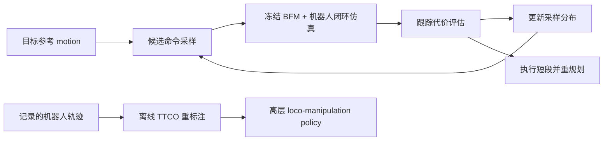
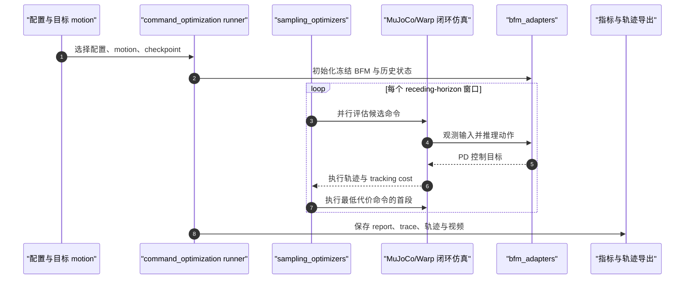

# TTCO（Test-Time Compute for Humanoid Behavior Foundation Models）

**Test-Time Command Optimization（TTCO）** 在测试时通过闭环仿真优化冻结人形行为基础模型（BFM）的输入 motion command，缩小目标动作与实际执行之间的差距；论文同时研究测试时预算分配，并将优化用于示范重标注。

## 英文缩写速查

| 缩写 | 英文全称 | 简要说明 |
|------|----------|----------|
| TTCO | Test-Time Command Optimization | 对输入 BFM 的目标命令进行测试时采样优化 |
| BFM | Behavior Foundation Model | 复用多样化全身行为先验的人形运动执行模型 |
| AMASS | Archive of Motion Capture as Surface Shapes | 论文用于 motion tracking 评测的参考动作集合 |
| MPC | Model Predictive Control | 反复优化、执行短段并重规划的控制范式 |
| GR00T | Generalist Robot 00 Technology | 项目页真机高层策略评测使用的策略基座之一 |

## 核心信息

| 项目 | 内容 |
|------|------|
| **机构** | 中国电信人工智能研究院（TeleAI）、上海交通大学、浙江大学、Gamma Robotics |
| **论文** | arXiv:2610.14896；2026-10-10 提交，v2 于 2026-10-14 更新 |
| **目标问题** | BFM 接收目标运动后，机器人执行轨迹会发生全局身体漂移或手足接触位置偏差 |
| **方法** | 冻结 BFM，在模型与机器人动力学闭环仿真中采样优化输入命令 |
| **代码** | [Gamma-Robot/bfm_ttc](../../sources/repos/bfm_ttc.md)；主代码 Apache-2.0，SPIDER sampler 有独立上游许可 |
| **数据 / 权重** | 项目页无独立权重或数据下载入口；仓库运行需准备 HEFT-PMG checkpoint、G1 资产与评测动作 |
| **项目页** | [bfmttc.github.io](../../sources/sites/ttco-test-time-compute-humanoid-bfm.md) |

## 为什么重要

- **把预算用于适配命令：** 对已有 BFM 进行输入侧搜索，减少直接下发参考 motion 时系统性执行偏差，无需重新训练底层行为模型。
- **将执行器误差变成标签问题：** 记录的机器人轨迹可以经 TTCO 离线求得模型专属命令，支持训练高层移动操作策略，也支持在不同 BFM 间复用示范。
- **把测试时算力纳入方法设计：** 工作分析候选数和计算预算如何分配；部署者需在误差改善与并行仿真成本之间权衡。
- **证据边界清晰：** 大规模 tracking 数字来自仿真；真机结果是指定任务上的高层策略实验和仿真优化命令回放，不能外推成通用真机成功率保证。

## 方法与流程

1. **给定目标动作：** 输入参考 motion、目标 BFM 与仿真配置。
2. **采样命令：** 采样优化器提议一组适配该 BFM 的候选输入。
3. **闭环评估：** 候选在 BFM 推理与机器人动力学仿真中执行，按 tracking cost 评分。
4. **执行并重规划：** 执行最低代价候选的第一段，再围绕剩余目标动作重算命令；因此运行时计算换取更好的跟踪精度。
5. **离线生成标签：** 将机器人状态轨迹映射为面向具体 BFM 的命令标签，再训练高层 loco-manipulation policy。

## 源码运行时序图

官方仓库已公开可运行的仿真入口，详见 [源码归档](../../sources/repos/bfm_ttc.md)。运行时按 README 的 `bfm-ttc run` 流程加载 motion 与 BFM adapter，在仿真中评估命令候选，输出指标、轨迹和视频；这不是连接真机的在线闭环控制接口。

该复现链使用仿真闭环作 test-time search；README 还要求单独准备 G1 robot assets 与 HEFT-PMG checkpoint。

## 实验与评测

### 三种 BFM 的 motion tracking（仿真）

在 AMASS 的 **12,273** 条参考动作上，论文以直接把参考 motion 当成命令为基线。项目页报告平均全局身体位置误差（厘米）：

| BFM | 直接参考命令 | TTCO 优化命令 | 误差下降 |
|-----|-------------:|---------------:|---------:|
| HEFT | 27.1 | 5.7 | 79.0% |
| SONIC | 61.5 | 12.7 | 79.3% |
| TWIST2 | 109.5 | 17.3 | 84.2% |

这些均为项目页展示的仿真均值，三个模型使用同一图表尺度；数值说明输入命令可以针对具体模型而调整，不能直接等同于跨机器人硬件的误差保证。真机片段回放仿真优化的命令，未在真机上在线 replanning。

### 真机策略标签实验

项目页说明作者在四个真实机器人任务中用 SONIC 示范微调 GR00T N1.7 高层策略；每个任务/标签来源各跑 **60 次 rollout**。观察和手部标签保持固定，仅身体动作标签变化：

| 标签来源 | 平均成功率 |
|----------|-----------:|
| 原始命令 | 60.4% |
| TTCO 命令 | 64.2% |
| 机器人状态 | 2.5% |

逐任务结果并非 TTCO 每项都胜过原始命令（例如 Cup in basket 持平，Basket on shelf 略低）；所以应把 64.2% 作为该四任务协议的平均结果，不解读成逐项稳定增益。robot-state labels 的低结果则呼应了「状态轨迹不是任意 BFM 的动作接口」这一问题设定。

### 测试时计算扩展

论文分析候选数与测试时预算之间的性能变化，并拟合 surrogate cost model 来近似计算最优预算分配。项目页报告其展示配置下平均 cost regret 为 **4.02%**，预算从 K=256 增至 K=8192 时 cost 降低 **58.0%**；这些指标服务于优化器预算设计，不是硬件任务成功率。

## 与其他工作对比

| 路线 | 改什么 | 代价 | 与 TTCO 的关系 |
|------|--------|------|----------------|
| 直接下发参考 motion（论文基线） | 不改 | 无额外计算 | TTCO 在同一冻结 BFM 上把仿真全局位置误差降 79–84% |
| 微调 / 重训 BFM | 底层模型权重 | 需训练数据与算力，可能影响已有能力 | TTCO 冻结权重，只在输入命令侧搜索；二者可叠加 |
| 动作空间采样 MPC（如 [MPPI](../methods/mppi.md)） | 关节级动作序列 | 每步在线采样 | TTCO 同样是「采样 + 闭环仿真评分 + 滚动执行」，但搜索空间是 BFM 的 motion command，底层仍由 BFM 输出动作 |
| [MotionWAM](./paper-motionwam-humanoid-loco-manipulation-wam.md) 等高层策略 | 学习生成 BFM 命令的策略 | 需要命令标签示范 | TTCO 的离线重标注可为这类高层策略提供 BFM 专属命令标签 |

- 评测对象是三个 BFM（HEFT / SONIC / TWIST2）在同一 AMASS 集上的输入侧改进，不是 BFM 之间的优劣排名。
- 真机部分仅比较标签来源（原始命令 / TTCO 命令 / 机器人状态），并非与其他测试时方法的对比。

## 结论

**TTCO 的核心价值是以并行仿真和采样计算换取更可靠的冻结 BFM 命令执行，并把原本缺少控制器专属动作命令的机器人轨迹转成可学习标签。**

1. **适用条件：** 已有可运行 BFM、对应仿真模型和足够并行算力，且直接 motion tracking 误差会影响高层任务。
2. **预算选择：** 从小候选预算测 tracking cost，再根据边际改善与仿真延迟决定是否增加 K；不要只追求采样数。
3. **标签迁移：** 若机器人示范只有状态轨迹，可先离线做 BFM-specific relabeling，再训练高层 policy；评测需和原命令标签并列对照。
4. **仿真与真机分开看：** 79–84% 是三种 BFM 的仿真全局位置误差下降；高层真机均值改善较小且任务间不一致。
5. **复现边界：** 公开代码便于跑研究流程，但需另准备 BFM checkpoint、G1 assets 和评测 motion；不要将它视为已提供可直接部署的权重或在线真机控制栈。

## 局限与风险

- 优化依赖仿真中的 BFM 推理与机器人动力学；仿真建模误差和硬件执行漂移会限制真机收益。
- 额外测试时计算来自并行候选仿真，改善需与 GPU 显存、延迟和预算成本一起评估。
- 公开页面展示的是 12,273 条 AMASS motion、3 个 BFM 的设定；不代表所有人形平台和控制器均有相同增益。
- 项目代码虽已开源，权重与 G1/HEFT 所需资产需独立获取；仓库含 Apache-2.0 与 SPIDER 上游 CC BY-NC 4.0 等多种许可，逐项核对。

## 关联页面

- [Behavior Foundation Model（BFM）](../concepts/behavior-foundation-model.md)
- [Loco-Manipulation](../tasks/loco-manipulation.md)
- [SONIC motion tracking](../methods/sonic-motion-tracking.md) — 论文评估的一个 BFM
- [Humanoid-X](./dataset-bfm-humanoid-x.md) — 与全身行为数据训练相关
- [MotionWAM](./paper-motionwam-humanoid-loco-manipulation-wam.md) — 基础模型驱动的全身 loco-manipulation 对照
- [MPPI](../methods/mppi.md) — 同属采样式滚动优化，但在动作空间而非 BFM 命令空间搜索

## 参考来源

- [论文来源笔记](../../sources/papers/ttco_test_time_compute_humanoid_bfm_arxiv_2610_14896.md)
- [官方项目页归档](../../sources/sites/ttco-test-time-compute-humanoid-bfm.md)
- [官方源码归档](../../sources/repos/bfm_ttc.md)
- arXiv 摘要：[Test-Time Compute for Humanoid Behavior Foundation Models](https://arxiv.org/abs/2610.14896)

## 推荐继续阅读

- [论文代码仓库](https://github.com/Gamma-Robot/bfm_ttc) — 仿真运行、采样优化器和复现实验入口
- [AMASS](../entities/amass.md) — 理解大规模 mocap 评测集及其许可
- [SONIC](../methods/sonic-motion-tracking.md) — 对照 TTCO 使用的行为基础模型
