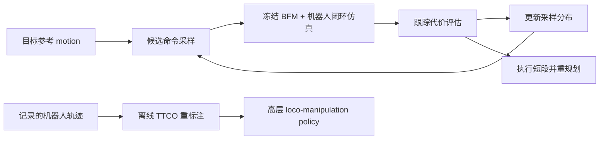
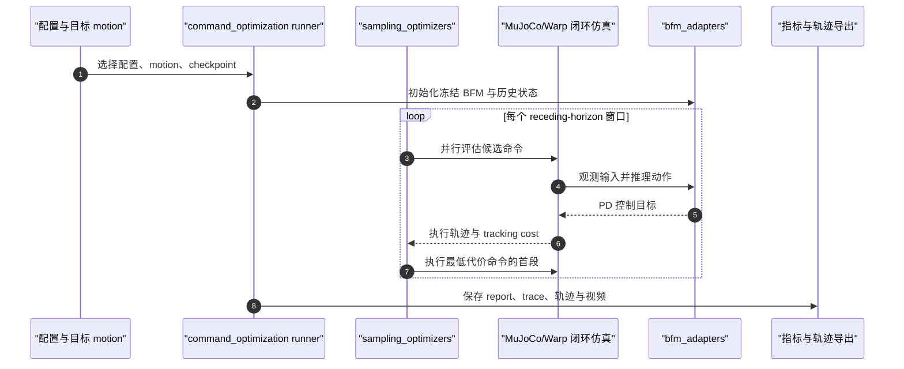

# TTCO（Test-Time Compute for Humanoid Behavior Foundation Models）

## 一句话定义

**Test-Time Command Optimization（TTCO）** 在测试时通过闭环仿真优化冻结人形行为基础模型（BFM）的输入 motion command，缩小目标动作与实际执行之间的差距；论文同时研究测试时预算分配，并将优化用于示范重标注。

## 英文缩写速查

| 缩写 | 英文全称 | 简要说明 |
|------|----------|----------|
| TTCO | Test-Time Command Optimization | 对输入 BFM 的目标命令进行测试时采样优化 |
| BFM | Behavior Foundation Model | 复用多样化全身行为先验的人形运动执行模型 |
| AMASS | Archive of Motion Capture as Surface Shapes | 论文用于 motion tracking 评测的参考动作集合 |
| MPC | Model Predictive Control | 反复优化、执行短段并重规划的控制范式 |
| CEM | Cross-Entropy Method | 论文比较 5 种采样优化器后选用的求解器 |
| GR00T | Generalist Robot 00 Technology | 论文真机实验微调的高层策略（GR00T N1.7-3B） |

## 核心信息

| 项目 | 内容 |
|------|------|
| **机构** | 中国电信人工智能研究院（TeleAI）、上海交通大学、浙江大学、Gamma Robotics |
| **论文** | arXiv:2610.14896；2026-10-10 提交，v2 于 2026-10-14 更新 |
| **目标问题** | BFM 接收目标运动后，机器人执行轨迹会发生全局身体漂移或手足接触位置偏差 |
| **方法** | 冻结 BFM，在模型与机器人动力学闭环仿真中采样优化输入命令 |
| **代码** | [Gamma-Robot/bfm_ttc](../../sources/repos/bfm_ttc.md)；主代码 Apache-2.0，SPIDER sampler 有独立上游许可 |
| **数据 / 权重** | 项目页无独立权重或数据下载入口；仓库运行需准备 HEFT-PMG checkpoint、G1 资产与评测动作 |
| **项目页** | [bfmttc.github.io](../../sources/sites/ttco-test-time-compute-humanoid-bfm.md) |

## 为什么重要

- **把预算用于适配命令：** 对已有 BFM 进行输入侧搜索，减少直接下发参考 motion 时系统性执行偏差，无需重新训练底层行为模型。
- **将执行器误差变成标签问题：** 记录的机器人轨迹可以经 TTCO 离线求得模型专属命令，支持训练高层移动操作策略，也支持在不同 BFM 间复用示范。
- **把测试时算力纳入方法设计：** 工作分析同一预算如何在迭代数、候选数、规划视野与重规划间隔之间分配；部署者需在误差改善与并行仿真成本之间权衡。
- **证据边界清晰：** 大规模 tracking 数字来自仿真；真机结果是指定任务上的高层策略实验和仿真优化命令回放，不能外推成通用真机成功率保证。

## 核心机制与流程总览

论文把「参考动作直接当命令」（nominal command）时的系统性偏差称为 **command–execution gap**，来源包括参考动作物理不可行、训练动作覆盖有限、策略优化残差，以及为 sim2real 加的正则与域随机化牺牲了精度。TTCO 的出发点是：让执行最接近参考的命令不必等于参考本身。

1. **给定目标动作：** 输入参考 motion、目标 BFM 与仿真配置；BFM 与动力学合成闭环转移，命令序列 c 决定执行轨迹。
2. **采样命令：** 在名义命令上加偏移，偏移只在稀疏控制节点上取值（根位置、旋转向量、关节位置），再线性插值到整段视野。
3. **闭环评估：** 候选在 BFM 推理与机器人动力学仿真中并行执行，按 cost 评分：跟踪项（关节位置、身体位置与姿态）+ 正则项（命令相对参考的形变、关节速度）+ 视野末端终端项。
4. **执行并重规划：** 每次规划优化 H 步命令，迭代 I 轮、每轮 N 个候选，执行最低代价候选的前 E 步后重规划，并以上次最优解平移热启动。
5. **离线生成标签：** 以记录的机器人动作为参考、用目标 BFM 离线优化，得到该 BFM 专属的命令标签，再训练高层 loco-manipulation policy。

| 设计点 | 论文做法 |
|--------|----------|
| 求解器 | 比较 CEM、Predictive Sampling、MPPI-CMA、CMA-ES、CBO，CEM 整体有竞争力，后续实验均用 CEM |
| 预算度量 | K = I·N·H/E，即每执行一个控制步消耗的仿真 BFM 转移数 |
| 预算分配 | 代理 cost 模型 = 不可约 cost + 有限视野误差(H, E) + 采样误差(I, N \| H, E)；在 SONIC 的 10 条动作上用 183 组配置拟合，再在预算约束下最小化预测 cost 选配置 |

## 源码运行时序图

官方仓库已公开可运行的仿真入口，详见 [源码归档](../../sources/repos/bfm_ttc.md)。运行时按 README 的 `bfm-ttc run` 流程加载 motion 与 BFM adapter，在仿真中评估命令候选，输出指标、轨迹和视频；这不是连接真机的在线闭环控制接口。

该复现链使用仿真闭环作 test-time search；README 还要求单独准备 G1 robot assets 与 HEFT-PMG checkpoint。

## 工程实践

| 环节 | 论文 / 仓库设定 | 实践含义 |
|------|-----------------|----------|
| 仿真与控制频率 | G1 29 关节；物理步 0.005 s，BFM 50 Hz（每个动作 4 个物理步）；MuJoCo Warp 做跟踪评测与命令优化，loco-manipulation 仿真用 Isaac Sim | 命令速度由解码位姿按控制周期 Δt=0.02 s 差分得到，优化与 BFM 共用同一时间网格 |
| BFM checkpoint | 官方发布的 SONIC G1、HEFT PMG、TWIST2 1017–20k；仓库 `docs/assets.md` 记录上游固定版本与转换步骤，TWIST2 固定文件可自动下载，HEFT-PMG 与 SONIC 需按上游取得后转换 | 仓库不打包 BFM 权重，需逐一核对上游许可 |
| 大规模跟踪评测 | CEM，(I, N, H, E) = (4, 80, 40, 20)，即 K=640 | 论文称这是为控制全量评测成本取的中等预算 |
| 标签生成 | CEM，(7, 39, 37, 5)，K=2048；每个候选在 4 个随机化动力学场景（摩擦、电枢、驱动强度、初速度扰动）上取平均 cost | 在 MuJoCo Warp 里优化、到 Isaac Sim 或真机执行，靠随机化缓解动力学差异 |
| 真机高层策略 | 每任务 50 条 SONIC 示范（约 20 分钟）；Unitree G1 + BrainCo Revo2 手 + ZED-M 相机；冻结 GR00T N1.7-3B 视觉-语言骨干，只微调动作头 | 标签只替换身体动作，图像、本体与手部标签保持不变 |
| 算力 | RTX 3080 Ti 上单次 TTCO 墙钟约 58.1 + 0.009961·C/N 秒（C 为总仿真转移数）；§4.1–4.3 约 1,800 / 380 / 1,700 RTX 3080 Ti 等效 GPU 小时，§4.4 约 700 H100 GPU 小时 | 候选数 N 越大越能并行摊薄，但全数据集评测仍受总计算量限制 |
| 源码开放状态 | **已开源**：[Gamma-Robot/bfm_ttc](https://github.com/Gamma-Robot/bfm_ttc)（[归档](../../sources/repos/bfm_ttc.md)）；Linux、Python 3.10+、CUDA GPU，`uv sync --frozen` 后用 `bfm-ttc run` / `render` | 原创代码 Apache-2.0；SPIDER sampler 保留 CC BY-NC 4.0，商用前单独核对 |

## 实验与评测

### 三种 BFM 的 motion tracking（仿真）

在重定向后的 AMASS **12,273** 条参考动作上，论文以直接把参考 motion 当成命令为基线（论文表 1、表 4；K=640）。全局身体位置误差为 14 个身体与参考的平均欧氏距离，先在每条动作内平均、再跨动作等权平均（厘米）：

| BFM | 直接参考命令 | TTCO 优化命令 | 误差下降 | 中位数误差（名义→优化） | cost 胜率 | 关节加速度（rad/s²） |
|-----|-------------:|---------------:|---------:|------------------------:|----------:|---------------------:|
| HEFT | 27.1 | 5.7 | 79.0% | 13.88 → 4.80 | 62.27% | 10.10 → 17.25 |
| SONIC | 61.5 | 12.7 | 79.3% | 11.51 → 4.86 | 86.00% | 8.83 → 12.00 |
| TWIST2 | 109.5 | 17.3 | 84.2% | 62.68 → 13.15 | 99.67% | 43.28 → 51.57 |

- 「误差下降」按表中四舍五入值计算；论文正文给出 79.1–84.2%（摘要写 79–84%），mean cost 同时下降 89.0–94.7%。
- 均值远大于中位数，名义误差分布长尾；按名义误差分四分位后，误差下降的大部分来自误差最高的四分位（HEFT 76.53%、SONIC 91.77%、TWIST2 69.25%）。
- 三个 BFM 的关节加速度都上升，论文视为跟踪精度与平滑度的权衡；HEFT 只有 62.27% 的动作总 cost 下降（位置误差胜率为 93.86%）。
- 以上均为仿真结果，不能直接等同于跨机器人硬件的误差保证。真机只展示左侧步、后退走两段，开环执行仿真中优化好的命令，未在真机上在线 replanning。

### 真机策略标签实验

论文表 3：每任务用 50 条 SONIC 示范微调 GR00T N1.7-3B，四个真机任务各跑 **60 次 rollout**。图像、本体与手部标签保持固定，仅身体动作标签变化；「SONIC→HEFT」指示范由 SONIC 采集、部署时换 HEFT 执行：

| 标签来源 | SONIC→SONIC 平均成功率 | SONIC→HEFT 平均成功率 |
|----------|-----------------------:|----------------------:|
| 原始命令 | 60.4% | 1.7% |
| TTCO 命令 | 64.2% | 48.8% |
| 机器人状态 | 2.5% | 12.1% |

同 BFM 时逐任务结果并非 TTCO 每项都胜过原始命令（Cup in basket 持平 55.0%，Basket on shelf 50.0% vs 53.3%），应把 64.2% 视为该四任务协议的平均结果，不解读成逐项稳定增益。换执行 BFM 后，原始 SONIC 命令几乎不可用，TTCO 重标注在四个任务上都高于两条基线。robot-state 标签的低结果呼应了「状态轨迹不是任意 BFM 的动作接口」这一问题设定。

### HumanoidArena 仿真标签实验

论文表 2 / 表 25：用 Diffusion Policy 在 5 个 HumanoidArena 任务上训练，3 个训练 seed、每任务每 seed 60 rollouts；表中为五任务平均成功率：

| 示范 BFM → 执行 BFM | 原始命令 | TTCO 命令 | 机器人状态 |
|---------------------|---------:|----------:|-----------:|
| SONIC → SONIC | 75.8% | 56.7% | 0.0% |
| SONIC → TWIST2 | 15.7% | 15.8% | 10.0% |
| SONIC → HEFT | 17.1% | 28.8% | 20.6% |
| TWIST2 → TWIST2 | 57.3% | 48.0% | 31.1% |
| TWIST2 → SONIC | 7.9% | 25.8% | 15.7% |
| TWIST2 → HEFT | 14.4% | 21.4% | 31.3% |

- 同 BFM 时 TTCO 标签明显低于原始命令，论文称其为原始标签的「部分替代」。
- 跨 BFM 时多数配对优于或接近两条基线，但 TWIST2→HEFT 中机器人状态标签最好；跨 BFM 配对里 Open Door 与 Pick & Place Box 在三种标签下均为 0%。

### 测试时计算扩展

论文在 SONIC 上用 10 条随机抽取的 AMASS 动作分别扫描求解器与视野参数（各配置 3 个优化器 seed）：

- **迭代 vs 候选：** 固定 O=I·N=8192 时，(I, N) 由 (1, 8192) 改为 (32, 256) 使 cost 降 53.42%，且最优拆分随预算变化。
- **视野 vs 重规划：** H/E 超过 4 后最优 cost 趋平；E 从 5 增到 10，在 H/E=4 时 cost 降 34.43%，在 H/E=10 时反升 12.87%，H 与 E 需联合选择。
- **代理模型选配置：** 在拟合用的 10 条 SONIC 动作、6 档预算上平均 regret **4.02%**（次优的随机森林 18.44%），K 从 256 增至 8192 时 cost 降 **58.0%**；不改参数用于 5 条新动作 × 3 个 BFM，平均 regret 4.60%（随机森林 12.27%），是唯一在三个 BFM 上都低于 10% 的策略，但 HEFT 上随机森林更低（1.31% vs 8.24%）。

这些指标服务于优化器预算设计，不是硬件任务成功率。

## 与其他工作对比

| 路线 | 改什么 | 代价 | 与 TTCO 的关系 |
|------|--------|------|----------------|
| 直接下发参考 motion（论文基线） | 不改 | 无额外计算 | TTCO 在同一冻结 BFM 上把仿真全局位置误差降 79–84% |
| 微调 / 重训 BFM | 底层模型权重 | 需训练数据与算力，可能影响已有能力 | TTCO 冻结权重，只在输入命令侧搜索；二者可叠加（推测，论文未实验） |
| 动作空间采样 MPC（如 [MPPI](../methods/mppi.md)） | 关节级动作序列 | 每步在线采样 | TTCO 同样是「采样 + 闭环仿真评分 + 滚动执行」，但搜索空间是 BFM 的 motion command，底层仍由 BFM 输出动作 |
| 命令 / prompt 空间优化（[Sumo](../methods/sumo.md)、[BFM-Zero](./paper-bfm-zero.md)） | 预训练全身策略的命令或 latent prompt | 仿真内采样 | 论文相关工作指出：Sumo 用策略在环仿真规划物体交互，BFM-Zero 只讨论自身模型；TTCO 面向一般预训练 BFM，以固定参考动作的执行误差为目标 |
| [MotionWAM](./paper-motionwam-humanoid-loco-manipulation-wam.md) 等高层策略 | 学习生成 BFM 命令的策略 | 需要命令标签示范 | 论文实测的是 Diffusion Policy 与 GR00T；TTCO 重标注能否用于 MotionWAM 这类策略属推测 |

- 评测对象是三个 BFM（HEFT / SONIC / TWIST2）在同一 AMASS 集上的输入侧改进，不是 BFM 之间的优劣排名。
- 真机与 HumanoidArena 部分仅比较标签来源（原始命令 / TTCO 命令 / 机器人状态），并非与其他测试时方法的对比。

## 结论

**TTCO 的核心价值是以并行仿真和采样计算换取更可靠的冻结 BFM 命令执行，并把原本缺少控制器专属动作命令的机器人轨迹转成可学习标签。**

1. **适用条件：** 已有可运行 BFM、对应仿真模型和足够并行算力，且直接 motion tracking 误差会影响高层任务。
2. **预算选择：** 从小候选预算测 tracking cost，再根据边际改善与仿真延迟决定是否增加 K；不要只追求采样数。
3. **标签迁移：** 若机器人示范只有状态轨迹，可先离线做 BFM-specific relabeling，再训练高层 policy；评测需和原命令标签并列对照。
4. **仿真与真机分开看：** 79–84% 是三种 BFM 的仿真全局位置误差下降。同 BFM 时 TTCO 标签只是原始命令的部分替代（真机均值 64.2% vs 60.4% 且逐任务不一致，HumanoidArena 中低于原始命令）；收益最明显的是换执行 BFM 复用示范（真机 SONIC→HEFT 48.8% vs 1.7%）。
5. **复现边界：** 公开代码便于跑研究流程，但需另准备 BFM checkpoint、G1 assets 和评测 motion；不要将它视为已提供可直接部署的权重或在线真机控制栈。

## 局限与风险

- **论文自述：** 当前实现不够快，无法满足实时要求，因此未在真机上做闭环命令优化；优化后的命令可能出现时间不规则并带来执行抖动（三个 BFM 的关节加速度均上升）；残余误差仍会限制需要精确接触和全身协调的任务。
- 优化依赖仿真中的 BFM 推理与机器人动力学；仿真建模误差和硬件执行漂移会限制真机收益。
- 额外测试时计算来自并行候选仿真，改善需与 GPU 显存、延迟和预算成本一起评估；论文各组实验合计约数千 GPU 小时。
- 预算分配的代理模型只用 SONIC 的 10 条动作拟合，迁移验证也只有 5 条新动作；HEFT 上并非最优策略。
- 公开页面展示的是 12,273 条 AMASS motion、3 个 BFM 的设定；不代表所有人形平台和控制器均有相同增益。
- 项目代码虽已开源，权重与 G1/HEFT 所需资产需独立获取；仓库含 Apache-2.0 与 SPIDER 上游 CC BY-NC 4.0 等多种许可，逐项核对。

## 关联页面

- [Behavior Foundation Model（BFM）](../concepts/behavior-foundation-model.md)
- [Loco-Manipulation](../tasks/loco-manipulation.md)
- [SONIC motion tracking](../methods/sonic-motion-tracking.md) — 论文评估的一个 BFM
- [HEFT](./paper-heft.md) · [TWIST2](./paper-twist2.md) — 论文评估的另两个 BFM
- [HumanoidArena](./paper-humanoidarena.md) — 仿真标签实验所用基准
- [Humanoid-X](./dataset-bfm-humanoid-x.md) — 与全身行为数据训练相关
- [MotionWAM](./paper-motionwam-humanoid-loco-manipulation-wam.md) — 基础模型驱动的全身 loco-manipulation 对照
- [MPPI](../methods/mppi.md) — 同属采样式滚动优化，但在动作空间而非 BFM 命令空间搜索

## 参考来源

- [论文来源笔记](../../sources/papers/ttco_test_time_compute_humanoid_bfm_arxiv_2610_14896.md)
- [官方项目页归档](../../sources/sites/ttco-test-time-compute-humanoid-bfm.md)
- [官方源码归档](../../sources/repos/bfm_ttc.md)
- arXiv 摘要：[Test-Time Compute for Humanoid Behavior Foundation Models](https://arxiv.org/abs/2610.14896)
- 全文 PDF（v2，2026-11-06 通读）：<https://arxiv.org/pdf/2610.14896v2>

## 推荐继续阅读

- [论文代码仓库](https://github.com/Gamma-Robot/bfm_ttc) — 仿真运行、采样优化器和复现实验入口
- [AMASS](../entities/amass.md) — 理解大规模 mocap 评测集及其许可
- [SONIC](../methods/sonic-motion-tracking.md) — 对照 TTCO 使用的行为基础模型
