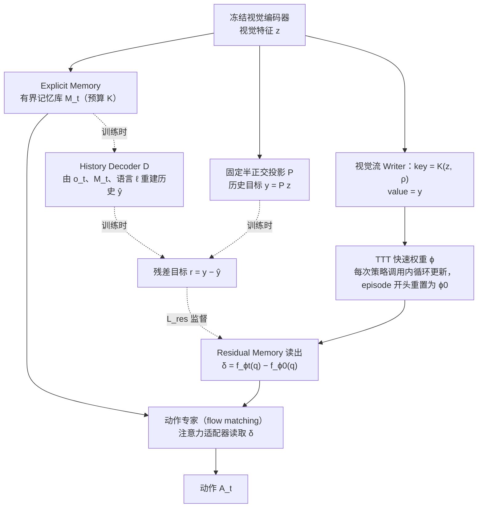

# TTT-RM（arXiv:2610.04701）

**TTT-RM**（*Test-Time Training as Residual Memory for Robot Policies*，[arXiv:2610.04701](https://arxiv.org/abs/2610.04701)，[项目页](https://hatchetproject.github.io/tttrm/)）来自 [具身智能小站 2026-10-13 盘点](../../sources/blogs/wechat_embodied_station_34_papers_mulligan_2026-10-13.md)，属「世界模型与仿真」组。

## 一句话定义

**用历史重建残差监督快速权重，只保存当前上下文解释不了的信息，为有限记忆库补充。**

## 英文缩写速查

| 缩写 | 英文全称 | 简要说明 |
|------|----------|----------|
| TTT | Test-Time Training | 测试时训练 |
| RM | Residual Memory | 残差记忆 |
| Fast weights | Fast Weights | 快速权重 |

## 为什么重要

- 长任务记忆应互补而非无限历史。
- 开源结论：**项目页未列 GitHub**（步骤 2.5，2026-10-14）。项目页入库日未列 GitHub。
- 同期同组工作见 [失败导向采集与可组合世界动作模型：具身智能小站 10-13 期 34 篇阅读坐标](../overview/embodied-station-2026-10-13-34-papers-technology-map.md)。

## 流程总览

图依据：论文 §4 Overview / §4.1–4.3 / Fig. 2（虚线为训练期独有；推理时丢弃 History Decoder）。

## 核心机制

| 项 | 内容 |
|----|------|
| **arXiv** | [2610.04701](https://arxiv.org/abs/2610.04701) |
| **开源** | **项目页未列 GitHub** |
| **要点** | 记忆任务与真机收纳。 |
| **文内指标** | 以原文为准。 |

## 源码运行时序图

**不适用（项目页未列 GitHub）** — 项目页入库日未列 GitHub。 不编造运行脚本；代码公开后再补。

## 实验与评测

- 以原文为准。
- **读法：** 本页为索引级摘要，依据公众号转述的官方摘要与仓库信息整理；逐项数字与 baseline 以原文 PDF 为准。

## 与其他工作对比

- 横向索引见 [失败导向采集与可组合世界动作模型：具身智能小站 10-13 期 34 篇阅读坐标](../overview/embodied-station-2026-10-13-34-papers-technology-map.md)；同 arXiv 不重复造页。

## 结论

**残差式记忆与 IMPRINT 的多流记忆可对照：一个补缺、一个汇流。**

1. 开源边界：**项目页未列 GitHub** — 项目页入库日未列 GitHub。
2. 核心机制：记忆任务与真机收纳。
3. 复现与选型前核对任务协议、硬件与基准口径，勿直接横比公众号摘录数字。

## 关联页面

- [imitation-learning](../methods/imitation-learning.md)
- [paper-imprint-multi-stream-latent-memory](./paper-imprint-multi-stream-latent-memory.md)
- [paper-robottt-test-time-training-vla-context](./paper-robottt-test-time-training-vla-context.md)
- [embodied-station-2026-10-13-34-papers-technology-map](../overview/embodied-station-2026-10-13-34-papers-technology-map.md)

## 参考来源

- [ttt_rm_residual_memory_arxiv_2610_04701.md](../../sources/papers/ttt_rm_residual_memory_arxiv_2610_04701.md)
- [wechat_embodied_station_34_papers_mulligan_2026-10-13.md](../../sources/blogs/wechat_embodied_station_34_papers_mulligan_2026-10-13.md)
- [arXiv:2610.04701](https://arxiv.org/abs/2610.04701)
- [arXiv PDF](https://arxiv.org/pdf/2610.04701)：已通读方法部分（实验与附录以略读为准）：§1 Introduction、§3 Preliminaries、§4 Methodology（§4.1–4.3）

## 推荐继续阅读

- [arXiv PDF](https://arxiv.org/pdf/2610.04701)
- [项目页](https://hatchetproject.github.io/tttrm/)
