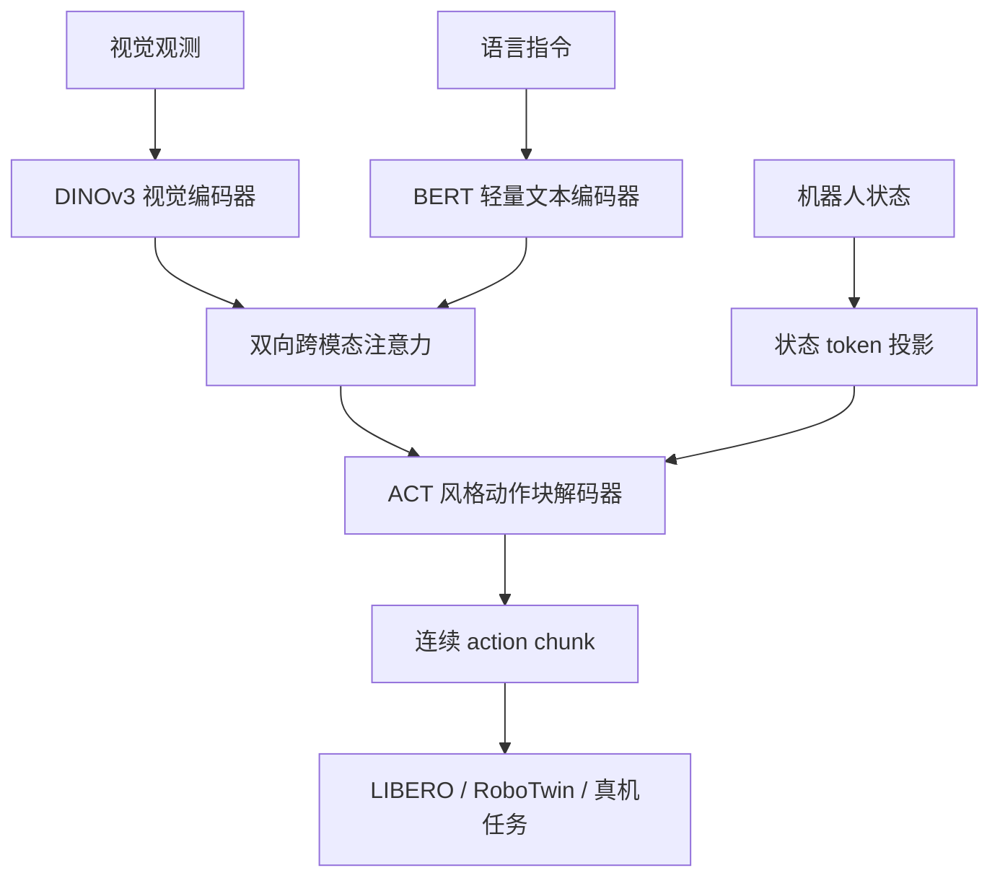
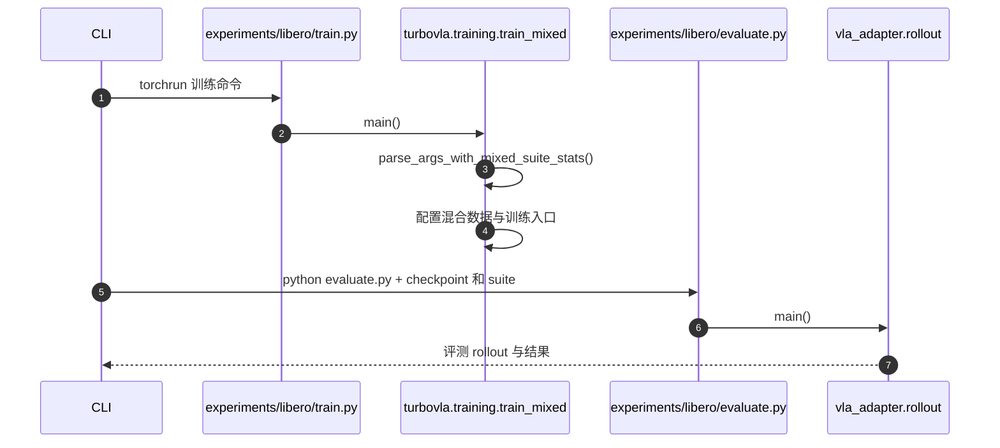

# TurboVLA：轻量双向视觉语言融合的实时动作策略 / Real-Time Vision-Language-Action Model at 32 Hz

## 一句话定义

**TurboVLA** 将典型 VLA 的 V→LLM→A 改成 **视觉特征 + 轻量指令编码 → 双向融合 → 连续动作块**：重点验证**执行层推理**是否可以在消费级 GPU 上足够快，而不依赖每步运行大型语言模型。

## 英文缩写速查

| 缩写 | 英文全称 | 简要说明 |
|---|---|---|
| VLA | Vision-Language-Action | 视觉语言条件动作策略 |
| VLM | Vision-Language Model | 此处对比的重型视觉语言骨干 |
| ACT | Action Chunking with Transformers | 本文动作解码器参考的序列预测结构 |
| VRAM | Video Random-Access Memory | 模型推理显存消耗 |
| OOD | Out-of-Distribution | 未见场景/指令分布，部署评价要区分 |
| BERT | Bidirectional Encoder Representations from Transformers | 本文轻量语义指令编码器 |

## 为什么重要

传统 VLA 强骨干在每次控制 tick 做完整推理，可能出现算力、显存和延迟瓶颈。TurboVLA 重新检查**是否必须让 LLM 在执行层参与动作生成**；其轻量视觉语言双向交互与 ACT 风格输出适合快速对照，但不能替代开放任务的高层规划。

## 核心原理

1. **分模态编码：** 视觉观测用 DINOv3 编码；指令用 BERT 等轻量文本编码；机器人当前状态单独投影为状态 token。
2. **双向交互：** 两类 token 经多层 bidirectional cross-attention，同时生成 language-aware visual features 和 vision-aware language features，而非简单连接字符串或只做单向 cross-attention。
3. **动作预测：** 把融合特征和状态 token 交给 ACT 风格连续 action-chunk decoder。LIBERO 配置 DINOv3 ViT-B + 12 步动作块；RoboTwin 使用不同视觉规模与 50 步 chunk，数值不可混写。

## 流程总览

## 源码运行时序图

官方入口 `experiments/libero/train.py` 与 `experiments/libero/evaluate.py`；二者只是 wrapper，不应直接当作全部训练/仿真逻辑。以下是代码可核实的分派路径。

序列中 `R` 为 wrapper 导入的模块路径；未宣称当前环境已运行训练、模拟器或 GPU。

## 实验与评测

| 配置 | 论文 v3 的数字 | 不可误读为 |
|---|---|---|
| LIBERO 0.2B / RTX 4090 | 平均成功率 **97.6%**；**31.2 ms** 推理；**约 0.9 GiB** 推理显存 | 不含传感器采集、执行通信和机器人控制环全流程 |
| RoboTwin 2.0 0.4B | Clean **88.02%** / Randomized **88.10%**，均值 **88.06%** | 不是同一 LIBERO checkpoint |
| CUDA Graph 消融 | 31.2→11.3 ms；进一步优化为 **7.42 ms** | 不是标准基线延迟，应标注优化条件 |
| 语言消融 | 去除语言 68.5%，语义指令 97.6% | 语言有实际条件作用，不是纯视觉控制 |

## 结论

**TurboVLA 的贡献在于证明轻量语言条件融合可以构成高效的执行层策略，不是推出更强通用任务规划模型。**

1. 使用 31.2 ms 推理时延评估策略计算预算；切勿自动写成整个机器人 32 Hz 闭环。
2. 双向视觉语言交互的消融优于单向/无交互，但只针对论文训练配置。
3. 不同视觉骨干、动作步长与 benchmark 应分开建表比较。
4. 评估真机时额外计入图像编码、通信、action chunk 衔接和低层伺服。
5. 原文承认长程开放指令分解不是当前设计的重点。

## 与其他工作对比

- [InternVLA-A1.5](./paper-internvla-a15-unified-vla.md)：用训练期 latent foresight 改善动作推理；TurboVLA 的主要优化目标是取消 LLM 每步计算。
- [VLA](../methods/vla.md)：对比常见 VLM+动作专家设计。
- [2026 VLA 开源生态](../comparisons/vla-open-source-ecosystem-2026-three-shifts.md)：与分层规划和工程工具区分。

## 工程实践

官方已发布训练/评测脚本、权重、LIBERO/RoboTwin 配置。复现前分别安装匹配的 simulator 环境、DINOv3/BERT 资产、模型 checkpoint 和归一化统计；本仓库仅静态核对官方入口，没有实测成功率。

## 局限与风险

- 面向**执行层操作**，缺少原生开放长程任务规划。
- 论文频率在特定 GPU 和预处理口径下测得，不构成安全实时保证。
- 仿真成功率依赖评测配置，切勿拿其他模型在不同 task suite 的报告值直接横向排名。

## 关联页面

- [VLA](../methods/vla.md)
- [Action Chunking](../methods/action-chunking.md)
- [2026 VLA 项目对比](../comparisons/vla-open-source-ecosystem-2026-three-shifts.md)

## 参考来源

- [TurboVLA 官方论文通读归档](../../sources/papers/turbovla_arxiv_2607_27205_full_reading.md)
- [TurboVLA 官方代码导航](../../sources/repos/turbovla.md)

## 推荐继续阅读

- [arXiv:2607.27205v3](https://arxiv.org/html/2607.27205v3)
- [官方仓库](https://github.com/H-EmbodVis/TurboVLA)
