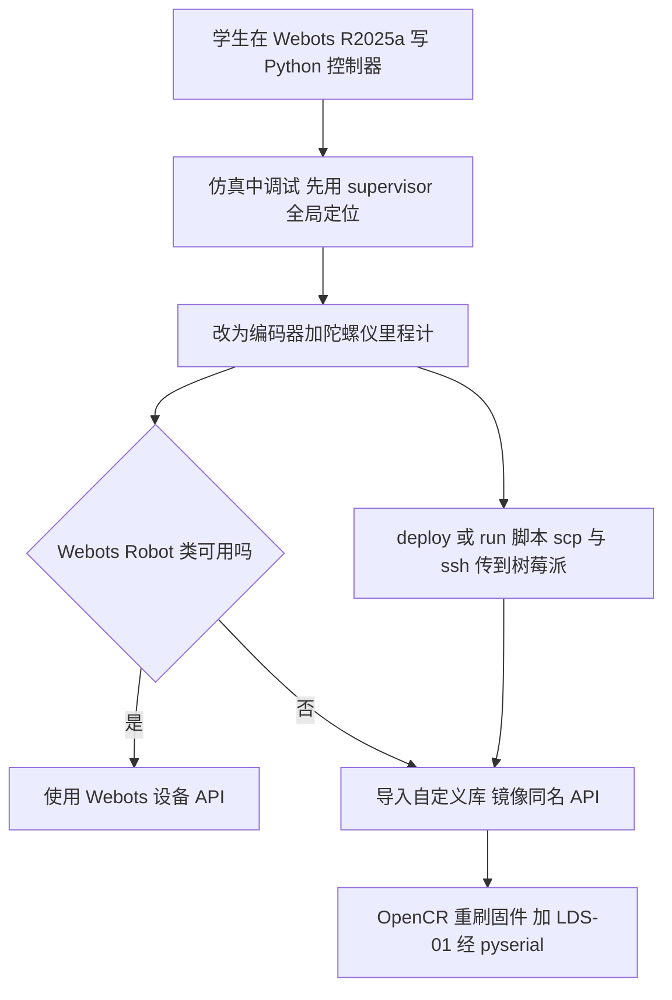

# Educational robotics beyond ROS：TurtleBot3 的 Webots 控制器直接迁移库

**论文：** *Educational robotics beyond ROS: a custom library for direct transfer of Webots controllers in the Turtlebot3*（[arXiv:2611.08142](https://arxiv.org/abs/2611.08142)，Pérez-Moro、Romero、Quintian、Bellas，拉科鲁尼亚大学 CITIC 研究中心）。这是一篇教学实践短文，**不涉及强化学习**：控制逻辑是学生手写的栅格建图、路径规划与里程计导航。

## 一句话定义

**一个模仿 Webots Python API 的 TurtleBot3 Burger 驱动库加三条部署脚本，让同一份控制器在 Webots 与真机上都能运行，学生无需学 ROS；证据来自 6 名学生的一学期课程。**

## 英文缩写速查

| 缩写 | 英文全称 | 简要说明 |
|------|----------|----------|
| ROS | Robot Operating System | 机器人中间件，论文视其为高校课程标配但对新手有门槛 |
| TB3 | TurtleBot3 Burger | 教学用差速轮式机器人，Raspberry Pi 3 加 OpenCR 1.0 |
| OpenCR | Open-source Control module for ROS | TB3 的控制板，内置 IMU，出厂固件面向 ROS，论文重刷 |
| IMU | Inertial Measurement Unit | 惯性测量单元（加速度计与陀螺仪） |
| LiDAR / LDS-01 | Light Detection and Ranging | TB3 自带的二维激光雷达 |
| ODE | Open Dynamics Engine | Webots 使用的物理引擎（§2.1） |
| UDC | Universidade da Coruña | 论文作者所在大学 |
| 通读 | -- | 本站健康度字段，见 [原文归档](../../sources/papers/turtlebot3-webots-noros-library_arxiv_2611_08142.md) |

## 为什么重要

- **作者自述的问题（摘要、§1）：** AI 方向硕士生中计算机背景弱者增多，ROS 的安装与分布式编程模型成为入门门槛；TB3 在该校属于 ROS 专用平台，课时与机构支持也不允许普遍装 Linux 或虚拟机。
- **作者的做法：** 不替换 ROS，而是给「重点是自主机器人算法而非中间件配置」的课程一条更简单的教学路径（§4）。
- **对本站的价值（我的判断）：** 它是 sim2real 的最朴素形态——不做域随机化或系统辨识，只把仿真器与真机的软件接口对齐，使控制代码零改动搬运。它说明「接口层一致」与「动力学一致」是两件事，前者很便宜，后者论文没有量化（见局限）。

## 核心原理

### 方法栈

| 层 | 设计（出处 §2.2） |
|----|------|
| 控制器 | 开头一段检测 Webots `Robot` 类是否可用，不可用则导入自定义库 |
| 库 API | `Robot` 入口加 `step(timestep)` 模拟仿真时间步；`Motor`、`PositionSensor`、`Accelerometer`、`Gyro`、`InertialUnit`、`Lidar` 同名同返回值；编码器计数转弧度与 Webots 一致 |
| 通信 | 树莓派用 pyserial 经串口与 OpenCR 通信；LiDAR 经 USB2LDS 板，单独线程读取 |
| 固件 | OpenCR 用 Arduino IDE 与 Dynamixel2Arduino 重刷，主循环响应「设轮速」「读编码器」，并暴露 IMU 原始数据与 roll / pitch / yaw |
| 部署 | `deploy` / `run` / `clean`，基于 scp 与 ssh，Linux 与 Windows 通用 |

### 流程总览

## 工程实践

- **设备覆盖（§2.2、§4）：** 轮电机与编码器、IMU、LiDAR；不含相机。新增串口 / USB 设备理论上只需新增镜像类，RGB-D 相机需另辟采集路径（作者自述，未验证）。
- **软件栈（§2.2）：** 学生端 Webots R2025a；树莓派 Ubuntu Server 22.04 LTS、Python 3.10、pyserial 3.5；Arduino IDE 2.3、Dynamixel2Arduino 0.8.1。
- **分项验证（§2.3）：** 编码器前进 25 cm、陀螺仪左转 90 度、前进到 LiDAR 目标读数，仿真与真机「接近且高度可重复」。
- **综合演示（§2.3）：** 前进 25 cm、左转 45 度、LiDAR 20 cm 内遇障转 90 度；同一代码在真机「无任何修改」运行，论文称序列被可靠复现。
- **课程任务（§3）：** 6×10 格、每格 40×40 cm 的栅格场地，3 个仿真环境加 1 个真实环境；先用 supervisor 全局定位调试，最终用编码器与陀螺仪里程计；二值占据栅格，LiDAR 在每格中心停车后读取；建图后在静态环境中规划最短路径并导航。
- **学生反馈（§3）：** Table 1 为 5 条开放回答，主旨是不必处理节点、消息、包等 ROS 概念，且便于用 NumPy 与优先队列；Fig. 4 一道评分题平均 4.83（据图读出 5 票 Level 5、1 票 Level 4）。
- **未核实：** 仓库 README、脚本与库源码本次未能访问，实际 API 覆盖度与文档质量以仓库为准。

## 评测与结果

这是一篇教学实践短文，**没有定量的 sim-to-real 评测、没有对照组、没有统计检验**。论文给出的证据只有三类：

| 证据 | 内容 | 出处 |
|------|------|------|
| 分项操作验证 | 编码器前进 25 cm、陀螺仪左转 90 度、前进到 LiDAR 目标读数，各做一次；仅称仿真与真机「接近且高度可重复」，无数值误差与重复次数，并声明目的不是刻画传感器误差 | §2.3 |
| 综合演示 | 前进 25 cm、左转 45 度、LiDAR 20 cm 内遇障转 90 度；同一代码零修改在真机运行，称序列被可靠复现（定性，附视频） | §2.3 |
| 课程问卷 | 6 名学生；Table 1 为 5 条开放回答；Fig. 4 一道评分题平均 4.83（5 票 Level 5、1 票 Level 4） | §3 |

## 结论

**这个库证明的是「软件接口对齐」可以很便宜地做到，让教学用控制器在 Webots 与 TurtleBot3 真机间搬运；它没有提供任何关于动力学或传感器差距的量化证据，也没有教学成效的对照数据。**

1. **真正要看的是接口覆盖度**：目前只镜像轮电机与编码器、IMU、LiDAR（§4）；课程若需要相机，需要另做采集路径。
2. **「零修改」要按任务读**：综合演示零修改，但课程任务从 supervisor 全局定位换到里程计仍需改实现（§3），两处表述不完全一致。
3. **次要成本**：需用 Arduino IDE 重刷 OpenCR 固件（出厂固件面向 ROS）；部署依赖 scp / ssh 与树莓派环境（§2.2）。
4. **问卷不等于学习成效**：6 人、无对照、学生已有基础 ROS 知识，4.83 分只说明满意度。
5. **适用场景**：以算法（建图、规划、里程计）为重点、课时不允许装 ROS 的入门课程；需要多机通信、动态环境或与 ROS 生态对接时不适用。

## 与其他工作对比

| 对照 | 差异读法 |
|------|----------|
| 标准 ROS 课程路径（见 [ROS 2 基础](../concepts/ros2-basics.md)） | TB3 出厂即面向 ROS，学生需理解节点、消息、包等概念；本文用镜像 Webots API 的 Python 库加重刷固件绕开中间件，作者明说不取代 ROS（§4） |
| 物理层 sim2real 方法（见 [Sim2Real](../concepts/sim2real.md)、[物理保真度与 sim2real 差距](../concepts/physics-fidelity-sim2real-gap.md)） | 域随机化、系统辨识等方法缩小动力学差距；本文只对齐软件接口，动力学一致性未量化（本 wiki 判断） |
| 其他仿真器 | 选 Webots 的理由是开源、ODE、多语言控制器与内置 TB3 模型（§2.1）；运动仿真精度对比只引用 Farley 等人 [10]，本文未自做比较 |

## 局限

**论文自己承认的：**

- 只覆盖课程所需设备，高带宽传感器（RGB-D 相机）需另做（§4）。
- 分项验证「目的不是刻画传感器误差」（§2.3）。
- 目的不是取代 ROS（§4）；作者在 §3 末尾也说学生满意真机是「并非主要目标的」附带发现。

**我看到的未验证之处：**

- **样本极小且无对照：** 6 名学生、一个学年、一个课程；没有使用 ROS 或只用仿真的对照组，问卷是满意度而非学习成效，也未给出题目总数与回收情况。Table 1 仅 5 条回答，且学生有基础 ROS 知识（表注），所谓「相对 ROS 的优势」是主观对比而非实际用 ROS 完成同一任务。
- **「直接迁移」要打折读：** §2.3 的综合演示称代码零修改；但 §3 任务清单最后一条写「转到真机需要调整实现，使其使用真实机器人接口而非 Webots 仿真设备」，两处并不完全一致。我推测指的是 supervisor 全局定位须换成里程计，以及导入替换，但论文未展开。
- **没有量化的 sim-to-real 差距：** 分项检查无任何数值误差、重复次数或统计；综合演示只有定性结论与一段视频（本次未观看）。里程计漂移、轮打滑、LiDAR 噪声等是否被 Webots 模型捕获，论文没有数据。
- **验证场景偏简单：** 栅格化、停车扫描、静态环境、每格 40 cm，对动态障碍或连续运动控制的迁移性不能外推。
- **效率与实时性未报告：** 如 `step` 在真机上如何对齐控制周期、串口延迟，论文只说「时间间隔一致」，无测量。

## 关联页面

- [TurtleBot3](../entities/turtlebot3.md)：本文使用的教学机器人
- [Webots](../entities/webots.md)：本文使用的仿真器
- [Sim2Real](../concepts/sim2real.md)：本文是接口层面的最简迁移案例
- [物理保真度与 sim2real 差距](../concepts/physics-fidelity-sim2real-gap.md)：本文未量化的那一部分
- [ROS 2 基础](../concepts/ros2-basics.md)：论文要绕开的中间件背景

## 参考来源

- [原文归档与通读记录](../../sources/papers/turtlebot3-webots-noros-library_arxiv_2611_08142.md)
- [arXiv:2611.08142](https://arxiv.org/abs/2611.08142)
- 代码：[jpperezm/TurtleBot3-NoROS-Library](https://github.com/jpperezm/TurtleBot3-NoROS-Library)（未核实）

## 推荐继续阅读

- [Sim2Real 概念页](../concepts/sim2real.md)
- [TurtleBot3 实体页](../entities/turtlebot3.md)
- [arXiv PDF](https://arxiv.org/pdf/2611.08142v1)
