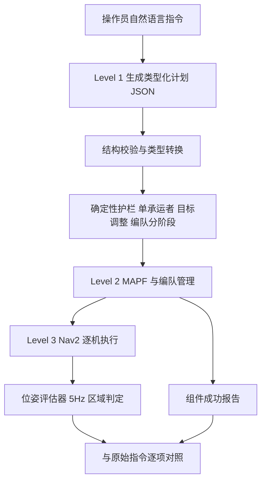

# Correctness Boundaries of Typed Plans（arXiv:2611.12654）

**Correctness Boundaries of Typed Plans for Natural-Language Robot Fleet Control**（[arXiv:2611.12654](https://arxiv.org/abs/2611.12654)，Innopolis University，v1 2026-11-09）是一篇仿真案例研究：把操作员的自然语言指令追踪过「类型化计划 → 确定性修正 → 车队协调 → 完成检查」，看每一层的通过 / 成功报告究竟覆盖原指令的哪些要求。

## 一句话定义

**这是一篇关于「检查器能证明什么」的案例研究，而不是提出更强控制器的论文：结构合规、局部成功报告、位姿评估器完成，三者都不等于原始指令被满足（第 3、9、11 节）。**

## 英文缩写速查

| 缩写 | 英文全称 | 简要说明 |
|------|----------|----------|
| LLM | Large Language Model | 把指令转成计划的语言模型 |
| MAPF | Multi-Agent Path Finding | 多智能体路径规划，论文用 LNS2 / PBS 后端 |
| LNS2 | MAPF-LNS2 | 大邻域搜索的 MAPF 修复算法，论文仿真使用它 |
| PBS | Priority-Based Search | 基于优先级的 MAPF 搜索，实现了但仿真未用 |
| ROS 2 | Robot Operating System 2 | 机器人中间件，论文用 Humble |
| Nav2 | Navigation 2 | 每台机器人一套的导航栈 |
| E1 / E2 | Experiment 1 / 2 | 离线计划验证基准 / 仿真任务完成 |
| M2 / M3 / M4 | Mission 2 / 3 / 4 | 5 任务、9 任务、编队定性案例 |

## 为什么重要

- 多机器人 LLM 系统常把「JSON 过 schema」「规划器说到了」「评估器判完成」当作成功信号；本文用保存的计划与日志展示三者各自漏掉了什么（第 8 节）。
- 提出的实践建议：分开报告请求、已规划、被跳过、已到达的机器人集合，并保留有效目标与允许调整目标的任务区域（第 9 节）。作者明确说这些案例只是动机，不证明护栏的因果效果。

## 核心原理与流程总览

三层结构（第 3–6 节）：Level 1 语言编排（类型化递归计划 + 确定性接口检查），Level 2 车队协调（LNS2 / PBS、编队管理、行为树执行器），Level 3 每机器人 Nav2 执行（20 套，Stage 仿真，AMCL 关闭，位姿来自仿真器）。

- 计划文法：叶子 mapf / formation / disband / idle，容器 sequence / parallel（第 4 节）。
- 评估器：访问任务 1.5 m 内一次采样即完成；搬运任务要求同一机器人先后在取货区、卸货区出现，物理装卸不在度量内（第 5 节）。
- 论文的四类问题：结构有效、任务含义、几何可行、评估器完成（第 3 节，表 1）。

## 关键结果（论文自述，均为仿真）

| 项 | 数值 | 出处 |
|----|------|------|
| E1 基准 | 44 例，12 类，每例 5 次，温度 0.1 | 第 7.1 节 |
| 本地无 schema 通过率 | 70.0%（Qwen3.5-4B）至 87.3%（Qwen3.5-9B） | 表 3 |
| 本地 Qwen3.5-9B 开 schema | 19.1%（无 schema 为 87.3%） | 第 8.4.1 节 |
| 托管 Qwen3.5-397B-A17B | 无 schema 93.2%，有 schema 95.0% | 表 3 |
| E2 选定运行 | 18 次全部满足位姿条件 | 第 8.5 节，表 5 |
| 任务区间均值 | no-LLM 203.5、model-9b 252.2、B/M2 260.0、B-M3 587.7 仿真秒 | 表 5 |
| 共享卸货点 | 守卫前 2 次均 8/9，守卫后 3 次均 9/9，不能隔离守卫效应 | 第 8.1 节 |
| 本地无 schema 失败 | 259/1100 条，编队字段或分阶段最多 82 | 表 4 |

案例（第 8 节）：三个保存的计划给已分配的取货点多派一台机器人；一次重复列队请求生成偏移 x=[0,0,0]、y=[1.5,-1.5,3.0]（横排，约 4.5 m 跨度）并通过结构校验，随后 LNS2 在足迹近似下判无静态路径；M4 运行 20260818_140918 中 MAPF 报 All agents arrived，而 robot 0 仍在原位，原因是重规划把它移出了到达检查集合。

## 与其他工作对比

| 工作 | 关注点 | 与本文的区别 |
|------|--------|--------------|
| 本文类型化计划车队控制 | 语言 → 类型化递归计划 → MAPF / 编队 → 20 台 Nav2，并逐层核对成功信号 | 重点是揭示 schema、规划器、评估器各自漏掉的失败，而非提出新规划方法 |
| [Natural-Language to Nav2](./paper-natural-language-to-nav2.md) | 自然语言转为经确定性检查的导航策略，投影成禁行区与代价层 | 单机导航约束；本文面向多机车队与编队，且着重成功信号的覆盖范围 |
| [SayCan](./paper-saycan.md) | LLM 规划与技能可行性打分结合 | 单机技能选择；本文用类型化 JSON 计划 + 确定性护栏，不用可供性打分 |

## 结论

**本文用一个 20 台仿真机器人的 LLM 车队系统说明：JSON 过 schema、规划器报到达、评估器判完成，三种成功信号各自只覆盖计划的一部分，必须分开报告。**

1. E1 结构通过率从本地 Qwen3.5-4B 的 70.0% 到托管 397B 的 95.0%，且本地 9B 开 schema 反而降到 19.1%（表 3、第 8.4.1 节）。
2. 结构有效的计划仍可能语义错误或几何不可行，例如列队偏移横排导致 LNS2 判无静态路径（第 8.2 节）。
3. MAPF 报「All agents arrived」时仍可能有机器人原地未动，因为重规划把它移出了到达检查集合（第 8 节 M4）。
4. 局限：全部为单地图仿真、选定运行（含替换重跑），版本与模型路由不一致，无法估计失败频率或证明护栏的因果效果（第 10 节）。

## 工程实践

- 复现入口：仓库 README 给出 Docker compose 与 `ros2 launch iros_llm_swarm_bringup swarm_lns.launch.py`，LLM 端点用 `llm_endpoint` 参数选择，场景含 `amongus`（静态读 README，未运行）。
- 本地扫描用 Ollama、16 GB RTX 5060 Ti、32,768 上下文、2,048 输出上限；托管用 OpenRouter、8,192 输出上限（第 7.1 节）。
- 论文建议的记录方式：每个校验结果与成功报告都标注其覆盖的计划、机器人集合、目标或任务条件（第 11 节）。
- 数据：论文称 paper/results 与 135 MB 公共归档可重分析；两条被替换运行的 bag 缺失（第 7.2 节）。本文未下载核对。

## 与文章说法的核对

文章（公众号《机器人动作块太长，什么时候该重新规划？》第 22 条）说法逐条对照：

| 文章说法 | 核对 |
|----------|------|
| 把语言指令转成类型化计划 | 属实（第 4 节），但这是系统描述，不是新方法贡献 |
| 保留修正、执行与结果证据链 | 基本属实：论文用保存的计划、日志与任务状态追踪；但作者自述历史运行有未提交改动、2 条运行 bag 缺失（第 7.2、10 节） |
| 多机器人仿真揭示检查器能力边界 | 属实，且是仿真（20 台 Stage 机器人），无真机 |
| 格式合规不能替代意图正确 | 属实，对应列队偏移案例（第 8.2 节）；注意是个别案例，论文说不估计频率（第 10 节） |
| 抵达区域不代表完成真实搬运 | 属实，评估器只记区域在场，物理装卸不在度量内（第 5、10 节） |
| 标题式「类型正确还不够」 | 可接受概括，但论文未做对照实验证明某种修复有效：「导致原因」留空（第 9 节） |

文章未提的限定：18 次全成功是选定样本，含 2 次替换重跑，不能当作成功率（第 7.2 节）；E1 无配对执行结果，通过率不能推出任务完成率（第 9 节）。文章标题里「动作块太长/重新规划」与本文主题（语言计划校验）不是同一问题，论文中没有动作块长度（action chunk）的实验，推测是文章栏目标题。

## 局限

论文自述：
- 仿真只覆盖一张 Stage 地图、两个主任务和选定运行；M3 前后对照软件版本与服务商路由都不同，无法隔离守卫效应（第 10 节）。
- 评估器不度量物理搬运、碰撞安全或峰值并发；M4 观察只是个案（第 10 节）。
- 模型快照与完整服务配置不可得；各配置模型、栈、预算不同（第 7.1、10 节）。

本文判断（未验证之处）：
- 全部为仿真，无真机、无人类操作员评估；作者为本科生团队为主，单机构，无第三方复现。
- 选择依赖结果（B/M2 替换），论文已披露，但样本仍不适合统计推断。
- 论文声明使用 AI 辅助编写代码与稿件（Statements 节），作者称已审阅。
- 数据归档与代码仓库内容本次未下载核对；图 1–3 只读了图注。

## 关联页面

- [LLM 机器人控制接口](../concepts/llm-robotics-control-interfaces.md)
- [行为树与 VLA 编排](../concepts/behavior-tree-vla-orchestration.md)
- [ROS 2 基础](../concepts/ros2-basics.md)
- [多机器人协同（人形）](../concepts/humanoid-multi-robot-coordination.md)
- [机器人安全状态机](../concepts/robot-safety-state-machine.md)
- [移动机器人导航规划方法对比](../comparisons/mobile-robot-navigation-planning-methods.md)
- [自然语言到 Nav2](./paper-natural-language-to-nav2.md)

## 参考来源

- [论文归档 typed-plans-fleet-control_arxiv_2611_12654](../../sources/papers/typed-plans-fleet-control_arxiv_2611_12654.md)
- arXiv：<https://arxiv.org/abs/2611.12654>
- 代码：<https://github.com/Innopolis-Robotics-Society/llm_swarm>
- 项目页（Sphinx 文档站）：<https://innopolis-robotics-society.github.io/llm_swarm/>

## 继续阅读

- 论文引用的对照工作：SayCan、Code as Policies、Inner Monologue、LLM-Modulo、CommandSwarm（arXiv:2605.07764）等，见论文第 2 节。
- 机器人侧 LLM 接口的整体脉络见 [LLM 机器人控制接口](../concepts/llm-robotics-control-interfaces.md)。
