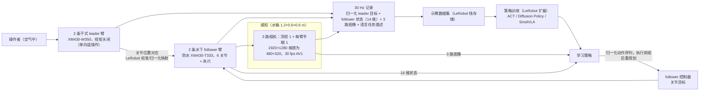

# ULOHA（arXiv:2609.19200）

**ULOHA**（*An Underwater Bimanual Robot System for Robot Learning*，[arXiv:2609.19200](https://arxiv.org/abs/2609.19200)，[项目页](https://mertcookimg.github.io/uloha/)）来自 [具身智能小站 10 篇盘点](../../sources/blogs/wechat_embodied_station_10_papers_contact_wm_2026-09-18.md)（策展档位：**扫读**）。

## 一句话定义

**水下双臂 dry leader + 三相机 + LeRobot；评测 ACT / Diffusion / SmolVLA 在 9 任务；观察气泡与浮力对 IL 影响。**

## 英文缩写速查

| 缩写 | 英文全称 | 简要说明 |
|------|----------|----------|
| WAM | World-Action Model | 联合预测未来观测与动作的策略 |
| VLA | Vision-Language-Action | 视觉–语言–动作策略 |
| SR | Success Rate | 任务成功率 |
| IL | Imitation Learning | 模仿学习 |
| GS | Gaussian Splatting | 高斯溅射三维表示 |

## 为什么重要

- 公众号将本文归入「接触时视觉之外还需预测什么」专题；扫读档位。
- **大阪大学（Osaka University）；神户大学（Kobe University）**；开源结论：**待发布**（步骤 2.5，2026-09-18）。
- 与 tactile/WAM、主动视角、多智能体场景理解、Sim2Real、人形导航等主线交叉。

## 流程总览

图依据：论文 §III-A–D 与 Fig. 1–3（系统概览、硬件、感知与数据采集、遥操作与模仿学习）

## 核心机制

| 项 | 内容 |
|----|------|
| **arXiv** | [2609.19200](https://arxiv.org/abs/2609.19200) |
| **开源** | **待发布** |
| **策展摘要** | 水下双臂 dry leader + 三相机 + LeRobot；评测 ACT / Diffusion / SmolVLA 在 9 任务；观察气泡与浮力对 IL 影响。 |

## 源码运行时序图

**不适用**（截至 2026-09-18 项目页/arXiv 未发布可运行官方代码）。

## 实验与评测

- 定量指标与 baseline 协议以 arXiv PDF 与项目页为准；本页为清单级摘要。
- 读法：先确认任务设定（仿真/真机、传感器、成功定义）再对比 SR/延迟/路径长度等 headline 数字。

## 与其他工作对比

> 本页为清单级摘要，下表只做**定位对照**：ULOHA 9 任务上的 ACT / Diffusion / SmolVLA 结果与下列各页不共享任务与传感器设定，不可横比。

| 对照 | 差异读法 |
|------|----------|
| [SmolVLA ONNX / LIBERO](./paper-smolvla-onnx-libero.md) | 同为跑 SmolVLA，问题相反：那页问「同一策略怎么压到端侧跑得动」，ULOHA 问「换成有气泡、有浮力的介质，同一批 IL 基线还剩多少」。前者变算力，后者变物理环境 |
| [LeRobot](./lerobot.md) | ULOHA 把水下双臂接进 LeRobot 数据/训练栈，本身不新增算法；读它主要读**平台与采集形态**（dry leader + 三相机），不是新策略 |
| [模仿学习](../methods/imitation-learning.md) | 该页归纳 IL 方法族；ULOHA 是「换介质做压力测试」的一份实证，与陆上 ACT/Diffusion 论文的差别在**扰动来源**（气泡遮挡、浮力漂移）而非网络结构 |
| [10 篇技术地图](../overview/contact-wm-10-papers-technology-map.md) | 同批次横向对照入口：本文列 **扫读** 档位，按「系统/平台」类读，而非方法创新 |

## 结论

**ULOHA 代表「扫读」档位的 underwater 方向样本——部署前以开源状态与评测协议为准绳。**

1. 开源状态：**待发布**；勿凭 PDF 臆断可复现性。
2. 与同专辑 [Agile-WAM](./paper-agile-wam.md) / [INSPECT](./paper-inspect-view-selection.md) 等形成「触觉 WAM → 主动视角 → 系统平台」阅读链。
3. 若做工程选型，先对齐传感器栈与任务是否匹配文内设定。
4. 关注项目页/arXiv 版本更新与代码发布。

## 关联页面

- [imitation-learning](../methods/imitation-learning.md)
- ./lerobot.md
- ./paper-smolvla-onnx-libero.md
- [manipulation](../tasks/manipulation.md)
- [10 篇技术地图](../overview/contact-wm-10-papers-technology-map.md)

## 参考来源

- [uloha_arxiv_2609_19200.md](../../sources/papers/uloha_arxiv_2609_19200.md)
- [wechat_embodied_station_10_papers_contact_wm_2026-09-18.md](../../sources/blogs/wechat_embodied_station_10_papers_contact_wm_2026-09-18.md)
- [arXiv:2609.19200](https://arxiv.org/abs/2609.19200)
- [arXiv PDF](https://arxiv.org/pdf/2609.19200)：已通读方法部分（实验与附录以略读为准）：摘要、§I 引言、§III 系统（A–D）（§IV 实验以略读为准）

## 推荐继续阅读

- [arXiv PDF](https://arxiv.org/pdf/2609.19200)
