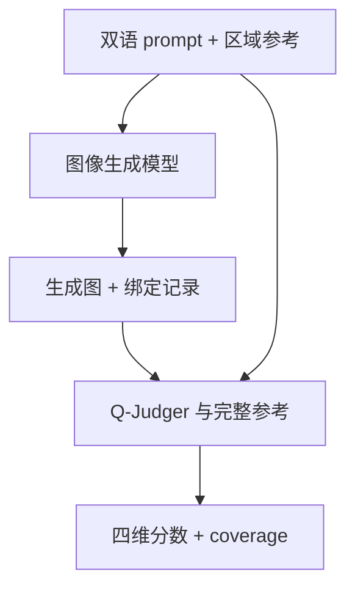
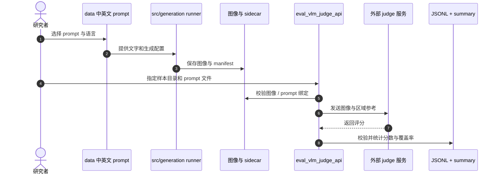

# UltraText Bench：图像生成中的双语视觉文本评测

UltraText Bench 测试模型能否在整张图中准确呈现中英文密集文本，而不是只生成漂亮但内容错误的标题。

## 英文缩写速查

| 缩写 | 英文全称 | 简要说明 |
|------|----------|----------|
| T2I | Text-to-Image | 从文本提示生成图像 |
| GT | Ground Truth | 区域目标字符串、位置与属性参考 |
| VLM | Vision-Language Model | 按 rubric 读取图像并评分的评委 |
| OCR | Optical Character Recognition | 读取图片文字的技术，不等于布局评分 |

## 为什么重要

图像模型可能把字画得清晰，却写错字符、漏掉次要区域或错放载体。整体美感和少量 OCR 字符分数不能表示整场景成功；该基准把内容、空间与场景属性分开评估。

## 方法栈与评测协议

432 个 prompt 覆盖 24 类场景、3 档难度，中英文各半，共 2,926 个文本区域；区域有目标文本、位置、角色、载体等参考。Q-Judger 收到完整图像和结构化参考后，输出六项评分并聚合成四维质量指标。

Composite = 0.60 × Fidelity + 0.30 × Clarity + 0.05 × Spatial + 0.05 × Scene。质量均值需与 coverage 同报；缺图或 judge 失败应计入覆盖失败而非静默删除。

## 源码运行时序图

仓库提供数据核验、生成 runner 与 Q-Judger 客户端，judge 服务和生成权重须另行配置。

离线检查入口为 `python scripts/rebuild_audit_snapshots.py --check` 与 `python -m unittest discover -s tests -v`。完整排行榜复现需提供兼容 judge API 和对应模型。

## 评测与结果

论文比较 24 组模型配置，GPT Image 2 [Low] 综合分 99.35，开放权重组 Boogu-Image-0.1-Base 为 77.89。Qwen-Image-2512 英文综合从 L1 86.50 降到 L3 42.86；Z-Image-Turbo clarity 74.41、fidelity 40.75，显示可读不等于内容忠实。以上是论文结果，不是本次执行代码所得。

## 结论

**密集文本生成必须分别测内容正确、字符可读、位置布局和场景融合。**

1. 用完整区域级参考，不要只看主标题或局部 OCR。
2. 质量均值与 coverage 同时汇报，说明失败请求如何处理。
3. 按语言、难度、场景和模型类型分层，避免总体均值掩盖退化。
4. 报告 Fidelity 与加权总分，避免权重让内容错误被清晰度补偿。
5. 固定模型、judge checkpoint、提示、采样参数和上下文预算。
6. 开放评估客户端不代表排行榜图像档案和 judge 权重已完整开放。

## 与其他工作对比

[Kandinsky 6.0 Video](./paper-kandinsky-6-video.md) 是音视频生成系统，UltraText 是图像文本 benchmark，任务指标不能互换。[扩散模型](../concepts/diffusion-model.md)提供共同生成建模背景。

## 工程实践

保留 prompt、生成图、sidecar、manifest 和模型版本；先跑少量样本做生成/评分 smoke test。对中文长文本、小字体和多区域分别做切片统计，并为 API 失败和缺图报告 coverage。

## 局限与风险

Q-Judger 可能存在读取和 rubric 偏差；人工评测参与者为 10 人。全量图像档案与 judge checkpoint 未随仓库提供。L1/L2/L3 是不同 prompt 组，不是同场景严格控变量的递进版本。

## 关联页面

- [Kandinsky 6.0 Video](./paper-kandinsky-6-video.md) — 多模态生成模型
- [扩散模型](../concepts/diffusion-model.md) — 图像生成基础
- [具身大模型评测基准选型闭环](../queries/embodied-eval-benchmark-selection-loop.md) — 视觉文本生成评测可作①认知层/生成质量的参照，不直接衡量机器人任务成功率

## 参考来源

- [论文摘录](../../sources/papers/ultratext_bench_arxiv_2610_09823.md)
- [项目页归档](../../sources/sites/ultratext-bench.md)
- [仓库归档](../../sources/repos/ultratext-bench.md)
- [arXiv:2610.09823v1](https://arxiv.org/abs/2610.09823v1)

## 推荐继续阅读

- [UltraText Bench 项目页](https://lins-lab.github.io/UltraText_Bench/)
- [LINs-lab/UltraText_Bench](https://github.com/LINs-lab/UltraText_Bench)
