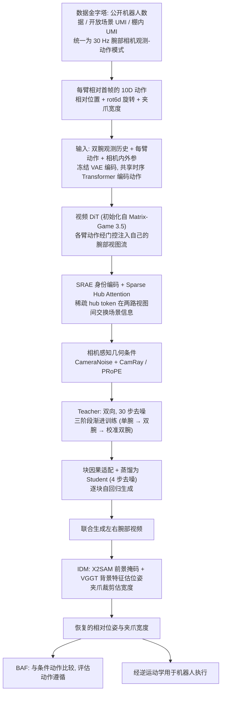

# UMI-WM（arXiv:2610.23913）

**UMI-WM**（*UMI-WM: Interactive World Modeling for Bimanual Manipulation from Wrist Cameras*，[arXiv:2610.23913](https://arxiv.org/abs/2610.23913)，[项目页](https://www.lv-lab.org/umi-wm/)）来自 [具身智能小站 2026-11-01 盘点](../../sources/blogs/wechat_embodied_station_56_papers_libero_dynamic_latency_eval_2026-11-01.md)，属「世界模型与在线适配」组。

## 一句话定义

**UMI-WM分别注入左右手动作，再用共享信息令牌协调双腕画面；以逆动力学评估动作跟随，蒸馏减少生成步骤，但视频逼真和动作可靠仍需分开看。**

## 英文缩写速查

| 缩写 | 英文全称 | 简要说明 |
|------|----------|----------|
| UMI-WM | UMI-WM: Interactive World Modeling for Bimanual Manipulation from Wrist Cameras | 本文方法 / 基准的简称 |
| UMI | Universal Manipulation Interface | 手持通用操作采集接口 |

## 为什么重要

- 双腕世界模型，要让两只手看到同一场景。
- 开源结论：**项目页未列 GitHub**（步骤 2.5，2026-11-01）。项目页 HTTP 200，未见 GitHub 链接或 coming soon 字样。
- 同期同组工作见 [动态评测、技能编译与环境潜变量适配：具身智能小站 11-01 期 56 篇阅读坐标](../overview/embodied-station-2026-11-01-56-papers-technology-map.md)。

## 流程总览

图依据：论文 §3.2、§4.1-4.3 / Fig.4 / 附录 B.3

## 核心机制

| 项 | 内容 |
|----|------|
| **arXiv** | [2610.23913](https://arxiv.org/abs/2610.23913) |
| **开源** | **项目页未列 GitHub** |
| **要点** | UMI-WM分别注入左右手动作，再用共享信息令牌协调双腕画面；以逆动力学评估动作跟随，蒸馏减少生成步骤，但视频逼真和动作可靠仍需分开看。 |
| **文内指标** | 公众号未给具体数字，本页不引用。 |

## 源码运行时序图

**不适用（项目页未列 GitHub）** — 项目页 HTTP 200，未见 GitHub 链接或 coming soon 字样。 不编造运行脚本；代码公开后再补。

## 实验与评测

- 公众号未给具体数字，本页不引用。
- **读法：** 本页为索引级摘要，依据公众号转述的官方摘要与仓库信息整理；逐项数字与 baseline 以原文 PDF 为准。

## 与其他工作对比

- 横向索引见 [动态评测、技能编译与环境潜变量适配：具身智能小站 11-01 期 56 篇阅读坐标](../overview/embodied-station-2026-11-01-56-papers-technology-map.md)；同 arXiv 不重复造页。

## 结论

**双腕世界模型，要让两只手看到同一场景：UMI-WM分别注入左右手动作，再用共享信息令牌协调双腕画面；以逆动力学评估动作跟随，蒸馏减少生成步骤，但视频逼真和动作可靠仍需分开看。**

1. 开源边界：**项目页未列 GitHub** — 项目页 HTTP 200，未见 GitHub 链接或 coming soon 字样。
2. 核心机制：UMI-WM分别注入左右手动作，再用共享信息令牌协调双腕画面；以逆动力学评估动作跟随，蒸馏减少生成步骤，但视频逼真和动作可靠仍需分开看。
3. 复现与选型前核对任务协议、硬件与基准口径，勿直接横比公众号摘录数字。

## 关联页面

- [world-action-models](../concepts/world-action-models.md)
- [generative-world-models](../methods/generative-world-models.md)
- [vla](../methods/vla.md)
- [bimanual-manipulation](../tasks/bimanual-manipulation.md)
- [embodied-station-2026-11-01-56-papers-technology-map](../overview/embodied-station-2026-11-01-56-papers-technology-map.md)

## 参考来源

- [umi_wm_arxiv_2610_23913.md](../../sources/papers/umi_wm_arxiv_2610_23913.md)
- [wechat_embodied_station_56_papers_libero_dynamic_latency_eval_2026-11-01.md](../../sources/blogs/wechat_embodied_station_56_papers_libero_dynamic_latency_eval_2026-11-01.md)
- [arXiv:2610.23913](https://arxiv.org/abs/2610.23913)
- [arXiv PDF](https://arxiv.org/pdf/2610.23913)：已通读全文：§3 数据与处理流水线，§4 UMI-WM 动作条件、多视图建模与因果生成、IDM 与 BAF，§5 实验设置，附录 B.3 训练与蒸馏

## 推荐继续阅读

- [arXiv PDF](https://arxiv.org/pdf/2610.23913)
- [项目页](https://www.lv-lab.org/umi-wm/)
