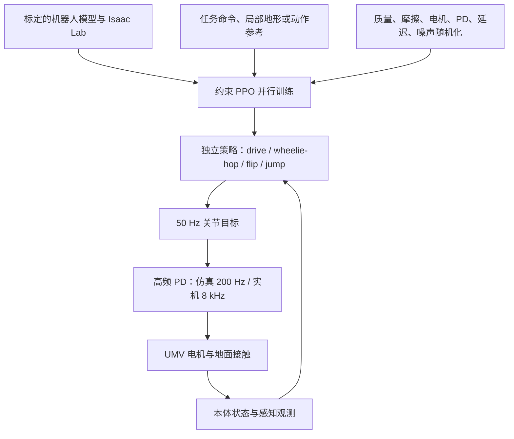

# UMV：用自行车底盘做动态平衡、跳跃与翻转

**Ultra Mobility Vehicle（UMV）** 是 RAI Institute 的单轨自行车机器人：它把自行车的高速、低能耗移动与一个可大幅移动的高位质量机构结合，靠质心和角动量调节实现静止平衡、轮跳、越障跳跃和前空翻。系统论文发表于 *Science Robotics* 11(119)，DOI: [10.1126/scirobotics.aed3627](https://doi.org/10.1126/scirobotics.aed3627)，预印本为 [arXiv:2602.22118](https://arxiv.org/abs/2602.22118)。

## 英文缩写速查

| 缩写 | 英文全称 | 简要说明 |
|------|----------|----------|
| UMV | Ultra Mobility Vehicle | RAI 的自行车式高机动机器人 |
| RL | Reinforcement Learning | 在仿真中优化闭环控制策略 |
| CMDP | Constrained Markov Decision Process | 将硬件限制显式写成约束的 RL 问题 |
| PPO | Proximal Policy Optimization | 论文使用的策略优化算法 |
| DoF | Degree of Freedom | 关节自由度；UMV 有 5 个驱动 DoF |
| IMU | Inertial Measurement Unit | 高频测量角速度和线加速度 |
| PD | Proportional-Derivative | 低层关节位置/速度反馈控制 |
| ToF | Time of Flight | 测量机器人离地高度，辅助着陆准备 |

## 为什么重要

- **用形态降低控制维度：** 相较高自由度腿式机器人，UMV 仅 5 个驱动 DoF，同时保留高速滚动和动态越障能力。
- **平衡由动态控制实现：** 车体没有反作用轮、撑脚或静态支撑多边形；转向、轮驱动与可动 Head 协同调节角动量和质心。
- **RL 不只是学周期动作：** 论文把越障跳跃定义成从 pit 到目标位置的任务，跳跃是策略为到达目标主动学出的行为；同时单独训练 wheelie-hop 和 flip。
- **接触时序不必全手工编码：** RL 通过接触反馈学习起跳、腾空、落地，安全相关边界则以硬约束管理。

## 系统设计

整机质量 **23.5 kg**，收缩时高 **0.8 m**。Bike 链接采用自行车式单轨底盘，提供转向 (q_s) 和后轮驱动 (q_w)；Head、Neck 与左右拉杆构成空间连杆。三个 Head 侧驱动关节 (q_h,q_l,q_r) 调整 Head 相对 Bike 的姿态和质量位置，合计 5 个驱动自由度。电池、算力与跳跃执行器集中在高位 Head，跳跃时可将机器人从约 0.8 m 伸展到约 1.52 m。

这一机构同时服务平衡与跳跃：左右连杆差动带来车体平面外的控制力矩；起跳时快速伸展将质量向上推，空中收拢降低俯仰转动惯量，落地前再调整姿态。前空翻中，收拢使俯仰角速度峰值达到约 **17 rad/s**。论文报告最高行驶速度 **8 m/s**，并能跳上约 **1 m** 高的平台（约为收缩高度的 130%）。

## 状态估计与传感

论文实验室的基线估计器以 **1 kHz IMU** 和 **120 Hz OptiTrack** 为输入：IMU 预积分提供平滑、高频状态，动捕降采样至 **30 Hz** 修正位姿；GTSAM 双分图因子图每 1 ms 更新、每约 33 ms 优化一次，跟踪位置、姿态、线速度和 IMU 偏置。精确线速度对 wheelie 与 hop 的动态平衡很关键。

需要区分两种证据：论文主体的性能实验由实验室动捕辅助状态估计；论文补充材料和官方说明页另有户外机载状态估计演示。这不等同于论文已完整证明所有极限动作都在无外部定位条件下完成。官方说明列出关节编码器、IMU、高速 ToF、LiDAR 和用于实验室定位的前视相机/标记。

## 方法：RL 控制栈

论文把策略学习写成**约束马尔可夫决策过程（CMDP）**，算法使用 PPO。越过电机力矩、关节范围、轮速、落地垂直速度、功率或碰撞边界时立即终止 episode；先放宽、随训练进展逐渐收紧约束。它将可能损坏硬件的失效转换成训练中明确的代价信号。

策略在 **50 Hz** 输出关节 PD 目标，仿真低层控制为 **200 Hz**，实机低层为 **8 kHz**。一般策略输入重力方向投影、车体角速度、关节位置/速度、机构角度及上一动作；各任务再加专用命令或感知输入。跳跃策略增加目标位置和前方 **112 维局部高度图**；翻转策略输入参考动作相位；wheelie-hop 输入速度/航向命令和 drive、wheelie、hop 模式。

### 各动作如何学出来

| 行为 | 训练信号 | 策略学到的控制要点 |
|------|----------|------------------|
| 驾驶与原地平衡 | 跟踪期望前进速度、偏航速度；保持姿态并惩罚过大力矩/抖动 | 用转向、后轮驱动及身体摆动维持动态平衡；可在静止附近做 track-stand 或 shimmy-turn |
| 兔子跳 / 后轮连续 hop | 命令 gait mode；相位指定支撑与腾空切换；奖励后轮交替触地、前轮离地 | 不直接回放固定动作，而是学习满足接触目标的起跳、飞行和落地控制 |
| 前轮抬起 wheelie | wheelie 模式奖励前轮离地、后轮保持接触，同时继续跟踪速度与航向 | 用质量转移和角动量维持单轮平衡，可在行驶中持续 wheelie |
| 越障跳跃 | 从 pit 到目标点；奖励到达目标并使速度朝向目标；输入局部高度图 | 跳跃行为由地形目标隐式产生，策略感知障碍后选择加速、起跳、空中姿态与落地 |
| 前空翻 | 模型控制器给出运动学/动力学不可行参考；按关节与车架位置的轨迹跟踪奖励训练 | 学习在真实关节/安全边界内近似参考，起跳后收拢加速旋转，落地前伸展并恢复行驶 |

flip 参考并非可直接执行的理想示范；它作为软的轨迹奖励，引导 RL 找到受硬件约束的可行动作。该做法与“一次性运动模仿”不同：最终策略靠闭环仿真迭代修正参考偏差，并在真实落地后继续稳定控制。

### Sim-to-real 与限制

训练中随机化质量、摩擦、质心位置、电机能力、PD 增益与执行延迟，并对关节状态、车体角速度、重力向量和高度图加噪声，另施加随机外力。作者报告多种动作从仿真**零样本迁移**到实机。官方说明还强调先校准机器人/电池/轮胎碰撞模型，部署观察后再调整奖励。

论文的核心极限动作仍依赖高质量模型、实验室状态估计与严格的硬件限制。作者指出 sim-to-real 差距仍是接触丰富动作的挑战；论文及项目说明页未链接可运行训练或部署源码、策略权重，也未公开完整机器人硬件设计。

## 实验与评测

- 23.5 kg 单轨机器人最高行驶速度 **8 m/s**。
- 自主连续跳上、越过最高 **1 m** 平台；补充视频展示 15 次连续 table jump。
- 实机演示 track-stand、后轮 wheelie、连续后轮 hop、侧向单轮跳、shimmy-turn、table jump 和前空翻。
- 前空翻中俯仰角速度约 **17 rad/s**；收拢身体通过降低转动惯量加速旋转。
- 方法验证聚焦一个定制硬件平台；不是多车型迁移基准，也没有公开可下载策略供第三方复现。

## 对比与相关工作的关系

| 工作 | 与 UMV 的关系 |
|------|---------------|
| [轮腿双足与四足](../concepts/wheel-legged-biped.md) | 轮式高效巡航、连杆/腿机构动态越障的另一种折中；UMV 采用单轨而非并排多轮支撑 |
| [强化学习](../methods/reinforcement-learning.md) | 对照 reference-free 奖励策略与 imitation reward；UMV 同一训练管线按任务拆成四类策略 |
| [状态估计](../concepts/state-estimation.md) | 高速动态动作依赖 IMU 与外部定位融合的低延迟基座线速度/姿态 |
| [Sim2Real](../concepts/sim2real.md) | 物理参数、延迟、观测噪声和外力随机化 + 高保真系统辨识 |

## 结论

**总判：** UMV 证明单轨自行车形态也能通过高位可动质量与约束 RL 获得腿式机器人风格的跳跃和翻转能力；关键不是“让策略自己乱试”，而是机械可控性设计、可用状态估计、任务化奖励和硬安全终止共同工作。

- 复现平衡先确保线速度与姿态可信；论文把高质量速度估计视为 wheelie/hop 的性能关键。
- 兔子跳的重点是按相位管理接触：支撑期抑制轮子竖直滑动，腾空期避免意外地面接触。
- 翻转可以从不可行模型轨迹开始，但轨迹奖励需与关节、落地速度和功率约束配合。
- 真机控制周期分层清晰：策略 50 Hz，PD 8 kHz；策略输出目标而非直接承担全部电机带宽。
- 单平台成功及零样本迁移不能代替跨硬件泛化结论；源码未公开，第三方难以复现策略训练栈。

## 源码运行时序图

**不适用**（论文和 RAI 官方说明页均未链接可运行的 UMV 训练/推理/部署代码；Isaac Lab 是训练环境，不是本文专用源码仓库）。

## 推荐继续阅读

- [Science Robotics 论文 DOI](https://doi.org/10.1126/scirobotics.aed3627)
- [arXiv HTML 全文](https://arxiv.org/html/2602.22118v3)
- [RAI Institute 官方系统介绍](https://rai-inst.com/resources/blog/designing-wheeled-robotic-systems/)

## 参考来源

- [UMV 论文摘录与书目信息](../../sources/papers/umv_arxiv_2602_22118.md)
- [RAI Institute 官方说明页归档](../../sources/sites/umv-rai-inst.md)
