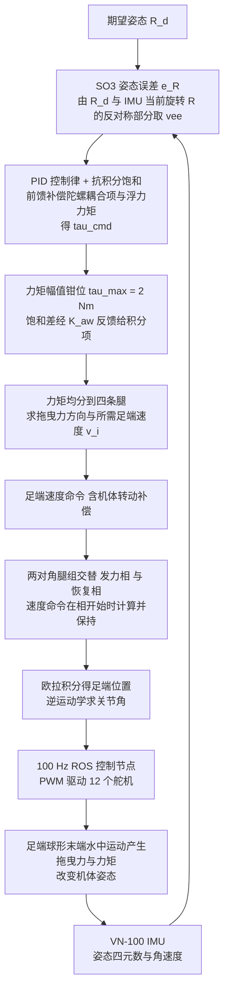

# 水下四足姿态控制（arXiv:2609.09217）

**水下四足姿态控制**（[Design and Attitude Control of an Underwater Quadruped Robot](https://arxiv.org/abs/2609.09217)）来自 [具身智能小站 11 篇盘点](../../sources/blogs/wechat_embodied_station_11_papers_vlm_manipulation_2026-09-10.md)。POM 防水电机壳+密封件+简化流体模型；SO(3) 误差闭环控制 roll/pitch/yaw；水箱真机验证。

## 一句话定义

**可复现硬件平台与姿态控制实验；控制代码截至入库日未确认开源。**

## 英文缩写速查

| 缩写 | 英文全称 | 简要说明 |
|------|----------|----------|
| IL | Imitation Learning | 从专家示范学习策略 |
| VLM | Vision-Language Model | 视觉-语言多模态模型 |
| WM | World Model | 预测未来观测或表征的动力学模型 |
| RL | Reinforcement Learning | 强化学习 |
| CEM | Cross-Entropy Method | 采样优化动作/轨迹的规划器 |
| DoF | Degrees of Freedom | 自由度 |

## 为什么重要

- 纳入本期 **VLM 控制 / 世界模型 / 灵巧操作 / 规划 / 评测** 主线之一。
- 开源状态：**部分开源**（步骤 2.5 核查，2026-09-10）。
- 与 [11 篇技术地图](../overview/vlm-manipulation-11-papers-technology-map.md) 中同类工作可横向对照。

## 流程总览

图依据：论文 §3.3 软件架构、§5 Attitude Controller Design（§5.1–§5.4）。

## 核心机制

| 项 | 内容 |
|----|------|
| **arXiv** | [2609.09217](https://arxiv.org/abs/2609.09217) |
| **项目页** | https://ntnu-arl.github.io/underwater-quadruped/ |
| **代码** | https://github.com/ntnu-arl/uw-quadruped-cad |
| **开源** | **部分开源** |
| **文内指标** | 可复现硬件平台与姿态控制实验；控制代码截至入库日未确认开源。 |

## 源码运行时序图

**不适用**（CAD/硬件描述已开源；控制栈以项目页与论文为主。）。

## 实验与评测

| 项 | 文内口径 |
|----|----------|
| 硬件 | **POM 防水电机壳** + 密封件；可复现机械设计 |
| 建模 | **简化流体模型**（非全 CFD） |
| 控制 | **SO(3) 误差** 闭环调节 roll / pitch / yaw |
| 验证 | **水箱** 真机实验 |
| 开源 | CAD 已开源（`ntnu-arl/uw-quadruped-cad`）；**控制代码截至入库日未确认开源** |

- **读法：** 本页为清单摘要，上表取自 [公众号盘点](../../sources/blogs/wechat_embodied_station_11_papers_vlm_manipulation_2026-09-10.md) 与项目页；姿态误差曲线、扰动设定与增益以 **原文 PDF** 为准（[参考来源](#参考来源)）。
- **水箱不是开放水域：** 无显著水流与长航程扰动，结论应按 **平台可行性验证** 读，不要外推到野外作业指标。

## 与其他工作对比

| 对照路线 | 差异 |
|----------|------|
| 陆地四足姿态控制 | 姿态由 **足端接触力** 主导；水下由 **浮力、附加质量与水动力阻尼** 主导，同一套 SO(3) 误差律的执行通道完全不同。 |
| AUV / ROV（推进器全驱） | 用推进器矢量分配产生力矩；本文用 **腿的摆动** 做姿态控制，机构复用但控制权限更受限。 |
| 全 CFD 在环建模 | 精度高、代价大且难实时；本文取 **简化流体模型**，把保真度差额交给闭环反馈吸收。 |
| 欧拉角 / 四元数误差表述 | 存在奇异或双覆盖；本文取 **SO(3) 上的误差** 定义，与本库 [SO(3) 旋转表示对比](../comparisons/so3-rotation-representations.md) 的取舍一致。 |
| 纯仿真水下运动论文 | 无实体验证；本文提供 **可复现硬件 + 水箱实测**，但控制代码尚未确认开源，复现停在机械层。 |

## 结论

**水下四足姿态控制 值得按「部分开源」边界阅读：先核对仓库是否可跑，再引用文内成功率数字。**

1. 索引来源为公众号导读，实验细节以 arXiv PDF 为准。
2. 开源结论：**部分开源** — CAD/硬件描述已开源；控制栈以项目页与论文为主。。
3. 选型时对照 [11 篇地图](../overview/vlm-manipulation-11-papers-technology-map.md) 中相邻节点，避免重复造页。

## 关联页面

- [VLM 与操作 11 篇技术地图](../overview/vlm-manipulation-11-papers-technology-map.md)
- [模仿学习 (Imitation Learning)](../methods/imitation-learning.md)
- [Generative World Models](../methods/generative-world-models.md)
- [Manipulation](../tasks/manipulation.md)

## 参考来源

- [underwater-quadruped-attitude-control_arxiv_2609_09217.md](../../sources/papers/underwater-quadruped-attitude-control_arxiv_2609_09217.md)
- [wechat 11篇盘点](../../sources/blogs/wechat_embodied_station_11_papers_vlm_manipulation_2026-09-10.md)
- [arXiv:2609.09217](https://arxiv.org/abs/2609.09217)
- [arXiv PDF](https://arxiv.org/pdf/2609.09217)：已通读方法部分（实验与附录以略读为准）：§1 引言贡献、§3.3 软件架构、§4 建模（部分）、§5 姿态控制器设计与仿真验证

## 推荐继续阅读

- [arXiv PDF](https://arxiv.org/pdf/2609.09217)
- [项目页](https://ntnu-arl.github.io/underwater-quadruped/)
- [GitHub](https://github.com/ntnu-arl/uw-quadruped-cad)
