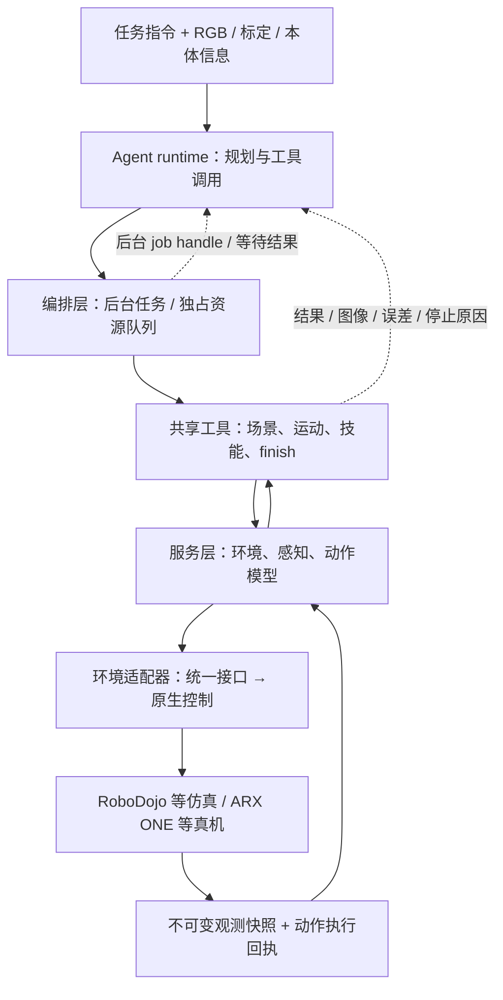

# Democratizing Robot-Use Agents: A Unified Harness with Open Models｜开放模型机器人使用智能体统一框架

## 一句话定义

**Uni-Robot-Agent（OpenRUA）是机器人使用智能体（RUA）的统一执行框架，而非新训练的 VLA 权重。** 它以可互换的 Agent runtime、共享工具、调度器、环境服务与后端适配器，连接语言模型推理和机器人动作，并保留跨环境互动记录，为后续训练开放模型提供基础。论文： [arXiv:2611.01560v2](https://arxiv.org/html/2611.01560v2)；[官方博客](https://openrua.ai/uni-robot-agent)；[开源实现](https://github.com/Open-RUA/uni-robot-agent)。

## 英文缩写速查

| 缩写 | 英文全称 | 简要说明 |
|---|---|---|
| RUA | Robot-Use Agent | 通过工具与环境交互的机器人使用智能体 |
| VLA | Vision-Language-Action | 视觉语言动作策略 |
| WAM | World Action Model | 世界动作模型 |
| SR | Success Rate | 完整完成任务的成功率；不同于部分得分 |
| EEF | End-Effector | 末端执行器 |
| RGB-D | Red, Green, Blue + Depth | 彩色图像与深度测量 |

## 为什么重要：方法边界

- **Unified：** 共享运动、感知、技能及 episode 控制工具，环境适配器负责不同仿真/真机的原生 API；不需为每个工具与每个环境分别写实现（论文 §2.2）。
- **Efficient：** Agent 推理与工具执行流水线重叠；同一独占资源的动作按提交顺序执行，结果依赖型决策仍必须等待（§2.3）。
- **Realistic：** RoboDojo 主要实验使用 RGB、多视角相机标定、机器人描述/本体状态，不提供仿真真值深度、物体 CAD、隐藏场景标注或 task-verifier 反馈。**无特权输入不代表没有标定/本体信息。** 真机实验则使用 RealSense 深度（§2.4、§3）。
- **Modular：** runtime / context / tools / services / simulator 或机器人后端可分别替换，交互日志可用于未来的智能体训练；**论文并未报告已经用这些日志训练出新基础模型**（§2.1、§8）。

## 核心机制与项目数据流程

按论文 v2 图 2–5 和 §2.5 整理。虚线表示独立的反馈链，非网络进程调用拓扑。



六项关键设计（§2.5）：图像/相机位姿/机器人状态绑定快照；请求身份防止超时后重复动作；运动和夹爪开合联合命令；基于实测进度而非固定步数终止；返回量化误差、拒绝/停滞原因与执行后图像；旧图像窗口化清理同时保留指令与调用文本。机器人到达目标 pose **不等于** 抓取或任务成功。

## 源码运行时序图（官方 main，2026-11-11）

核对 `uni_robot_agent/cli.py`、`session.py`、`execution/parallel.py`、`execution/scheduler.py`、`tools/toolkit.py` 和 [架构文档](https://github.com/Open-RUA/uni-robot-agent/blob/main/docs/architecture.md)。下图是 CLI → 工具实际主干，环境原生服务与模型 provider 依所选集成变化。

```mermaid
sequenceDiagram
  participant U as User
  participant C as cli.py
  participant S as Session / session.py
  participant A as Agent runtime
  participant E as ParallelToolExecutor
  participant Q as ResourceScheduler
  participant T as Toolkit
  participant H as Native handler / adapter
  U->>C: uni-robot-agent run --integration robodojo
  C->>S: run(args) / assemble_session(args)
  S->>S: create integration session; register tools
  S->>E: create_executor(toolkit, policies)
  S->>A: run_agent()
  A->>E: call / submit(tool, arguments)
  E->>Q: submit(job, resource policy)
  Q->>T: execute_tool(name, arguments)
  T->>H: tool_def.handler(**arguments)
  H-->>T: ToolOutput + images / diagnostics
  T-->>E: ToolOutput / recorded result
  E-->>A: immediate result or job handle
  opt Background job
    A->>E: job_result(job_id)
    E-->>A: completed result or pending status
  end
  A-->>S: agent outcome
```

资源独占与后台等待来自 `ResourceScheduler`；工具调用由 `Toolkit.execute_tool` 分派到注册 handler，结果有结构化回执。上图只说明已阅读的源码调用链，**未在本次环境实际启动仿真或真机**。官方 [Python SDK](https://github.com/Open-RUA/uni-robot-agent/blob/main/docs/sdk.md) 也可用 `Session.tools` 自行执行策略。

## 实验结果与对照条件

### RoboDojo（论文 v2 表 1）

42 个任务、五个维度；主要设置每任务 3 seeds × 2 layouts，计 252 episodes。Score（0–100）可给中途进度分，SR 是完整成功率。下面为论文列出的不同 harness 和模型配置，**不是相同模型、相同输入的全控制实验**。

| 模型 + Harness（主表无仿真深度） | SR | Score |
|---|---:|---:|
| Qwen3.8-Flash-Next + RoboProbe | 0.83% | 1.90 |
| Qwen3.8-Flash-Next + GAP Hybrid（含 π₀.₅） | 16.11% | 21.01 |
| **Qwen3.8-Flash-Next + Uni-Robot-Agent** | **25.00%** | **31.39** |
| DeepSeek-V4.1-Flash + Uni-Robot-Agent | 21.39% | 27.11 |
| GPT-6 Astra + RoboProbe（已发表基线） | 22.48% | 28.97 |
| GPT-6 Astra + Uni-Robot-Agent | 46.67% | 51.90 |

这说明 harness 本身是重要变量，而不能将跨配置优势全部归功于模型。论文还显示 VLA/WAM 在某些长时任务表现更强（§3.1）。

### 真机 Real Eval（论文 v2 表 2、附录 B）

双臂桌面平台、19 项任务、五个各占 20 分的维度；每项细则包括任务完成和指定的中间进度。**分数不是任务成功率。**

| 模型 | 训练/输入条件 | 总分 / 100 |
|---|---|---:|
| GPT-6 Astra + Uni-Robot-Agent | 零样本；RGB + D405 深度 | 80.50 |
| **Qwen3.8-Flash-Next + Uni-Robot-Agent** | **零样本；RGB + D405 深度** | **53.50** |
| π₀.₅ | 每任务约 10 小时示范微调；RGB | 47.75 |
| Dream-1 | 零样本；RGB | 43.50 |

论文 v1 早期文本曾给出 Qwen 真机 49.50；**v2 表 2、表 4 和作者博客一致为 53.50**。输入模态、示范训练和协议差异不允许直接解释成同等条件的政策胜负；真机 unseen tasks 两个 Agent 都只有 8/20（§3.2、附录 B）。

### 消融与效率

- 去除仿真深度、保留标定：Qwen 由 **35.89** 降至 **31.39**；若继续移除相机参数，论文报告降至 **9.13**（§5.1），表明“无深度”不等同于“无几何信息”。
- 取消技能库及技能编写：**30.31 Score / 24.58% SR**，相较使用技能库的 **31.39 / 25.00%**，说明主要收益并非依赖预设技能，但不排除任务说明/工具接口的影响（§5.2）。
- 五个示例任务的单回合串行/流水线比较：**84.5%–93.8%** 物理执行时间与模型请求重叠，回合耗时减少 **4.8%–73.7%**；每配置每任务仅一次运行，不代表跨任务或跨硬件的统计保证（§6.2）。
- 按代际/家族/大小分析的四类失败：**视觉理解、跨视角空间定位、几何变换代码、具身交互推理**。相关性和部分辅助评审来自作者的观察与分析，并非因果定律（§4）。

## 工程实践：复现入口与开源状态

- 官方项目页、[博客](https://openrua.ai/uni-robot-agent)、[MIT 仓库](https://github.com/Open-RUA/uni-robot-agent)、[文档](https://uni-robot-agent.com/docs/) 已核实可访问。2026-11-11 仓库 README 列出 **v0.2.0**、RoboDojo / RoboUse / RoboLab、RoboTwin / LIBERO 等适配器，以及已公开的 **ARX ONE** 真机集成；Franka 仍标为 coming soon。新扩展并不等于论文已完成相应评测。
- 基础复现：Python 3.11 Linux GPU 环境中安装 `uni-robot-agent`，使用 `setup --integration robodojo` 准备环境；运行前需配置模型 endpoint/key。**RoboDojo 代码默认启用 depth**，复现实验主设置须显式传 `--no-depth` 且保留相机标定。详见 [官方 README](https://github.com/Open-RUA/uni-robot-agent#quick-start) 和 [配置说明](https://github.com/Open-RUA/uni-robot-agent/blob/main/docs/integrations.md)。
- 开源仓库中的真机执行涉及物理设备、驱动、标定及操作者安全流程，不应把安装示例直接当成上机验证。作者没有证明任意机器人即插即用；精密空间定位、双臂协调和长任务仍具挑战。
- 本次仅进行论文与公开源码静态核查；**未实测复现 benchmark、API 成本或硬件控制**。

## 局限与风险

现有成果以工具驱动的零样本推理与执行为主，尚未证实跨平台模型权重训练收益或在所有真实硬件上的稳健性。实验仍存在多视角定位、精密操作、长时规划、端到端吞吐和外部模型服务依赖等边界；真机对照的感知输入、训练预算与任务成功判据并不完全相同，不能无条件比较。

## 与其他工作对比

| 维度 | 本页 Uni-Robot-Agent | [ORA](./ora-open-robot-use-agents.md) | [GPT-6 Astra 具身报告](./paper-gpt-6-astra-embodied-intelligence.md) |
|---|---|---|---|
| 主要目标 | 跨模型与环境共享工具、调度和反馈，研究开放权重 RUA | 开源 ReAct 机器人使用框架 | 测量通用模型在仿真及真机的具身能力 |
| 控制闭环 | Agent 工具调用 + 后台队列 + 原生 adapter | ReAct 工具调用与有界 supervisor 执行 | 直接/混合模型策略与执行反馈 |
| 评测参考 | RoboDojo、19 项 Real Eval | RoboTwin C2R、LIBERO-Pro | 不同任务与独立协议 |
| 注意 | 强调 harness 与观测边界 | 不能直接迁移得分 | 不能与本页跨基准横比 |

## 关联页面

- [ORA](ora-open-robot-use-agents.md) — 类似研究方向与 harness 设计。
- [LLM 机器人控制接口](../concepts/llm-robotics-control-interfaces.md) — 工具控制与低层控制的边界。
- [具身大模型评测基准选型闭环](../queries/embodied-eval-benchmark-selection-loop.md) — 区分 score、SR、模型输入与评测协议。

## 推荐继续阅读

建议依次阅读 [论文 §2：框架机制](https://arxiv.org/html/2611.01560v2)、[论文 §3–6：实验与消融](https://arxiv.org/html/2611.01560v2)、[源码架构文档](https://github.com/Open-RUA/uni-robot-agent/blob/main/docs/architecture.md) 和 [ARX ONE 集成说明](https://github.com/Open-RUA/uni-robot-agent/blob/main/uni_robot_agent/integrations/arx_one/README.md)。

## 参考来源

- [论文 v2 全文归档](../../sources/papers/uni_robot_agent_arxiv_2611_01560.md)
- [官方源码归档](../../sources/repos/uni-robot-agent.md)
- [官网与博客归档](../../sources/sites/uni-robot-agent.md)
