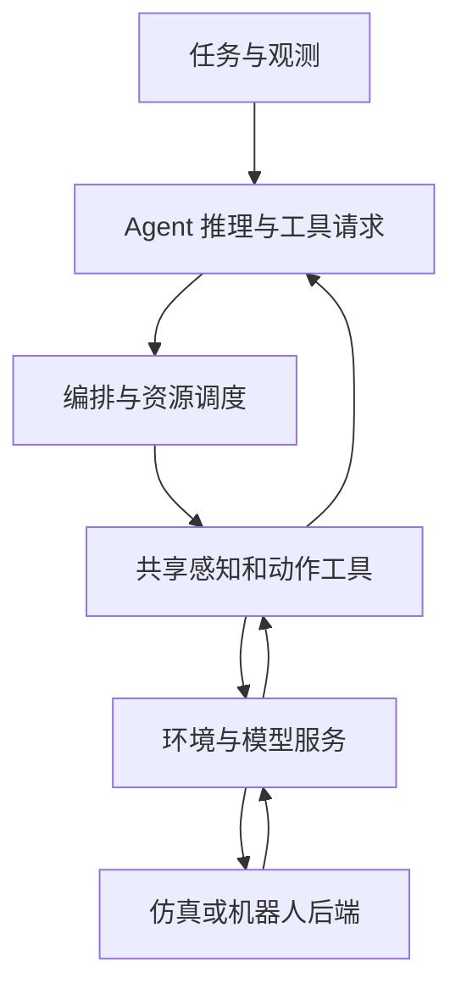
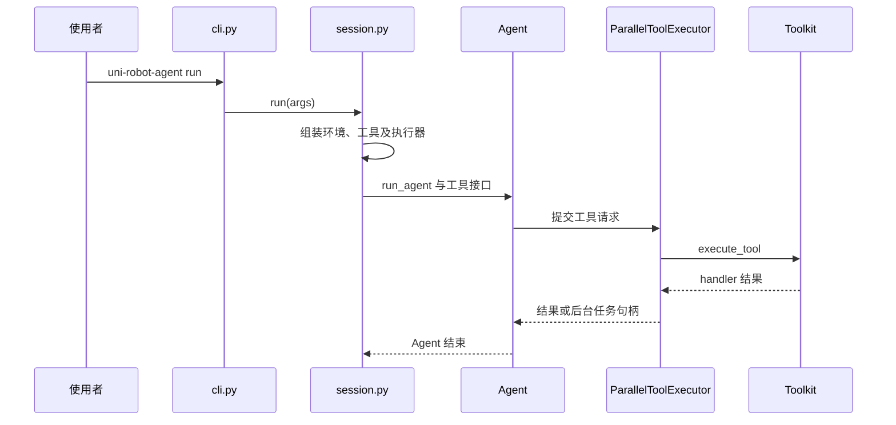

# Democratizing Robot-Use Agents: A Unified Harness with Open Models｜开放模型的统一机器人智能体框架

## 一句话定义

Uni-Robot-Agent 将模型、共享机器人工具与环境适配器连接成可反馈的操作闭环，支持开放权重模型进行零样本机器人任务。

## 英文缩写速查

| 缩写 | 英文全称 | 简要说明 |
|---|---|---|
| RUA | Robot-Use Agent | 使用机器人工具完成任务的智能体 |
| VLA | Vision-Language-Action | 视觉语言动作模型 |
| WAM | World Action Model | 世界动作模型 |
| SR | Success Rate | 完成任务成功率 |

## 流程总览

以下按论文 v1 图 2 的逻辑层组织；服务与后端是可替换组件。

- 统一接口将运动、感知、技能和 episode 工具映射到环境适配器；可通过后台调用与资源队列重叠推理和执行。
- 图像、标定和机器人状态绑定为快照；动作带请求身份以防通信失败后重复执行。移动工具根据实测位姿迭代生成中间目标并反馈误差、停止原因和图像。
- 旧图像按滑动窗口淘汰而保留周围文本；结果依赖的后续决策仍需等待执行反馈。

## 源码运行时序图

核对仓库 commit `9d6a051e2045fa23ad863cfed49101e699d520de` 的 CLI、session、executor 和 toolkit；下图只描述已核实的工具调用主干。

源码入口及公开范围见 [仓库归档](../../sources/repos/uni-robot-agent.md)；尚未实际运行仿真。

## 评测与局限

论文 v1 的 RoboDojo 评测为 42 任务、每任务 3 seeds × 2 布局，共 252 episodes；主设置提供 RGB、相机标定及机器人信息，不向 agent 提供仿真真值深度或任务验证器反馈。

| 配置 | 成功率 | RoboDojo 分数 |
|---|---:|---:|
| Qwen3.8-Flash-Next + 本框架 | 25.00% | 31.39 |
| GPT-6 Astra + RoboProbe（已发表基线） | 22.48% | 28.97 |
| GPT-6 Astra + 本框架 | 46.67% | 51.90 |

比较涉及不同模型与 harness，不能将优势单独归因于模型。真机 19 个任务、五个维度中 Qwen 得 49.50/100，微调 π₀.₅ 得 47.75/100；该分数包含部分完成得分，**不是任务成功率**。Agent 额外使用 RealSense 深度，而 π₀.₅ 和 Dream-1 使用 RGB，输入条件不同。

去除仿真深度但保留相机标定时 Qwen 为 31.39 分；进一步去除相机参数降至 9.13。技能库消融为 30.31 分。论文通过轨迹分析指出视觉理解、空间定位、几何代码及具身推理四类失败；其相关性分析不等于因果证明。

## 与其他工作对比

| 维度 | 本页 Uni-Robot-Agent | [ORA](./ora-open-robot-use-agents.md) | [GPT-6-Astra 具身智能报告](./paper-gpt-6-astra-embodied-intelligence.md) |
|------|------|------|------|
| 定位 | 共享工具、资源调度与环境适配器组成的统一 harness | 面向机器人使用任务的开源 ReAct harness | 评测通用模型在仿真、控制框架与真机上的表现 |
| 闭环方式 | 工具请求经编排执行，可后台调用重叠推理与执行；动作带请求身份防重复 | 逐轮调用工具，supervisor 执行有界动作并返回回执 | 模型生成动作或动作序列，可使用冻结 ICL 知识包与扩展步数 |
| 主要评测 | RoboDojo 42 任务 252 episodes；真机 19 任务计分 | RoboTwin C2R、LIBERO-Pro 仿真 | 12 个仿真设置 + G1 真机抓放与行走 |
| 信息边界 | 不提供仿真真值深度或任务验证器反馈，保留 RGB 与相机标定 | 不向模型提供成功判定实现、仿真真值与接触信息 | 允许用训练示范构建知识包 |

- **怎么选**：要在 RoboDojo 上复现开放模型 agent 并研究调度与观测消融看本页；要跨 RoboTwin / LIBERO-Pro 的工具调用基线看 ORA；要理解示范与预算对通用模型分数的影响看 GPT-6-Astra 报告。
- **读法**：三者基准、模型与观测条件均不同，成功率只能在各自协议内解读。

## 结论

共享接口和执行机制可显著影响机器人智能体的实验表现，但评价必须保留模型、观测和评测协议的条件。

- 复现无深度仿真设置时需保留相机标定；公开仓库 RoboDojo 默认有深度，须显式选择 `--no-depth`。
- 精密操作、空间定位和长时任务仍是弱项；到达目标位姿也不代表抓取成功。
- 论文真机实验不等于公开包已支持真机；官方 README 将 ARX One、Franka 集成标为待发布。

## 待核查

论文全文尚未逐节通读；项目主页、博客、在线文档本次无法访问。需完成全文通读并核对站点资源与开放数据后再将本页和 PR 转为完成状态。

## 关联页面

- [ORA](ora-open-robot-use-agents.md) — 另一套机器人使用智能体框架。
- [LLM 机器人控制接口](../concepts/llm-robotics-control-interfaces.md) — 理解工具与控制接口的分层。
- [具身大模型评测基准选型闭环](../queries/embodied-eval-benchmark-selection-loop.md) — 本页可归入其 ③ 策略任务成功率评测层：RoboDojo 成功率随模型与 harness 组合、深度与相机标定条件变化，真机 0–100 计分含部分完成，防止跨 harness 横比或把计分当成功率。

## 参考来源

- [论文 v1 归档](../../sources/papers/uni_robot_agent_arxiv_2611_01560.md)
- [官方源码归档](../../sources/repos/uni-robot-agent.md)
- [项目页面归档](../../sources/sites/uni-robot-agent.md)
