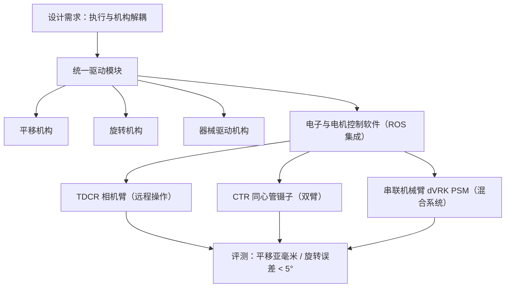

# 统一连续体机器人驱动平台：设计与表征

**统一连续体机器人驱动平台**（*Design and Characterization of a Unified Continuum Robot Actuation Platform*，[arXiv:2610.19798](https://arxiv.org/abs/2610.19798)）用一套模块化驱动硬件与软件，把执行机构与连续体机器人的机械构型解耦，使同一平台可驱动多类连续体机器人，并与标准串联机械臂组合。

## 英文缩写速查

| 缩写 | 英文全称 | 简要说明 |
|------|----------|----------|
| TDCR | Tendon-Driven Continuum Robot | 腱驱动连续体机器人；本文用其构型的相机臂验证平台 |
| CTR | Concentric Tube Robot | 同心管机器人；本文用其 2.53 mm 镊子做双臂实验 |
| PSM | Patient-Side Manipulator | dVRK 的患者端机械臂，本文作为串联臂载体 |
| dVRK | da Vinci Research Kit | 开源手术机器人研究平台，本文的验证对象 |

## 为什么重要

连续体机器人适合手术与工业检测中的狭窄空间作业，但其驱动系统多为单一构型定制，难以复用。把驱动与机械设计分开，换构型时不必重做驱动硬件与软件，也便于扩展到大自由度与"连续体 + 标准机械臂"的混合系统。对做连续体实验平台的团队，这是一个值得参考的工程组织方式。

## 核心信息

| 项目 | 内容 |
|------|------|
| 论文 | Design and Characterization of a Unified Continuum Robot Actuation Platform，arXiv:2610.19798（2026-10-14 提交，cs.RO） |
| 作者 | Yunti Xu, Aedan Mangan, Miheer Potdar, Alex Lu, Tania K. Morimoto（PI） |
| 机构 | 加州大学圣地亚哥分校（UCSD）机械与航空航天工程系（Morimoto Lab） |
| 数据/平台 | 开源手术机器人 dVRK（PSM 作串联臂）；TDCR 相机臂；CTR 镊子 |
| 开源状态 | **已开源（按项目页声明）**：项目页链接硬件仓库 `UCSDMorimotoLab/unified-actuation-hardware` 与软件仓库 `UCSDMorimotoLab/unified-actuation-software`；仓库内容与许可证本次未能访问核实（2026-10-15） |

## 核心原理

**一句话机制：** 把"驱动模块（平移 / 旋转 / 器械驱动）+ 电机运动控制软件"做成与机械构型无关的统一接口，再按构型装配。

- **模块化：** 平移、旋转、器械驱动三类机构共用一套电子与软件，构型差异主要落在机械接口。
- **软件：** 论文章节涵盖电机运动控制与软件集成，细节以仓库为准（未核实）。
- **混合系统：** 连续体机器人挂在串联臂末端，由同一平台统一控制。

## 工程实践

| 项 | 说明 |
|----|------|
| 硬件 | 项目页称提供定制 CAD 文件；对应仓库 `unified-actuation-hardware`（内容未核实） |
| 软件 | 电机运动控制与 ROS 集成；对应仓库 `unified-actuation-software`（内容未核实） |
| 关键指标 | 平移精度（30 mm 范围内亚毫米）、旋转误差（180° 范围内 < 5°） |
| 复现前检查 | 核对仓库 README、依赖与许可证；确认 dVRK 或等价串联臂接口 |
| 源码运行时序图 | **不适用**（本次入库未能访问仓库内容，无法核实可运行入口；核实后可补充） |

## 实验与评测

- **执行模块表征：** 30 mm 平移范围内亚毫米精度；180° 旋转范围内误差小于 5°。
- **TDCR 相机远程操作：** 在受限环境中远程操作连续体相机。
- **CTR 双臂遥操作：** 2.53 mm 同心管镊子与常规腕式器械协同工作。
- **对比：** 摘要与章节中未见与其他驱动平台的定量对比（未核实）。

## 结论

**一句话总判：这篇论文的主要价值是"驱动与机构解耦"的工程组织方式，单个精度数字要按条件读。**

1. **解耦是复用的前提** — 驱动硬件与软件和机械构型分离，换构型不必重做驱动。
2. **精度数字要按条件读** — 亚毫米 / <5° 是单模块表征，不等于手术级闭环精度。
3. **混合系统是落地重点** — 连续体与 dVRK 串联臂组合是论文的主要应用面。
4. **开源程度要自己核** — 项目页声明开源，但本次未核实仓库内容与许可证，复现前需检查。
5. **选型读法** — 适合作为连续体实验平台或驱动模块参考，不宜直接当作临床系统。

## 与其他工作对比

- **与同类腱驱动软连续体工作：** [腱驱动软连续体 MuJoCo](./paper-quadrotor-tendon-soft-continuum-arm-mujoco.md) 侧重仿真与控制，本文侧重驱动平台的模块化与表征。
- **与手术双臂工作：** [TDHD 手术双臂](./paper-tdhd-surgical-dual-arm.md) 面向双臂手术系统，本文以 dVRK PSM 为串联臂验证统一驱动。
- **与作者前序工作：** 项目页列出 [arXiv:2604.15638](https://arxiv.org/abs/2604.15638)（受限环境中连续体机器人的接触感知规划与控制），本文偏驱动硬件与软件，二者分工互补。

## 局限与风险

- 论文以模块表征与远程操作演示为主，缺少临床或长时可靠性数据（未核实）。
- 多驱动模块的线缆布局、张紧与维护对安全与可靠性的影响需要实际部署验证。
- 仓库内容与许可证本次未核实；把"项目页声明开源"当作可直接复用，存在误读风险。

## 关联页面

- [腱驱动软连续体 MuJoCo](./paper-quadrotor-tendon-soft-continuum-arm-mujoco.md)：同为连续体 / 腱驱动方向的仿真与控制工作。
- [TDHD 手术双臂](./paper-tdhd-surgical-dual-arm.md)：手术双臂平台，可对照驱动与系统集成思路。
- [遥操作](../tasks/teleoperation.md)：本文 TDCR / CTR 的远程操作演示所属任务。
- [操作任务](../tasks/manipulation.md)：连续体器械与串联臂协同属于操作问题。

## 参考来源

- [unified_continuum_actuation_arxiv_2610_19798 归档](../../sources/papers/unified_continuum_actuation_arxiv_2610_19798.md)

## 推荐继续阅读

- [arXiv:2610.19798：Design and Characterization of a Unified Continuum Robot Actuation Platform](https://arxiv.org/abs/2610.19798)
- [项目页：unified-actuation（UCSD Morimoto Lab）](https://ucsdmorimotolab.github.io/unified-actuation/)
- [前序工作 arXiv:2604.15638：Contact-Aware Planning and Control of Continuum Robots](https://arxiv.org/abs/2604.15638)
