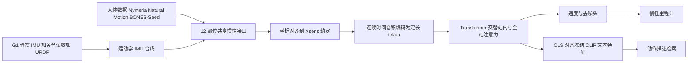

# A Unified Inertial Encoder for Human and Humanoid Motion（arXiv:2611.10137）

*A Unified Inertial Encoder for Human and Humanoid Motion*，[arXiv:2611.10137](https://arxiv.org/abs/2611.10137)，Amazon FAR、UC Berkeley、Stanford、CMU（论文首页），项目页 <https://unified-inertial-encoder.github.io/>。本页依据对论文全文的通读（见 [来源归档](../../sources/papers/unified-inertial-encoder_arxiv_2611_10137.md)），数字均出自论文并标章节 / 表号；「推测」「我的判断」为本页补充。

## 一句话定义

**一个编码器同时吃「人体穿戴 IMU」和「由 G1 骨盆 IMU + 关节读数合成的各连杆 IMU」，在人体与重定向人形数据上联合训练速度估计和动作-文本对齐，不用仿真、真机轨迹或微调即可零样本用于真机 Unitree G1（论文摘要、III）。**

## 英文缩写速查

| 缩写 | 英文全称 | 简要说明 |
|------|----------|----------|
| IMU | Inertial Measurement Unit | 惯性测量单元，测比力（含重力）与角速度 |
| AVE | Absolute Velocity Error | 机体系速度预测的平均欧氏误差，单位 m/s（式 8） |
| ATE | Absolute Trajectory Error | 速度积分后的轨迹均方根误差，单位 m（式 9） |
| ATE_GT / ATE_Pred | — | 积分时用真值姿态 / 陀螺积分姿态；后者含姿态漂移 |
| R@1 | Recall at 1 | 动作到文本检索的第一位命中率 |
| mAP | mean Average Precision | 文本到动作检索的平均精度 |
| CLIP | Contrastive Language-Image Pre-training | 冻结的 ViT-L/14@336px 文本编码器作为对齐目标 |
| URDF | Unified Robot Description Format | 提供连杆几何，用于运动学传输 |
| RK4 | Runge-Kutta 4th order | 四阶龙格-库塔，用于积分角速度 |
| TRT | TensorRT | 论文时延测试所用推理引擎 |

## 为什么重要

- **训练覆盖不再被控制器卡住（作者自述，I）：** 从机器人录像学状态估计，只覆盖现有控制器能做的动作；人体数据集（Nymeria、Natural Motion、BONES-Seed）动作更广。本文给出一条把人体经验用到人形传感端的路径，而不是迁移参考动作或控制策略（II-C）。
- **证据：** 联合训练使真机 G1 的 ATE_GT 从人形单独训练的 5.901 m 降到 3.153 m（IV-E.1，表 V）；真机 G1 AVE 0.099 m/s，低于表 III 中所有对比方法。
- **一个模型两件事：** 同一 checkpoint 做惯性里程计与动作描述检索（IV）。
- 我的判断：对做人形腿式状态估计的读者，值得看的是「合成各连杆 IMU 作为通用接口」这一输入设计，而不只是数字。

## 核心机制

### 流程总览

### 方法要点（均出自论文 III）

1. **共享惯性接口（III-A、III-B）：** 12 个解剖部位：骨盆、头、左右上臂 / 前臂 / 大腿 / 小腿 / 脚。人体用穿戴 IMU 或运动学虚拟传感器。
2. **运动学 IMU 合成（III-B.1，式 2）：** 把骨盆 IMU 的角速度与加速度沿关节链传输到各连杆，含切向、向心、科氏与相对连杆加速度项；不需要世界位姿或根速度。重定向 G1 的基座信号来自根部运动学，真机则读骨盆 IMU。
3. **坐标对齐（III-B.2）：** 各数据集传感器轴约定不同，统一旋转到 Xsens 约定，真机与重定向 G1 共用同一修正。
4. **连续时间编码（III-B.3，式 4）：** 学习的 B-spline 连续卷积按时间戳聚合，容忍不同采样率、缺样本、不规则时序，免去重采样。
5. **多任务损失（III-C，式 5-7）：** 速度、短区间位移轨迹一致性、与冻结 CLIP 文本特征的余弦对齐、去噪辅助；速度与轨迹权重用梯度范数比 EMA 自适应。
6. **随机化（III-D，表 I）：** 重力、噪声、偏置漂移、振动、冲击、体型 / 速度 / 采样率扰动；范围为启发式选取。

### 关键结果（作者实测）

| 项 | 数值 | 出处 |
|----|------|------|
| 真机 G1 AVE | 0.099 m/s（AirIO w/ joints 0.190，AirIO 0.350，TLIO 0.371） | 表 III |
| 重定向 G1 AVE | 0.024 m/s | IV-B |
| 真机 G1 ATE_GT / ATE_Pred | 3.153 m / 11.50 m | 表 III |
| 未见类别语言检索 | R@1 53.8%，mAP 11.3%（IMU2CLIP 17.3% / 0.5%） | 表 IV |
| 联合训练 vs 人形单独训练（真机 ATE_GT） | 3.153 m 对 5.901 m | 表 V |
| 单骨盆 IMU 输入（真机 ATE_GT） | 8.114 m | 表 V |
| 推理时延 | 1.78 ms（TensorRT，NVIDIA L40S，4 s 窗口，12 个 IMU，200 Hz） | IV-D |
| 计算最优拟合 | N_opt ∝ C^0.52，D_opt ∝ C^0.48 | IV-F |

## 工程实践

- **输入要求：** 真机只需骨盆 IMU 与关节位置 / 速度（论文称 1 IMU + 关节），然后按式 2 合成其余 11 个站点；采样率不必统一。
- **训练配方（IV-A.3）：** 20 epoch、4096 ms 窗口、bfloat16、batch 1024、Muon + AdamW、权重 EMA 0.95。
- **数据划分（IV-A.1）：** 人体按轨迹 85% / 15% 划分；G1 的复杂动作（如舞蹈）整体留作未见评测；真机 G1 记录仅 0.7 h，完全留作评测，评测时不做增强。
- **部署：** 论文给出 L40S + TensorRT 的时延，没有给出机载算力上的时延（论文未说明，未核实）。
- **代码：** 项目页链到 [amazon-far/Unified-Inertial-Encoder](https://github.com/amazon-far/Unified-Inertial-Encoder)，README 称含训练、基线、预处理、评测与分析，Apache-2.0；本页未克隆也未运行代码。
- **消融提示（表 V）：** 去掉连续时间编码退化最重（真机 ATE_GT 17.37 m）；只加关节量（骨盆 IMU + joints）真机 ATE_GT 3.513 m，但 ATE_Pred 18.36 m，差于完整方法的 11.50 m。

## 与其他工作对比（论文 IV-B、IV-C）

| 对照 | 差异 |
|------|------|
| TLIO / AirIMU / AirIO | 单骨盆 IMU，逐数据集单独训练（表 III 脚注）；本文多站点 + 联合训练 |
| AirIO w/ joints | 作者为控制「额外信息」加的基线，真机 AVE 0.190，仍高于本文 |
| TartanIMU | 使用其发布的人体头模型直接评测，真机 AVE 0.391 |
| IMU2CLIP / ImageBind | 语言检索基线；IMU2CLIP 逐数据集训练，ImageBind 用头部 IMU 预训练评测 |
| [X-IONet](./paper-x-ionet-cross-platform-inertial-odometry.md) | 同属跨平台惯性里程计，本文不同在利用人体数据与语言对齐（本页对比为我的判断，未对读该页的数字） |

## 局限与未验证之处

**论文自承（V、IV-B、IV-F）：**

- 硬件评测只有一个人形平台（Unitree G1）。
- 语言监督部分为合成，词汇有限。
- 姿态漂移仍是轨迹误差的主要来源：真机 ATE_GT 3.153 m 与 ATE_Pred 11.50 m 差距显著；Nymeria 的 ATE_Pred 上 TLIO 略好。
- 计算最优估计含外推，且优化验证误差，未必给出最佳硬件迁移。
- 随机化范围为启发式选取（III-D）。

**我看到的未验证之处（我的判断）：**

- 真机评测数据仅 0.7 h（表 II），场景覆盖有限；真机语言检索只有定性演示（图 4、图 5），没有定量数字。
- 速度误差是在离线记录上评测，论文未做闭环状态估计或控制验证；与滤波融合列为后续工作。
- 表 IV 的 R@1 用 19 个随机干扰项，难度低于全库检索；未见类别也是「重定向 G1 上、人体训练中出现过」的类别，不等于真机未见动作。
- 摘要说「最低速度误差」指论文选定的基线集合；基线中 TLIO、AirIO、AirIMU 为逐数据集重新训练，训练细节以论文为准。
- 项目页与 README 的更多声明（权重、复现结果）未逐项核实。
- 论文无附录，超参、网络规模等细节主要靠正文与代码。

## 关联页面

- [状态估计](../concepts/state-estimation.md)
- [IMU 原理、算法与相机同步](../concepts/imu-principles-algorithms-camera-sync.md)
- [动作重定向](../concepts/motion-retargeting.md)
- [Sim2Real](../concepts/sim2real.md)
- [Unitree G1](./unitree-g1.md)
- [Nymeria 论文](./paper-nymeria.md)
- [BONES-SEED 数据集](./bones-seed.md)
- [CLIP](./paper-clip.md)
- [X-IONet 跨平台惯性里程计](./paper-x-ionet-cross-platform-inertial-odometry.md)

## 参考来源

- [来源归档：unified-inertial-encoder_arxiv_2611_10137.md](../../sources/papers/unified-inertial-encoder_arxiv_2611_10137.md)
- [arXiv:2611.10137](https://arxiv.org/abs/2611.10137)
- [项目页](https://unified-inertial-encoder.github.io/)
- [GitHub 仓库](https://github.com/amazon-far/Unified-Inertial-Encoder)

## 推荐继续阅读

- [arXiv PDF（v1）](https://arxiv.org/pdf/2611.10137v1)
- [状态估计](../concepts/state-estimation.md)
- [Nymeria 论文](./paper-nymeria.md)
