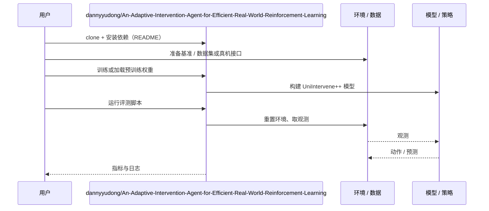

# UniIntervene++（arXiv:2610.03620）

**UniIntervene++**（*UniIntervene++: An Adaptive Intervention Agent for Efficient Real-World Reinforcement Learning*，[arXiv:2610.03620](https://arxiv.org/abs/2610.03620)，[代码](https://github.com/dannyyudong/An-Adaptive-Intervention-Agent-for-Efficient-Real-World-Reinforcement-Learning)）来自 [具身智能小站 2026-10-13 盘点](../../sources/blogs/wechat_embodied_station_34_papers_mulligan_2026-10-13.md)，属「强化学习与数据采集」组。

## 一句话定义

**把自主策略、轨迹纠正与代码辅助纳入统一选项框架，周期探测自主能力以动态分配辅助控制。**

## 英文缩写速查

| 缩写 | 英文全称 | 简要说明 |
|------|----------|----------|
| RL | Reinforcement Learning | 强化学习 |
| HiL | Human-in-the-Loop | 人在回路 |
| Option | Options framework | 分层 RL 选项框架 |

## 为什么重要

- 随策略变强，人工介入比例应自适应下降。
- 开源结论：**已开源**（步骤 2.5，2026-10-14）。仓库可达。
- 同期同组工作见 [失败导向采集与可组合世界动作模型：具身智能小站 10-13 期 34 篇阅读坐标](../overview/embodied-station-2026-10-13-34-papers-technology-map.md)。

## 核心机制

| 项 | 内容 |
|----|------|
| **arXiv** | [2610.03620](https://arxiv.org/abs/2610.03620) |
| **开源** | **已开源** |
| **要点** | 五项真机任务；介入率有专门统计口径。 |
| **文内指标** | 以原文为准。 |

## 源码运行时序图

以下为按仓库入口（`dannyyudong/An-Adaptive-Intervention-Agent-for-Efficient-Real-World-Reinforcement-Learning`）推断的通用运行链路；入库日仅核实仓库可达，未逐文件阅读，具体脚本名以 README 为准。

## 实验与评测

- 以原文为准。
- **读法：** 本页为索引级摘要，依据公众号转述的官方摘要与仓库信息整理；逐项数字与 baseline 以原文 PDF 为准。

## 与其他工作对比

- 横向索引见 [失败导向采集与可组合世界动作模型：具身智能小站 10-13 期 34 篇阅读坐标](../overview/embodied-station-2026-10-13-34-papers-technology-map.md)；同 arXiv 不重复造页。

## 结论

**真机 RL 的介入策略本身可学：先探测能力，再分配控制。**

1. 开源边界：**已开源** — 仓库可达。
2. 核心机制：五项真机任务；介入率有专门统计口径。
3. 复现与选型前核对任务协议、硬件与基准口径，勿直接横比公众号摘录数字。

## 关联页面

- [safe-real-world-rl-fine-tuning](../concepts/safe-real-world-rl-fine-tuning.md)
- [reinforcement-learning](../methods/reinforcement-learning.md)
- [paper-mulligan-performance-guided-data-collection](./paper-mulligan-performance-guided-data-collection.md)
- [embodied-station-2026-10-13-34-papers-technology-map](../overview/embodied-station-2026-10-13-34-papers-technology-map.md)

## 参考来源

- [uniintervene_plus_plus_adaptive_intervention_arxiv_2610_03620.md](../../sources/papers/uniintervene_plus_plus_adaptive_intervention_arxiv_2610_03620.md)
- [wechat_embodied_station_34_papers_mulligan_2026-10-13.md](../../sources/blogs/wechat_embodied_station_34_papers_mulligan_2026-10-13.md)
- [arXiv:2610.03620](https://arxiv.org/abs/2610.03620)

## 推荐继续阅读

- [arXiv PDF](https://arxiv.org/pdf/2610.03620)
- [https://github.com/dannyyudong/An-Adaptive-Intervention-Agent-for-Efficient-Real-World-Reinforcement-Learning](https://github.com/dannyyudong/An-Adaptive-Intervention-Agent-for-Efficient-Real-World-Reinforcement-Learning)
