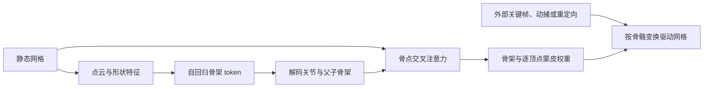
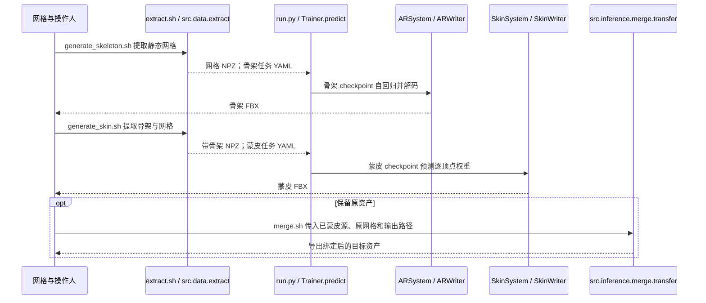

# UniRig: Diverse Skeleton Rigging | 给静态 3D 模型自动绑定骨架与蒙皮

## 一句话定义

UniRig 从静态 3D 网格自动预测关节及其父子骨架，再估计每个顶点随各骨骼变形的蒙皮权重。输出是**能被动作驱动的资产**，不是动作本身；动作来自关键帧、动捕或后续重定向。

## 英文缩写速查

| 缩写 | 英文全称 | 含义 |
|---|---|---|
| AR | Autoregressive | 自回归地生成骨架 token |
| J2J | Joint-to-Joint | 两组关节的 Chamfer 距离 |
| LBS | Linear Blend Skinning | 按骨权重混合变换，得到网格变形 |
| FBX | Filmbox | 官方骨架及蒙皮阶段的中间导出格式 |

## 为什么重要

对尚无骨架的非标准角色，不能先假定人形关节索引再复制权重。把骨架预测与蒙皮分开，可以先检查层级和关节，再用已确认或人工纠正的骨架重算权重。作者展示涵盖人物、动物与虚构角色，但演示覆盖不代表所有拓扑都能正确绑定。

| 机构 | 清华大学（Tsinghua University）、VAST |
|---|---|

## 核心机制与组件结构

- **骨架树：** 网格表面采样点云，提取形状条件后，GPT 顺序预测骨架 token，再解码为关节、骨及父子结构。骨类型、分支编码和可匹配的模板帮助减少冗余；并非要求每个角色都用同一人形骨架。
- **蒙皮：** 将骨架几何和顶点特征做骨点交叉注意力，加入顶点到骨骼的体素测地距离，预测各顶点的混合权重。论文还研究弹簧骨属性及给定运动下的顶点重建监督；当前公开权重的功能范围不以研究演示推断。
- **动画：** 输出 rig 后，外部姿态/动作才改变关节变换，再由蒙皮驱动网格。没有时间序列输出，也不能代替对机器人可达性、接触和动力学的检查。

## 方法流程总览

## 工程实践

按官方发布流程，先执行 `generate_skeleton.sh`，检查骨方向、父子关系与左右对应，然后把带骨架的 FBX 交给 `generate_skin.sh`。需要保留原始网格资产时，再用 `merge.sh` 回写骨架/权重；不能拿只有骨架的 FBX 当已蒙皮资产。挑几个大幅关节姿态检查权重泄漏（例如远端顶点跟错骨、薄部位自交），再做后续动画。

## 源码运行时序图

依据官方 `6793c66` 的两个推理 shell、`run.py`、Lightning 系统与 Writer、以及 `src.inference.merge.transfer`。

## 实验与评测

| 论文对照 | UniRig | NBS | 口径 |
|---|---:|---:|---|
| VRoid 骨架误差 | 0.0092 | 0.0205 | 表 3，J2J Chamfer，越低越好 |
| VRoid 蒙皮误差 | 0.0028 | 0.02721 | 表 4，逐顶点权重 L1，越低越好 |
| VRoid 动态变形 | 0.0004 | 0.0582 | 表 5，对给定 Mixamo 动画比较顶点重建损失 |

## 与其他工作对比

同一实验表中，UniRig 与 NBS 比较的是骨架、蒙皮与给定动作造成的变形，不能把指标读作动作规划或动画生成成功率。与 [GMR](../methods/motion-retargeting-gmr.md) 和 [NMR](../methods/neural-motion-retargeting-nmr.md) 的下游任务也不同：这些方法迁移既有运动，UniRig 为静态资产提供可驱动骨架和形变关系。

## 局限与风险

- **权重版本要分开：** 作者公开的骨架和蒙皮 checkpoint 用 **Articulation-XL2.0** 训练；论文主实验使用 **Rig-XL / VRoid**。代码与数据可访问不等同于主实验权重已发布，不用上表给开源 checkpoint 背书。
- 明显偏离训练分布的抽象结构、极度风格化角色仍可能绑定错误；资产修整和试姿不能省略。论文中的物理辅助骨属性并非当前公开推理功能。
- 核对了入口和实验协议，未跑 GPU 权重或重做论文比较。rig 不提供质量/摩擦/关节力矩等机器人模型参数。

## 结论

先把 UniRig 当作静态网格的自动绑定起点：检查骨树与蒙皮，再交给动画或运动重定向。对具体资产的质量验收，优先检查极端姿势及细小结构，不外推论文指标。

## 关联页面

- [动作重定向](../concepts/motion-retargeting.md)：先有 rig，已有动作才有映射目标。
- [GMR](../methods/motion-retargeting-gmr.md) · [NMR](../methods/neural-motion-retargeting-nmr.md)：下游既有运动迁移。
- [动作重定向纵深](../../roadmap/depth-motion-retargeting.md)：Stage 0 输入与输出边界。

## 参考来源

- [论文归档](../../sources/papers/unirig_arxiv_2504_12451.md)
- [作者项目页](../../sources/sites/unirig.md) · [源码与权重归档](../../sources/repos/unirig.md)

## 推荐继续阅读

- [正式论文 DOI](https://doi.org/10.1145/3730930)
- [官方模型卡与训练数据标记](https://huggingface.co/VAST-AI/UniRig)
