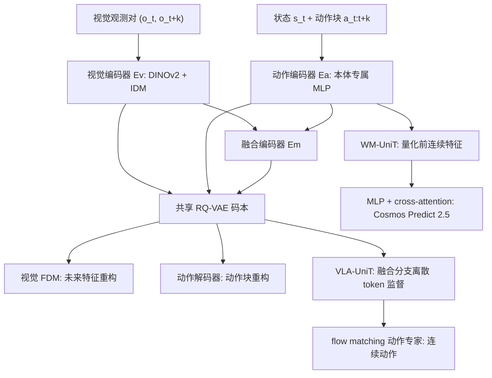
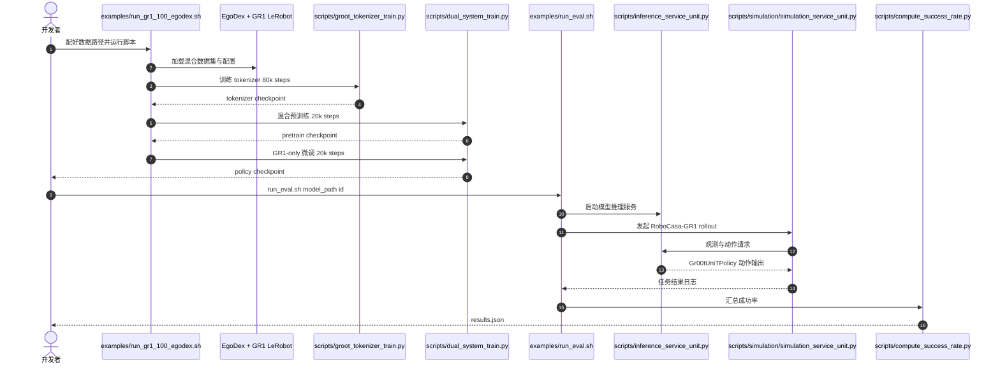

# UniT：人到人形策略学习与世界建模的统一物理语言 / Toward a Unified Physical Language

**UniT**（*Toward a Unified Physical Language for Human-to-Humanoid Policy Learning and World Modeling*，[arXiv:2604.19734](https://arxiv.org/abs/2604.19734)）由 **小鹏机器人（XPENG Robotics）**、清华大学、香港大学提出：用视觉锚定的三分支交叉重构，把人与人形异构运动学投影到 **同一离散潜动作空间**，同时服务策略学习（VLA-UniT）与世界建模（WM-UniT）。

## 一句话定义

**UniT 通过视觉锚定三分支交叉重构学习共享物理潜动作：VLA 以离散融合分支 token 为监督目标，WM 以动作分支量化前连续特征为条件；两个下游接口不能混同。**

## 英文缩写速查

| 缩写 | 英文全称 | 简要说明 |
|------|----------|----------|
| UniT | Unified Latent Action Tokenizer | 本文分词器框架 |
| VLA | Vision-Language-Action | 下游策略范式（VLA-UniT） |
| WM | World Model | 下游动作条件视频建模（WM-UniT） |
| RQ-VAE | Residual Quantized Variational Autoencoder | 共享离散码本量化 |
| IDM | Inverse Dynamics Model | 视觉分支上的物理过渡编码 |
| FDM | Forward Dynamics Model | 用潜动作重构未来视觉特征 |
| OOD | Out-of-Distribution | 跨任务/跨场景泛化评测轴 |

## 为什么重要

- **缩放瓶颈在跨本体，不在「有没有人体视频」。** 人体数据再多，没有共享动作语言就会卡在 retargeting 与视觉–动作错配。
- **一个学习框架、两类下游接口：** VLA 的融合分支离散 token 用于交叉熵训练监督；WM 从动作分支取连续特征，经 cross-attention 控制视频生成。
- **在五路径图中属 ⑤ 动作表示入口：** 本身不接管平衡；决定后续 WAM 用什么动作词汇（见[五路径](../overview/wam-motion-control-five-paths.md)）。

## 核心信息

| 项 | 内容 |
|----|------|
| **机构** | 小鹏机器人（XPENG Robotics）；清华大学（Tsinghua University）；香港大学（The University of Hong Kong） |
| **作者** | Boyu Chen、Yi Chen、Lu Qiu、Jerry Bai、Yuying Ge、Yixiao Ge |
| **原文** | [arXiv:2604.19734v2](https://arxiv.org/html/2604.19734v2)（2026-10-11；初版 2026-04-21） |
| **评测** | RoboCasa GR1；真机 IRON-R01-1.11（50 维动作） |
| **关键数字（论文）** | VLA-UniT 全数据 **66.7%**（Pick&Place 67.3% / Articulated 64.7%）；相对 FLARE **+11.7 个百分点**，相对同架构 GR00T **+18.9 个百分点** |
| **代码配方参考结果** | 官方 README：GR1-full **66.4%**、EgoDex + GR1-100 **50.9%**；与论文 66.7% / 50.0% 属不同报告口径 |
| **开源范围** | **VLA 训练/评测代码与权重已公开**（Apache-2.0）：[xpeng-robotics/UniT](https://github.com/xpeng-robotics/UniT)、[HF checkpoint](https://huggingface.co/xpeng-robotics/VLA-UniT-checkpoints)；官方 README 未给出 WM 独立可运行配方 |

## 核心原理

### 四类潜动作设计对照

| 设计 | 问题 |
|------|------|
| 仅动作 tokenizer | 缺视觉锚定，码仍本体专用 |
| 仅视觉 tokenizer | 纠缠外观，浪费姿态先验 |
| 双模态松对齐 | 各自重构，最多分布级对齐 |
| **UniT** | **共享码本 + 交叉重构**，只留双边一致信号 |

### 三分支

1. **视觉分支** — $(o_t,o_{t+k})$ 经冻结 DINOv2 特征和 IDM 编码物理转移。
2. **动作分支** — $(s_t,a_{t:t+k})$ 先按本体映射、补齐并经专属 MLP 编码。
3. **融合分支** — 汇集视动两侧特征得到紧凑共享表示。
4. **共享 RQ-VAE** — 三分支通过同一码本离散化，**每一个分支的 token 都要同时重构未来视觉特征和动作块**；损失由视觉余弦、动作重构和量化项组成（§3.2，式 1–3）。

**下游细节（原文 §3.3–3.4）**：VLA-UniT 把**融合分支离散码**作为 VLM 的交叉熵监督，另由 flow-matching expert 从视觉语言上下文生成连续控制动作（式 4–5）；WM-UniT 则使用**动作分支量化前连续特征**，经 MLP/cross-attention 条件化 Cosmos Predict 2.5 的未来视频生成（式 6）。

### 流程总览

**注意**：跨重构约束是 tokenizer 的预训练目标。VLA 需要 token 监督加动作专家；WM 不直接消费离散 codebook index，使用动作编码器连续特征。WM 分支来自论文，并非下方开源脚本的调用链。

## 源码运行时序图

基于官方公开的 `examples/run_gr1_100_egodex.sh`、`examples/run_eval.sh` 和其真实调用的 Python 入口（**VLA-UniT**）：

另一入口 `examples/run_gr1_full.sh` 执行 tokenizer 80k → GR1-full 预训练 160k，无专门微调阶段。**WM-UniT / Cosmos 的独立运行入口未见于官方仓库 README，不画未经源码核实的 WM 运行时序图。**

## 工程实践

| 用途 | 做法 |
|------|------|
| 策略 | 离散 token 为 CE 辅助监督；动作专家仍通过 flow matching 生成连续动作 |
| 世界模型 | 动作分支量化前连续特征经 MLP / cross-attention 条件化视频生成，不直接使用 RQ-VAE code index |
| 数据 | RoboCasa-GR1 24 任务：full 24,000 轨迹、few-shot 2,400 轨迹；EgoDex basic_pick_place 27,419 轨迹；真机为 50 维动作空间 |
| 对齐检查 | t-SNE：原始动作 vs UniT embedding vs 下游内部特征 |
| 噪声鲁棒 | 视觉锚定使动作噪声下重构退化慢于纯动作 tokenizer |

## 实验与评测

| 原文实验（v2） | 结果 | 限定条件 |
|---|---|---|
| RoboCasa GR1 全量 | **66.7%** vs FLARE 55.0%、GR00T 47.8% | 24 任务，每任务 50 episodes；不能与 README 的 66.4% 混写 |
| Few-shot 加人体数据 | **45.5% → 50.0%**；OOD 平均 **34.7% → 38.5%** | 100 条 GR1/任务，联合 EgoDex 再仅以 GR1 微调 |
| 真机 IRON-R01-1.11 | Pick&Place **70% → 78%**；Pouring **35% → 75%** | UniT robot-only 对比人体数据 co-training |
| 未见堆叠任务（真机） | 人机混训 UniT **60%**；robot-only UniT **10%**、GR00T **0%** | 零样本指**任务没在机器人训练数据中**，不是无需机器人训练 |
| WM 人类预训练→人形微调 | RoboCasa PSNR **16.34 → 18.06**、EPE **0.478 → 0.446** | Cosmos Predict 2.5 固定模型，论文表 2 |
| WM 跨本体视频条件 | Human→Robot **2.95 → 3.27**，Robot→Human **2.92 → 3.84** | Gemini-3-Pro 自动评审的一致性 1–5 分，**非真机成功率**（表 3） |
| 动作噪声 σ=0.2 | UniT MSE 退化 **1.7×**、action-only **2.7×**、FAST **10.7×** | 是重构鲁棒性实验，不是 sim2real 稳定性指标 |

**原文核对**：已按 arXiv:2604.19734v2 §1–6、公式（1）–（6）、表 1–3 与设计消融核对；资料归档中明确记录通读范围。

## 结论

**UniT 把「跨本体介质」从手工 retargeting 换成视觉锚定的共享离散语言；策略与世界模型可以讲同一种物理话。**

- 真贡献是 **交叉重构约束下的共享码本**，不是又堆一个双编码器。  
- VLA 收益看 **成功率与样本效率**；WM 收益看 **跨本体条件可控性**。  
- 适合作为后续 Fe₀ 等大规模异构基础模型的动作词汇层。  
- 仍不替代低层全身稳定控制。  
- 开源复现应先采用 **VLA 公开 checkpoint + 官方 GR1 脚本**；WM 部分尚不能照 README 一键复现。

## 局限与风险

- **已开源不等于论文双分支均可复现**：截至 2026-11-19，仓库 README 提供 VLA tokenizer、训练、评测配方及权重，未列 WM-UniT / Cosmos 训练评测入口。
- **复现成本**：README 说明默认训练配置要求每卡约 120+GB 显存；RoboCasa rollout 测试于 24GB RTX 4090，需额外 RoboCasa/robosuite 依赖与补丁。
- 共享语言的迁移仍取决于接触/执行器差异；视觉结果相似并不等于动力学约束完全一致。  
- 真机结果绑定具体平台与采集协议。  
- 勿与 Unitree / UniTracker 等「Uni*」名称混淆。

## 与其他工作对比

| 工作 | 相对 UniT |
|------|-----------|
| 传统 retargeting | UniT 避免「人视觉+机动作」硬配对与每机求解器 |
| [Being-M0.7](./paper-being-m07-humanoid-latent-wam.md) | 同做人数据先验；M0.7 偏 latent WAM 计划，UniT 偏 **分词介质** |
| [MotionWAM](./paper-motionwam-humanoid-loco-manipulation-wam.md) | MotionWAM 联合视频–动作 DiT；UniT 先统一动作语言再接下游 |
| [EgoWM](./paper-egowm-egocentric-world-model.md) | EgoWM 预测像素未来；UniT 可为其提供跨本体动作条件 |
| [AnyWorld](./paper-anyworld.md) | AnyWorld 以 UniT 为 VLA 基线，用因子化 WM rollout 做目标具身适配数据引擎 |

## 关联页面

- [WAM×运动控制五路径](../overview/wam-motion-control-five-paths.md)
- [VLA](../methods/vla.md)
- [Motion Retargeting Pipeline](../concepts/motion-retargeting-pipeline.md)
- [World Action Models](../concepts/world-action-models.md)
- [跨本体迁移纵深路线](../../roadmap/depth-cross-embodiment.md)

## 参考来源

- [UniT 源码归档](../../sources/repos/unit.md)（<https://github.com/xpeng-robotics/UniT>）

- [unit_xpeng_arxiv_2604_19734.md](../../sources/papers/unit_xpeng_arxiv_2604_19734.md)
- [xpeng-robotics-unit.md](../../sources/sites/xpeng-robotics-unit.md)
- [xpeng_robotics_unit.md](../../sources/repos/xpeng_robotics_unit.md)
- [wechat_embodied_ai_lab_wam_motion_control_five_paths.md](../../sources/blogs/wechat_embodied_ai_lab_wam_motion_control_five_paths.md)

## 推荐继续阅读

- [项目页](https://xpeng-robotics.github.io/unit/)
- [arXiv:2604.19734](https://arxiv.org/abs/2604.19734)
- [GitHub xpeng-robotics/UniT](https://github.com/xpeng-robotics/UniT)
- [Fe₀ 后续博文](https://xpeng-robotics.github.io/fe0/)
