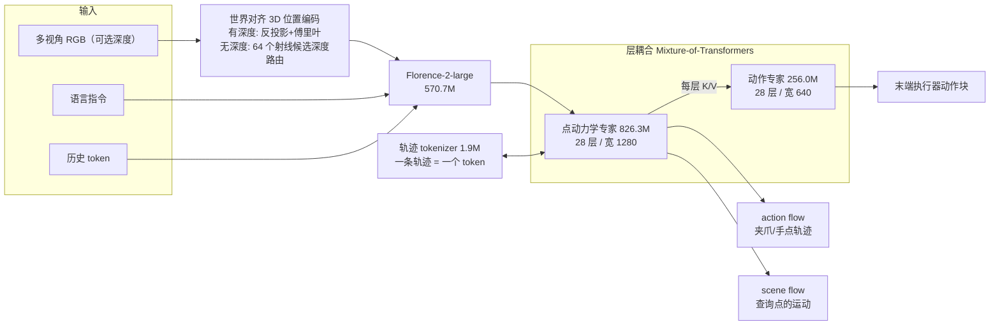

# UNITAS

**UNITAS**（*A 3D-Native World Action Model for Embodied Manipulation*，arXiv:2610.12099，2026-10-08，Under review）是一个 **3D 原生的世界–动作模型（WAM）**：不再用视频/图像潜变量表示世界，而是把观测、机器人动作与场景动力学放进同一个度量 3D 坐标系，用 **点轨迹** 同时表示夹爪/人手运动（action flow）和场景点的响应运动（scene flow），1.7B 参数，既能直接输出动作，也能做动作条件的场景预测。

## 英文缩写速查

| 缩写 | 英文全称 | 简要说明 |
|------|----------|----------|
| WAM | World Action Model | 同时预测“该做什么动作”和“动作会让场景怎样变化”的模型 |
| MoT | Mixture-of-Transformers | 各专家独立参数、逐层耦合注意力的结构；此处为点动力学专家 + 动作专家 |
| PE | Positional Embedding | 位置编码；此处为由深度或射线路由得到的世界系 3D 位置编码 |
| ADE / FDE | Average / Final Displacement Error | 点轨迹平均 / 终点位移误差，用于评估场景预测 |
| FiLM | Feature-wise Linear Modulation | 用条件向量对特征做逐通道缩放平移，tokenizer 用它注入时间信息 |
| MANO | Hand Model with Articulated and Non-rigid defOrmations | 参数化人手模型，这里取每手 21 个关键点作 action flow |

## 为什么重要

- **WAM 的表征问题：** 主流 WAM 建立在视频生成器上，作者指出图像是视角相关的投影，像素距离不等于物理距离，而机器人在度量 3D 空间里行动。UNITAS 是对“视频 WAM 是否是唯一路线”的一个直接反例。
- **跨本体统一：** 夹爪（URDF 采 20 点）与人手（MANO 21 点）都变成点轨迹，因此 DROID、AgiBot、RoboMIND、RH20T 与第一视角人手数据（VITRA）可混训。
- **小模型对大模型：** 1.7B 在 RoboTwin 2.0 上超过 6B 的 Fast-WAM 与 8B 的 Motus，说明 3D 归纳偏置可能比堆视频生成器参数更划算（作者所述，需注意各模型训练数据不同）。
- **可裁剪推理：** 只要动作时可省略两路 flow 分支，每块 55.77 ms。

## 方法栈与流程总览

## 方法

- **点集定义：** action flow 每个夹爪按 URDF 几何采 20 点、经正运动学得到轨迹；人手用 MANO 每手 21 关键点。scene flow 的背景点来自深度，模拟中 5 mm 体素化并最多 12,000 点，混合数据训练里只保留约 1%（约 120 个查询点）。
- **世界对齐 3D 位置编码：** 有深度时用相机内参与相机到世界变换把像素反投影，经固定傅里叶映射 ψ 与 Enc3D 加到 patch token。无深度时沿射线在 0.1–2.0 m 均匀取 64 个候选深度，由 patch 特征做注意力权重，得到加权傅里叶特征；用路由损失 L_PE（权重 0.1，对深度派生目标 stop-gradient）监督，训练中以 0.1 概率用路由特征替换深度特征。
- **轨迹 tokenizer：** 一条点轨迹编码成一个 token，与长度、采样率无关；时间以秒计（T_max=3 s，潜变量维度 256），时间 MLP 产生 FiLM 参数；编码器把 H 个位移步池化为一个潜变量，解码器在指定时间戳读出；当前 3D 点的傅里叶特征在去噪全程加到 token 上以固定空间锚点。先训 tokenizer 再冻结，潜变量标准化。
- **主干与注意力：** Florence-2-large 编码指令与图像；点动力学专家同时建模 action flow 与 scene flow；动作专家每层读取动力学专家的观测/语言 K/V。观测/语言/历史上下文双向可见；scene token 只关注干净的 action-flow token；动作块 token 跳过 flow token，因此策略推理可整体省略两路 flow。
- **训练目标：** 动作流、场景流、动作块均为 rectified flow + MSE（权重各 1.0），外加 L_PE（0.1），缺失目标与缺失臂槽掩码；推理每个激活专家 10 步 Euler，上下文 K/V 在去噪步间缓存；action flow 与动作块并行去噪，scene flow 以生成的或外部给定的 action flow 为条件。
- **三阶段训练：** tokenizer → 可选混合数据预训练 200K 步（batch 1,024；AdamW；动力学/动作专家 lr 1e-4、VLM 1e-5；224×224；64 张 BW1000_H DCU + FSDP）→ 按基准/真机微调。预训练数据 9 个来源：RoboTwin、LIBERO、VLABench、DROID、AgiBot、RoboMIND、RH20T、自采 W1、VITRA；未来视野 H=20（VITRA 为 10），6–20 Hz。

## 实验与评测

| 项目 | UNITAS | 对比 |
|------|--------|------|
| LIBERO 平均 | 99.8%（无预训练 99.5%） | 原文表中另有 π0.5、π0、X-VLA 等 |
| RoboTwin 2.0 Clean / Randomized | 92.94 / 93.04 | Fast-WAM(6B) 91.88 / 91.78；Motus(8B) 88.66 / 87.02 |
| VLABench SR | 56.2% | π0.5 48.1% |
| LIBERO-Plus 总体 / 相机扰动 | 89.1% / 82.1% | Cosmos Policy 相机 75.8%，LaMP 64.5% |
| 场景预测 Moving ADE（RoboTwin） | 0.427 cm | PointWorld 0.656；X-WAM+STv2 2.286；Ctrl-World+DA3+STv2 3.310 |
| 场景预测 Acc@1cm | 92.31% | PointWorld 88.22%；X-WAM+STv2 49.69% |
| 真机 Organize Books / Pack the Ball（各 20 次） | 18/20 / 16/20 | π0.5 15/20 / 11/20；Fast-WAM 13/20 / 12/20 |

- **相对 PointWorld：** Moving ADE 低 35%、Moving FDE 低 21%、Static ADE 低 49%（摘要的“最高 49%”指 Static ADE）。
- **消融（LIBERO-Plus，无预训练）：** 去 3D 位置编码 85.74%→81.35%，相机扰动 79.11%→66.73%；去 action-flow 监督 78.89%；去历史 token 75.92%（机器人初始状态扰动掉 19.87 点）；三者全去 67.58%，被作者视为 VLA 式基线；加 scene-flow 监督 85.74%→86.47%；无深度路由 PE 84.43% 对真值深度 84.68%。预训练再加 2.6 点。
- **延迟（RTX 5090 D，每块）：** 仅动作 55.77 ms；+action flow 122.51 ms；+两路 flow 305.49 ms（1,024 查询）/ 561.60 ms（3,000 查询）。
- **数字口径提醒：** 论文引言一处把 Pack the Ball 写成 65%，与表 2 的 80% 不一致，本页取表值；抓取仅覆盖 HTML 前约 100K 字符（总 117K），末段未核。

## 源码运行时序图

官方仓库 [DexForce/UNITAS](https://github.com/DexForce/UNITAS) 已发布推理与评测代码。README 提供场景流推理脚本 `src/unitas/scene_flow/inference.py`，并用 `visualize.py` 在 Viser 中交互查看预测轨迹；训练代码与数据集仍未发布。

## 工程实践

- **复现边界：** 官方已发布模型权重与推理/评测代码，但训练代码和训练数据集仍未公开；论文报告预训练使用 64 张 64 GiB BW1000_H DCU。
- **部署选择：** 只做动作时延迟约 56 ms，需要场景预测时必须提供当前 3D 查询点坐标（来自深度或外部几何），延迟升至 300 ms 量级。
- **无深度相机场景：** 路由 PE 在 LIBERO-Plus 上只比真值深度低 0.25 点，可作为缺深度时的替代。

## 结论

**UNITAS 的主张是：WAM 的世界表征应当落在度量 3D 空间的点轨迹上，而不是视频潜变量；从论文数字看这一路线在多个基准上优于更大的视频 WAM，但真机证据与可复现性仍薄弱。**

1. **3D 位置编码和 action-flow 监督是主要增益来源** — 消融中去掉后相机扰动下掉 12 点以上，整体掉到 78.89%/81.35%。
2. **点轨迹是跨本体接口** — 夹爪与人手共用 token 化轨迹，可混训真机与第一视角人手数据。
3. **推理可按需裁剪** — 仅动作约 56 ms，加场景预测到 300+ ms，按任务选择分支。
4. **对比口径要谨慎** — 与 Fast-WAM、Motus 的训练数据、预训练规模不同，参数少不等于同条件更优。
5. **真机仅两任务各 20 次** — 85% 平均值置信区间宽，不要外推为通用能力。
6. **推理可用不等于训练可复现** — 官方已有权重与推理/评测代码，训练代码及数据集仍未发布。

## 与其他工作对比

| 对照 | 差异读法 |
|------|----------|
| [Fast-WAM](./paper-fast-wam.md) | 视频 DiT 主干的 WAM；UNITAS 同在 RoboTwin 2.0 上用 1.7B 对比其 6B |
| [PointWorld](./paper-sa-2601-03782-pointworld.md) | 同属点流式世界模型；UNITAS 在 RoboTwin 动作条件场景预测上 ADE 更低，并多出直接输出动作的策略模式 |
| [CF-WAM](./paper-cf-wam-dynamic-next-state-prediction.md) | CF-WAM 把未来表示作为可轮换的多投影（含深度），仍是视频形式；UNITAS 直接把 3D 点轨迹作为唯一表示 |
| [π0 / π0.5](./paper-pi05-open-world-vla.md) | 纯 VLA 基线，无场景预测；UNITAS 消融的“三者全去”即类 VLA 基线 |

## 局限与风险

- **开源状态（2026-10-20 核验）：** 已有 Apache-2.0 许可、模型权重及推理/评测代码；训练代码与数据集未发布（见 [unitas-project.md](../../sources/sites/unitas-project.md)）。
- **评测局限：** 论文无独立局限节；真机只有 Organize Books 与 Pack the Ball；论文投稿状态为 Under review。
- **依赖几何输入：** 场景预测需要深度或外部几何提供查询点；长时程交互预测被作者列为未来工作。
- **单位信息：** arXiv 页未列单位，机构取自项目页。

## 关联页面

- [周报汇总：Manipulation 2026-10-05 至 10-09](../overview/frontier-manipulation-2026-10-05-10-09.md)
- [World Action Models](../concepts/world-action-models.md)
- [生成式世界模型](../methods/generative-world-models.md)
- [Manipulation 任务](../tasks/manipulation.md)
- [双臂操作](../tasks/bimanual-manipulation.md)
- [LIBERO 基准](./libero-benchmark.md)、[RoboTwin](./robotwin.md)

## 参考来源

- [unitas_arxiv_2610_12099.md](../../sources/papers/unitas_arxiv_2610_12099.md) — 论文归档
- [unitas-project.md](../../sources/sites/unitas-project.md) — 项目页与开源核查
- [frontier_manipulation_2026_10_05_10_09.md](../../sources/blogs/frontier_manipulation_2026_10_05_10_09.md) — 周报线索
- 论文：<https://arxiv.org/abs/2610.12099>

## 推荐继续阅读

- [UNITAS 项目页](https://unitas-wam.github.io)
- [UNITAS GitHub（推理/评测代码与权重）](https://github.com/DexForce/UNITAS)
- [arXiv HTML 全文](https://arxiv.org/html/2610.12099v1)
