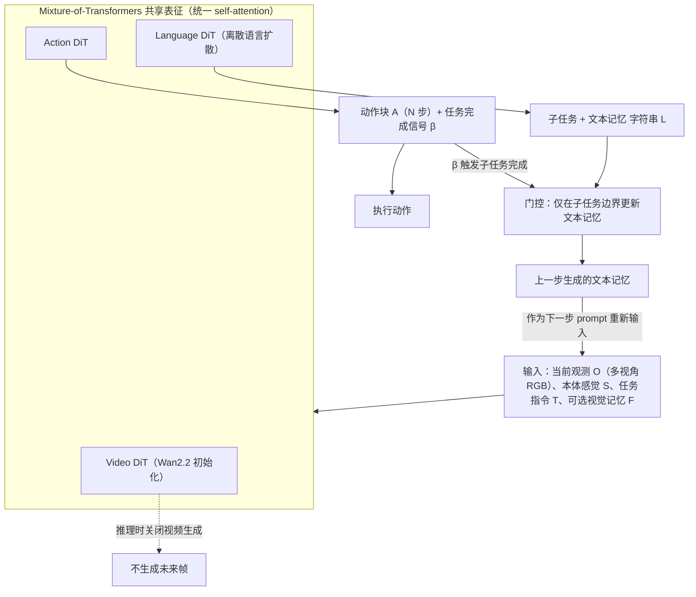

# UniWALM（统一世界-动作-语言模型）

## 一句话定义

**UniWALM 用同一个骨干同时生成未来视频、动作与语言，并把模型自己生成的语言当作记忆回馈，从而不依赖外部规划器完成记忆依赖的具身任务。**

## 英文缩写速查

| 缩写 | 英文全称 | 简要说明 |
|------|----------|----------|
| WAM | World Action Model | 同时预测未来视频与动作的模型 |
| VLA | Vision-Language-Action | 视觉语言动作模型，本文主要对照对象 |
| FM-C | Flow Matching with Correction | 本文的训练目标，学习从扰动动作中恢复（缩写为本页约定） |
| RMBench | RMBench | 论文使用的记忆依赖基准子集；摘要未展开 |

## 为什么重要

- 具身任务中，很多失败来自需要记住历史信息的步骤；把语言作为可读写的记忆，可以在不增加外部规划器的情况下处理这类任务。
- 统一世界、动作与语言的骨干，使三者在同一表征内相互影响（据摘要的设计描述）。

## 流程总览

图依据：论文 §3.1 / §3.3 / Fig.2。

## 方法与机制

- **统一骨干：** mixture-of-transformers 联合生成视频、动作与语言。
- **语言记忆：** 模型生成的语言回馈为后续步骤的记忆，不需要外部 planner。
- **Flow Matching with Correction：** 训练时学习从扰动的动作轨迹中恢复，推理无额外成本（据摘要）。

## 实验与评测

- MolmoSpaces pick-and-place：优于同骨干基线（如 FastWAM）。
- RMBench 记忆依赖子集：34.5%，高于 Mem-0 的 28.5%。
- 真机 Find-the-Item：11.1% → 61.1%（加入文本记忆）；论文摘要报告一项对比 VLA 基线在 Find-the-Item 上为 33.3%。

## 与其他工作对比

- 与同骨干基线 FastWAM：摘要称 UniWALM 在 MolmoSpaces 上更优。
- 与 Mem-0：RMBench 记忆子集上摘要给出 34.5% 对 28.5%。
- 与对比 VLA 基线：摘要给出的真机 Find-the-Item 结果为 33.3%；本文加入文本记忆后为 61.1%。

## 结论

本文的核心判断是：把语言作为模型内部可生成、可回读的记忆，比依赖外部规划器更直接。

- 统一骨干中的语言记忆可以替代部分外部规划。
- 扰动恢复目标（FM-C）在推理无额外成本，是值得关注的训练设计。
- 证据目前来自摘要与若干基准的数字，尚未核实代码与复现细节。

## 工程实践

- 代码、权重与项目页：本次抓取未发现，未核实。
- 复现前需要确认 mixture-of-transformers 骨干与训练数据的公开状态。

## 局限与风险

- 代码与数据公开状态未核实。
- 推测：模型自生成的语言记忆若出现错误，会沿时序传播，需要检验记忆的可靠性。
- 摘要未展开对比基线的版本与评测设置，需读全文核对。

## 关联页面

- [World Action Models](../concepts/world-action-models.md) — 同时预测视频与动作的模型背景
- [VLA 方法](../methods/vla.md) — 对照的视觉语言动作模型路线

## 参考来源

- [UniWALM 论文来源归档](../../sources/papers/uniwalm_arxiv_2610_28626.md)
- [arXiv PDF](https://arxiv.org/pdf/2610.28626)：已通读方法部分（实验与附录以略读为准）：§3.1–§3.5（含 Fig.2–4、Algo.1）

## 推荐继续阅读

- [arXiv 2610.28626](https://arxiv.org/abs/2610.28626)
