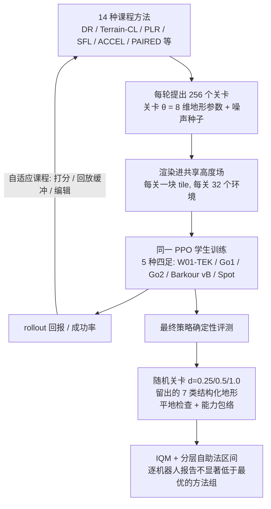

# 究竟是课程有效，还是起点简单？四足无监督环境设计基准

**无监督环境设计基准**（*Is It the Curriculum or Just the Easy Start? Benchmarking Unsupervised Environment Design on Quadrupeds*，[arXiv:2610.40364](https://arxiv.org/abs/2610.40364)）收录于 senlanke「具身运控lab」10-26–10-30 前沿论文动态（人形/四足）。本页依据**周报条目 + arXiv 摘要页**整理，流程图依据论文方法部分（见参考来源），未逐页核对实验数字；指标与结论以论文为准。

## 一句话定义

**究竟是课程有效，还是起点简单？四足无监督环境设计基准——在五种三维四足机器人上，以相同步数预算比较 14 种环境设计、域随机化和地形课程；结果表明没有一种方法在所有机器人及测试地形上占优，腿式机器人常用的成功率驱动课程进入最优组的次数最多。**

## 英文缩写速查

| 缩写 | 英文全称 | 简要说明 |
|------|----------|----------|
| RL | Reinforcement Learning | 强化学习 |
| WBC | Whole-Body Control | 全身控制 |

## 为什么重要

- 周报所述待解决的问题：无监督环境设计方法主要在二维迷宫上比较，而四足地形课程使用不同机器人、预算和指标，结论无法直接对照。

## 流程总览

图依据：论文 Fig.1、§3（基准：机器人/任务、方法、关卡空间）、§4（评测协议）

## 核心机制

| 项 | 内容 |
|----|------|
| **arXiv** | [2610.40364](https://arxiv.org/abs/2610.40364) · [PDF](https://arxiv.org/pdf/2610.40364) |
| **作者（arXiv）** | Gilewicz, Jakub, Galus, Dominik, Wojdas, Piotr |
| **机构（周报所述，未逐条核实）** | 弗罗茨瓦夫理工大学、Solvro 学生研究团队 |
| **arXiv 评论栏** | （无） |
| **开源** | arXiv 摘要页与评论未见代码或项目页链接（仅核对 arXiv 摘要页，不代表未发布）（2026-11-02） |
| **周报所述创新点** | 在五种三维四足机器人上，以相同步数预算比较 14 种环境设计、域随机化和地形课程；结果表明没有一种方法在所有机器人及测试地形上占优，腿式机器人常用的成功率驱动课程进入最优组的次数最多。 |

### arXiv 摘要节选（英文原文）

> Unsupervised environment design (UED) methods such as PLR, ACCEL, SFL and PAIRED are compared mostly on 2D mazes, grid worlds and BipedalWalker, while terrain curricula for legged robots are hand-designed and evaluated against a few baselines. We present a benchmark that runs fourteen UED, domain-randomisation and robotics curricula under one protocol on five 3D quadrupeds in MuJoCo MJX: the closed-chain W01-TEK and the open-chain Unitree Go1 and Go2, Google Barkour vB and Boston Dynamics Spot.

## 源码运行时序图

**不适用**：arXiv 摘要页与评论未见代码或项目页链接（仅核对 arXiv 摘要页，不代表未发布），无可对齐的官方代码流程。

## 实验与评测

- 周报与摘要给出的数字/场景已写入上表「创新点」与摘要节选；其余实验细节、基线与成功率定义请回到论文正文。
- 读法：先对齐任务设定、传感器与成功定义（仿真/真机），再解读 headline 数字，勿跨论文直接比较。

## 与其他工作对比

| 维度 | 读法 |
|------|------|
| **同周对照** | 见 [人形/四足周报技术地图](../overview/senlanke-weekly-2026-10-26-30-humanoid-quadruped-technology-map.md)，按方向浏览同期论文 |
| **开源状态** | arXiv 摘要页与评论未见代码或项目页链接（仅核对 arXiv 摘要页，不代表未发布） |

## 结论

**究竟是课程有效，还是起点简单？四足无监督环境设计基准。**

1. 本页是入库级摘要，复现前请核对论文正文、附录与代码仓库。
2. 指标须连同实验条件解读。
3. 关注 arXiv 版本更新与代码发布。

## 关联页面

- [senlanke-weekly-2026-10-26-30-humanoid-quadruped-technology-map](../overview/senlanke-weekly-2026-10-26-30-humanoid-quadruped-technology-map.md)
- [locomotion](../tasks/locomotion.md)
- [reinforcement-learning](../methods/reinforcement-learning.md)

## 参考来源

- [unsupervised-environment-design-quadruped-benchmark_arxiv_2610_40364.md](../../sources/papers/unsupervised-environment-design-quadruped-benchmark_arxiv_2610_40364.md)
- [wechat_senlanke_weekly_humanoid_quadruped_2026-10-26_30.md](../../sources/blogs/wechat_senlanke_weekly_humanoid_quadruped_2026-10-26_30.md)
- [arXiv:2610.40364](https://arxiv.org/abs/2610.40364)
- [arXiv PDF](https://arxiv.org/pdf/2610.40364)：已通读 §3 基准与 §4 评测协议及 Fig.1；§5–§7 结果、指南与讨论仅浏览，未逐表核对

## 推荐继续阅读

- [arXiv PDF](https://arxiv.org/pdf/2610.40364)
