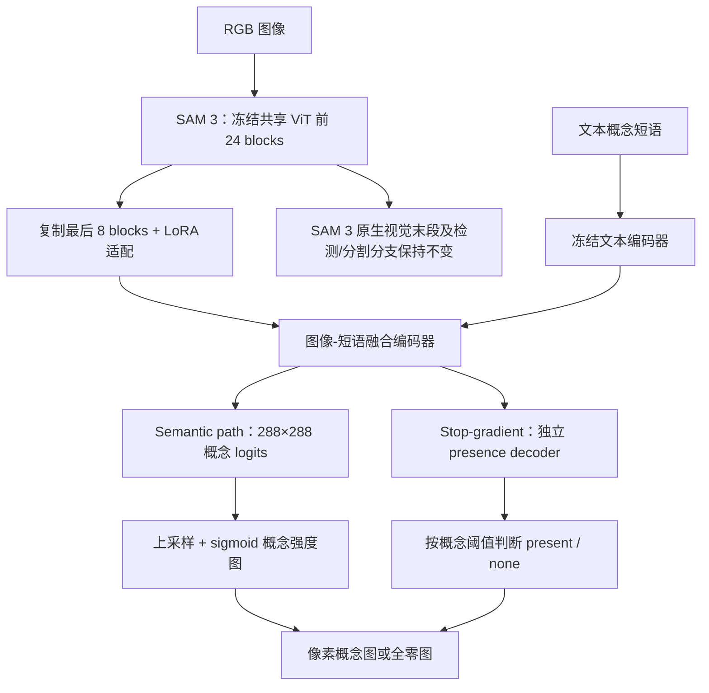
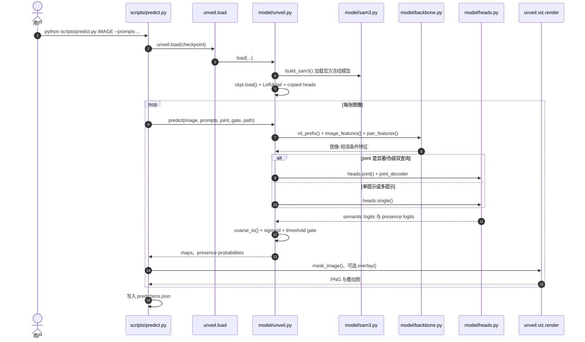

# UNVEIL｜SAM 3 看见的不止于检测：超越类别的可提示概念图

## 一句话定义

**UNVEIL**（论文 *SAM 3 Sees More Than It Detects: Promptable Concept Maps Beyond Categories*，[arXiv:2611.25747v1](https://arxiv.org/abs/2611.25747)）利用 [SAM 3](./paper-sam3.md) 的语义路径，把一条文本概念提示变成**像素级概念图或明确的“none”**，使阴影、透明物体、镜子、显著/伪装目标、边缘等非传统对象类别也能按短语查询。

## 英文缩写速查

| 缩写 | 英文全称 | 简要说明 |
|---|---|---|
| UNVEIL | UNVEIL（官方方法名） | 本文在 SAM 3 旁路训练的可提示概念图系统 |
| PCM | Promptable Concept Maps | 短语提示 → 单张概念图，或判定不存在 |
| SAM 3 | Segment Anything Model 3 | 用作视觉、文本与语义分割基础模型 |
| ViT | Vision Transformer | 冻结前段、复制并适配最后 8 个视觉 block |
| LoRA | Low-Rank Adaptation | 视觉末段低秩参数微调 |
| LVIS | Large Vocabulary Instance Segmentation | 用于类别存在判断及留出类别泛化对比 |
| IoU | Intersection over Union | 镜面/透明物体等任务的区域重合指标 |
| ODS | Optimal Dataset Scale | 边缘与骨架任务的评测尺度指标 |

## 为什么重要

SAM 3 的原生主任务是 **Promptable Concept Segmentation**：按文本/实例提示找对象。对“shadow”“edges”之类没有稳定实例边界的概念，它的**语义像素分支可能有响应**，但用于对象检测的图像级 presence 会把结果判成“没有”。UNVEIL 将“**在哪里**”的语义图与“**在不在**”的存在判定分开训练，从而让一个通用提示接口处理对象、光学现象、场景上下文和结构线索。

对机器人而言，这可作为**感知候选图**或上游伪标注，例如“阴影区域”“透明障碍物”“目标轮廓”，但论文并未证明它能直接完成 3D 建图、避障或真机闭环。

## 核心信息

| 项 | 核对结果 |
|---|---|
| 作者 | Yu-Huan Wu、Yun Liu、Liangli Zhen |
| 机构 | 新加坡科技研究局前沿人工智能研究中心（CFAR, A*STAR）；南开大学（Nankai University） |
| 论文版本 | [arXiv:2611.25747v1](https://arxiv.org/html/2611.25747v1)，2026-11-19 |
| 基础模型 | SAM 3，官方仓固定源码 commit `2345a4ad109ac29c569da749c91d84f10dc08c40` |
| 开源状态 | **已开源**：[UNVEIL 源码](https://github.com/yuhuan-wu/UNVEIL) 与 [v1.0 附加 checkpoint](https://github.com/yuhuan-wu/UNVEIL/releases/tag/v1.0)；SAM 3 基础权重仍需单独取得访问许可 |
| 输出 | 与输入图同尺寸的 0–1 概念图 + presence probability；可按阈值返回全零（none） |
| 范围 | 单图 2D 概念映射与存在决策；非 3D/视频跟踪/机器人控制算法 |

## 核心原理

### 1. 从实例分割转向可提示概念图

论文将提示概念按语义分为四组：

| 组别 | 提示样例 | 输出含义 |
|---|---|---|
| Identity | `person`、`dog` | 对象类别的空间响应 |
| Light | `shadow`、`transparent object`、`mirror` | 光照与材质相关区域 |
| Context | `salient object`、`camouflaged object` | 显著性与伪装目标区域 |
| Structure | `edges`、`skeleton`、`symmetry axis` | 边缘、骨架或对称轴的线状/结构图 |

原生 SAM 3 的实例路径以检测置信度与 image-level presence 的乘积衡量对象存在。对光影或结构等“非对象”，presence 可能压掉原本可用的 semantic map。论文通过语义分支抽取和重新监督修复这个错位，而不是把每个概念强行转换成带 bounding box 的对象。

### 2. 共享冻结主干，拷贝末段与语义头

- **SAM 3 原始分支保持不变**；新建旁路复用冻结的前 24 个 ViT blocks 和文本编码器，复制末 8 个 blocks，以 LoRA 适配。
- 从拷贝的图文融合编码器与 semantic head 得到 **288×288** 粗分辨率概念 logits，经双线性插值映射回输入尺寸。
- **presence decoder** 单独学习“提示是否真的在图中出现”；其读取的融合特征与文本提示使用 stop-gradient，不让存在判别损失破坏语义图。
- 单概念使用按提示确定的门限；任意自由文本使用共同门限。Context 的 `salient object` + `camouflaged object` 另有专门联合查询模式。
- 附加模型可以调用原生 `instances()` 或 `path="sam3"` 作对照，因此新地图与既有 SAM 3 输出能在同一模型实例中共存。

### 流程总览

这张图的 `presence` 是**图像–短语是否匹配**，不是像素级 confidence；而语义分支即使被门控，仍可用 `--no-gate` 做离线评测。

## 源码运行时序图

根据官方 `scripts/predict.py`、`unveil/__init__.py`、`unveil/model/{unveil,sam3,backbone,heads}.py` 的实际调用接口整理，属于**静态代码核对**，非本地 GPU 实测：

**可重跑入口：** `python scripts/predict.py assets/examples/coco_000000228144.jpg --prompts mirror edges "salient object" person --overlay --out outputs/example`。图中的 `heads.joint()` 表示 joint 专用分支；实际代码调用 `UNVEIL.joint()` 和联合 decoder，而普通 `single()` 从 `ConceptHeads.single()` 返回两路 logits。

## 工程实践

1. 根据 [UNVEIL 源码归档](../../sources/repos/unveil.md) 安装 PyTorch CUDA 12.8 对应包、固定版本的官方 SAM 3、`pip install -e ".[eval,data,test]"`，下载 UNVEIL v1.0 safetensors；先取得 SAM 3 checkpoint 权限或提供本地 `sam3.pt`。
2. 用 `scripts/predict.py` 输入一张图与多个短语，读取灰度 PNG 和 `predictions.json` 中的 `presence`、`threshold`、`accepted`，区分**概念图低响应**与**被 presence 门控**。
3. 做定量消融时使用 `--no-gate` 检查完整语义图，并用 `--path sam3` 对照冻结 SAM 3 语义路径；注意这两种设置的 presence 行为不同。
4. **机器人感知应用建议**：先在目标相机、弱光、镜面/透明物等难场景中人工核验召回与误报，再接深度/LiDAR 和世界坐标融合；勿直接用 2D 软图驱动碰撞安全决策。
5. 仓库要求 CUDA GPU；官方使用说明报告单查询显存约 **4.2 GiB**，八提示约 **6.6 GiB**。需在实际 GPU、分辨率、提示数量和延迟预算下重新测吞吐。

## 实验与评测

### PCM-Bench：跨任务平均不等于统一 mIoU

论文的 PCM-Bench 覆盖 **7 项主任务 / 15 个测试集 / 31,175 张图像**；各项采用对应领域指标（例如 saliency 的 S-measure、shadow 的 100−BER、透明/镜面的 IoU、edges/skeleton 的 ODS），最后对标准化的七项得分求平均。此均值**不能解释为单个分割数据集上的 IoU**。

| 论文报告的方案 | 七任务平均分（越高越好） |
|---|---:|
| **UNVEIL** | **90.5** |
| SAM 3（冻结原版） | 46.5 |
| SAM 3（presence 强制为 1） | 61.8 |
| SAM 3（full fine-tuning） | 81.6 |
| SAM 3（LoRA fine-tuning） | 82.6 |
| ConceptSeg-R1 | 74.2 |

UNVEIL 七任务对应报告分数：shadow **98.2**、transparent object **95.6**、mirror **96.4**、salient object **92.9**、camouflaged object **92.6**、edges **85.6**、skeleton **72.0**。不要混用它们对应的评价指标或将本表视为实测性能保证。

### Presence 拒绝与类别泛化

- **单查询存在判断：** 概念出现时接受率 **98.8%**；概念不存在时拒绝率 **84.7%**（论文设定）。
- **联合 Context 查询：** 出现时接受率 **94.3%**；不存在时拒绝率 **97.5%**。
- **未见对象类对照：** LVIS 留出 200 类平均 IoU 为 **0.841**，冻结 SAM 3 为 **0.831**；增益有限，说明核心贡献是非对象概念映射与存在处理。
- **计算成本：** 论文报告 RTX 4080 SUPER 上单次查询约 **138 ms**；本次未执行 GPU 复现实验。附加 LoRA / 语义训练涉及约 **24.6M 可训练参数**，另有联合 presence 扩展，不应与全模型参数量混淆。

## 结论

**UNVEIL 的价值是把 SAM 3 中未充分利用的语义像素能力变成可提示接口，并单独校准概念是否存在；它不是新的机器人策略，也不能用平均分代替真机验证。**

1. 比较前先固定**提示语义、presence gate、评价指标**；`--no-gate` 和“返回 none”是不同实验条件。
2. 面对阴影、镜面、透明体、边缘等非对象目标，可优先测试 PCM，而不是强制用 bbox/实例模型。
3. 当任务需要**可追踪对象实例**时，仍使用 [SAM 3](./paper-sam3.md) 原生实例路径；UNVEIL 的输出偏单图像素概念。
4. 必须抽检**概念不存在时的误报**，因为 verified negatives 在不同概念类型中的覆盖不均衡。
5. 在机载视觉使用前，实测多提示延迟与 GPU 显存，并完成 2D → 3D 提升、时序一致性和安全筛选。

## 与其他工作对比

| 方法 | 主要目标 | 与 UNVEIL 的差异 |
|---|---|---|
| [SAM 3](./paper-sam3.md) | 概念提示下的对象实例检测、分割及视频跟踪 | UNVEIL 复用其语义分支，面向非对象概念与显式 none 判定，保留原生功能 |
| [DART / SAM 3](./paper-dart-sam3-realtime.md) | 多类别**框检测**的实时推理重组 | DART 优先吞吐与 detection；UNVEIL 优先多类型概念的像素响应图 |
| [图像分割任务分类](../concepts/image-segmentation-taxonomy.md) | 区分语义/实例/全景分割 | PCM 进一步让光照、场景上下文、结构线索也可由短语直接定位 |

## 局限与风险

- **verified negatives 不均衡：** Context、LVIS 类别及部分 mirror 经过显式空图监督，其余光照和结构短语的缺席预测仍可能不可靠。
- **单图、二维：** 没有真机 3D 场景图、跨帧身份跟踪、机器人控制闭环或导航任务成功率验证。
- **基座与许可：** SAM 3 基础权重可能需要 Hugging Face 访问授权；UNVEIL 权重开放不等于所有依赖都免许可限制。
- **算力：** SAM 3 视觉骨干仍有明显显存与推理成本，论文桌面 GPU 数字不能推导为边缘部署帧率。
- **基准口径：** PCM-Bench 七任务跨不同指标，且部分评测对 ungated maps 打分；需将地图质量与 presence 判断分别验收。

## 关联页面

- [SAM 3：Segment Anything with Concepts](./paper-sam3.md) — UNVEIL 所依赖、且保持原生分支的基础模型。
- [DART：SAM 3 实时多类检测](./paper-dart-sam3-realtime.md) — 同基座、不同目标（检测吞吐而非多类型概念图）。
- [图像分割任务分类](../concepts/image-segmentation-taxonomy.md) — 区别语义、实例与结构/光学概念图。
- [FCN 语义分割](../methods/fcn-semantic-segmentation.md) — 对照固定类别像素监督与短语条件的概念图，澄清二者任务差异。
- [目标检测方法](../methods/object-detection.md) — 对照 bbox/存在置信度与 UNVEIL 的像素空间语义图、独立 presence 判别。
- [GO2 3D 语义建图方案](../queries/go2-3d-semantic-mapping-sam-pipeline.md) — 机器人侧深度融合与建图接口；UNVEIL 并非已集成。

## 参考来源

- [论文全文与实验核对（arXiv:2611.25747v1）](../../sources/papers/unveil_pcm_arxiv_2611_25747.md)
- [UNVEIL 官方源码与运行入口核对](../../sources/repos/unveil.md)

## 推荐继续阅读

- [原始论文 HTML 全文](https://arxiv.org/html/2611.25747v1)
- [官方仓库、运行说明及测试入口](https://github.com/yuhuan-wu/UNVEIL)
- [v1.0 附加权重发布页](https://github.com/yuhuan-wu/UNVEIL/releases/tag/v1.0)
