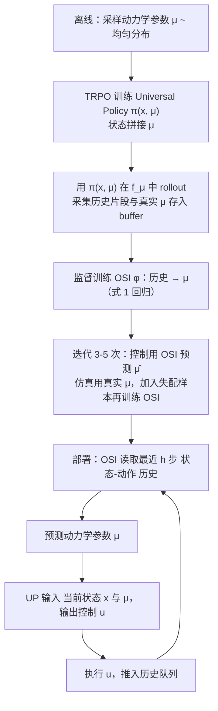

# Preparing for the unknown: learning a universal policy with online system identification

**Preparing for the unknown: learning a universal policy with online system identification (UP-OSI)**（[arXiv:1702.02453](https://arxiv.org/abs/1702.02453)）收录于 [自由度FreeDof · Sim2Real 四条路线梳理](../../sources/blogs/wechat_freedof_sim2real_four_routes_dr_to_residual_2026-08-23.md) 参考文献 **[23/44]**，归类 **在线适应**。

## 一句话定义

通用策略 + 在线辨识器：从历史估计动力学参数并调节动作，是在线适应早期形态。

## 英文缩写速查

| 缩写 | 英文全称 | 简要说明 |
|------|----------|----------|
| UP-OSI | Universal Policy with Online System Identification | 本文方法 |
| SysID | System Identification | 系统辨识 |
| RSS | Robotics: Science and Systems | 机器人科学系统会议 |

## 为什么重要

- 文内与 RMA 并列的「推迟辨识」代表。
- 在 [44 篇技术地图](../overview/freedof-sim2real-44-papers-technology-map.md) 与 [四条路线对比](../comparisons/sim2real-four-routes-identifiability.md) 中作为 **在线适应** 节点。
- 开源结论：**待核实**（步骤 2.5，2026-09-20）。

## 流程总览

图依据：论文 §III（Fig. 1、Algorithm 1 / 2）。

## 核心机制

| 项 | 内容 |
|----|------|
| **出处** | RSS 2017 |
| **文内章节** | 在线适应 |
| **要点** | 辨识器输出 extrinsics/参数 → 条件策略；部署期在线运行。 |
| **开源** | **待核实** |

## 源码运行时序图

**不适用（待核实）** — 截至 2026-09-20 以项目页/论文 Code availability 为准；入库未核验可运行入口。

## 实验与评测

- **本页为索引级节点**（FreeDof 44 篇梳理 [23/44]）：正文固化文内角色与机制要点，**未转存原文实验表**。
- **回原文须核对的证据**：本页要点是「辨识器输出 extrinsics/参数 → 条件策略；部署期在线运行」，对应证据是在线辨识器的参数估计收敛速度，以及条件策略在参数突变下的回报保持。
- **读法：** 先对齐平台、任务、指标定义与成功阈值，再读任何数字；勿从公众号摘录外推。

## 与其他工作对比

| 维度 | 读法 |
|------|------|
| **文内路线** | 归类 **在线适应**；同路线其他节点见 [44 篇技术地图](../overview/freedof-sim2real-44-papers-technology-map.md) 与 [四条路线对比](../comparisons/sim2real-four-routes-identifiability.md) |
| **横比口径** | 在线适应的收益前提是参数**本身可辨识**——先读 [02/44] 基参数与 [06/44] 信息矩阵两个节点，再判断该方法在自己平台上是否成立。 |
| **开源状态** | **待核实** — 部署 / 复现前以项目页或原文 Code availability 为准 |

## 结论

**在线 SysID 与 DR 组合是成熟路线，但激励不足会静默失效。**

1. 文内角色：在线适应 路线上的参考节点，非重复 arXiv 页面。
2. 机制要点：辨识器输出 extrinsics/参数 → 条件策略；部署期在线运行。…
3. 部署/复现前请对照原文与项目页，勿直接外推公众号数字。

## 关联页面

- [Sim2Real 四条路线（可辨识性）](../comparisons/sim2real-four-routes-identifiability.md)
- [44 篇技术地图](../overview/freedof-sim2real-44-papers-technology-map.md)
- [Sim2Real](../concepts/sim2real.md)

## 参考来源

- [freedof_sim2real_23_up-osi-universal-policy-online-sysid.md](../../sources/papers/freedof_sim2real_23_up-osi-universal-policy-online-sysid.md)
- [wechat_freedof_sim2real_four_routes_dr_to_residual_2026-08-23.md](../../sources/blogs/wechat_freedof_sim2real_four_routes_dr_to_residual_2026-08-23.md)
- [freedof_sim2real_44_catalog.md](../../sources/papers/freedof_sim2real_44_catalog.md)
- [arXiv PDF](https://arxiv.org/pdf/1702.02453)：已通读方法部分（实验与附录以略读为准）：§III Methods（A. Learning Universal Policy、B. Learning Online System Identification Model）、Fig. 1、Algorithm 1 / 2

## 推荐继续阅读

- [arXiv PDF](https://arxiv.org/pdf/1702.02453)
- [44 篇 Sim2Real 技术地图](../overview/freedof-sim2real-44-papers-technology-map.md)
