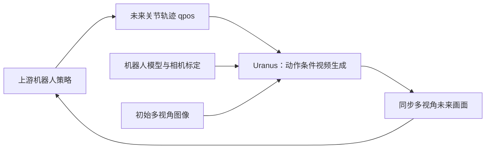
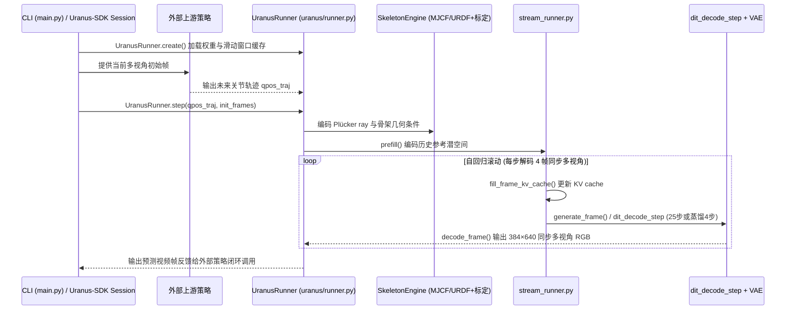

# Uranus：面向具身 AI 的下一代模拟基础设施

## 一句话定义

**Uranus**（*Building the Next-Generation Simulation Infrastructure for Embodied AI*，[arXiv:2609.24815](https://arxiv.org/abs/2609.24815)）由**地瓜机器人（D-Robotics）大模型团队**提出，是一款面向策略闭环评测的可交互动作条件化多视角视频扩散世界模拟器：输入多视角初始帧、相机内外参标定、机器人 `MJCF/URDF` 几何描述与外部策略给出的未来关节轨迹 `qpos`，滚动生成同步多视角视频（最高 24 FPS）；它模拟的是动作之后的**视觉观测**，不负责产生策略动作，也不是带有显式接触求解的通用物理引擎。

## 英文缩写速查

| 缩写 | 英文全称 | 简要说明 |
|------|----------|----------|
| WM | World Model | 根据状态/动作预测环境未来的模型；此处强调视觉后果预测 |
| qpos | Joint Position | 机器人关节位置向量；Uranus 的动作条件接口之一 |
| DiT | Diffusion Transformer | 用 Transformer 主干实现扩散/流匹配生成的架构 |
| VAE | Variational Autoencoder | 将视频帧压缩为 latent 并解码回图像 |
| KV cache | Key–Value Cache | 保存注意力历史以减少自回归生成重复计算 |
| FPS | Frames Per Second | 每秒帧数；论文报告 Uranus 达到 24 FPS |

## 为什么重要

传统物理仿真可以提供显式状态与接触动力学，但高保真渲染和资产/场景搭建成本高；纯视频生成则往往缺少可控的机器人动作接口。Uranus 的切入点是把**可执行的关节轨迹**变成显式条件，并把多视角相机几何和机器人骨架纳入生成，使其可作为具身策略的交互式视觉评测环境。项目公开了推理代码、模型权重和小规模演示数据，有利于直接检验这一接口，但不代表全量训练栈与训练数据已开放。

## 核心机制与架构

1. **条件输入：** 多视角参考 RGB、相机标定/Plücker rays、机器人 MJCF/URDF 骨架，以及上游策略提供的未来 qpos 序列。策略是动作源，Uranus 是视觉后果模型。
2. **条件视频生成：** 外层自回归滚动；内层通过 flow-matching latent diffusion transformer 生成下一段 latent，再由 VAE 解码成 4 帧同步多视角 RGB。
3. **跨相机与跨时间：** 交替使用跨视角空间注意力和单相机时间注意力；机器人骨架和相机射线编码帮助模型在视点变化时维持几何对应。
4. **在线推理：** 将历史写入 DiT KV cache，逐段追加生成结果，并以滑动窗口限制上下文长度。论文报告 24 FPS 在线生成。

## 评测、对比与解释

- **WorldOlympiad 与长时滚动（Table 5 / GE-Sim 2.0）**：在 WorldOlympiad 评测中，论文报告 `Uranus-1.3B` 综合得分 **`0.722`**，高于同表对比的 `Cosmos-Predict-2.5`（`0.712`）与 `LingBot-World`（`0.684`）；在 140–160s 长时滚动阶段，`GE-Sim 2.0` 指标报告为 **`12.3` PSNR / `0.45` SSIM**（对比基线 **`7.1` PSNR / `0.20` SSIM**）。（基线用途、预测长度与调用粒度存在差异，应作条件化对照而非通用排行榜。）
- **分布内外一致性检验（Table 8）**：5 位评审对采样 rollout 进行视觉与物理合理性打分，训练集样本一致性为 **`86%`**，未见测试环境降至 **`58%`**，明确暴露 OOD 场景泛化短板。
- **闭环策略相关性（Fig. 19）**：在 RoboTwin 闭环策略评估中，Uranus 生成环境下的策略表现与真实/干净环境呈强线性相关（**`Pearson r = 0.98`**，**`MMRV = 0.01`**）。

它与 [Isaac Lab](./isaac-lab.md)、[Newton Physics](./newton-physics.md) 的关系是互补而非替代：Isaac Lab / Newton 侧重显式状态推进、控制训练与刚体接触计算，Uranus 侧重从 `qpos` 条件生成同步多视角视觉帧；若任务高度依赖精确接触力、抓取成败或物理约束，仍必须保留物理仿真或真机校验。

## 源码运行时序图

公开推理仓库 [D-Robotics-AI-Lab/Uranus-OSS](https://github.com/D-Robotics-AI-Lab/Uranus-OSS) 与服务化封装 `Uranus-SDK` 的核心运行链路如下（详参官方 README）：

## 工程实践

- **训练底座与加速配方（Table 2）**：由 `Wan2.1` 初始化，在 3,300 小时多具身数据上使用 64 卡训练约 `500k` 步（`HSDP 8×8` + `SP=4`）；推理侧集成 `Flash-VAED`（**6×** 加速）、`FP8` 量化（**3.06×** 加速）与 H20 GPU 计算-通信重叠优化（单步延迟由 `535 ms` 降至 `505 ms`），配合滑动窗口 KV cache 实现最高 `24 FPS` 实时生成。
- **双仓库分工与资产边界**：`Uranus-OSS`（Apache-2.0）开放 `main.py`、`uranus/runner.py`（`UranusRunner.create/step`）与 `uranus/functional/stream_runner.py`；`Uranus-SDK` 提供 `UranusSimulationSession` 在线仿真会话封装。Hugging Face 已发布 `Uranus-1.3B`（25 步）、`Uranus-1.3B-Distillation`（4 步，约 `17.5 GB`）和 `Uranus-Demo-Data`；论文所用 3,300 小时全量数据与完整训练脚本尚未公开。
- **复现前检查**：自有数据必须保证关节状态 `qpos` 时间戳、机器人 `MJCF/URDF`、参考帧和相机内外参严格对齐（坐标系失配将表现为机械臂视觉畸变）；策略筛选后须结合物理仿真或真机抽样复核。

## 局限

- 不计算明确的动力学、接触力或物体状态约束，抓取/接触动作可能出现视觉上不一致的结果。
- 自回归长时预测会累积误差；分布外机器人、视角与场景可能退化。
- 视觉一致性不能自动推出动力学有效性，不能仅凭生成帧判断策略安全或真实成功率。
- 公开 demo 不等于全量训练数据，开源推理也不等于公开完整训练管线。

## 结论

**判断：** Uranus 是“由真实动作接口驱动的生成式视觉模拟器”，适合快速闭环测试和反事实视觉预测，但尚不能取代显式物理仿真或真机安全验证。

- 先把它作为策略开发的视觉筛选/数据扩增层，不作为唯一安全验证层。
- 严格核对 qpos、MJCF/URDF 和多相机标定；对齐程度决定动作条件是否有效。
- 对抓取、接触、长时任务和 OOD 场景，做物理仿真或真机对照。
- 复现实验时分别标注公开 demo、公开权重、推理代码和不可获得的训练数据/配方，避免将“开源项目”误解为全量可复现。

## 关联页面

- [World Action Models（WAM）](../concepts/world-action-models.md)：任务相关的动作与未来联合建模；Uranus 与之共享动作条件预测，但本身不是生成动作的 WAM 策略。
- [生成式世界模型](../methods/generative-world-models.md)：扩散与视频生成式环境预测。
- [Isaac Lab](./isaac-lab.md)：显式机器人仿真与学习框架。
- [Newton Physics](./newton-physics.md)：机器人/物理仿真工具链。
- [具身大模型评测基准选型闭环](../queries/embodied-eval-benchmark-selection-loop.md)：Uranus 作为策略闭环评测环境时，对应其中「世界模型预测保真度评测」层，需要用真机或物理仿真抽样复核。

## 参考来源

- [论文与开源状态归档](../../sources/papers/uranus_arxiv_2609_24815.md)
- [官方项目页归档](../../sources/sites/d-robotics-uranus.md)
- [官方推理仓库归档](../../sources/repos/uranus-oss.md)
- [arXiv 论文](https://arxiv.org/abs/2609.24815)
- [Uranus-OSS](https://github.com/D-Robotics-AI-Lab/Uranus-OSS)
- [Demo Data](https://huggingface.co/datasets/D-Robotics/Uranus-Demo-Data)
- [模型集合](https://huggingface.co/collections/D-Robotics/uranus)

## 推荐继续阅读

- 论文与技术报告（`arXiv:2609.24815` v3）：<https://arxiv.org/abs/2609.24815>
- 官方推理仓库（`Uranus-OSS`，Apache-2.0）：<https://github.com/D-Robotics-AI-Lab/Uranus-OSS>
- 官方仿真会话封装（`Uranus-SDK`）：<https://github.com/D-Robotics-AI-Lab/Uranus-SDK>
- 模型权重集合与演示数据（Hugging Face）：<https://huggingface.co/collections/D-Robotics/uranus>
