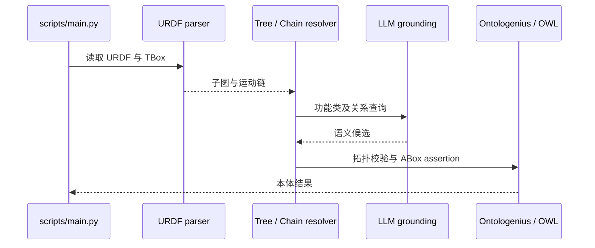

# Taxonomy-Agnostic Neurosymbolic Grounding of Robot Kinematics｜URDF2Ontology 机器人运动学语义接地

## 一句话定义

URDF2Ontology 将 URDF 的运动学图通过双轨形态解析、LLM 语义推理和图清理转成 OWL 本体。

## 英文缩写速查

| 缩写 | 英文全称 | 简要说明 |
|---|---|---|
| URDF | Unified Robot Description Format | 本研究涉及的URDF术语 |
| OWL | Web Ontology Language | 本研究涉及的OWL术语 |
| LLM | Large Language Model | 本研究涉及的LLM术语 |

## 为什么重要

读取关节/连杆图和用户提供的 taxonomy。

## 核心原理与方法

1. 读取关节/连杆图和用户提供的 taxonomy。
2. 分支结构用 bottom-up Tree Track，串联结构用 top-down Chain Track。
3. 对已解析子图逐步清理，通过符号规则约束 LLM 输出语义能力本体。

## 流程总览

> 根据论文方法与作者公开资料重绘，非作者原图。

## 实验与评测

摘要称异构机器人上能抽取结构、实现 schema 对齐；文章提及五类机器人，复杂传感器和语义分类仍有局限。

上述结果均为作者报告或用户附件转载，**不是本次复测**。

## 结论

**URDF2Ontology 将 URDF 的运动学图通过双轨形态解析、LLM 语义推理和图清理转成 OWL 本体。**

1. 读取关节/连杆图和用户提供的 taxonomy。
2. 分支结构用 bottom-up Tree Track，串联结构用 top-down Chain Track。
3. URDF 缺少任务语义，LLM 语义推断可能幻觉；不等同自动认证机器人能力。

## 与其他工作对比

比较本文与相关基线时应在相同任务、数据、样本量、传感器和部署条件下评估；不能把论文中的单个数字解释为真实部署的通用进步。待全文表格核对后补足逐项量化对照。

## 源码运行时序图

按官方 README/启动入口绘制，尚未独立执行。

## 工程实践

- 对齐版本、传感器、动作/观测空间和评测预算后再尝试复现。
- 正式应用应增加跨分布扰动与任务安全边界检查；原文完整复现步骤待核对。
- 已通读可获取的原文方法、实验及附录；尚未独立运行代码。

## 局限与风险

URDF 缺少任务语义，LLM 语义推断可能幻觉；不等同自动认证机器人能力。

已核对论文正文与附录；源码运行和真实部署仍需独立验证。

## 全文核验补记

URDF2Ontology 输入 URDF 的 link/joint 图与用户指定的 TBox 类层次，将可推断的本体功能映射到 OWL/ABox 实例断言。图 2 表明三阶段循环：Phase I 提取尚未处理的子链，Phase II 用 Tree Track 自底向上聚合多分支的传感器、末端执行器与移动组件，用 Chain Track 自顶向下拆分串联肢体，Phase III 完成实体命名、拓扑检验与 ABox 写入；外层循环逐类处理并清掉已经标注的节点，降低 LLM 上下文负担。文章展示五类机器人形态，不代表对所有高密度传感器及语义角色都正确。官方仓提供 `scripts/main.py` 类入口及 ROS 2 Ontologenius 启动说明，依赖正确 URDF/本体与 LLM 配置；本轮没有运行。

## 关联页面

- [motion-retargeting](../concepts/motion-retargeting.md)
- [whole-body-control](../concepts/whole-body-control.md)

## 参考来源

- [原论文及阅读进度](../../sources/papers/urdf2ontology_arxiv_2611_13850.md)
- [官方源码入口](../../sources/repos/urdf2ontology.md)
- [用户附件 13 篇原始资讯整理](../../sources/blogs/embodied-research-digest-2026-11-12.md)

## 推荐继续阅读

- [arXiv 原文](https://arxiv.org/abs/2611.13850)
- [官方源码](https://github.com/RIS-WITH/urdf2ontology)
