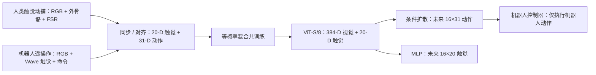
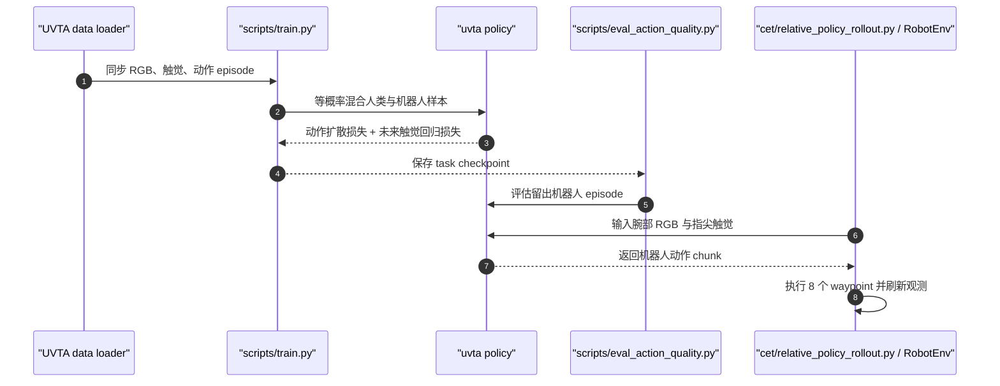

# UVTA：跨本体视触觉动作建模

**一句话定义：** UVTA 用可穿戴人类触觉示范学习跨本体接触表征，并与机器人遥操作数据联合预测未来动作和触觉轨迹；部署时仅执行机器人动作。

## 英文缩写速查

| 缩写 | 英文全称 | 简要说明 |
|------|----------|----------|
| UVTA | Unified Visual-Tactile-Action | 跨本体联合学习视觉、触觉与动作表示的方法 |
| VTPM | Visual-Tactile-to-Piezoresistive Taxel Mapping | 将 Wave 视觉触觉变形映射为人手 FSR 风格的 20-D 区域触觉 |
| FSR | Force-Sensing Resistor | 人手触觉外骨骼指尖使用的压阻式传感器 |
| DDIM | Denoising Diffusion Implicit Models | rollout 时以 16 个反向步骤采样动作块的扩散采样方法 |
| DoF | Degrees of Freedom | 表示外骨骼与机器人灵巧手的关节自由度 |

## 核心信息

| 字段 | 内容 |
|------|------|
| 机构 | 上海交通大学（Shanghai Jiao Tong University）、北京通用人工智能研究院（BIGAI）、Sharpa Robotics、北京理工大学（Beijing Institute of Technology） |
| 人类采集系统 | 被动 22-DoF 手指连杆外骨骼 + VIVE 腕部追踪 + 腕部鱼眼 RGB + 指尖 FSR |
| 机器人平台 | Sharpa North 固定底座双臂平台，双手为 22-DoF Sharpa Wave |
| 同步频率 | 图像、触觉、腕姿与手动作统一重采样至 30 Hz |
| 数据 | 五项任务；每项 1,000 条人类示范、约 150 条机器人遥操作示范；flip_book 发布 149 条机器人 episode |
| 开源 | 官方训练、评估与 rollout 代码公开（MIT）；数据集托管于 Hugging Face，约 482 GB |

## 为什么重要

- **把「人类示范规模」延伸到触觉。** 普通第一视角视频很难直接揭示接触压力、滑移与局部形变；UVTA 用穿戴式指尖触觉把人类的接触经验与动作同步采出来。
- **跨本体传知识，不直接重放人手动作。** 人手和机器人手的结构不同，模型对齐的是触觉与动作表征中的交互规律；人类动作是监督目标，部署只下发机器人动作。
- **让模型预见接触后果。** 未来触觉轨迹作为辅助预测目标共同塑造视觉表征，使动作生成关注动作将造成怎样的接触变化。消融显示该目标对结果有实际贡献。

## 核心原理

### 采集与统一表示

人类侧由被动 22-DoF 外骨骼、两只 VIVE Tracker 3.0、腕部鱼眼相机与指尖压阻阵列采集；每个指尖含四个区域，五指合并成 20 维触觉量。机器人侧以 Sharpa North 遥操作采集腕部 RGB、Wave 视觉触觉和可执行腕/指命令。两侧都形成同步样本：

- 当前观测：腕部 RGB 图像 + 20-D 触觉向量；
- 动作目标：31-D 向量，由腕部相对位姿（平移 3-D + 连续旋转表示 6-D）与 22-D 手指关节角组成；
- 未来目标：与 16 步动作时域对齐的 16×20 触觉轨迹。

VTPM 将机器人 Wave 传感器的视觉形变图投影到与人手手套对应的四个指尖区域，形成两种本体共享的 20-D 触觉表示。人手 22-DoF 姿态通过指尖运动学、约束 IK 和关节耦合映射到 Sharpa Wave 手的关节空间；动作采用各自本体的归一化统计，降低传感器与运动尺度差异。

### 联合动作–触觉模型

视觉编码器从腕部 224×224 图像生成 384-D token，与当前触觉 token 拼成 404-D 条件表示。动作头以 FiLM 条件化 1-D U-Net 做扩散去噪；触觉头是两层 MLP，直接回归未来触觉。训练总目标：

$$
\mathcal{L}=\mathcal{L}_{\mathrm{action}}+0.2\,\mathcal{L}_{\mathrm{tactile}}.
$$

人类与机器人样本通过等概率、有放回抽样参与同一次训练，而非先人类预训练、再机器人微调。推理使用 16 个 DDIM 反向步骤得到 16-step 动作块；真机每次执行前 8 个腕/手 waypoint，再用新观测滚动更新。未来触觉预测支路仅作训练监督，不直接进入控制命令。

## 数据与实现

| 项目 | 公开实现与复现注意 |
|------|-------------------|
| 数据集 | Hugging Face 上 28 个 Zarr v2 tar 分片，约 482 GB；按任务下载并保留隐藏 Zarr 元数据 |
| 任务 | 翻书页、拧灯泡、拨动开关、球体材质分类、滴管转液 |
| 训练 | scripts/train.py；每任务单次联合训练，默认 300 epochs、batch 250；灯泡任务配置 500 epochs |
| 离线评估 | scripts/eval_action_quality.py；检查留出机器人 episode 的腕部 RMS 误差与动作块粗糙度 |
| 真机 rollout | cet/relative_policy_rollout.py；RobotEnv、机械臂运动学和厂商 SDK 需目标平台自行适配 |
| 依赖条件 | Python ≥3.10；README 指定 PyTorch 2.5.1 / torchvision 0.20.1（按 CUDA 版本安装） |
| 开源范围 | 代码 MIT；数据集许可需以 Hugging Face 数据卡为准，本次未确认 |

## 源码运行时序图

源码模块名与官方仓库 README 入口对应。部署入口可复用策略 rollout，但须适配目标机器人的接口、运动学和厂商 SDK。

## 实验结果

五项真机任务每项进行 10 次 rollout；成功率如下：

| 方法 | 翻页 | 灯泡 | 开关 | 球体分类 | 液体转移 | 平均 |
|------|------:|------:|------:|------:|------:|------:|
| ViTacFormer | 0% | 4% | 0% | 0% | 0% | 1% |
| RDP | 10% | 20% | 20% | 18% | 0% | 14% |
| T-Rex（最强基线） | 43% | 26% | 24% | 36% | 15% | 29% |
| UVTA（完整模型） | **83%** | **80%** | **88%** | **56%** | **44%** | **70%** |

- 移除未来触觉预测：平均成功率降至 42%（完整模型高 28 个百分点）。
- 仅用人类数据训练：平均成功率 0%，说明人类动作须与本体特定机器人执行监督结合。
- 视觉单模态：26%；加入本体感觉的消融：18%。在该设置中，额外本体感觉输入未带来增益。
- 人类示范扩展到每任务 1,000 条时，三个扩展任务平均 84%，仍未见性能饱和。

## 局限与风险

- **任务与评测规模有限：** 五项固定底座 Sharpa North 任务；每任务 10 次评测 rollout，不能据此推断开放环境泛化能力。
- **触觉覆盖仅在指尖：** 作者明确指出未采集手掌及手部其余区域的接触。
- **数据重且部署需工程适配：** 数据集约 482 GB；代码未提供目标平台的完整 RobotEnv、厂商 SDK 和机械臂运动学，部署并非下载后即能直接运行。
- **跨本体映射有损：** 人手和 Wave 触觉均压缩成四区×五指区域量，局部接触细节会被丢弃。
- **复现依赖时间同步与标定：** 人手与机器人触觉分别做基线校正和归一化；需保持一致的观测时间对齐和传感器标定。

## 对比：触觉未来监督与多模态世界模型

[Thinker-WM](./paper-thinker-wm-unified-world-model.md) 将 RGB、度量深度与机器人动作放入共享动态表征，并覆盖多种世界预测、动作生成与策略推理任务；UVTA 的研究范围更窄，重点是双手灵巧操作中的接触状态，把未来指尖触觉轨迹作为动作策略的辅助监督。前者扩大统一世界模型的模态与任务覆盖，后者针对视觉容易漏掉的局部接触物理提供直接触觉目标，两者互补，指标不宜横向直接比较。

## 结论

**UVTA 证明人类触觉接触经验可以扩展机器人灵巧操作训练，但人类动作不能直接替代机器人执行示范；未来触觉预测是共享表征学习中的关键监督。**

1. **优先复现联合训练，而非仅用人类数据。** 论文中人类数据 only 的结果为 0%，机器人示范仍提供目标本体的可执行控制监督。
2. **重视未来触觉辅助头。** 移除此头后平均成功率从 70% 降至 42%；这 28 个百分点是论文的重要消融结果。
3. **按评测次数解读指标。** 主表每任务 10 次 rollout，70% 是五任务均值，不能视为大规模稳健性保证。
4. **预算计入数据和部署工程。** 数据约 482 GB；真机 rollout 需要适配 RobotEnv、腕部相机、触觉同步与手臂运动学。
5. **将其视为指尖触觉路线。** 人手全掌接触与更大规模模型仍是待扩展方向。

## 关联页面

- [Tactile Sensing（触觉感知）](../concepts/tactile-sensing.md) — 接触量测作为操作闭环的观测与学习信号
- [Visuo-Tactile Fusion（视触觉融合）](../concepts/visuo-tactile-fusion.md) — 视觉与触觉表征的融合机制
- [Contact-Rich Manipulation（接触丰富操作）](../concepts/contact-rich-manipulation.md) — 依赖力、摩擦和形变反馈的操作任务
- [Manipulation（操作任务）](../tasks/manipulation.md) — 机器人操作任务谱系
- [Imitation Learning（模仿学习）](../methods/imitation-learning.md) — 从人类与机器人示范提取策略监督
- [Diffusion Policy（扩散策略）](../methods/diffusion-policy.md) — 多步连续动作块生成

## 参考来源

- [UVTA 论文来源归档](../../sources/papers/uvta_arxiv_2609_34182.md)
- [UVTA 项目页与开放状态核查](../../sources/sites/uvta.md)
- [UVTA 官方代码与数据复现入口](../../sources/repos/uni-vta-uvta.md)

## 推荐继续阅读

- [UVTA 官方项目页](https://uni-vta.github.io/)
- [官方代码仓库](https://github.com/uni-vta/UVTA)
- [Hugging Face 数据集](https://huggingface.co/datasets/Chopper233/UVTA)
- [TouchWorld：预测式触觉基础模型](./paper-touchworld-tactile-foundation-dexterous-manipulation.md)
- [T-Rex：触觉中训练与动作专家](./paper-trex-tactile-reactive-dexterous-manipulation.md)
