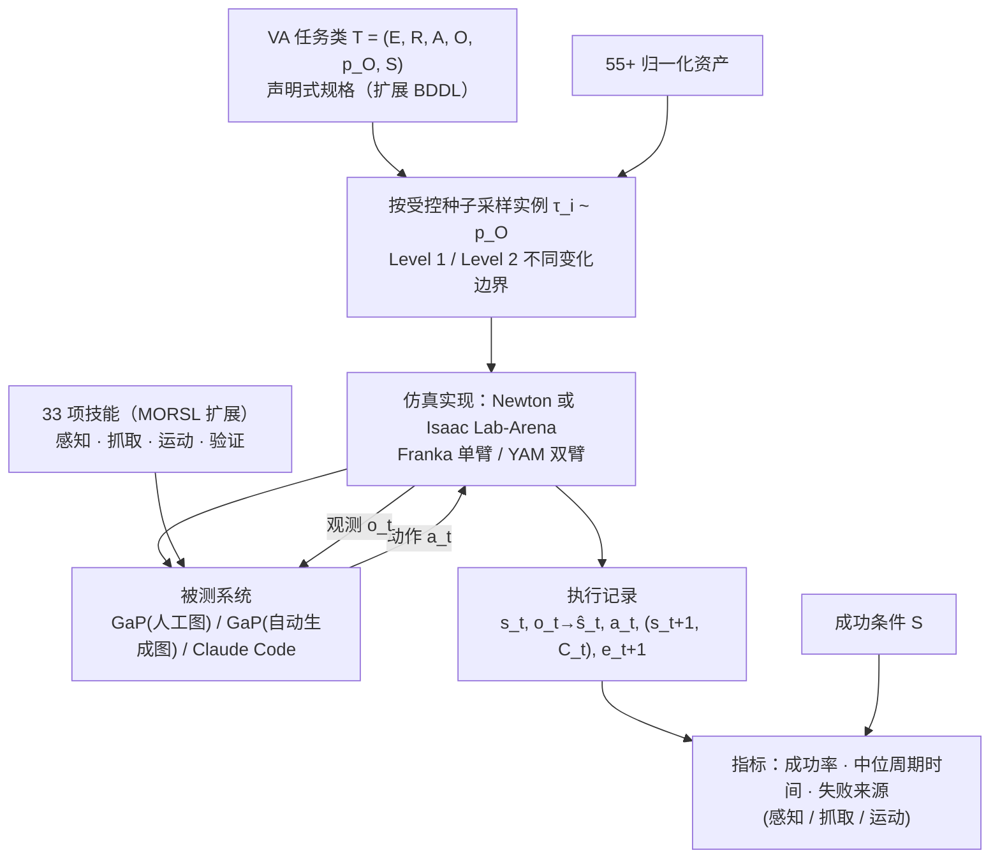
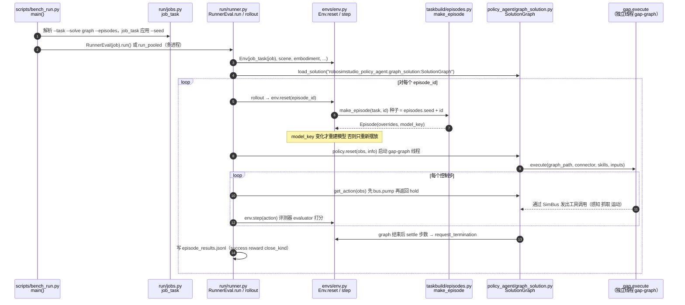

# VABAR（变体自动化 agentic 机器人基准）

**VABAR**（*VABAR: A Variational Automation Benchmark for Agentic Robotics*，Shuangyu Xie\* 等 19 位作者，UC Berkeley / NVIDIA / Siemens，arXiv:[2611.06881](https://arxiv.org/abs/2611.06881)，本页依据 **v1**，提交日 2026-11-04，[项目页](https://berkeleyautomation.github.io/vabar-website/)）是一个**开放、可复现、基于仿真**的操作基准，用来系统评测"由 LLM / VLM 编码 agent 构建机器人程序"的系统在**已知对象形状与位姿变化**下能否持续、可靠地完成同一任务。

## 一句话定义

**把"变体自动化（VA）"形式化为元组 T = (E, R, A, O, p_O, S)，在六类工业 / 医疗 / 基础设施操作任务上按固定种子从受约束的变化分布里采样实例，配 33 个可复用技能和人工编写的参考计算图，并记录物理接触证据以便定位失败来源。**

## 英文缩写速查

| 缩写 | 英文全称 | 简要说明 |
|------|----------|----------|
| VABAR | Variational Automation Benchmark for Agentic Robotics | 本基准 |
| VA | Variational Automation | 介于固定自动化与通才机器人之间：任务目标持久、实例在已知范围内变化 |
| GaP | Graph-as-Policy | 把策略表示为计算图的多 agent harness，本文基线，见 [GaP 页](./paper-gap-graph-as-policy.md) |
| MORSL | Modular Open Robot Skill Library | GaP 的技能库；VABAR 在其上扩展 |
| ILA | Isaac Lab-Arena | NVIDIA 的基准编写与评测框架，见 [Isaac Lab Arena](./isaac-lab-arena.md) |
| BDDL | Behavior Domain Definition Language | 原用于 BEHAVIOR 的任务描述语言；VABAR 扩展到刚体 + 可变形体 |
| YAM | （双臂平台名，论文未展开全称） | 双臂机器人，用于线缆插接与布线 |
| TS / TH / GM / SP / CI / CR | Tool Sorting / Tool Hanging / Gear Meshing / Syringe Packing / Cable Insertion / Cable Routing | 六类任务简称（论文 Table I） |

## 为什么重要

- **补上"agentic 系统该怎么比"的缺口**：论文指出 LIBERO、ManiSkill、SimplerEnv 等多面向语言条件视觉运动策略、以家居拾放为主且不少已被高成功率刷饱和（§I）；VABAR 针对"持久目标 + 结构化变化"的产线类场景，并且**不规定程序表示**——生成代码、计算图、工具调用、学习策略、混合系统都可在同一条件下比较（§II-C）。
- **把"变化"当作任务本身而非扰动**：与 LIBERO-Plus / PRO / X 等"在名义任务周围加扰动"不同，变化轴与难度档是任务定义的一部分（§II-B）。
- **失败可归因**：除成功率外记录观测 / 估计 / 动作 / 物理结果 / 接触 / 验证事件，可映射到感知、决策、物理交互、验证四类失败（§III-C，Fig. 3）。
- 与本库的关系：[变体自动化](../concepts/variational-automation.md) 概念由 GaP 提出，VABAR 是它的**评测基准化**；同一批作者（Berkeley AUTOLab 的 Chen、Xie、Yoo、Zhu、Goldberg 等）也做了 [RoboSimStudio](./robosimstudio.md)，VABAR 的 Newton 实现与之关系见下文「核对」。

## 核心方法 / 机制

### 1. VA 任务形式化（§III-B）

- T = (E, R, A, O, p_O, S)：E 环境坐标系；R 机器人与夹爪；A 可用初始资产（含物理属性与碰撞网格）；O 可接受的物体配置空间；p_O 其上的分布；S 可测量的成功条件。
- 一个实例 τ_i = {(a_j, x_j)}，x_j ∈ SE(3)，τ_i ~ p_O。项目页补充：**实例在受控随机种子下抽取**，重新运行文档可复现同一批场景。
- **O 不是无约束场景随机化**，而由五条准则界定：任务不变性、物理可行（支撑 / 碰撞 / 几何一致）、机器人可行（落在可达工作空间内）、难度可控（档位逐级放宽）、技能保持（同档实例可由同一组技能或其扩展解决）。

### 2. 变化（variation）如何生成

| 层面 | 论文 / 项目页的说法 | 来源 |
|------|----------------------|------|
| 变化轴 | 每任务显式列出：工具种类 / 位姿 / 密度（TS），工具种类 / 数量 / 位姿 / 挂架位姿（TH），齿轮数 / 尺寸 / 初始位姿（GM），目标数量 / 收纳盒类型（SP），连接器与接口位姿（CI），钉子数量 / 位置 / 间距、目标顺序、线缆长度 / 松弛 / 曲率、端点、板位姿（CR） | §V |
| 难度档 | 每任务 Level 1 / Level 2 两档（Table I），"同一采样器、不同边界，变化的是可接受区域宽度而非任务目标" | Table I；项目页 §6 |
| 有效性保证 | 齿轮啮合"从一个有效装配构型出发，再移除并重新摆放选定齿轮"，保证实例物理有效 | §V(3) |
| 可复现 | 受控种子 + 标准成功判据（设计准则 5） | §III-A |
| 评测规模 | 每个任务×难度条件 N = 30 个独立生成实例 | §VII-C |

论文**没有给出采样器的具体实现**。静态阅读 RoboSimStudio 仓库（VABAR 的 Newton 实现所依托的平台，见「核对」）可看到通用机制：`taskbuild/episodes.py` 规定"一个 episode 只取决于它的种子"，种子 = `task.episodes.seed + episode_id`，采样器是纯函数 `sampler(task, episode_id, rng)`，内置 `fixed`、`grid_xy_quat`（在网格 × 偏航上枚举并加 jitter）、`move_near`、`compose`。这些是平台的通用采样器，**不是 VABAR 各任务的实现**（VABAR 任务集合在该仓库中被刻意排除，见下文）。

### 3. 任务执行记录（§III-C，Fig. 3）

记录 s_t（特权物理状态）、o_t → ŝ_t（观测与状态估计）、a_t（动作）、(s_{t+1}, C_t)（物理结果与接触）、e_{t+1}（验证 / 执行事件），并给出四条失败映射：感知 / 状态估计，决策 / 技能选择，物理交互（抓取、运动、碰撞），验证与恢复。

### 4. 资产、机器人、任务规格、物理（§IV）

- **55+ 资产**，在格式、尺度、外观、碰撞几何上归一化。
- **机器人**：单臂 Franka（TS / TH / GM / SP，项目页）与双臂 YAM（CI / CR）。论文正文写明 GM 为单臂、CR 为双臂 YAM；"任务 1–4 用 Franka、5–6 用 YAM"出自项目页。
- **任务规格**：声明式，扩展 BDDL 以统一刚体与可变形体。
- **物理**：NVIDIA Newton，统一刚体与可变形体及其交互；论文给出两套实现：Newton 与 Isaac Lab-Arena（两者纹理、光照、资产、机器人实现不同）。

### 5. 技能库：33 项（§VI，Fig. 4）

在 MORSL（GaP 技能库）上扩展：**25 个新增、8 个沿用**（相对"May Graph-as-Policy library"）。下表由 Fig. 4 的卡片逐项读出（PDF 第 6 页，图片，非正文文字；"+"为新增）：

| 类别 | 技能（+ 为新增） | 数量 |
|------|------------------|------|
| (a) 感知与状态估计 | Perceiving objects；Perceiving objects oneshot；Perceiving object parts；Tracking objects；+ Perceiving next item；+ Perceiving functional features；+ Perceiving relational correspondences；+ Perceiving sorting pairs；+ Reconstructing collision worlds；+ Registering held objects；+ Perceiving deformable linear objects；+ Perceiving routing fixtures | 12（新增 8） |
| (b) 抓取提议与执行 | Grasping direct IK；Grasping with planner；Grasping short axis；+ Proposing short axis grasps；+ Proposing side grasps；+ Selecting reachable grasp；+ Grasping linear feature；+ Grasping concave contour | 8（新增 5） |
| (c) 运动规划与执行 | Transporting objects；+ Computing feature mating poses；+ Planning held object motion；+ Executing held object motion；+ Executing feature mating；+ Placing held feature；+ Anchoring a free end；+ Seating a cable crossing；+ Plugging a cable end；+ Tipping over a surface edge | 10（新增 9） |
| (d) 验证 | + Verifying grasps；+ Verifying placement；+ Verifying a cable route | 3（新增 3） |

合计 12 + 8 + 10 + 3 = 33；新增 8 + 5 + 9 + 3 = 25；沿用 4 + 3 + 1 + 0 = 8，与图注一致。图中还标出"graph-level retry / re-perception / replanning"从验证层回到感知与抓取。技能说明：感知端含"度量级特征定位、源-目标对应、手内配准"，线缆技能"估计并跟踪有序 3D 中心线，支持锚定、布线、末端放置"。核心感知与机器人能力（末端位姿读取、基于 SAM3 的分割）六类任务共用（§VIII-d）；另有项目页展示的 unjam 恢复技能片段（Fig. 5 之后的对比视频，属项目页内容，论文正文未列为 33 项之一，是否计入 33 项**未能核实**）。

## 流程总览

图依据：论文 Fig. 2（评测框架）、Fig. 3（诊断执行流）、§VII-B（评测协议）。

## 实验与评测

### 设置（§VII）

- **被测系统**（Table II 列）：a-i GaP（Human）on Newton；a-ii GaP（Human）on ILA；b Claude Code（Claude Opus 5，无机器人 harness 与技能库）on Newton；c GaP on Newton（同一模型自动生成计算图并接 MORSL 技能）。
- 说明：论文里的"Isaac Lab Arena 基线"**不是另一种方法**，而是**同一份人工计算图换到 ILA 实现上跑**（a-ii），用来对比两种实现；a-i 与 c 共享感知 / 技能 / 规划 / 执行模块，二者差距只反映图的组合与参数化。
- 协议：N = 30 个独立生成实例 / 条件（论文）；项目页称 ILA 列在自己的实例上 N = 40（**项目页表述**，论文正文未写；见下方核对）。成功单位按任务依赖结构定：互不依赖的多物体任务按物体计，GM 等状态相关任务以完整实例为单位；周期时间为仿真时间，只对成功试验取中位数；失败按"最早可被证据支持的失败"归因；ILA 在 NVIDIA L40 GPU 集群上跑。

### Table II：成功率 Succ.（%）/ 中位周期时间 Cyc.（s）

| 任务 | 难度 | a-i GaP(人工) Newton | a-ii GaP(人工) ILA | b Claude Code Newton | c GaP Newton |
|------|------|----------------------|--------------------|----------------------|--------------|
| Tool Sorting | L1 | 47.1 / 421.6 | 20.0 / 555.0 | 0.0 / N/A | 26.7 / 134.2 |
| Tool Sorting | L2 | 33.7 / 913.8 | – / – | 0.0 / N/A | 13.3 / 232.3 |
| Tool Hanging | L1 | 86.7 / 86.1 | 67.5 / 98.3 | 16.7 / 96.2 | 33.3 / 81.5 |
| Tool Hanging | L2 | 81.7 / 158.4 | 50.0 / 138.3 | 10.0 / 190.8 | 10.0 / 270.9 |
| Gear Meshing | L1 | 100.0 / 165.9 | 87.5 / 198.9 | 0.0 / N/A | 70.0 / 156.6 |
| Gear Meshing | L2 | 90.0 / 235.5 | 80.0 / 381.3 | 0.0 / N/A | 60.0 / 284.1 |
| Syringe Packing | L1 | 87.0 / 228.8 | 52.5 / 939.0 | 0.0 / N/A | 33.3 / 371.1 |
| Syringe Packing | L2 | 63.0 / 472.3 | 40.0 / 1810.0 | 0.0 / N/A | 12.1 / 652.2 |
| Cable Insertion | L1 | 86.7 / 78.8 | 97.5 / 104.9 | 0.0 / N/A | 36.7 / 79.0 |
| Cable Insertion | L2 | 30.0 / 74.2 | 17.5 / 118.8 | 0.0 / N/A | 23.3 / 80.5 |
| Cable Routing | L1 | 46.7 / 116.0 | 50.0 / 145.9 | 3.3 / 120.7 | 36.7 / 50.8 |
| Cable Routing | L2 | 46.7 / 189.8 | 5.0 / 151.5 | 0.0 / N/A | 13.3 / 120.3 |

### Table III：GaP 失败来源（占失败的百分比；Perception / Grasp / Motion）

| 任务 | L1 | L2 |
|------|----|----|
| Tool Sorting | 37.8 / 51.4 / 10.8 | 56.4 / 28.7 / 14.9 |
| Tool Hanging | 0.0 / 0.0 / 100.0 | 21.4 / 28.6 / 50.0 |
| Gear Meshing | N/A | 7.1 / 21.4 / 71.4 |
| Syringe Packing | 0.0 / 0.0 / 100.0 | 57.9 / 0.0 / 42.1 |
| Cable Insertion | 50.0 / 0.0 / 50.0 | 0.0 / 4.0 / 96.0 |
| Cable Routing | 27.3 / 45.5 / 27.3 | 5.3 / 31.6 / 63.2 |

### 论文的四条讨论（§VIII）与本页核对

- **(a) harness 与技能库有价值**：同一底层模型下 GaP 在 12 个条件中的 11 个高于 Claude Code（核对 Table II：Tool Hanging L2 两者均为 10.0，为平局，其余 11 个条件 GaP 更高）；GM 上 GaP 为 70.0 / 60.0，Claude Code 为 0。但 GaP 在 Newton 上**全部 12 个条件均低于人工图**。论文自述这比较的是整体系统，**无法拆分 harness 与技能库各自的贡献**。
- **(b) 多数错误来自运动规划**：低变化档下感知与抓取基本可靠；高变化档（杂乱、可变形）感知与抓取劣化，精密接触任务（USB-C 插接）几乎全是运动 / 插入对准失败。注意 Table III 的 TH L1 与 SP L1 样本量小（占比为 0 / 100 的极端值）——**推测**每格失败数不多，论文未给计数。
- **(c) 详细物理模型支持诊断**：Fig. 5 展示 syringe 卡在盒盖平面的两个 jam 回合 t01 / t29（验证报告 blocked，已投 7/8 与 6/8）。
- **(d) 技能复用广泛**：TH 与 SP 共享手持物体运动、功能特征感知、物体配准、特征对接等技能。

## 结论

**VABAR 的价值在于把"产线式重复任务 + 受控变化"做成可复现的 agentic 评测，并给出一个明确结果：在这个基准上，有机器人 harness 与技能库的 GaP 远超通用编码 agent，但仍系统性低于人工写的图。**

- 真实可比的是"同一技能栈下，人工图 vs 自动生成图"（Table II a-i vs c）：差距只来自图组合与参数化，12 个条件无一例外。
- 难度档确实有区分度：CI 在 Newton 上 86.7 → 30.0，SP 87.0 → 63.0（人工图）；TH 与 CR（Newton 人工图）两档接近。
- 跨实现差异不可忽略：同一人工图在 ILA 上 CI L1 达 97.5（高于 Newton 的 86.7），SP 周期时间 939.0 / 1810.0 s 远大于 Newton 的 228.8 / 472.3 s；两实现资产、光照、机器人均不同，**不应把 ILA 与 Newton 数字当同一口径**。
- 复现前提：仓库按项目页标注 Nov 9 公开，截至 2026-11-06 未能获取；公开后需核对仿真器版本、实例集与评测脚本是否与论文数字一致。

## 局限

**原文自述 / 可见**：

- 基线仅有 GaP 与一个通用编码 agent；论文明确"比较的是整体系统，不隔离 harness 与技能库"。
- 每任务仅两档难度（Table I）；"耐久性（durability）"要求随版本扩展变化范围，但 v1 只给出两档。
- Table II 无 ILA 的 Tool Sorting L2 结果（以 "–" 标出，原因论文未说明）。
- 论文是仿真基准；"结果可预测真实成功率"属设计目标（准则 2），v1 **未提供真机验证**。

**本页核对（含推测）**：

- 项目页上 arXiv 链接仍为占位 `arXiv:XXXX.XXXXX`，BibTeX 年份写 2027 且键名 `xie2027vabar`，与 arXiv 2026-11-04 提交不符，引用时以 arXiv 为准。
- Table II 中 ILA 列各数值均为 2.5 的整数倍（如 97.5、67.5、17.5、5.0），与项目页"N = 40"相符（**推测**：97.5 对应 39/40）；而 Newton 列的 47.1、33.7、87.0、63.0、12.1 等不是 1/30 的倍数，与"按物体计试验"的协议一致（**推测**）。
- 33 项技能清单仅见于 Fig. 4 图片，文字版未在论文正文列出；本页逐卡片读出并核对了 33 / 25 / 8 三个计数。

## 源码运行时序图

**不适用于 VABAR 本体**：截至 2026-11-06，项目页写明仓库 `github.com/BerkeleyAutomation/VABAR` "available by Nov 9"，`git ls-remote` 返回需要认证（未公开或尚未创建），GitHub API 返回 403。因此 VABAR 任务环境、实例生成器、评测器、基线运行器均无法阅读。

下图改为描述 **VABAR 的 Newton 实现所依托平台 RoboSimStudio 的评测通路**（仓库 `robosimstudio/robosimstudio`，提交 `013b7181d3f5810cd29f954e00131bf6d7b97b61`，**静态阅读、未运行**）。依据：项目页把 RoboSimStudio 列为 Simulation Platforms；仓库内 `examples/08_demos/route_the_cable/board.py` 称其为 "VABAR `cable_route/port_easy`" 的复现，`robosimstudio_bench/run/fleet.py` 提到 `vabar_eval.wave_widths`，`tests/test_panda_vendored.py` 指明 `vabar/` 集合"不在本仓库"。**VABAR 与该通路的确切对应关系属推测**，节点均为该提交里真实存在的文件 / 类 / 函数。

复现要点（来自 `scripts/bench_run.py` 的模块文档）：`--solve graph --graph <name> --episodes 0:16 --workers 4` 或 `--num-worlds 16`；evaluator 的判定才是成功度量，graph 自报成功只是"声明"；仓库自述"出货的每个套件声明 `EpisodeSpec(count=1, sampler=fixed)`，`--episodes 0:32` 是对同一布局的 32 次试验"，要测泛化须自带带采样器的 job 文件。这说明该平台默认并不自带 VABAR 的变化采样，**VABAR 的实例集需等其仓库公开后核对**。

## 与相关工作对比

| 工作 | 与 VABAR 的区别（论文 §II 口径 + 本库节点） |
|------|--------------------------------------------|
| [GaP](./paper-gap-graph-as-policy.md) | 本文基线与技能库来源；GaP 自带 8 个 VA benchmark，VABAR 是独立、含难度档与失败归因的基准化扩展 |
| [LIBERO](./libero-benchmark.md) 及其鲁棒性变体 | 面向语言条件视觉运动策略与家居拾放；变化作为扰动 |
| [RoboLab](./robolab.md)、[RoboDojo](./robodojo.md) | 论文称其分别提供语言引导场景 / 变化生成与 sim-and-real 评测；仍以通用策略为中心 |
| [RoboTwin](./robotwin.md)、[FurnitureBench](./painode-013-furniturebench.md) | 强调接触丰富 / 装配 / 双臂，不以"持久目标 + 结构化变化"为组织原则 |
| [ManiSkill](./maniskill2.md)、[RoboCasa](./robocasa.md)、[BEHAVIOR](./behavior-1k.md) | 技能泛化 / 家居移动操作 |
| [ASPIRE](../methods/aspire.md)、[ENPIRE](../methods/enpire.md) | 论文引用的 agentic 策略改进路线（技能累积 / 真机反复试验），VABAR 的评测对象而非竞品 |

## 关联页面

- [变体自动化](../concepts/variational-automation.md)
- [GaP（Graph-as-Policy）](./paper-gap-graph-as-policy.md)
- [RoboSimStudio](./robosimstudio.md)
- [Newton 物理引擎](./newton-physics.md)
- [Isaac Lab-Arena](./isaac-lab-arena.md)
- [SAM 3](./paper-sam3.md)
- [仿真评测基础设施](../concepts/simulation-evaluation-infrastructure.md)
- [具身评测基准 Hub](../overview/hub-embodied-eval-benchmark.md)
- [操作任务](../tasks/manipulation.md)
- [Ken Goldberg 的 agentic robotics 文章](./ken-goldberg-agentic-robotics-goosebumps.md)
- [NVIDIA GEAR Lab](./nvidia-gear-lab.md)

## 参考来源

- [vabar_arxiv_2611_06881.md](../../sources/papers/vabar_arxiv_2611_06881.md)：论文来源归档（v1，已通读全文 9 页含 Table I–III、Fig. 1–5）
- [vabar-berkeleyautomation-github-io.md](../../sources/sites/vabar-berkeleyautomation-github-io.md)：项目页归档
- [vabar_berkeleyautomation.md](../../sources/repos/vabar_berkeleyautomation.md)：仓库状态与 RoboSimStudio 静态阅读记录
- [arXiv:2611.06881](https://arxiv.org/abs/2611.06881)
- [arXiv PDF](https://arxiv.org/pdf/2611.06881)

## 推荐继续阅读

- [GaP 论文页](./paper-gap-graph-as-policy.md)：先理解计算图策略与 MORSL，再读 VABAR 的基线。
- [RoboSimStudio](./robosimstudio.md)：VABAR Newton 实现所依托的开放仿真工具包。
- [Isaac Lab-Arena](./isaac-lab-arena.md)：ILA 实现的框架背景。
- [变体自动化](../concepts/variational-automation.md)：VA 与固定自动化 / 通才机器人的任务谱。
