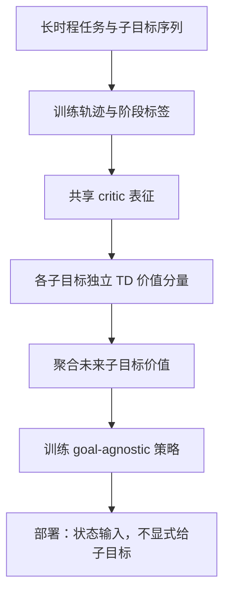

# VaDar：隐式目标条件化的价值分解

**VaDar**（*Implicit Goal Conditioning via Value Disaggregation*）把长时程任务的子目标序列转成可分别监督的价值分量；共享 critic 学到这些分量后，用未来子目标价值聚合来训练一个部署时不需要显式 goal 输入的策略。

## 英文缩写速查

| 缩写 | 英文全称 | 简要说明 |
|------|----------|----------|
| RL | Reinforcement Learning | 从奖励与交互中学习策略 |
| TD | Temporal Difference | 用自举目标更新价值估计 |
| MDP | Markov Decision Process | 状态、动作、转移与奖励构成的决策过程 |
| Q-value | Action-Value Function | 给定状态与动作的预期回报 |
| VaDar | Value Disaggregation | 论文提出的子目标价值分解方法 |

## 问题与关键洞见

长时程操作通常由一串阶段性子目标构成。只用当前子目标训练策略会偏向眼前进展：某动作可能更快完成当前阶段，却让后续阶段更难（项目页以泡茶时壶与杯的摆放、浸泡锅与海绵操作为例）。显式目标条件策略在部署时还需要跟踪并提供当前目标；VaDar 希望保留训练期的阶段监督，同时让部署策略不依赖显式子目标标签。

## 方法

给定有序子目标序列 `(g_1,\ldots,g_K`)，共享 critic 为每个子目标预测一个价值分量 `(Q_{g_i}(s,a)`)，各分量用对应时序差分目标监督。它们共享表示，但保留子目标区分，避免把不同阶段压成不可解释的单一标量。

策略训练时，将当前及未来子目标的价值按论文定义聚合为动作目标；当前动作因此同时考虑眼前阶段及其对后续阶段的影响。测试时执行的是不以显式子目标为输入的策略。其核心不是部署时额外运行高层目标选择器，而是把未来阶段信息注入策略更新。

## 实验与解读

项目页展示长程操作任务、价值分解示意和策略行为可视化，支持“当前阶段贪心可能损害后续阶段”的动机。本次未从可访问页面提取到完整主表、精确成功率或置信区间，因此不补写数值，也不把演示动画当统计显著性证据；定量比较应以论文 PDF 完整协议和主表为准。

## 工程与复现边界

项目页链接的是论文和研究展示；其 GitHub Pages 仓库承载网站源文件，不是训练、评估或部署实现。**截至 2026-10-12，未发现官方可运行的 VaDar 算法代码或数据下载入口**。因此不能从网站仓库推断训练脚本、环境依赖或可复现命令；代码开放后再补运行时序图。

## 结论

**总判：** VaDar 将训练时可用的子目标结构保留在价值学习中，再把后续阶段价值传给无显式目标输入的策略，面向长程任务中“局部进度与全局可完成性不一致”的问题。

- 评估应关注完整任务成功率与后续阶段可达性，而非单一子目标的即时奖励。
- 价值分解提供阶段级诊断信号；共享表征避免为每个子目标完全独立训练 critic。
- 部署简化依赖训练任务中的目标顺序与分段信号，不能据此假设开放词汇任务也无需高层状态管理。
- 精确收益仍须以论文实验表核实；项目页展示不足以支撑未报告的数字比较。

## 与其他工作对比

| 路线 | 训练期如何使用子目标 | 部署时是否需要显式子目标 | 与 VaDar 的差异 |
|------|----------------------|--------------------------|-----------------|
| **VaDar** | 每个子目标一个价值分量、共享 critic 表征；聚合未来子目标价值训练策略 | 否（goal-agnostic 策略） | — |
| 只按当前子目标训练 | 仅用当前阶段奖励/价值 | 视实现而定 | 易短视：阶段内更快完成，可能让后续阶段更难；VaDar 把未来阶段价值注入当前动作的更新 |
| 显式目标条件策略 | 以子目标作为策略输入 | 是，部署时需跟踪并提供当前目标 | VaDar 保留阶段监督，但去掉部署期的目标输入与跟踪 |
| [分层强化学习](../methods/hierarchical-reinforcement-learning.md)（上层选 option，下层执行） | 上层 $\pi_{high}(o\mid s)$ 选择选项/子目标 | 是，需要运行高层选择器 | VaDar 不在部署时额外运行高层目标选择器，层级信息只存在于训练期 critic |
| 单一标量 critic | 所有阶段压成一个价值 | 否 | VaDar 保留子目标级分量，提供阶段级诊断信号 |

以上为机制层面的对照；论文主表的基线与定量差距本库尚未核对（见上文实验节），不在此给出数值。

## 关联页面

- [Hierarchical Reinforcement Learning](../methods/hierarchical-reinforcement-learning.md)：显式层级与隐式子目标价值训练的关系。
- [Reinforcement Learning](../methods/reinforcement-learning.md)：价值函数与策略更新背景。
- [Manipulation](../tasks/manipulation.md)：长时程操作任务背景。

## 推荐继续阅读

- [VaDar 项目页](https://shashwatsaxena13.github.io/vadar-site/)
- [论文 PDF](https://shashwatsaxena13.github.io/vadar-site/assets/vadar-paper.pdf)

## 参考来源

- [论文归档](../../sources/papers/vadar.md)
- [官方项目页归档](../../sources/sites/vadar.md)
