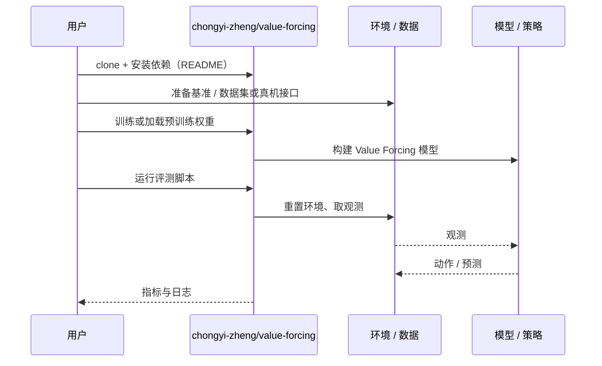

# Value Forcing（arXiv:2611.02160）

**Value Forcing**（*Value Forcing: Aligning Return Distributions at All Noise Levels*，[arXiv:2611.02160](https://arxiv.org/abs/2611.02160)，[项目页](https://chongyi-zheng.github.io/value-forcing)，[代码](https://github.com/chongyi-zheng/value-forcing)）来自 [具身智能小站 2026-11-04 盘点](../../sources/blogs/wechat_embodied_station_57_papers_da_reward_model_failure_2026-11-04.md)，属「奖励学习与策略后训练」组。

## 一句话定义

**通过流匹配学习回报分布，并在每个噪声层施加贝尔曼一致性；形成两类离线学习算法，研究有限数据下的价值估计，实验属于长时仿真任务。**

## 英文缩写速查

| 缩写 | 英文全称 | 简要说明 |
|------|----------|----------|
| Value Forcing | Value Forcing: Aligning Return Distributions at All Noise Levels | 本文方法 / 基准的简称 |

## 为什么重要

- 在每个噪声层约束回报分布。
- 开源结论：**已开源**（步骤 2.5，2026-11-04）。仓库可达（git ls-remote）。项目页 HTTP 200。
- 同期同组工作见 [VLM 奖励评估、动作动力学与开放权重机器人智能体：具身智能小站 11-04 期 57 篇阅读坐标](../overview/embodied-station-2026-11-04-57-papers-technology-map.md)。

## 核心机制

| 项 | 内容 |
|----|------|
| **arXiv** | [2611.02160](https://arxiv.org/abs/2611.02160) |
| **开源** | **已开源** |
| **要点** | 通过流匹配学习回报分布，并在每个噪声层施加贝尔曼一致性；形成两类离线学习算法，研究有限数据下的价值估计，实验属于长时仿真任务。 |
| **文内指标** | 公众号未给具体数字，本页不引用。 |

## 源码运行时序图

以下为按仓库入口（`chongyi-zheng/value-forcing`）推断的通用运行链路；入库日仅核实仓库可达，未逐文件阅读，具体脚本名以 README 为准。

## 实验与评测

- 公众号未给具体数字，本页不引用。
- **读法：** 本页为索引级摘要，依据公众号转述的官方摘要与仓库信息整理；逐项数字与 baseline 以原文 PDF 为准。

## 与其他工作对比

- 横向索引见 [VLM 奖励评估、动作动力学与开放权重机器人智能体：具身智能小站 11-04 期 57 篇阅读坐标](../overview/embodied-station-2026-11-04-57-papers-technology-map.md)；同 arXiv 不重复造页。

## 结论

**在每个噪声层约束回报分布：通过流匹配学习回报分布，并在每个噪声层施加贝尔曼一致性；形成两类离线学习算法，研究有限数据下的价值估计，实验属于长时仿真任务。**

1. 开源边界：**已开源** — 仓库可达（git ls-remote）。项目页 HTTP 200。
2. 核心机制：通过流匹配学习回报分布，并在每个噪声层施加贝尔曼一致性；形成两类离线学习算法，研究有限数据下的价值估计，实验属于长时仿真任务。
3. 复现与选型前核对任务协议、硬件与基准口径，勿直接横比公众号摘录数字。

## 关联页面

- [vla](../methods/vla.md)
- [imitation-learning](../methods/imitation-learning.md)
- [reinforcement-learning](../methods/reinforcement-learning.md)
- [embodied-station-2026-11-04-57-papers-technology-map](../overview/embodied-station-2026-11-04-57-papers-technology-map.md)

## 参考来源

- [value_forcing_arxiv_2611_02160.md](../../sources/papers/value_forcing_arxiv_2611_02160.md)
- [wechat_embodied_station_57_papers_da_reward_model_failure_2026-11-04.md](../../sources/blogs/wechat_embodied_station_57_papers_da_reward_model_failure_2026-11-04.md)
- [arXiv:2611.02160](https://arxiv.org/abs/2611.02160)

## 推荐继续阅读

- [arXiv PDF](https://arxiv.org/pdf/2611.02160)
- [项目页](https://chongyi-zheng.github.io/value-forcing)
- [https://github.com/chongyi-zheng/value-forcing](https://github.com/chongyi-zheng/value-forcing)
