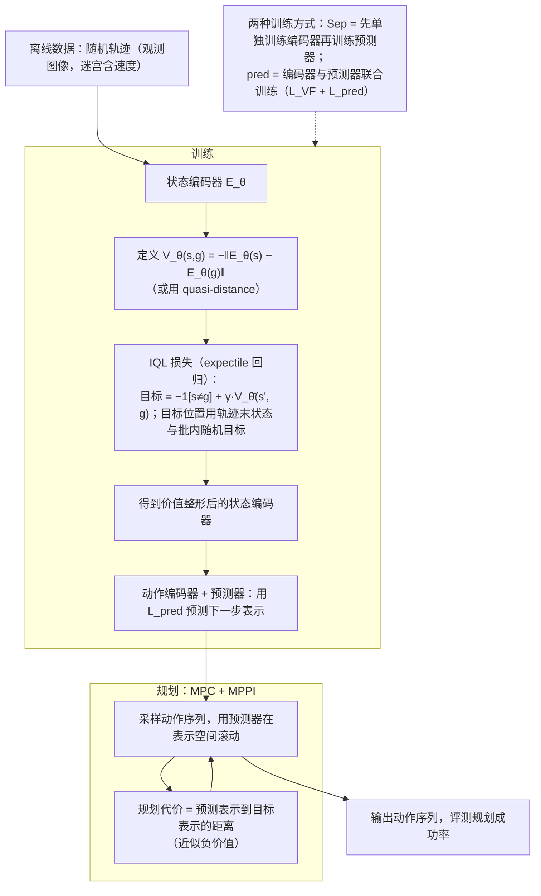

# Value-Guided Action Planning with JEPA World Models

**Value-Guided Action Planning** 用 goal-conditioned value 训练 JEPA 潜空间，让「两个状态在潜空间里的距离」近似「从一个状态到达另一个状态有多难」，从而改善基于潜空间的动作规划。

## 英文缩写速查

| 缩写 | 英文全称 | 简要说明 |
|------|----------|----------|
| JEPA | Joint-Embedding Predictive Architecture | 在潜空间做预测的世界模型架构 |
| WM | World Model | 预测动作后果的内部模型 |
| RL | Reinforcement Learning | 与 goal-conditioned value 同源的价值函数思路 |
| CEM | Cross-Entropy Method | 常见的采样式规划优化方法（本页以「采样规划」泛指，论文细节未核对） |

## 为什么重要

只按「图像上是否更接近目标」规划会失败：目标隔着墙、图像上很近但要绕很远。本工作把「行动代价」写进表示空间，是把预测用于决策的一步。

## 流程总览

图依据：论文 §3（3.1–3.2）、§4.2 与附录 7.2（MPC 使用 MPPI 优化器）。

## 核心信息

- 作者：Matthieu Destrade、Oumayma Bounou、Quentin Le Lidec、Jean Ponce、Yann LeCun（arXiv 页）
- 机构：arXiv 页未显示
- 代码：截至 2026-10-20，arXiv 页未列代码仓库

## 核心原理（方法栈）

1. **JEPA 表示**：学习环境动力学的潜空间预测。
2. **goal-conditioned value**：估计从状态到目标的代价。
3. **value shaping**：训练潜空间，使嵌入距离逼近该代价。
4. **规划**：在整形后的潜空间中选择动作序列。

## 实验与评测

- 摘要称：在若干简单控制环境中，value shaping 后的表示改善了 action planning 表现。
- 具体环境与指标未在本次入库中核对原表。

## 工程实践

- 无官方代码，复现需从论文细节自行实现；入库前无法确认训练超参。
- 若复现，建议先在含墙体的迷宫类任务上检验「欧氏距离失效」的场景是否被修复。

## 局限与风险

- 仅有摘要级证据，且任务偏简单，尚不能推断到真实机器人复杂操作。
- 价值函数估计误差会直接进入潜空间距离，错误价值会误导规划。

## 与其他工作对比

| 维度 | Value-Guided JEPA | [Causal-JEPA](./paper-causal-jepa.md) |
|------|-------------------|----------------------------------------|
| 改动点 | 潜空间距离结构（加入价值） | 学习单位与遮挡预测目标 |
| 代码 | 未列出 | 已公开 |

## 结论

**把行动代价写进潜空间距离，是让 JEPA 真正用于规划的关键一步，但目前证据主要来自简单任务与摘要。**

1. **问题定位准确** — 「图像近 ≠ 可达」是 JEPA 规划的真实失效模式。
2. **方法简单** — 核心是训练一个 value 并整形嵌入，不需要改动预测器结构（依据摘要，推测）。
3. **证据有限** — 无官方代码，任务偏简单，应等待更多复现。
4. **读法** — 视为「世界模型为决策服务」的方法方向，而非可直接部署的方案。

## 关联页面

- [Causal-JEPA](./paper-causal-jepa.md) — 同样面向规划的 JEPA 表示改造
- [LeWorldModel](./paper-lewm.md) — 同属 LeCun 路线的端到端 JEPA 世界模型
- [价值方法（Value-based RL）](../methods/value-based-reinforcement-learning.md) — goal-conditioned value 的背景
- [Model-Based RL](../methods/model-based-rl.md) — 世界模型规划的通用框架

## 参考来源

- [Value-guided action planning 论文归档](../../sources/papers/value_guided_jepa_planning_arxiv_2601_00844.md)
- [深蓝具身智能文章归档](../../sources/blogs/wechat_deepblue_lecun_jepa_11_papers_2026-10-20.md)
- [arXiv PDF](https://arxiv.org/pdf/2601.00844)：已通读方法部分（实验与附录以略读为准）：§2 相关工作、§3 方法、§4 实验设定与结果、§5 讨论、附录 7.1–7.3

## 推荐继续阅读

- [arXiv:2601.00844](https://arxiv.org/abs/2601.00844)
