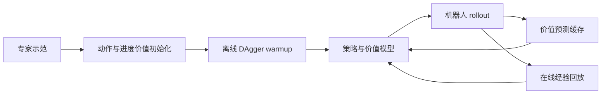
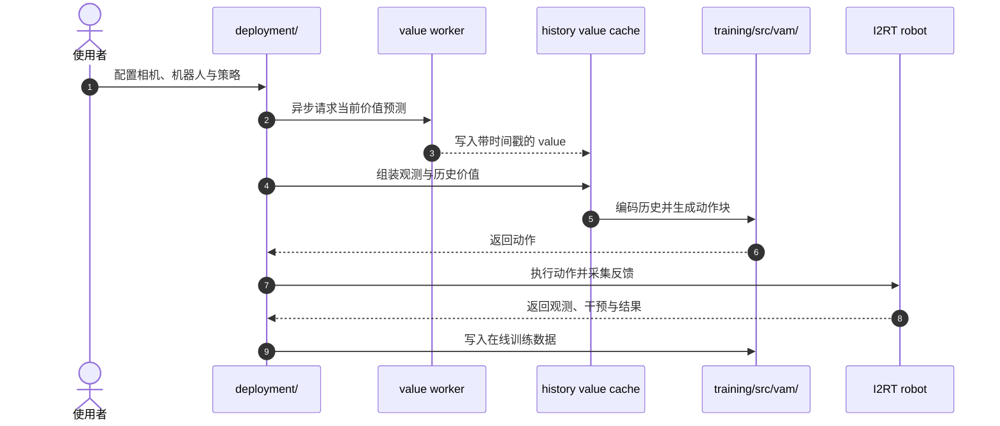

# VaM：把价值预测用作机器人策略的记忆

## 一句话定义

**Value as Memory (VaM) 将近期价值预测作为任务进度记忆提供给动作策略，并用在线机器人经验持续更新动作与价值模型。**

## 英文缩写速查

| 缩写 | 英文全称 | 简要说明 |
|------|----------|----------|
| VaM | Value as Memory | 用价值预测历史作为策略记忆的方法 |
| RL | Reinforcement Learning | 用奖励反馈优化策略 |
| BC | Behavior Cloning | 从专家示范初始化策略 |
| TD | Temporal Difference | 通过时间差分误差学习价值函数 |

## 为什么重要

长时程操作中，相似的当前画面可能对应进展、停滞或退步等不同状态。只看当前观测容易让动作策略混淆；离线训练也无法及时使用机器人部署后产生的新数据。VaM 把近期价值变化作为进度线索，并将在线数据采集与训练接入后训练循环。

## 核心原理

1. 由示范数据进行 BC 初始化动作专家，并初始化进度价值专家。
2. 通过离线 DAgger warmup 收集人类干预和 episode 结果，用 TD 学习 value expert，并以优势条件化 flow matching 更新策略。
3. 在线部署时异步预测并缓存带时间戳的价值；将历史价值与观测历史对齐、屏蔽缺失项，经 masked GRU 编码为一个 token，条件化动作专家。
4. 在线循环按轮次更新动作/价值模型，同时累积新的 rollout replay。

## 源码运行时序图

README 将部署拆在 `deployment/`，训练逻辑放在 `training/src/vam/`，在线循环见 `docs/online.md`：

## 实验与评测

- 评测覆盖可变形物体和接触丰富操作的长时程任务。
- 论文摘要报告 value caching 平均成功率绝对提升 29.4 个百分点；在线自主学习相对相同预算离线训练提升 32.8 个百分点。
- 同梯度步预算下，在线调度完成 8 倍策略迭代；并行采集与训练的单步梯度耗时降低超过 2 倍。

## 工程实践与局限

- 仓库采用 Ubuntu 24.04、Python 3.11、CUDA 12.6；真实机器人部署额外需要 I2RT、RealSense 与相机/手臂配置。
- 价值缓存依赖时间戳对齐、历史 mask 和训练/部署归一化一致；错误对齐会让“进度记忆”成为噪声。
- 在线强化学习需要安全的干预和失败处理机制；摘要性能不代表在无人工监护下可直接运行。

## 与其他工作对比

| 工作 | 记忆 / 闭环形式 | 与 VaM 的差异 |
|------|-----------------|---------------|
| [REKI](./paper-reki-vla-register-memory.md) | action expert 内的 register tokens 缓存近期 VLM 表征 | 记忆的是压缩视觉语言表征；VaM 记忆的是标量价值历史，直接对应任务进度 |
| [Fast-VLA](./paper-fast-vla-once-per-episode.md) | episode 开始时一次性生成固定 KV 任务记忆 | 固定记忆不随进度刷新；VaM 在回合内持续写入价值预测 |
| [I3L](./paper-i3l.md) | 多轮人工接管 + HG-DAgger 数据聚合 | 同样利用部署期干预，但 I3L 只做模仿更新；VaM 另学 TD 价值并以优势条件化策略 |
| [DSP](./paper-dsp-supervised-play.md) | play policy 自主采集 + 世界模型 MPC | 二者都把在线数据接回训练；DSP 不依赖价值函数，VaM 不学习显式动力学模型 |

VaM 把“记忆”与“在线 RL 后训练”捆在一起报告；对比其他记忆模块时，应按论文的两组消融分别读缓存收益（+29.4 pt）与在线学习收益（+32.8 pt）。

## 结论

**VaM 的记忆不是额外的视觉历史，而是策略对过去任务进展的价值摘要；它与在线数据闭环一起处理部分可观测和分布变化。**

1. 检查 value 的时间戳与策略观测是否严格对齐。
2. 分开测量缓存带来的收益与在线更新带来的收益。
3. 对在线机器人训练保留人工干预、episode 切换和回放记录。
4. 复现前匹配策略 checkpoint、history/normalization 配置及部署硬件栈。

## 关联页面

- [强化学习](../methods/reinforcement-learning.md)
- [基于价值的强化学习](../methods/value-based-reinforcement-learning.md)
- [DSP：自主采集交互数据](./paper-dsp-supervised-play.md)

## 参考来源

- [VaM 论文归档](../../sources/papers/vam_arxiv_2610_22368.md)
- [项目页与方法说明](../../sources/sites/vam.md)
- [官方仓库与运行入口](../../sources/repos/vam.md)

## 推荐继续阅读

- [VaM 项目页](https://virlus.github.io/vam/)
- [VaM 官方仓库](https://github.com/Virlus/vam)
