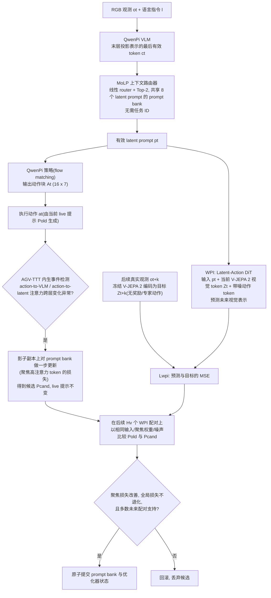

# VANE（arXiv:2608.09448）

**VANE**（[arXiv:2608.09448](https://arxiv.org/abs/2608.09448)）收录于 [多模空间 · 一周 VLA 研究趋势简析（2026.08.10–08.16）第一篇](../../sources/blogs/wechat_duomo_vla_weekly_trends_2026-08-10_part1.md) **架构模块** 段。

## 一句话定义

**可靠 VLA 测试时训练：在独立「试用区」结合当前画面与指令提出调整，观察执行结果确认有帮助才启用，否则撤回，减轻跨任务 TTT 干扰与未验证更新破坏闭环控制。**

## 英文缩写速查

| 缩写 | 英文全称 | 简要说明 |
|------|----------|----------|
| VLA | Vision-Language-Action | 视觉–语言–动作策略 |
| VLM | Vision-Language Model | 视觉–语言多模态模型 |
| VLN | Vision-Language Navigation | 视觉–语言导航 |
| WAM | World Action Model | 联合未来与动作生成的具身策略 |
| TTT | Test-Time Training | 部署阶段无标注数据的在线适配 |

## 为什么重要

- 可靠 VLA 测试时训练：在独立「试用区」结合当前画面与指令提出调整，观察执行结果确认有帮助才启用，否则撤回，减轻跨任务 TTT 干扰与未验证更新破坏闭环控制。
- 开源状态：**待核实**（步骤 2.5，入库日 2026-09-19）。
- 与 [vla weekly trends 2026 08 10 part1 technology map](../overview/vla-weekly-trends-2026-08-10-part1-technology-map.md) 同批工作可横向对照。

## 流程总览

图依据：论文 §3.1–§3.4 / Fig.1、Eq.(1)–(8)

## 核心机制

| 项 | 内容 |
|----|------|
| **arXiv** | [2608.09448](https://arxiv.org/abs/2608.09448) |
| **开源** | **待核实** |
| **文内评测** | SimplerEnv-WidowX / Google Robot |

## 源码运行时序图

**不适用**（截至入库日未提供可运行官方代码入口，或仓库尚未公开）。

## 实验与评测

- **文内口径：** SimplerEnv-WidowX / Google Robot
- **读法：** 本页为 [公众号策展](../../sources/blogs/wechat_duomo_vla_weekly_trends_2026-08-10_part1.md) 摘要；逐项指标以 **原文 PDF** 为准。

## 与其他工作对比

> 下表只做**定位对照**：本页与下列同批各页均为 [公众号策展](../../sources/blogs/wechat_duomo_vla_weekly_trends_2026-08-10_part1.md) 的索引级摘要，未逐条核对原文实验表，彼此**不共享同一评测协议**，不可据此横比数字。

| 对照 | 差异读法 |
|------|----------|
| [WAM-TTT / RoboTTT / StellaVLA / Zero-WAM 对比](../comparisons/wam-ttt-robottt-stellavla-zero-wam-embodied-icl.md) | 该页把部署期适配分成**快权重记忆**与**纯上下文**两族；VANE 属前者，但多加一道**门**——先在独立试用区看执行结果，确认有帮助才启用、否则撤回。读 VANE 该比的是「有无验证回滚」，不是 TTT 本身 |
| [HyMeS](./paper-hymes-hybrid-memory-manipulation.md) / [OnEvoMemory](./paper-onevomemory.md) | 同批同为部署期演化，改的对象不同：这两条改**记忆**（外置代码规则 / 价值引导模块），VANE 改**权重**。改权重能修正策略本身，代价是可能破坏已经稳定的控制闭环——试用区正是为这个代价设的 |
| [Sim2Real](../concepts/sim2real.md) | TTT 的动机是部署分布与训练分布不一致；该页给这条 gap 的来源，VANE 的取舍是**在线补**而非训练前堵，因此跨任务干扰成为它独有的一类失败模式 |
| [VLA](../methods/vla.md) | 该页的默认假设是部署期权重冻结；VANE 打破这一点，选型前先确认目标场景是否真的允许在线改权重（安全认证、可复现性要求往往不允许） |

## 结论

**VANE 适合作为本期「架构模块」路线的快速索引页。**

1. 核心贡献：可靠 VLA 测试时训练：在独立「试用区」结合当前画面与指令提出调整，观察执行结果确认有帮助才启用，否则撤回，减轻跨任务 TTT 干扰与未验证更新破坏闭环控制。
2. 开源结论：**待核实** — 以项目页/仓库实际链接为准。
3. 横向对照见 [技术地图](../overview/vla-weekly-trends-2026-08-10-part1-technology-map.md)，避免与同 arXiv 重复造页。

## 关联页面

- [VLA（Vision-Language-Action）](../methods/vla.md)
- [一周 VLA 趋势技术地图](../overview/vla-weekly-trends-2026-08-10-part1-technology-map.md)
- [Generative World Models](../methods/generative-world-models.md)

## 参考来源

- [wechat_duomo_vla_weekly_trends_2026-08-10_part1.md](../../sources/blogs/wechat_duomo_vla_weekly_trends_2026-08-10_part1.md)
- [arXiv:2608.09448](https://arxiv.org/abs/2608.09448)
- [arXiv PDF](https://arxiv.org/pdf/2608.09448)：已通读方法部分（实验与附录以略读为准）：§1 Introduction、§3.1 Overview、§3.2 MoLP、§3.3 WPI、§3.4 AGV-TTT；§4 仅略读（未读附录算法细节）

## 推荐继续阅读

- [VLA 方法页](../methods/vla.md)
- [arXiv PDF](https://arxiv.org/pdf/2608.09448)
