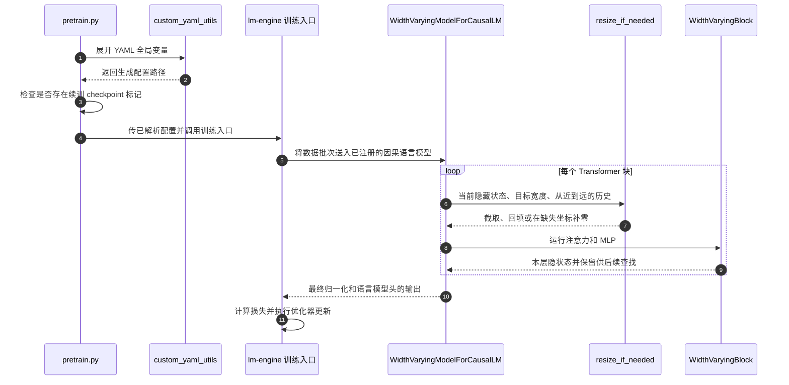

# Variable-Width Transformers｜可变宽度 Transformer

## 一句话定义

作者提出的 × 形 Transformer（`><former`）让前后层较宽、中段较窄，并把窄层没有处理的残差坐标传给之后的宽层；计算宽度按层预先确定，不随 token 改变。

## 英文缩写速查

| 缩写 | 英文全称 | 简要说明 |
| --- | --- | --- |
| MLP | Multilayer Perceptron | 块中的前馈变换，与注意力一起按层改宽 |
| MoE | Mixture of Experts | 混合专家，论文额外测试 3B 总参数的稀疏模型 |
| KV | Key–Value | 推理时保存的注意力键和值，容量受各层宽度影响 |
| FLOPs | Floating-Point Operations | 浮点操作数，不等于实际运行时间 |
| DCLM | DataComp-LM | 作者使用的语言模型预训练数据 |

## 为什么重要

同一个参数预算不必均匀分给每层。大部分权重数目随隐藏宽度平方增长，而在注意力头设定固定时，点积计算和 KV 缓存分别随各层宽度之和增长。因此，在匹配深度和近似参数预算时，重新分配宽度可以降低平均层宽，不过收益最终要在目标运行时验证。

## 核心信息

| 项目 | 内容 |
| --- | --- |
| 作者 | Zhaofeng Wu、Oliver Sieberling、Shawn Tan、Rameswar Panda、Yury Polyanskiy、Yoon Kim |
| 机构 | 麻省理工学院（MIT）、MIT-IBM 沃森人工智能实验室（MIT-IBM Watson AI Lab） |
| 原文 | [arXiv 2606.18246v1](https://arxiv.org/abs/2606.18246v1)，2026-06-16 |
| 对照 | 200M、500M、1B、2B 稠密解码器；3B 总参数 / 约 1B 激活的 MoE |

## 核心方法

- **静态宽度调度：** 维持深度和参数预算，瓶颈两侧分别用几何级数，同宽的首末块由方程求出，最后按实现要求取整。作者的默认配方是第 75% 深度处取参考等宽模型隐藏维度的约 30%，并非所有规模下的唯一最优点。
- **无参数残差调整：** 收窄只处理低索引子向量，不永久丢弃剩余坐标；拓宽时，从最近有该坐标的状态拷回，从未出现才补零。等价地看，是一条逻辑上的宽残差流和各层不同的活跃切片，而官方默认代码通过历史张量实现。
- **维持嵌入接口：** 输入 / 输出嵌入保持参考宽度，首层 QKV 投影和末层 MLP 的边界修正也纳入参数求解。减少的是注意力点积和缓存开销，不能把等参数条件下所有线性层 FLOPs 同样计为下降。

## 流程总览

## 评测与结果

| 对照规模 | 等宽 → 可变宽的预训练 loss | 预训练 FLOPs 变化 | 平均层宽变化 |
| --- | --- | --- | --- |
| 200M | 3.452 → 3.430 | −3.2% | −10.0% |
| 500M | 3.138 → 3.099 | −3.7% | −11.0% |
| 1B | 2.926 → 2.890 | −2.6% | −10.5% |
| 2B | 2.751 → 2.726 | −2.5% | −10.9% |
| 3B/1B MoE | 2.726 → 2.710 | −4.6% | −10.9% |

表 2 是同预算训练结果；MoE 匹配总参数，但可变宽模型的激活参数少约 3%。图 4 的稠密模型拟合以等宽 2B 的 loss 2.751 为目标，得到 77.8% 的预训练 FLOPs 和 85.1% 的平均层宽（缓存容量代理），不应与表 2 或实际时延混用。零样本下游评测中，两种规模的困惑度均改善；MoE 的分类准确率互有胜负。表 4 的 500M 扩宽消融中，沿用坐标 / 补零 / 可学习投影的最佳 loss 分别为 3.099 / 3.124 / 3.150（固定宽度 3.138）。

## 与其他工作对比

- **与 OpenELM 和逐层 FFN 分配相比：** OpenELM 同样预算分层，但调节注意力和前馈的内部维度；逐层 FFN 研究只重分配前馈容量。本文直接改变整个块的活跃隐藏宽度，并显式处理残差对齐；两类工作得到的瓶颈位置没有构成同协议的直接比较。
- **与 Hourglass Transformer 相比：** 后者压缩和恢复序列长度，本文保持 token 数，压缩的是每个 token 的隐藏坐标。
- **与 Inner Thinking Transformer 相比：** ITT 研究按 token 选择思考深度；这里每个 token 都走同一套预先配置的层宽，不引入动态路由。

## 结论

在论文的 200M–3B 解码器 LM 范围内，× 形分配是比固定宽度更好的资源分配方案之一；这些结果不直接给出机器人策略收益。

- 用匹配深度、训练数据和参数的等宽基线，区分真实测得的 loss 与拟合出的等 loss 成本。
- 固定输入序列长度，先核算各层 KV 预算；对注意力头数、缓存精度、批大小及长上下文分别做控制变量。
- 在相同硬件上分别量预填充和逐 token 解码，报告峰值显存、吞吐和 P95；窄层不保证更快的 kernel。
- 若迁移到 VLA 语义骨干，应保留动作头和控制接口，再用目标任务成功率与闭环时延重新验证。

## 源码运行时序图

以 [作者仓库](https://github.com/ZhaofengWu/variable-width-transformers) 的 `dense_500m.yml` 和默认 `move_up` 路径为例：

## 工程实践与局限

- 模型、配置和预训练实现已公开；作者仓库中未核实公开训练权重。复现可由 500M 配置开始，用 `bottleneck_ratio: 1.0` 构造等宽基线，再对比默认变宽配置。
- 依赖 lm-engine 子模块、Megatron 格式数据和 CUDA 训练栈；README 还要求本地适配 attention reshape 与 MoE forward。核对仓库路径和导入名后再启动，详见[源码归档](../../sources/repos/zhaofengwu-variable-width-transformers.md)。本次只做源码走读，不声称已复跑训练。
- 层形状不一致使 kernel 优化、张量并行和流水线负载均衡更复杂；理论缓存节省不是整机峰值显存等比例下降。论文不含机器人数据或闭环控制实验。

## 关联页面

- [Transformer](../concepts/transformer.md)
- [LLM 推理显存估算](../concepts/llm-inference-vram-estimation.md)
- [Inner Thinking Transformer](./paper-inner-thinking-transformer.md)
- [网络架构纵深路线：Stage 5](../../roadmap/depth-model-architecture.md)

## 参考来源

- [论文归档](../../sources/papers/variable-width-transformers.md)
- [官方源码归档与运行入口](../../sources/repos/zhaofengwu-variable-width-transformers.md)

## 推荐继续阅读

- [OpenELM](https://arxiv.org/abs/2404.14619)：分层配置注意力和前馈容量的另一种实现。
- [Hierarchical Transformers](https://arxiv.org/abs/2110.13711)：比较沿 token 轴而非隐藏通道轴实施瓶颈。
