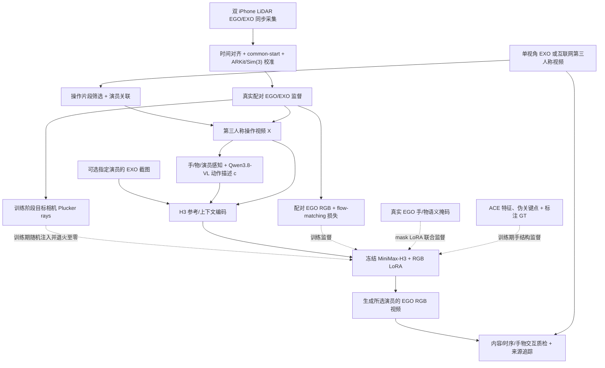

# VBot Exo2Ego Policy：轻量采集与第三人称到第一人称视频生成

## 一句话定义

**VBot Exo2Ego Policy**（*Lightweight Data Collection and Exocentric-to-Egocentric Video Generation*，arXiv:2611.16417v1）由维他动力（Vbot Physical AI Lab）提出：结合低门槛 EGO/EXO 采集和视频生成模型，**把给定演员的第三人称操作视频转换为第一人称 RGB 视频**，以扩充具身学习视觉数据；它是**视角转换视频生成器**，不是直接输出机器人动作的策略。

## 英文缩写速查

| 缩写 | 英文全称 | 简要说明 |
|------|----------|----------|
| EXO | Exocentric | 第三人称/外部观察相机视角，生成器输入 |
| EGO | Egocentric | 操作者第一人称视角，训练目标/生成输出 |
| RGB-D | Red Green Blue and Depth | 双 iPhone 同步采集的颜色与深度观测 |
| DiT | Diffusion Transformer | 生成视频所使用的视频生成 Transformer 主干 |
| LoRA | Low-Rank Adaptation | 微调冻结 MiniMax-H3 的视频生成分支 |
| HOI | Hand-Object Interaction | 手与被操作物体交互区域的语义监督 |
| ACE | ACE-Ego-Hand | 提供手部中间特征与关键点伪标签的读出模型 |
| FVD | Fréchet Video Distance | 生成视频分布与真实视频分布的评测指标 |

## 为什么重要

- 第一人称人手操作视频易用于预训练，但佩戴/同步设备的采集成本高；互联网 EXO 视频量更大，若能转换成 EGO 便可增加**视觉监督**覆盖。
- 大幅视角变化不仅是重投影：被遮挡手指、对象背面、相机头动都需要生成式补全；纯 RGB 相似度不能衡量手–物交互是否保真。
- 面向数据管线的关键在于区分**真实 EGO、真实 EXO、生成 EGO**，保留来源、演员身份和训练分组，避免把合成影像误认成有机器人动作标签的演示轨迹。

## 核心信息

| 项目 | 原文事实 |
|------|----------|
| 英文标题 | VBot Exo2Ego Policy: Lightweight Data Collection and Exocentric-to-Egocentric Video Generation |
| 作者 | Tong Rao、Zhihao Zhang、Yuntian Wang、Siyu Zhou、Hailong Qin、Yinan Yu |
| 机构 | 维他动力（Vbot Physical AI Lab，上海） |
| 发布 | arXiv:2611.16417v1，2026-11-12 |
| 数据来源 | 双 LiDAR iPhone Pro 配对 RGB-D / 单视角 EGO / 单视角及互联网 EXO |
| 方法骨干 | MiniMax-H3 Ref2VA + RGB LoRA；Qwen3.8-VL 生成源视频描述；ACE-Ego-Hand 辅助手监督 |
| 实际推理输入 | EXO 视频、源动作描述、可选演员截图；**不需要目标相机标定** |
| 输出 | 所选演员的第一人称 RGB 视频；语义联合分支可附带 mask |
| 源码状态 | **未核实到公开可运行实现**（论文全文和 arXiv 页未列官方代码/独立项目页；2026-11-16） |

## 流程总览

*图示依据：* arXiv v1 §§3–5、Fig.2、Appendix B。虚线为**仅训练时**的条件/监督，不表示推理时必须提供标定或关键点。

## 核心原理

### 1. 轻量采集与跨视角配对

- 双 iPhone Pro 记录同一操作的 EXO/EGO、ARKit 相机轨迹、可用 LiDAR 深度、帧时间戳。**common-start SOP** 先拍摄共同可见区域，连接后续视野几乎不重叠的 EGO/EXO，结合几何重建和 ARKit 的 Sim(3) 对齐估计相对几何。
- 仅采 EGO 的视频可直接作为视觉预训练来源；仅采 EXO/互联网录像经演员关联和片段定位，再交给生成器合成 EGO。
- 真实/合成身份、录制源和版本均需保留；派生数据与源录像一同划分数据集，不能把同一源的派生视频放进不同 split。

### 2. 基座生成模型与目标演员选择

- **源视频理解：** Qwen3.8-VL 使用 EXO 帧与结构化的人、手、物体证据，生成描述演员动作与事件顺序的文本。
- **生成：** MiniMax-H3 Ref2VA 的冻结视频 VAE/主干提供视觉和上下文编码，RGB LoRA 学习 EXO→EGO 映射，并以 flow-matching 损失训练。
- **谁的视角：** 若画面有多名演员，可以用 EXO 截图指定目标；训练时通过同步 EXO 相机镜头切换，保持连续 EGO 目标学习跨镜头操作连续性。

### 3. 几何引导训练，推理去几何依赖

- 用目标 EGO 像素对应 Plücker rays 作为训练期几何信号，以零初始化线性投影注入 DiT 目标 token。
- 前 70% 训练按 0.5 概率使用射线；70–80% 线性减到 0；末尾 20% 完全不使用。推理只保留 EXO、文本及可选演员参考，无需估计目标位姿。
- 附录 A.2 对 loss 的历史对照承认训练数据池与学习率 schedule 不同，不能仅据更低 flow-MSE 推断独立的相机模块增益。

### 4. 手–物语义和手结构监督

- **语义 HOI：** 语义掩码分支区分背景、被操作物体及穿戴者手/臂/衣袖；先做独立 mask warm-up，再以 RGB 损失 + 0.1×mask 损失联合微调，使掩码梯度影响 RGB 表征。
- **手部：** 用 ACE-Ego-Hand 特征与伪 2D 关节读出，配合 HOT3D、ARCTIC、Re:InterHand 的人工标注校准。ACEaux 监督预测 clean latent 的手结构；MultiLayer 在多层 EGO latent 特征上学习手部读出。
- **边界：** 输出视频的手关键点“可被后处理恢复”与“有真实动作真值/机器人可直接执行”并不等价。

## 实验与评测

**原文口径：** 546 clips / 86 captures（475 seen、71 unseen），448×448、30 fps；49-frame 比 EgoX released，141-frame 比 EgoX/H3。对比系统的视角先验和训练方案不完全相同，不能视为等计算预算的单变量因果对照。

| Table 3 指标 | 对照方法 | VBot Exo2Ego | 说明 |
|--------------|---------:|-------------:|------|
| 49 帧 PSNR ↑ | 12.630 dB | **15.856 dB** | EgoX，546 clips |
| 49 帧 SSIM ↑ | 0.4087 | **0.4894** | EgoX，546 clips |
| 49 帧 LPIPS ↓ | 0.5942 | **0.4955** | EgoX，546 clips |
| 49 帧 FVD ↓ | 306.90 | **191.55** | EgoX，546 clips |
| 141 帧 PSNR ↑ | 12.579 dB | **15.826 dB** | EgoX/H3，545 clips |
| 141 帧 FVD ↓ | 284.49 | **171.21** | EgoX/H3，545 clips |

**辅助监督（Table 4、6）：**
- 语义联合训练：PCK@5% **11.519%→16.538%**，官方 object IoU **5.471%→7.770%**；但 hand coverage **92.433%→90.805%**（下降）。
- ACEaux：聚合 PCK@5% **11.52%→20.02%**，EPE **57.09→47.42 px**，手覆盖率 **92.43%→95.18%**。MultiLayer 聚合图像指标较强，但部分手覆盖率下降。
- 训练几何对照（Table 7）：updates 3001–5000 的 flow-MSE **0.13638→0.12557**（-7.93%）；**只是不同训练配方的日志比较**。
- 补充数据口径：论文附录的 210,261 是“配置的配对缓存条目”，不是 210,261 条独立 EGO 实录。

## 与其他工作对比

| 工作 | 输入 → 输出 | 关键区别 |
|------|-------------|----------|
| **VBot Exo2Ego Policy** | EXO 视频 + 文本 + 可选演员参考 → EGO 视频 | 相机射线只参与训练，语义/手部辅助监督；保留跨镜头身份 |
| [EgoWorld](./paper-egoworld.md) | 单张 EXO 图像 + 点云/手/文本等条件 → EGO 图像 | 单帧生成，条件表示和时序要求不同 |
| EgoX（论文 Table 3 基线） | EXO 视频 + 几何 EGO prior → EGO 视频 | 发布模型使用推理期目标视角先验，49 帧评测条件不同 |
| [EgoMimic](./paper-ego-03-egomimic.md) | 第一视角人类示范 → 操作策略学习 | **下游学习**路线；VBot 本文只做 EGO 视觉数据供给 |

## 结论

**本文提供了配对采集 + EXO→EGO 生成的数据扩增方案，并在作者的第一视角视频指标上优于所选基线；但它尚未证明合成 EGO 能提高真实机器人策略成功率。**

1. **数据采集：** 把双机配对的可靠监督和单视角/互联网 EXO 的规模分开管理，并保留原始/生成溯源标签。
2. **推理部署：** 将相机几何作为训练期引导，最终推理不需要目标相机标定；不代表任意遮挡都能恢复真实第一视角。
3. **监督选择：** 同时评估 RGB 画质、对象位置/IoU、手关键点/覆盖率，不以 PSNR 代替交互保真。
4. **数字读法：** 完整系统优于 EgoX，但基线有几何先验、片长与训练配方差异；相机 loss 不是严格控制消融。
5. **策略数据：** 如果用于 BC/VLA，应另做数据来源审计、动作提取质量和真实机器人成功率验证，纯视频不能自动充当低层动作真值。
6. **复现状态：** 未找到作者公布的可运行代码入口，现阶段是可核读的论文方法，不是开箱即用的软件包。

## 工程实践

- **采集元数据：** 记录 source ID、演员身份、EGO/EXO/生成类型、同步偏差、相机内参、ARKit 位姿、有效深度与追踪置信度；附录 B 配对接受窗口为 20 ms。
- **数据质量：** 先按真实录制源分割数据集，质检源动作顺序、手–物接触合理性与遮挡失败；对生成/真实设置单独标签。
- **评测分层：** 视频质量（PSNR/LPIPS/FVD）与 ACE 提取手部指标（PCK、EPE、coverage）分别报表；若要用于下游机器人策略，新增动作标注与真机闭环 A/B 测试。
- **源码运行时序图：** **不适用（截至 2026-11-16）**。arXiv v1 原文及官方论文页没有可核实的训练/推理代码、README 运行入口或项目页，无法在不编造实现的情况下画真实 runtime sequenceDiagram。

## 局限与风险

- **欠定生成：** EXO 中被遮挡的手指、物体表面、头部运动无唯一真实解；视频看似合理不代表动作和接触真实。
- **多镜头边界：** 仅针对同一事件同步切换视角的训练；跨时间跳剪或换演员的广泛编辑未验证。
- **统计与对照：** Table 3 比较整个系统，附录确认几何优化历史对照配方不同；官方 unseen-object 支持仅 10 clips / 4 captures，不能泛化为全场景改善。
- **开源与下游：** 当前无可运行官方源码核验；报告未提供真实机器人政策学习的下游收益。

## 关联页面

- [Ego 数据采集分类](../overview/ego-category-01-data-collection.md) — 实录第一视角的数据采集基础
- [EgoWorld：EXO→EGO 单帧视点转换](./paper-egoworld.md) — 条件与时间维度对照
- [EgoMimic](./paper-ego-03-egomimic.md) — 下游从人类 EGO 视频学习机器人操作
- [Generative Data Augmentation](../methods/generative-data-augmentation.md) — 合成/扩增数据的一般方法与质量控制
- [具身数据纵深路线 Stage 4](../../roadmap/depth-embodied-data.md) — 本文在采集与合成双阶段的定位

## 参考来源

- [VBot Exo2Ego Policy 论文 v1 原文核读归档](../../sources/papers/vbot_exo2ego_arxiv_2611_16417.md) — §§1–7、Table 1–7、Appendix A–C

## 推荐继续阅读

- [arXiv HTML（v1，完整论文）](https://arxiv.org/html/2611.16417)
- [arXiv PDF](https://arxiv.org/pdf/2611.16417)
- [EgoX：Egocentric Video Generation from a Single Exocentric Video](https://arxiv.org/abs/2512.08269)
- [Grounded-Exo2Ego](https://arxiv.org/abs/2608.20534)
