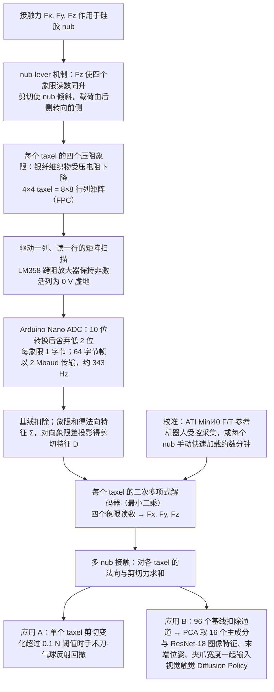

# VecTile（arXiv:2610.31472）

**VecTile**（*VecTile: A Low-Cost Flexible Tactile Array for 3-DoF Force Sensing*，[arXiv:2610.31472](https://arxiv.org/abs/2610.31472)，[项目页](https://jiannnh.github.io/VecTile/)）来自 [具身智能小站 2026-10-29 盘点](../../sources/blogs/wechat_embodied_station_58_papers_diverse_demonstrations_2026-10-29.md)，属「触觉与灵巧操作」组。

## 一句话定义

**VecTile以硅胶凸点将三轴接触转为可区分的压力分布，配合压阻层完成读出；单点力标定、弯曲测试和插头插入实验支持其应用，误差需对应测试载荷。**

## 英文缩写速查

| 缩写 | 英文全称 | 简要说明 |
|------|----------|----------|
| VecTile | VecTile: A Low-Cost Flexible Tactile Array for 3-DoF Force Sensing | 本文方法 / 基准的简称 |

## 为什么重要

- 低成本柔性阵列也能测剪切力。
- 开源结论：**待发布**（步骤 2.5，2026-10-29）。项目页 HTTP 200，页面写 Code upon acceptance（论文录用后释出）。
- 同期同组工作见 [多样成功示范、触觉工具链与预见式感知：具身智能小站 10-29 期 58 篇阅读坐标](../overview/embodied-station-2026-10-29-58-papers-technology-map.md)。

## 流程总览

图依据：论文 §III（Fig. 2、nub-lever 机制）、§IV-C/D（解码器与校准）、§V（Fig. 8 两个演示）；“多 nub 求和”见 §IV-D。

## 核心机制

| 项 | 内容 |
|----|------|
| **arXiv** | [2610.31472](https://arxiv.org/abs/2610.31472) |
| **开源** | **待发布** |
| **要点** | VecTile以硅胶凸点将三轴接触转为可区分的压力分布，配合压阻层完成读出；单点力标定、弯曲测试和插头插入实验支持其应用，误差需对应测试载荷。 |
| **文内指标** | 公众号未给具体数字，本页不引用。 |

## 源码运行时序图

**不适用（待发布）** — 项目页 HTTP 200，页面写 Code upon acceptance（论文录用后释出）。 不编造运行脚本；代码公开后再补。

## 实验与评测

- 公众号未给具体数字，本页不引用。
- **读法：** 本页为索引级摘要，依据公众号转述的官方摘要与仓库信息整理；逐项数字与 baseline 以原文 PDF 为准。

## 与其他工作对比

- 横向索引见 [多样成功示范、触觉工具链与预见式感知：具身智能小站 10-29 期 58 篇阅读坐标](../overview/embodied-station-2026-10-29-58-papers-technology-map.md)；同 arXiv 不重复造页。

## 结论

**低成本柔性阵列也能测剪切力：VecTile以硅胶凸点将三轴接触转为可区分的压力分布，配合压阻层完成读出；单点力标定、弯曲测试和插头插入实验支持其应用，误差需对应测试载荷。**

1. 开源边界：**待发布** — 项目页 HTTP 200，页面写 Code upon acceptance（论文录用后释出）。
2. 核心机制：VecTile以硅胶凸点将三轴接触转为可区分的压力分布，配合压阻层完成读出；单点力标定、弯曲测试和插头插入实验支持其应用，误差需对应测试载荷。
3. 复现与选型前核对任务协议、硬件与基准口径，勿直接横比公众号摘录数字。

## 关联页面

- [manipulation](../tasks/manipulation.md)
- [tactile-sensing](../concepts/tactile-sensing.md)
- [dexterous-kinematics](../concepts/dexterous-kinematics.md)
- [contact-rich-manipulation](../concepts/contact-rich-manipulation.md)
- [embodied-station-2026-10-29-58-papers-technology-map](../overview/embodied-station-2026-10-29-58-papers-technology-map.md)

## 参考来源

- [vectile_arxiv_2610_31472.md](../../sources/papers/vectile_arxiv_2610_31472.md)
- [wechat_embodied_station_58_papers_diverse_demonstrations_2026-10-29.md](../../sources/blogs/wechat_embodied_station_58_papers_diverse_demonstrations_2026-10-29.md)
- [arXiv:2610.31472](https://arxiv.org/abs/2610.31472)
- [arXiv PDF](https://arxiv.org/pdf/2610.31472)：已通读方法部分（实验与附录以略读为准）：§I、§III（A–C）、§IV（A–D）、§V（A、B）

## 推荐继续阅读

- [arXiv PDF](https://arxiv.org/pdf/2610.31472)
- [项目页](https://jiannnh.github.io/VecTile/)
