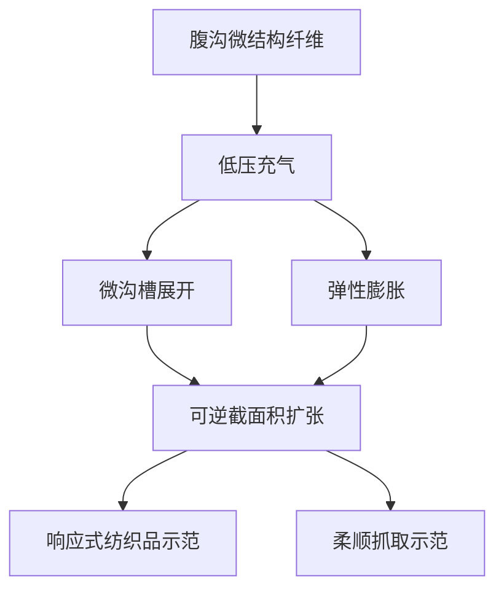

# 仿生腹沟纤维：体积可编程气动驱动

## 一句话定义

仿生腹沟纤维通过微沟槽展开与弹性膨胀耦合，实现低压下可逆的截面积变化，用于气动抓取与响应式织物。

## 英文缩写速查

| 缩写 | 英文全称 | 简要说明 |
|------|----------|----------|
| NUS | National University of Singapore | 新加坡国立大学 |
| SUTD | Singapore University of Technology and Design | 新加坡科技设计大学 |
| kPa | kilopascal | 压力单位，千帕 |

## 核心信息

| 字段 | 内容 |
|------|------|
| 论文 | Bioinspired ventral-groove fibers for volume-programmable pneumatic actuation |
| 机构 | 新加坡国立大学；新加坡科技设计大学 |
| 来源 | Science Advances，2026-10-23；[DOI](https://doi.org/10.1126/sciadv.aeh5116) |
| 状态 | 当前依据论文摘要；期刊正文访问受限，实验细节待核实 |

## 机制概览

以下概念图仅依据论文摘要，**不是通读全文后的完整实验流程图**。

## 摘要报告的结果

- 约 **0.8 kPa** 下实现约 **400 倍可逆面积扩张**；这是面积比，不是直径或长度比。
- 纤维直径从约 **100 μm 到厘米级**，长度可达数十米；漂浮服装示范使用 **20 米**纤维。
- 抓取示范包括抗干扰、高精度抓取，以及对神经样细丝和香灰锥的柔顺处理；摘要还报告开环操作。

## 结论

这项研究展示了以纤维结构形变实现低压气动驱动的潜力，但目前本页只依据摘要。

- 将面积扩张与直径扩张区分，避免误读 400 倍指标。
- 织物与抓取是不同示范，不能将单项指标直接推广到所有构型。
- 抓取控制精度、响应速度、寿命和负载等工程指标需结合全文确认。
- 摘要中的开环示范不能证明所有任务均无需反馈。

## 源码运行时序图

不适用：目前未核实到可运行的官方源码，不能据此判断是否开源。

## 参考来源

- [论文资料归档及摘要](../../sources/papers/ventral_groove_fibers_aeh5116.md)

## 关联页面

- [操作任务](../tasks/manipulation.md)
- [顺应性欠驱动机器人手](paper-deimel-compliant-underactuated-robotic-hand.md)
- [HapMorph 气动触觉框架](paper-hapmorph-pneumatic-haptic-render.md)

## 推荐继续阅读

- [Science Advances 论文原文](https://doi.org/10.1126/sciadv.aeh5116)
