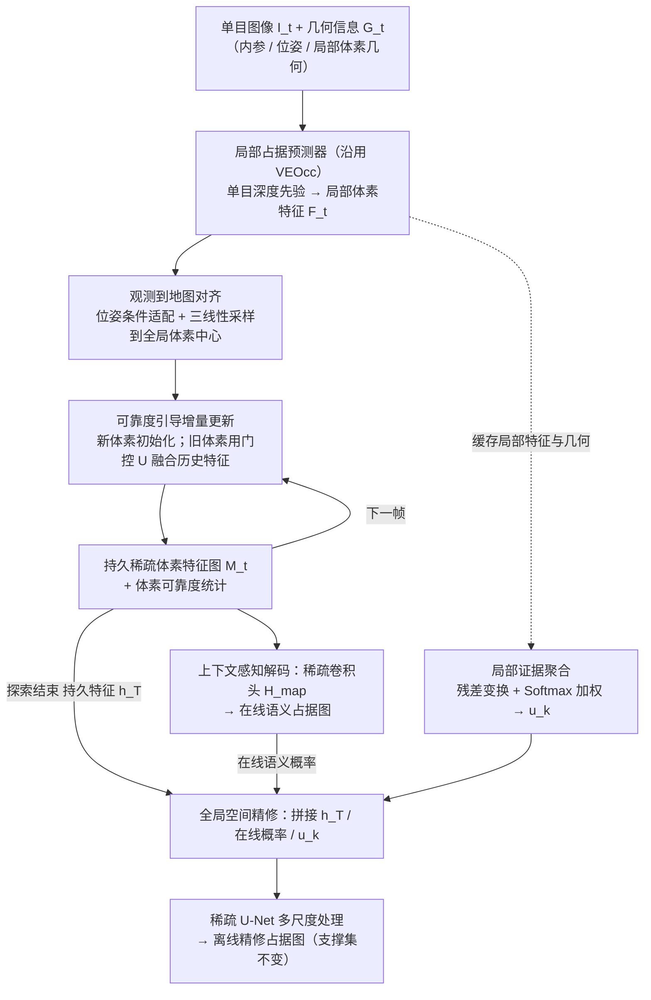

# VEOcc++（arXiv:2610.27704）

**VEOcc++**（*VEOcc++: Learning Persistent Voxel Feature Maps for Embodied Online Semantic Occupancy Mapping and Offline Refinement*，[arXiv:2610.27704](https://arxiv.org/abs/2610.27704)，[项目页](https://wryzju.github.io/VEOccpp/)）来自 [具身智能小站 2026-10-31 盘点](../../sources/blogs/wechat_embodied_station_50_papers_scenerig_photo_to_sim_2026-10-31.md)，属「导航、感知与多机器人」组。

## 一句话定义

**VEOcc++用持久稀疏体素特征贯通在线语义占据建图与离线精修；基准和移动机器人验证迁移，仍依赖外部相机位姿，存储随场景增长。**

## 英文缩写速查

| 缩写 | 英文全称 | 简要说明 |
|------|----------|----------|
| VEOcc++ | VEOcc++: Learning Persistent Voxel Feature Maps for Embodied Online Semantic Occupancy Mapping and Offline Refinement | 本文方法 / 基准的简称 |

## 为什么重要

- 探索时建图，结束后再精修。
- 开源结论：**待发布**（步骤 2.5，2026-10-31）。项目页 HTTP 200，未列 GitHub，Code 按钮标 Code coming soon（curl 扫描）。
- 同期同组工作见 [单图重建仿真、VLA 适配评测与跨形态世界模型：具身智能小站 10-31 期 50 篇阅读坐标](../overview/embodied-station-2026-10-31-50-papers-technology-map.md)。

## 流程总览

图依据：论文 §3.1–3.5、Fig.2。

## 核心机制

| 项 | 内容 |
|----|------|
| **arXiv** | [2610.27704](https://arxiv.org/abs/2610.27704) |
| **开源** | **待发布** |
| **要点** | VEOcc++用持久稀疏体素特征贯通在线语义占据建图与离线精修；基准和移动机器人验证迁移，仍依赖外部相机位姿，存储随场景增长。 |
| **文内指标** | 公众号未给具体数字，本页不引用。 |

## 源码运行时序图

**不适用（待发布）** — 项目页 HTTP 200，未列 GitHub，Code 按钮标 Code coming soon（curl 扫描）。 不编造运行脚本；代码公开后再补。

## 实验与评测

- 公众号未给具体数字，本页不引用。
- **读法：** 本页为索引级摘要，依据公众号转述的官方摘要与仓库信息整理；逐项数字与 baseline 以原文 PDF 为准。

## 与其他工作对比

- 横向索引见 [单图重建仿真、VLA 适配评测与跨形态世界模型：具身智能小站 10-31 期 50 篇阅读坐标](../overview/embodied-station-2026-10-31-50-papers-technology-map.md)；同 arXiv 不重复造页。

## 结论

**探索时建图，结束后再精修：VEOcc++用持久稀疏体素特征贯通在线语义占据建图与离线精修；基准和移动机器人验证迁移，仍依赖外部相机位姿，存储随场景增长。**

1. 开源边界：**待发布** — 项目页 HTTP 200，未列 GitHub，Code 按钮标 Code coming soon（curl 扫描）。
2. 核心机制：VEOcc++用持久稀疏体素特征贯通在线语义占据建图与离线精修；基准和移动机器人验证迁移，仍依赖外部相机位姿，存储随场景增长。
3. 复现与选型前核对任务协议、硬件与基准口径，勿直接横比公众号摘录数字。

## 关联页面

- [vision-language-navigation](../tasks/vision-language-navigation.md)
- [locomotion](../tasks/locomotion.md)
- [sim2real](../concepts/sim2real.md)
- [vision-language-navigation](../tasks/vision-language-navigation.md)
- [embodied-station-2026-10-31-50-papers-technology-map](../overview/embodied-station-2026-10-31-50-papers-technology-map.md)

## 参考来源

- [veocc_plus_plus_arxiv_2610_27704.md](../../sources/papers/veocc_plus_plus_arxiv_2610_27704.md)
- [wechat_embodied_station_50_papers_scenerig_photo_to_sim_2026-10-31.md](../../sources/blogs/wechat_embodied_station_50_papers_scenerig_photo_to_sim_2026-10-31.md)
- [arXiv:2610.27704](https://arxiv.org/abs/2610.27704)
- [arXiv PDF](https://arxiv.org/pdf/2610.27704)：已通读全文：问题定义与方法总览（§3.1–3.2）、在线增量建图（§3.4）、离线全局精修（§3.5）

## 推荐继续阅读

- [arXiv PDF](https://arxiv.org/pdf/2610.27704)
- [项目页](https://wryzju.github.io/VEOccpp/)
