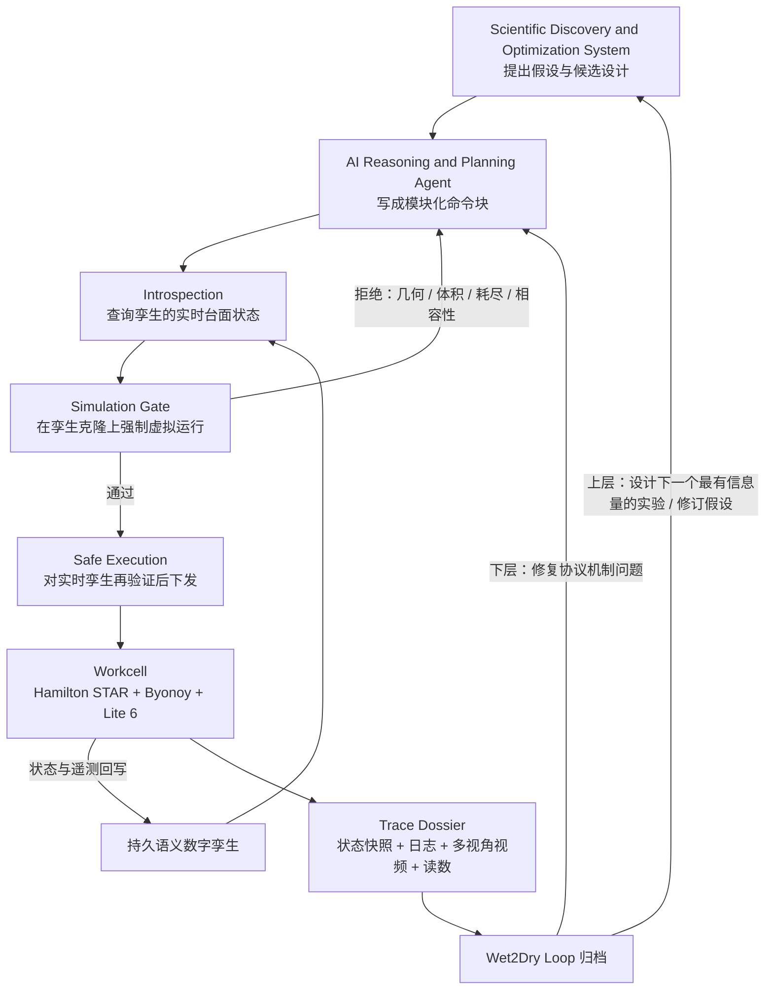
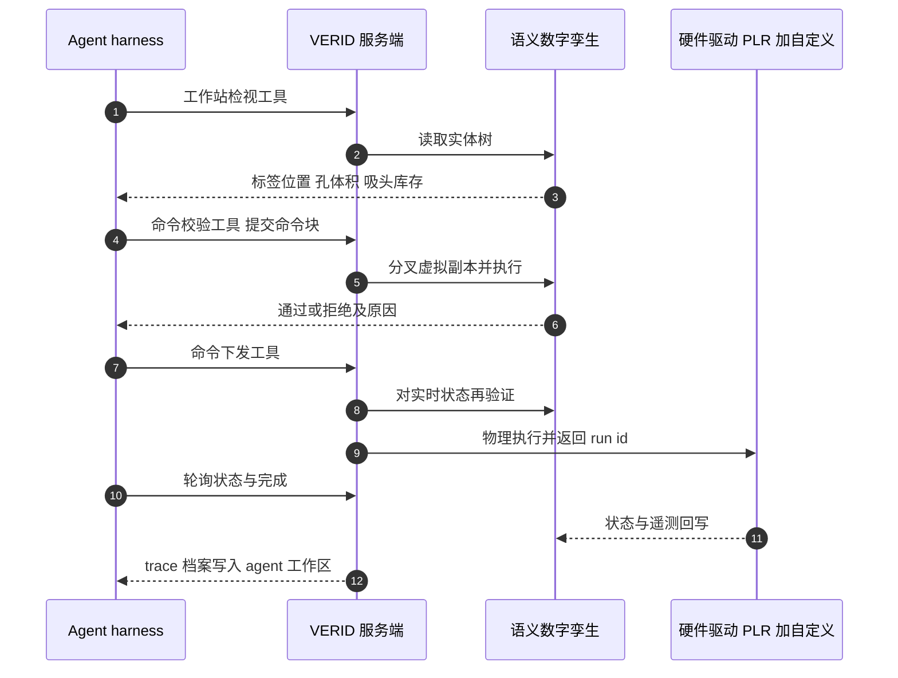

# VERID：自动化实验室里 agentic self-play 的语义表示

**VERID**（VERified Infrastructure for Discovery Laboratories）是 Google 研究者（Delley、Sirkovic、Pawlosky 等）在论文 *Semantic Representation for Agentic Self-Play in Automated Laboratories*（[PDF](https://www.gstatic.com/science-ai/verid_semantic_lab.pdf)，页眉 2026-10-22；[arXiv:2610.32755v1](https://arxiv.org/abs/2610.32755)，2026-10-23）中提出的实验室基础设施。论文用「VERID」命名系统，标题里的「语义表示」指它维护的语义数字孪生。本页依据论文全文（16 页，无附录）。

## 一句话定义

**VERID 是一个持久存在、可查询、可分叉仿真的「实验工作站语义数字孪生」，夹在 AI agent 与液体处理机 / 读板器 / 机械臂之间：agent 的每个命令块必须先在孪生的克隆上过仿真门，再下发到真机，并把状态快照、日志和视频同步成一份 trace 档案。**

## 英文缩写速查

| 缩写 | 英文全称 | 简要说明 |
|------|----------|----------|
| VERID | VERified Infrastructure for Discovery Laboratories | 本文系统名（论文自述） |
| PLR | PyLabRobot | 开源、硬件无关的液体处理机接口；VERID 的驱动和内存资源层级 / 体积 / 吸头追踪建立其上 |
| HITL | Human-in-the-Loop | 人在回路，案例 1 的模式 |
| ODD | Operating Design Domain | 运行设计域，把容量、间隙、转速、化学相容矩阵写成可检查不变量（§4.5.1） |
| OD | Optical Density | 吸光度读数单位 |
| SC / MC | Single-Cycle / Multi-Cycle | 案例 3 中一次性提交 vs 多轮反馈的 Solver |
| mnats | millinats | 案例 3 的评分单位，1 mnat = 10^-3 nats，越低越好 |
| KL | Kullback-Leibler divergence | 评分用的回火分布散度（式 3） |
| DEL / MPRA | DNA-encoded library / massively parallel reporter assay | §4.1 举例的高通量平台，用来说明执行伪影会冒充生物信号 |

## 为什么重要

- **把「语法正确」与「物理安全」分开。** 论文指出 agent 可以写出语法有效但物理不可能的代码（把 8 通道歧管放进窄槽）、逻辑无效的代码（从已耗尽的孔吸液、往带盖板转移）或被未建模流体效应污染的代码；能否执行取决于工作站的实时状态，不能只看代码（§1）。
- **对机器人读者：** 这是「世界模型 / 仿真门」思路在湿实验室的一个落地。论文把它与机器人世界模型对比：机器人常训练神经网络预测未来像素，VERID 在符号层面强制已知的体积守恒与几何约束，agent 只需学未建模残差（液膜携带、密度分层、光学串扰），见 §4.3。
- **和 PyLabRobot 的关系明确：** VERID 把 PLR 的单脚本内存状态扩展为跨命令块、跨仪器、跨硬件故障的服务端持久状态（§2、§6.2）。
- 属于作者表述的定位：他们称这一语义层是在生化 / 生医领域部署自主 agent 的必要前提；论文并未用生物试剂证明这一点（见局限）。

## 核心原理：语义数字孪生与四项服务

**语义表示的含义（论文 §2）：** 孪生是一棵实时、可查询的实体树，每个物件（机械臂、读板器、孔、吸头）记录空间坐标、容器几何、运行状态和语义内容（试剂身份、体积、液面高度）。本体层级形式化「包含」与「空间」关系，例如孔属于板、盖子阻挡孔的可达性。Agent 可以问「C3 孔当前体积和液面高度是多少」「哪些吸头和试剂槽还有足够容量」，而不是从文本日志或相机像素里推断台面状态（§2.1）。

| 服务 | 作用（论文 §2.1-2.4、图 1） |
|------|---------------------------|
| Introspection（可查询检视） | 结构化 API 读取活的台面状态 |
| Simulation Gate（仿真门） | 克隆当前孪生状态，对命令块做强制虚拟运行；追踪质量守恒、吸头状态、台面几何、耗时，孵育 / 等待可快进；是确定性的离散状态记账引擎，不是物理场仿真 |
| Safe Execution（安全执行） | 仿真中评估机械轨迹、体积界限和化学相容规则，拦截不安全动作；硬件反馈持续同步回孪生，下发前再次对实时状态验证 |
| Trace Dossier（trace 档案） | 以共同参考时钟同步三类数据流：命令块之前 / 之中 / 之后的孪生状态快照；俯视龙门图像、侧视移液视频和仪器遥测；逐行执行日志（把高层协议代码连到底层硬件命令、状态变迁和视频帧） |

## 流程总览

图依据论文图 1 与 §2、§6.2 重绘；「Wet2Dry Loop」是图 1 中的名称。

### Agentic self-play 在这篇论文里指什么

- 论文把 self-play 放在「构思、实验、自动化」的迭代里（摘要）。落到可检验的实验只有案例 3：一个自动化 **Challenger** 配制四个盲二元染料混合物外加四个纯参考；一个盲 **Solver** agent 在固定物理预算（一块 96 孔板、吸头数上限、仅俯视 RGB 相机）内设计并执行闭环实验循环以推断每个混合物的组成；独立的四波长读板器 **Oracle** 测封存参考样品给出真值并计分（图 4a、§3.3、§6.3）。
- 学习信号是自监督预测误差，即预期与观测的物理结果之间的失配，不需要任务特定的外部奖励函数（§4.3）。
- **我的核对（推测性解读）：** 论文没有写 Challenger 与 Solver 同时被训练、也没有对抗式更新；两代之间只传递一份「样本盲」的通用物理 / 程序经验总结（Challenge 2A 到 2B）。因此这里的 self-play 更接近「出题 - 解题 - 评分 - 经验蒸馏」的多代循环，而非 AlphaZero 式双方自我对弈。经验以结构化自然语言运行界限和分析模型的形式存入经验知识库，引用 ExpeL [34]（§4.3）。

## 源码运行时序图

**不适用**：论文未提供代码或仓库链接，arXiv 摘要页无代码链接，故没有可核对的真实入口。下图仅依据论文 §6.2 对 agent 工具调用的文字描述，不是源码时序（工具的真实名称与参数论文未给出）。

## 实验与评测

全部使用去离子水与零售食用色素（红 / 黄 / 蓝 / 绿）水溶液，避开生物复杂性（§3、§6.1）。案例 1-3 使用 Gemini 4 Argon 的内部预览检查点（§6.2），见 [Gemini 4 Argon](./gemini-4-argon.md)。论文没有常规意义的基线对比表，下表为各案例读数（图号见论文）。

| 案例 | 设置 | 结果（原文数字） |
|------|------|------------------|
| 1 人在回路协议精修（图 2） | 11 步 2 倍系列稀释 × 4 种染料，每种从试剂槽和 Falcon 管各吸两份，96 孔板 | 初版 z = 0 mm 下实测步稀释仅约 1.4x-1.5x（红 / 绿 / 黄）与 1.6x-1.8x（蓝），每步携带约 68-70% 染料；人工看同步侧视视频认定两个叠加原因：孔底密度分层、吸头被孔底挤压堵塞。改为 1.5 mm 底部间隙与垂直对流混匀（z = 1.5 mm 吸 100 µL、z = 4.8 mm 打，4 轮 / 列）后，平均步稀释 1.92x-1.99x，管与槽差异 ≤0.02x；全部移液后读板器报错，凭持久状态无需重新移液即可续跑（取出板、空腔校准、完成多波长读数） |
| 2 仿真门控规划与多步诊断（图 3） | 把 4 种浓缩染料在 12 列试剂槽里标准化到目标 OD | 仿真拒绝 8 通道同时入槽（8 吸头跨度至少 72.0 mm，大于槽长 71.2 mm），改 7 通道混匀（63.0 mm）并分两次 4 通道取样；第四种染料时中途通信故障，凭保存的状态从断点续跑；事后见相邻稀释水平 15-20% 浓度差异、通道 8 吸光度下降 28-47%；8 列析因诊断：干吸头基线平坦（1.58 OD，CV = 1.4%）；通道 1-7 混匀、通道 8 干时复现 -27.7%（1.63 OD）；反向分配后通道 8 恢复（2.20 OD）、-28.6% 缺口转移到通道 1（1.58 OD）；结论是槽内 250 µL 混匀使 7 个吸头内壁挂染料，150 µL 孔内混匀时洗下，带入 +4.9 µL（+40.6%），同时解释 24 µL 与 12 µL 两个稀释水平之间 14.5% 的偏差 |
| 3 端到端物理自博弈（图 4） | Challenger / Solver / Oracle，Solver 只有 RGB 相机；三组配对挑战 Challenge 1、2A、2B | Challenge 1：MC-1 85 mnats 优于 SC-1 205 mnats（无先验经验，仅靠轮内反馈）；单周期谱系 SC-2A 142 到 SC-2B 162 mnats 停滞；MC-2A 冷启动，4 轮内总损失 247 到 307 mnats（红通道饱和与小体积移液抖动，但 Red+Blue 预测改善）；MC-2B 继承经验，Cycle 1 为 137 mnats，最终平均 58 mnats，文中称比 MC-2A 提升 5 倍以上 |

**评分（§6.3，式 1-5）：** 每个目标孔得分 = 组成损失（回火染料分布间的 KL 散度，回火指数 β = 0.5、平滑常数 ε = 0.03）+ 总浓度损失（对裁剪后水分数的 logit 平方误差，权重 λ_total = 0.03125）；运行得分为四个目标孔平均，单位 mnats。

**案例 3 中 agent 自主发现的物理 / 光学规律（图 4d、§3.3）：** 斜视相机使被照亮的孔壁渗入外圈测量，用 3D 相机标定把孔沿与孔底分别投影并只取无视差的孔底圆盘；近空源孔吸液引入气泡、小体积转移方差大、浓混合物使相机 8 位通道削顶，由此提炼最小转移量与残余体积界限；以含跨通道耦合、光晕和红染料负表观红通道吸光度的线性光模型替代逐通道 Beer-Lambert 拟合；发现未混匀深孔源板中的纵向浓度梯度，并推出黄 / 蓝 / 绿的线性光孪生简并，促成多点稀释轨迹与校准过的概率对冲。

## 工程实践

论文没有给出安装或复现步骤，以下为论文 §6 描述的搭建要点和上手前的注意事项。

| 项 | 内容 |
|----|------|
| 硬件 | Hamilton Microlab STAR（96 通道头 + 8 通道独立头 Span-8）；Byonoy Absorbance 96 四波长读板器；UFACTORY Lite 6 六自由度机械臂在液体处理机与读板器间转运板；OBSBOT Tiny 2 相机装在龙门上，另有消费级 RGB 相机（§6.1） |
| 软件 | 基于 PyLabRobot 的 Python 设备驱动加自定义仪器接口；agent 与 VERID 经 client-server 结构化工具调用交互（检视、校验、下发、状态与完成轮询）；agent 另有工作区文件 / 代码执行工具、仅限本地工作区的沙箱 shell 与持久知识库（§6.2） |
| Agent 脚手架 | 预装协议设计与实验迭代的结构化指令、带科学计算库与静态代码分析的沙箱 Python；监督运行中有锁定到已验证脚本的操作员批准门；VERID 与推理模型解耦（作者称 model-agnostic） |
| 先用染料调系统 | 作者的做法：先用低成本染料实验做流体 / 光学的定量表征，再组合成复杂实验、最后上生物问题（§1） |
| 代码 / 数据开放核查 | 全文无代码 / 数据可用性声明，无仓库链接；arXiv 摘要页无代码链接；论文自身是 CC BY 4.0。GitHub 搜索接口 502，未能搜索确认，结论为「未声明开放」，不代表一定不存在 |
| 版本核查 | arXiv 仅检索到 v1；Crossref 标题检索无期刊版；Google Research publications 检索未见条目 |
| 复现门槛（推测） | 需要同款工作站与一个能接入 PLR 的自建孪生服务端；论文没有给仿真器的实现细节，因此无法仅凭论文复现 |

## 结论

**这篇论文被真正验证的是「符号层语义孪生 + 仿真门 + trace 档案」能拦住物理上不可能的命令并在硬件故障后续跑，而不是 self-play 能提升科学发现。**

1. **第一类收益是拦截与可恢复性**：仿真门按几何算出 8 吸头跨度至少 72.0 mm 大于槽长 71.2 mm 而拒绝；读板器报错与第四种染料时的通信故障都凭持久状态从断点续跑，无需重做移液。
2. **第二类收益是归因**：靠同步的侧视视频与状态快照，把「步稀释只有 1.4x–1.5x」定位到孔底密度分层与吸头堵塞，改 1.5 mm 底部间隙加垂直对流混匀后到 1.92x–1.99x；案例 2 的 8 列析因把通道 8 的 -28% 缺口归到吸头内壁挂染料（+4.9 µL）。
3. **self-play 的量化只有案例 3**（mnats 越低越好），MC-2B 的平均 58 mnats 同时混杂了继承经验、周期数与挑战难度变化，不能单独归功于自博弈。
4. **次要代价是验证范围**：全部实验只用去离子水与食用色素，三个案例均为单次演示叙述，没有重复次数、置信区间，也没有「去掉仿真门 / 去掉 trace」的消融。
5. **自主性是带监督的**：案例 1 由人看视频定因，案例 2 由操作员决定接受哪些限制，监督运行另有锁定到已验证脚本的批准门。
6. **部署视角**：孪生建在 PyLabRobot 之上，但需要同款工作站与自建服务端持久状态；论文未给仿真器实现细节，也未声明代码 / 数据开放，仅凭论文无法复现。

## 与其他工作对比

| 项目 | 定位区别 |
|---|---|
| [PyLabRobot](./pylabrobot.md) | 硬件无关的液体处理机接口与单脚本内存状态；VERID 把它扩展为跨命令块、跨仪器、跨硬件故障的服务端持久孪生 |
| [生成式世界模型](../methods/generative-world-models.md) | 用神经网络预测未来观测；VERID 在符号层强制体积守恒与几何约束，只把未建模残差（液膜携带、光学串扰）留给 agent |
| [Safety Filter](../concepts/safety-filter.md) | 控制屏障函数式的动作过滤；本文在下发前用仿真门与 ODD 不变量做同类拦截，但化学相容规则在案例中未单独验证 |
| [Agentic Aptamer Sandbox](./paper-agentic-aptamer-sandbox.md) | 同博客的智能体湿实验闭环，用真实蛋白靶标但执行全靠人工；本文有自动化工作站而只做染料与去离子水 |

## 局限

**原文自述：**
- 只验证了染料与去离子水的光学与流体基础；对生物突破的验证是「下一步」（§5）。
- 跨已归档 trace 档案的大规模索引、知识抽取以及对下游活动影响的基准评测，留作未来工作（§4.2）。
- 当前实现把发现持久化为结构化自然语言运行界限和分析模型（§4.3）；生物安全的组成谱系追踪、物理化学传播规则以及 SecureDNA 类自动筛查网关仍是设想（§4.5.3）。
- 化学相容与 ODD 不变量的编码方式在 §4.5.1 为设计原则，案例中未单独验证相容规则的拦截。

**我的核对：**
- 三个案例是演示性质的单次运行叙述，没有重复次数、置信区间或消融（例如去掉仿真门或去掉 trace 的对照），无法量化各服务各自的贡献。
- 案例 3 的 SC / MC 对比各只有一条谱系，且 Challenge 1 与 2A / 2B 难度不同（文中自述不同染料对难度差异大），5 倍提升（MC-2A 到 MC-2B）还与继承经验、周期数、挑战本身变化同时混杂。
- 案例 1 依赖人工看视频定位原因，案例 2 由人类操作员决定哪些限制接受、哪些去克服，所谓 agent 自主性是带监督的。
- 所有实验使用同一个 Gemini 4 Argon 内部预览检查点，外部无法获取，因此结果与具体模型的耦合未知。
- 与标题 / 摘要口径：摘要用 "self-play" 描述整体循环，但实验中只有案例 3 是类似的出题 - 解题循环（见上文推测）。

## 关联页面

- [Gemini 4 Argon](./gemini-4-argon.md)：论文案例 1-3 所用模型的内部预览检查点
- [Sim2Real](../concepts/sim2real.md)：仿真门的「先仿真后真机」思路与机器人 sim2real 的对照
- [Safety Filter](../concepts/safety-filter.md)：论文 §4.5.1 引用控制屏障函数思路，在下发前把动作过滤到安全集合内
- [AI Agent 评测](../concepts/ai-agent-evaluation.md)：agent 评测的通用框架
- [生成式世界模型](../methods/generative-world-models.md)：论文 §4.3 把符号层孪生与像素级世界模型对比
- [Agentic Aptamer Sandbox](./paper-agentic-aptamer-sandbox.md)、[Epitope Excision 结合体设计](./paper-epitope-excision-binder-design.md)：同一 Google 博客的另两篇论文节点（本页未读其内容，仅按博客归属并列）
- 同博客的 Grounding AI agents in wet labs 页（google-grounding-ai-agents-wet-labs）撰写时尚不存在，暂未链接
- [pylabrobot](./pylabrobot.md) — PyLabRobot：硬件无关的液体处理机器人开源接口

## 参考来源

- 论文 PDF：<https://www.gstatic.com/science-ai/verid_semantic_lab.pdf>
- arXiv：<https://arxiv.org/abs/2610.32755>
- 归档：[verid_semantic_representation_lab_self_play_gstatic_2026](../../sources/papers/verid_semantic_representation_lab_self_play_gstatic_2026.md)

## 推荐继续阅读

- PyLabRobot：Wierenga et al., *Device* 1(4), 100111, 2023（论文参考文献 [25]；本页未读其原文）
- Safe-SDL：arXiv:2602.15061（论文 [35]，自驱动实验室安全框架；本页未读其原文）
- ExpeL：Zhao et al., AAAI 2024（论文 [34]，经验式 LLM agent）
- Baird & Sparks, *Matter* 2022（论文 [27]，自驱动实验室的最小可用示例，染料实验的依据）
