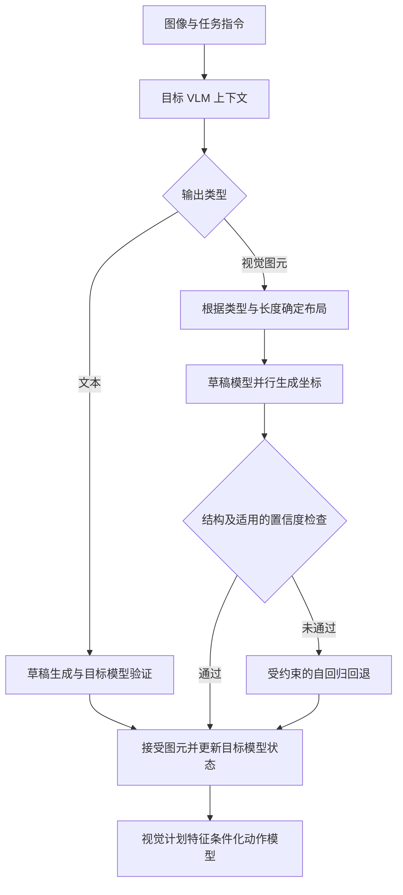

# VFlash：通过闪速图元解码实现快速精准的视觉规划

## 一句话定义

VFlash 用轻量草稿模型并行生成完整轨迹或边界框，通过图元结构约束接受视觉坐标，同时保留文本的推测解码校验。

## 英文缩写速查

| 缩写 | 英文全称 | 简要说明 |
|------|----------|----------|
| VLM | Vision-Language Model | 视觉语言模型 |
| FPD | Flash Primitive Decoding | 闪速图元解码 |
| AR | Autoregressive | 自回归生成 |
| WAM | World Action Model | 世界动作模型 |
| ADE | Average Displacement Error | 平均位移误差 |

## 核心信息

| 项目 | 内容 |
|------|------|
| 标题 | VFlash: Fast, Accurate Visual Planning via Flash Primitive Decoding |
| 机构 | 英伟达；约翰斯·霍普金斯大学、香港理工大学、普渡大学、香港大学（额外机构） |
| 原文版本 | [20261105-2 技术报告](https://research.nvidia.com/labs/lpr/vflash/assets/paper/vflash.pdf?v=20261105-2)，核对方法、实验与附录 |

## 项目流程图

## 核心机制

- **结构对齐：** 输出类型和长度确定图元坐标布局，支持变长 2D/3D 轨迹、边界框及稠密点运动。
- **训练：** 先适配目标 VLM，再冻结目标；五层非因果 drafter 读取目标特征，以标注坐标的交叉熵学习完整图元，文本块共同训练。
- **推理：** 文本走 DFlash 式验证；视觉图元并行生成，经格式约束后直接接受。框可使用空间置信度检查，失败时受约束 AR 回退。目标模型仍需处理接受的图元以更新缓存并提取动作条件特征。
- **与 [LocateAnything](paper-locateanything.md) 的关系：** 后者侧重固定大小的框与点；VFlash 扩展到变长轨迹等图元，并结合经验证的文本生成。

## 实验与评测

| 场景 | 报告结果与条件 |
|------|----------------|
| 3D 轨迹 | InternA1、2D+3D 模型：ADE 0.153 → 0.062 m；参考点按路径弧长重采样，并非定时控制指令。 |
| MolmoSpaces | 同一 WAM 架构下，原始编码器基线 62.6%，VFlash 视觉计划条件 70.2%，四个任务套件等权平均；条件编码不同，不能归因于解码速度单一因素。 |
| Jetson Thor | batch size 1，MolmoSpaces 模型流水线 3552.7 → 703.3 ms；含视觉、prefill、解码和动作模型，不含加载、预热等，不是完整机器人闭环测量。 |
| 稠密点运动 | H100 单次 rollout 约 25 倍，报告称为初步测量；不应视为普遍吞吐或端到端控制加速。 |
| 边界框 | 直接接受在 COCO 平均 F1 41.32，低于 AR 的 48.68；使用 AR fallback 为 47.79，体现质量和速度的权衡。 |

## 与其他工作对比

以下对照均取自技术报告的实验设置（见上表），不是跨论文横比：

| 对照对象 | 差异 | 报告中的结果 |
|----------|------|--------------|
| 逐 token 自回归（AR）解码 | VFlash 整段并行生成图元、按结构约束直接接受；AR 逐坐标生成 | 边界框直接接受 COCO 平均 F1 41.32，低于 AR 的 48.68；加 AR fallback 后 47.79——速度换质量 |
| DFlash 式推测解码（文本） | 文本仍走草稿 + 目标模型验证；视觉图元不要求与目标 token 一致 | 文本路径沿用验证，未单独报告增益 |
| [LocateAnything](paper-locateanything.md) | 后者侧重固定大小的框与点；VFlash 扩展到变长 2D/3D 轨迹与稠密点运动 | 无同表对比 |
| 原始编码器的 WAM 基线 | 同一 WAM 架构，改用 VFlash 视觉计划作动作条件 | MolmoSpaces 四套件等权平均 62.6% → 70.2%；条件编码不同，不能单归因于解码速度 |

## 结论

结构化视觉输出可通过完整图元并行生成降低解码延迟，但质量取决于任务、训练和校验方式。

- 部署时分别测量解码、动作模型与完整闭环延迟。
- 轨迹预测是高层计划，不等价于低层控制频率或安全保证。
- 对检测等任务评估直接接受的精度损失，并考虑回退。
- 仿真操作结果与单次预测性能不能直接推断真机表现。

## 源码运行时序图

不适用：截至 2026-11-06，项目页代码按钮指向 Eagle/Embodied，该目录 README 是 LocateAnything，未找到可核实的 VFlash 专属运行入口或权重，不能用相关项目的流程替代源码分析。

## 参考来源

- [技术报告归档](../../sources/papers/vflash.md)
- [官方项目页及开放状态核查](../../sources/sites/nvidia-vflash.md)

## 关联页面

- [LocateAnything](paper-locateanything.md)
- [世界动作模型](../concepts/world-action-models.md)

## 推荐继续阅读

- [VFlash 官方项目页](https://research.nvidia.com/labs/lpr/vflash/)
