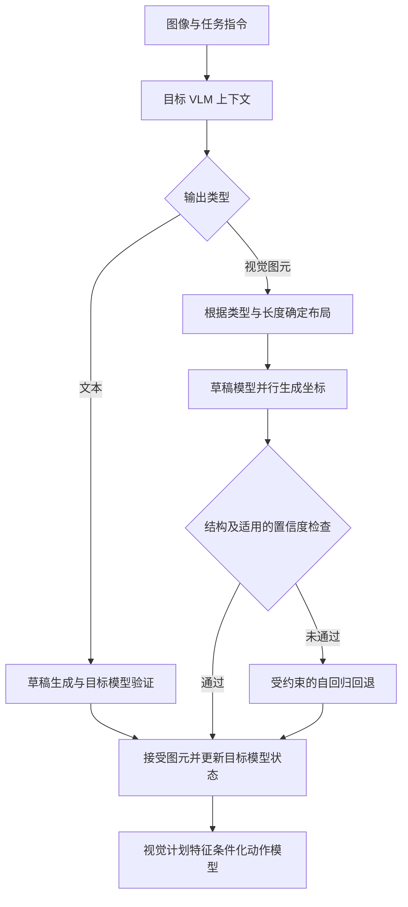

# VFlash：通过闪速图元解码实现快速精准的视觉规划

## 一句话定义

VFlash 用轻量草稿模型并行生成完整轨迹或边界框，通过图元结构约束接受视觉坐标，同时保留文本的推测解码校验。

## 英文缩写速查

| 缩写 | 英文全称 | 简要说明 |
|------|----------|----------|
| VLM | Vision-Language Model | 视觉语言模型 |
| FPD | Flash Primitive Decoding | 闪速图元解码 |
| AR | Autoregressive | 自回归生成 |
| WAM | World Action Model | 世界动作模型 |
| ADE | Average Displacement Error | 平均位移误差 |

## 核心信息

| 项目 | 内容 |
|------|------|
| 标题 | VFlash: Fast, Accurate Visual Planning via Flash Primitive Decoding |
| 机构 | 英伟达；约翰斯·霍普金斯大学、香港理工大学、普渡大学、香港大学（额外机构） |
| 原文版本 | [20261105-2 官方技术报告](https://research.nvidia.com/labs/lpr/vflash/assets/paper/vflash.pdf?v=20261105-2)；另有 [arXiv:2611.08449v1](https://arxiv.org/abs/2611.08449) |

## 项目流程图

## 为什么重要

- 视觉计划（框、轨迹、稠密点运动）越详细，AR VLM 需要的坐标 token 越多；论文测得 Thor 上 AR 解码占每步延迟 75–87%，是物理 AI 批大小 1 场景的主要瓶颈。
- 传统推测解码要求逐 token 与目标一致，轨迹块内 DFlash 每次迭代仅提交 2.2 token（文本 5.5）；差一个量化格就被拒，几何误差其实很小。VFlash 把验收标准从“token 一致”换成“结构合法”，实现一遍草拟整段图元。
- 论文观察到轻量 drafter 在多数机器人轨迹任务上甚至比 AR 目标更准（如 AgiBot 5 cm 精度 50% → 73%），暗示 AR 不必是视觉输出的质量上限。

## 核心机制

- **结构对齐：** 输出类型和长度确定图元坐标布局，支持变长 2D/3D 轨迹、边界框及稠密点运动。
- **训练：** 先适配目标 VLM，再冻结目标；五层非因果 drafter 读取目标特征，以标注坐标的交叉熵学习完整图元，文本块共同训练。
- **推理：** 文本走 DFlash 式验证；视觉图元并行生成，经格式约束后直接接受。框可使用空间置信度检查，失败时受约束 AR 回退。目标模型仍需处理接受的图元以更新缓存并提取动作条件特征。
- **与 [LocateAnything](paper-locateanything.md) 的关系：** 后者侧重固定大小的框与点；VFlash 扩展到变长轨迹等图元，并结合经验证的文本生成。

## 实验与评测

| 场景 | 报告结果与条件 |
|------|----------------|
| 3D 轨迹 | InternA1、2D+3D 模型：ADE 0.153 → 0.062 m；参考点按路径弧长重采样，并非定时控制指令。 |
| MolmoSpaces | 同一 WAM 架构下，原始编码器基线 62.6%，VFlash 视觉计划条件 70.2%，四个任务套件等权平均；条件编码不同，不能归因于解码速度单一因素。 |
| Jetson Thor | batch size 1，MolmoSpaces 模型流水线 3552.7 → 703.3 ms；含视觉、prefill、解码和动作模型，不含加载、预热等，不是完整机器人闭环测量。 |
| 稠密点运动 | H100 单次 rollout 约 25 倍，报告称为初步测量；不应视为普遍吞吐或端到端控制加速。 |
| 边界框 | 直接接受在 COCO 平均 F1 41.32，低于 AR 的 48.68；使用 AR fallback 为 47.79，体现质量和速度的权衡。 |

## 工程实践

- **接入前提：** 需冻结的目标 VLM 加五层 drafter；坐标需固定宽度布局（1,001 个特殊坐标 token，或符号加五位数字网格）；变长图元由 tool call 声明长度。每个图元训练一整块，并带逐位置词表约束与校验规则。
- **训练预算：** 先对目标做任务适配，再只训 drafter（MolmoMotion 仅训 drafter）；预算见论文附录 B 表 10。
- **延迟测量：** 论文按视觉编码、prefill、解码、动作模型分段，批大小 1，在 Thor、DGX Spark、H100 上报告；加速几乎全来自解码（12–42 倍），其他阶段不变。MolmoSpaces 每步降 5.1–5.2 倍（Thor/Spark）、3.6 倍（H100）。
- **下游接入：** 动作模型 cross-attend 冻结 VLM 处理接受图元后的隐状态；MolmoSpaces 每三个 20 步动作块重新请求一次含十个 2D+3D 路点的计划。
- **框任务：** 直接接受快但掉点，需空间置信度检查与受约束 AR 回退；回退版 COCO/Dense200 平均 F1 与 AR 持平且快 2.6–2.8 倍。

## 局限

- 条件独立假设：drafter 对各位置条件独立预测，不保证与目标分布一致；文本以外的质量由任务评测而非无损验证保证。
- 框：不加回退时 Dense200 平均 F1 约降 20 点，IoU 0.95 处 F1 低于 AR。
- 稠密点运动：WorldTrack FDE 增 15%，PWT 低 7–12%；约 25 倍仅为 H100 单次 rollout 的初步测量。
- 延迟不含完整闭环；论文评测集中在仿真（MolmoSpaces、LIBERO 家族）和离线驾驶基准（NAVSIM、Waymo），未报告真机结果；条件编码不同使 62.6% → 70.2% 不能单归因于解码速度。
- 仍需目标模型处理接受的图元以更新缓存和提取特征；代码与权重截至核对日未见专属入口。

## 与其他工作对比

以下对照均取自技术报告的实验设置（见上表），不是跨论文横比：

| 对照对象 | 差异 | 报告中的结果 |
|----------|------|--------------|
| 逐 token 自回归（AR）解码 | VFlash 整段并行生成图元、按结构约束直接接受；AR 逐坐标生成 | 边界框直接接受 COCO 平均 F1 41.32，低于 AR 的 48.68；加 AR fallback 后 47.79——速度换质量 |
| DFlash 式推测解码（文本） | 文本仍走草稿 + 目标模型验证；视觉图元不要求与目标 token 一致 | 文本路径沿用验证，未单独报告增益 |
| [LocateAnything](paper-locateanything.md) | 后者侧重固定大小的框与点；VFlash 扩展到变长 2D/3D 轨迹与稠密点运动 | 无同表对比 |
| 原始编码器的 WAM 基线 | 同一 WAM 架构，改用 VFlash 视觉计划作动作条件 | MolmoSpaces 四套件等权平均 62.6% → 70.2%；条件编码不同，不能单归因于解码速度 |

## 结论

结构化视觉输出可通过完整图元并行生成降低解码延迟，但质量取决于任务、训练和校验方式。

- 部署时分别测量解码、动作模型与完整闭环延迟。
- 轨迹预测是高层计划，不等价于低层控制频率或安全保证。
- 对检测等任务评估直接接受的精度损失，并考虑回退。
- 仿真操作结果与单次预测性能不能直接推断真机表现。

## 源码运行时序图

不适用：截至 2026-11-06，项目页代码按钮指向 Eagle/Embodied，该目录 README 是 LocateAnything，未找到可核实的 VFlash 专属运行入口或权重，不能用相关项目的流程替代源码分析。

## 参考来源

- [技术报告归档（新增 arXiv 索引）](../../sources/papers/vflash.md)
- [arXiv:2611.08449v1](https://arxiv.org/abs/2611.08449)
- [官方项目页及开放状态核查](../../sources/sites/nvidia-vflash.md)

## 关联页面

- [LocateAnything](paper-locateanything.md)
- [世界动作模型](../concepts/world-action-models.md)

## 推荐继续阅读

- [VFlash 官方项目页](https://research.nvidia.com/labs/lpr/vflash/)
