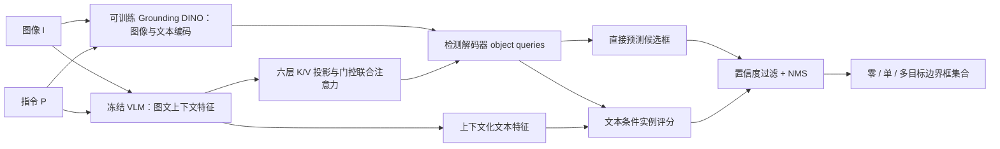

# VGE：VLM 引导的广义指代表达目标定位（VLM-guided Grounding Expert）

## 一句话定义

**VGE（VLM-guided Grounding Expert）把冻结 VLM 的图文上下文注入可训练 Grounding DINO 专家，用逐层联合注意力精炼目标查询、用文本条件评分筛选候选框，从而在指令改写或添加上下文时定位零个、一个或多个指代目标。**

## 英文缩写速查

| 缩写 | 英文全称 | 简要说明 |
|---|---|---|
| VGE | VLM-guided Grounding Expert | 本文冻结 VLM + 可训练检测专家的组合 |
| VLM | Vision-Language Model | 提供不自回归生成框坐标的上下文特征 |
| GREC | Generalised Referring Expression Comprehension | 允许零、单或多个目标的广义指代表达理解 |
| NMS | Non-Maximum Suppression | 对候选定位框做重叠抑制 |
| IoU | Intersection-over-Union | 评估预测框与目标框是否匹配 |
| F1 | F1 Score | 按单条指令的 TP/FP/FN 评估目标集恢复 |

## 为什么重要

- 机器人收到「把两个杯子收起来」与附带说明的同义指令时，所指目标集应不变；但检测器易受额外上下文影响，自回归 VLM 又易漏掉多个对象或误判缺席对象。
- 把「理解长句」和「定位所有实例」分给两个模型，不再依赖语言模型逐 token 输出坐标。
- 提供**零目标拒识**与**多目标召回**的评测维度；静态图像 F1 不能直接等同机械臂取放成功率。

## 核心信息

| 项 | 内容 |
|---|---|
| 论文 | [arXiv:2611.22625v1](https://arxiv.org/abs/2611.22625v1)（2026-11-17） |
| 机构 | Spirit AI（中国北京）、牛津大学、中国科学院大学、清华大学 |
| 作者 | Mingcheng Zhu、Wentian Xu、Tao Lin 等 12 位；Yang Gao 为通讯作者（附录 S1） |
| 主干 | 冻结 Qwen3.5-9B + 可训练 Grounding DINO-base + 两个接口 |
| 任务 | 图像 + 自然语言指令 → 0/1/N 个目标框 |
| 代码 | **待发布**：论文 v1 承诺发表后公开，未给出 VGE 官方仓库或实现入口（核查于 2026-11-19） |

## 核心原理与方法栈

1. **联合注意力引导目标查询（§3.3）：** 将检测专家六个解码层依次对齐冻结 VLM 最后六个 *full-attention* 层。VLM 的 K/V 先映射到专家空间，与原生 K/V 在同一个 softmax 中参与注意力，而非另起一套独立交叉注意力。每层可学习 α 门控初始为 0，避免一开始破坏专家已有注意力。
2. **文本条件实例评分（§3.4）：** 最后一个 VLM 块的上下文化文本特征投影至查询空间；每个最终 object query 对其做注意力，再将修正量加回专家的原始匹配分数。分数修正层零初始化，最终经阈值 + NMS 选出目标集。
3. **训练目标（§3.5）：** 冻结 VLM、更新检测专家与两套接口，使用 Hungarian matching 的 focal + 5×L1 + 2×GIoU 损失；无目标时只有负例分类监督。任务训练只用原始指令，改写和上下文增强留给测试。
4. **核心差异：** VLM 不生成最终坐标，保留 Grounding DINO 的视觉主干与直接框预测。这是感知目标接地前端，**不是** 直接输出机器人动作的完整 VLA 策略。

## 流程总览

图据原文 Figure 2、§3.2–3.5 整理。VLM 与专家各自预处理输入；图中两条分支表示信息流，不暗示未经公开源码验证的并发调度。

## 源码运行时序图

**不适用（官方 VGE 实现未发布）。** 截至 2026-11-19，论文 v1 仅承诺发表后发布代码，没有可核查的 VGE 训练/推理仓库或运行入口；因此不以论文概念图冒充运行时序。

## 工程实践

| 检查项 | 原文配置 / 可操作验证 |
|---|---|
| 输入预处理 | 专家短边 800 px、长边至多 1333 px；VLM 独立原生图像预处理（附录 S3.2） |
| 模型微调 | VLM 冻结；专家峰值 LR 1e-4，接口 5e-4；batch 32、10% warmup、BF16 |
| 候选筛选 | 按原始验证集调阈值，gRefCOCO/RoboRefIt/Ref-ZOM 分别 0.40/0.25/0.30；NMS IoU 0.5 |
| 评测协议 | 相同图像与目标标注，分别用原始/同义改写/附加背景的指令，按 IoU≥0.5 计算 sample F1 |
| 部署验收 | 另测图像/文本预处理、相机输入到框输出的端到端延迟；论文只报告不含预处理的 GPU 推理时间 |
| 源码复现 | **暂不可运行 VGE 官方实现**；仅能获取原论文引用的公共底座模型 |

## 实验与评测

**三数据集五测试分割**：gRefCOCO Test A/B、RoboRefIt Test A/B、Ref-ZOM Test。主要指标为各条样本 F1（零目标且正确输出空集计 1），三种指令形式等权汇总。

| 数据集 / 分割 | VGE 三指令平均 F1 | 原始 / 改写 / 额外上下文 F1 | 读法 |
|---|---:|---|---|
| gRefCOCO Test A | 79.98% | 80.6 / 79.8 / 79.6% | 额外上下文下优于所列基线 |
| gRefCOCO Test B | 72.52% | 72.8 / 72.5 / 72.2% | LoRA Qwen 的原始/改写 F1 更高 |
| RoboRefIt Test A | **95.02%** | 95.2 / 94.7 / 95.2% | 零/单/多目标 F1 为 97.5/94.5/96.0% |
| RoboRefIt Test B | **89.67%** | 90.1 / 88.9 / 90.0% | 零/单/多目标 F1 为 96.2/89.8/81.3% |
| Ref-ZOM Test | 85.8%（依 Table 1a 三项均值） | 86.1 / 85.2 / 86.1% | 零/多目标不优于所有基线 |

- **上下文鲁棒性：** 五个分割的 context-augmented F1 均优于表中比较模型；同一分割三种指令结果差值至多 1.2 pp。不要误读为对每个目标数、每种指令都第一。
- **延迟（Table 3）：** 三数据集均值 139.9–145.1 ms；相对 LoRA Qwen3.5-9B 生成框快 5.3–13.0×，但相对纯 Grounding DINO 约慢 2.1×；均排除预处理。
- **消融（Table 4）：** RoboRefIt A/B 三指令平均：DINO-only 82.25/76.29，joint-only 79.66/73.47，scoring-only 83.61/78.29，二者合用 95.02/89.67。两个接口并非可以简单独立相加。
- **冻结边界（Table 2）：** gRefCOCO Test B 的 CE-adapted VLM 比冻结 VLM 高 4.62 pp；冻结的性价比不能解释成所有场景最好。

## 与其他工作对比

- 相对纯 [Grounding DINO](https://arxiv.org/abs/2303.05499)：保留直接定位优势，额外借 VLM 语境降低 instruction context 扰动，付出额外推理计算。
- 相对自回归 Qwen3.5-9B 定位：避免逐框坐标 token 输出，在 RoboRefIt 的零/多目标定位上具有更好的完整性与延迟表现；并非所有 gRefCOCO 条件均超过 LoRA 基线。
- 相对 [MIGU](./paper-migu-multimodal-instruction-grounding.md)：VGE 解决纯语言的图像多实例框恢复；MIGU 融合人类指向几何不确定性并可提供目标信念与澄清。
- 相对 [GSR/ParaVLA](./paper-gsr-paravla.md)：VGE 优化**感知接地**抗上下文干扰；GSR/ParaVLA 优化**动作政策**对改写指令的鲁棒性，两者评价指标不相同。

## 结论

**VGE 说明冻结的语言视觉上下文与可训练的专用空间专家可以协同提高机器人场景的目标集合恢复及指令鲁棒性，但论文仅验证静态接地，尚未给出完整机器人闭环执行证据。**

1. **把指令鲁棒性与目标数拆开测。** 同义改写稳定不代表零目标拒识、多目标完整召回准确。
2. **先保留检测器的直接输出。** VLM 提供上下文指导而非逐 token 产框，可显著缩短相对生成式基线的定位时间。
3. **联合注意力要配合实例评分。** RoboRefIt 单用联合注意力反而降低 F1，两个接口结合才有明显收益。
4. **冻结不是无条件最优。** gRefCOCO Test B 的 VLM LoRA 适配仍提供较大增益。
5. **用端到端时延重新验收。** 论文表中 140 ms 级别均值未含预处理，不能直接当真实机器人实时闭环频率。
6. **源码发布后再谈可复现。** 当前只能审论文算法与公开底座，不能声称重现 VGE 数字。

## 局限与风险

- 目前没有 VGE 官方可运行代码、接口实现或权重，无法验证细节、显存开销及部署兼容性。
- RoboRefIt 是带机器人场景图像的目标框基准，并非含运动执行、遮挡恢复和碰撞反馈的真机闭环测试；静态 F1 不代表任务成功率。
- 仅单次 seed 0 训练，报告的 bootstrap 标准差刻画测试参考重采样，不是跨训练 seed 的方差（附录 S3.4）。
- 冻结 VLM 的局限在 gRefCOCO Test B 可见，较小专家在 RoboRefIt 又会显著掉点（附录 S4），部署成本与领域迁移须另测。
- 论文阈值依数据集原始验证指令校准，换相机/场景/指令分布后应重新做无目标误报与多目标漏报评估。

## 关联页面

- [机器人操作](../tasks/manipulation.md)
- [VLA 方法](../methods/vla.md)
- [MIGU：多模态指向不确定性接地](./paper-migu-multimodal-instruction-grounding.md)
- [GSR / ParaVLA：指令改写的动作鲁棒性](./paper-gsr-paravla.md)
- [VLA 纵深路线（Stage 2）](../../roadmap/depth-vla.md)

## 参考来源

- [VGE 论文原始资料归档](../../sources/papers/vge_arxiv_2611_22625.md)
- [arXiv:2611.22625v1，HTML 全文](https://arxiv.org/html/2611.22625v1)

## 推荐继续阅读

- [原文 PDF（13 页）](https://arxiv.org/pdf/2611.22625v1)
- [Grounding DINO 原论文](https://arxiv.org/abs/2303.05499)
