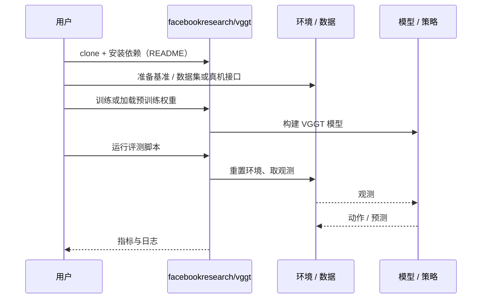

# VGGT（arXiv:2503.11651）

**VGGT**（*VGGT: Visual Geometry Grounded Transformer*，[arXiv:2503.11651](https://arxiv.org/abs/2503.11651)，[项目页](https://vgg-t.github.io/)，[代码](https://github.com/facebookresearch/vggt)）来自 [深蓝具身智能 2026-11-01 盘点](../../sources/blogs/wechat_shenlan_cv_best_papers_2023_2026_labs.md)，属「3D / 4D 几何重建」组。

## 一句话定义

**VGGT 是前馈神经网络，直接从一张、几张或上百张视图推出相机参数、点图、深度图与 3D 点轨迹等关键 3D 属性。**

## 英文缩写速查

| 缩写 | 英文全称 | 简要说明 |
|------|----------|----------|
| VGGT | Visual Geometry Grounded Transformer | 前馈统一 3D 几何的 Transformer |
| SOTA | State of the Art | 当前最优水平 |

## 为什么重要

- 统一此前各自专用的 3D 视觉任务；摘要称重建不到 1 秒，且无需几何优化后处理仍优于需要后处理的方法（公众号归属：牛津 VGG 组 + Meta AI）。
- 开源结论：**已开源**（步骤 2.5，2026-11-01）。仓库 facebookresearch/vggt 经 git ls-remote 可达；项目页 HTTP 200。
- 同期同组工作见 [从视觉编程到 4D 重建：CV 三大会 2023–2026 Best Paper 阅读坐标](../overview/cv-best-papers-2023-2026-technology-map.md)。

## 核心机制

| 项 | 内容 |
|----|------|
| **arXiv** | [2503.11651](https://arxiv.org/abs/2503.11651) |
| **开源** | **已开源** |
| **要点** | 单个 Transformer 前馈输出相机参数、多视图深度、稠密点云与点跟踪（arXiv 摘要）。 |
| **文内指标** | arXiv 摘要称在相机参数估计、多视图深度估计、稠密点云重建、3D 点跟踪等任务达到 SOTA；具体数字未转录。 |

## 源码运行时序图

以下为按仓库入口（`facebookresearch/vggt`）推断的通用运行链路；入库日仅核实仓库可达，未逐文件阅读，具体脚本名以 README 为准。

## 实验与评测

- arXiv 摘要称在相机参数估计、多视图深度估计、稠密点云重建、3D 点跟踪等任务达到 SOTA；具体数字未转录。
- **读法：** 本页为索引级摘要，依据公众号转述的官方摘要与仓库信息整理；逐项数字与 baseline 以原文 PDF 为准。

## 与其他工作对比

- 横向索引见 [从视觉编程到 4D 重建：CV 三大会 2023–2026 Best Paper 阅读坐标](../overview/cv-best-papers-2023-2026-technology-map.md)；同 arXiv 不重复造页。

## 结论

**VGGT：前馈统一多任务几何，D4RT 在其基础上扩展到动态 4D。**

1. 开源边界：**已开源** — 仓库 facebookresearch/vggt 经 git ls-remote 可达；项目页 HTTP 200。
2. 核心机制：单个 Transformer 前馈输出相机参数、多视图深度、稠密点云与点跟踪（arXiv 摘要）。
3. 复现与选型前核对任务协议、硬件与基准口径，勿直接横比公众号摘录数字。

## 关联页面

- [state-estimation](../concepts/state-estimation.md)
- [3d-spatial-vqa](../concepts/3d-spatial-vqa.md)
- [cv-best-papers-2023-2026-technology-map](../overview/cv-best-papers-2023-2026-technology-map.md)

## 参考来源

- [vggt_visual_geometry_grounded_transformer_arxiv_2503_11651.md](../../sources/papers/vggt_visual_geometry_grounded_transformer_arxiv_2503_11651.md)
- [wechat_shenlan_cv_best_papers_2023_2026_labs.md](../../sources/blogs/wechat_shenlan_cv_best_papers_2023_2026_labs.md)
- [arXiv:2503.11651](https://arxiv.org/abs/2503.11651)

## 推荐继续阅读

- [arXiv PDF](https://arxiv.org/pdf/2503.11651)
- [项目页](https://vgg-t.github.io/)
- [https://github.com/facebookresearch/vggt](https://github.com/facebookresearch/vggt)
